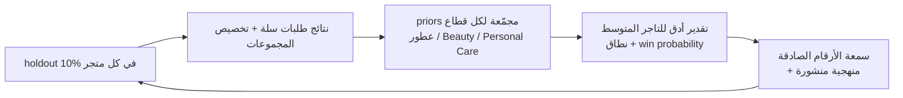
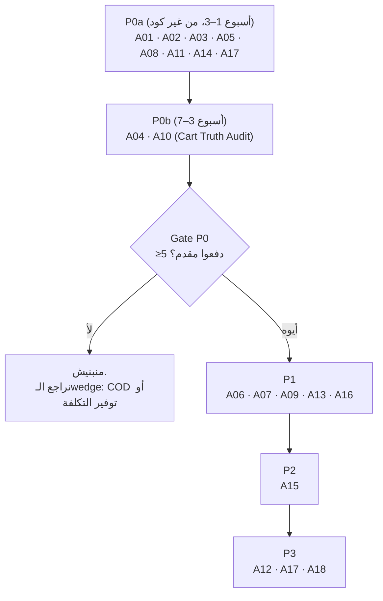

# 2. Critical Assessment of the Business Idea

> الحالة: مسودة v1.0 — بانتظار موافقة المؤسس (2026-10-21)

> **مفتاح التصنيف:** [مؤكدة] = عليها مصدر (رابط + تاريخ اطلاع). [افتراض] = محتاجة اختبار مع العملاء أو بالبيانات. [اقتراح] = توصية مننا. **غير مؤكدة** = ملقيناش دليل في أي اتجاه، ومش معناها "مش موجودة".
> كل الروابط تاريخ اطلاعها **2026-10-21** إلا لو مكتوب غير كده. التفاصيل والمصادر الكاملة في [`docs/research/`](../research/).
> القسم ده بيجاوب على أسئلة **Task 1** في [البرومبت الأصلي](../00-master-prompt.md) بالترتيب. الأسماء والـIDs (M01..M21، P0..P6، E01..E18) من الـDecision Spine الموحّد للـBlueprint.

---

## 0. الخلاصة في جدول واحد

| سؤال Task 1 | الإجابة المختصرة | التفاصيل |
|---|---|---|
| هل الفكرة قوية تجاريًا؟ | **كما هي مكتوبة: ضعيفة.** لو ضيّقناها وغيّرنا زاويتها: **متوسطة لقوية، وقابلة للاختبار بتكلفة قليلة** | [§1](#1-هل-الفكرة-قوية-تجاريًا) |
| المشكلة الرئيسية | التاجر بيدفع رسائل وخصومات عشان يسترجع مبيعات، ونسبة كبيرة منها كانت هتحصل كده كده، ومحدش بيقوله الحقيقة [افتراض] | [§2](#2-المشكلة-الرئيسية-اللي-بنحلها) |
| الموجود في السوق | تقريبًا **كل** الـMVP اللي في البرومبت موجود: سلة نفسها، وتطبيقات بـ49–119 ريال، وKaram بـ268–698 ريال، وMeta Business Agent | [§3](#3-إيه-الموجود-فعلًا-في-السوق) |
| فرص التميّز | قياس الربح الإضافي بـholdout كـdefault للتاجر المتوسط، وقرار "مين يستاهل رسالة"، وخصم محكوم بهامش. اسمها الجديد **Profit-Proven Recovery** | [§4](#4-فين-فرص-التميّز-الحقيقية) |
| نقاط الضعف في التصور الحالي | 13 Module لشركة فيها 50 شخص، وكلمة "OS" و"Autonomous"، والاعتماد على 3 منصات، وwedge بقى commodity، وAI agent في أول نسخة | [§5](#5-نقاط-الضعف-في-تصورنا-الحالي) |
| ميزات متتبنيش دلوقتي | Voice، Workflow builder، White label، Marketing Studio، CRM كامل، NL analytics، قنوات غير WhatsApp، Shopify/Woo، Uplift models، خصومات مستقلة | [§6](#6-ميزات-لا-تستحق-التطوير-الآن) |
| المخاطر | 12 خطر رئيسي، 3 منهم قاتلين ومش تقنيين: تصنيف Meta، استعداد التاجر يدفع للصراحة، شروط سلة | [§7](#7-المخاطر-التجارية-والتقنية-ملخّص) و[القسم 13](13-risks-mitigation.md) |
| افتراضات لازم نختبرها | 18 افتراض، أخطرهم: **التاجر هيدفع مقابل رقم أصغر وأصدق** | [§8](#8-الافتراضات-اللي-لازم-نختبرها-مع-العملاء) |

---

## 1. هل الفكرة قوية تجاريًا؟

### 1.1 الحكم

**الفكرة كما هي مكتوبة في البرومبت ضعيفة تجاريًا. لو ضيّقناها وغيّرنا زاويتها تبقى متوسطة لقوية، وقابلة للاختبار بتكلفة قليلة.**

"كما هي مكتوبة" معناها: AI Revenue OS بـ13 Module، أول منتج فيه AI Sales Agent + Shared Inbox + Abandoned Cart + Analytics على سلة وواتساب، وميزة اسمها "Profit-Aware Autonomous Growth". ده منتج **موجود بالفعل** في السوق السعودي (Karam بـ268–698 ريال [مؤكدة، تفاصيل في §3])، وغالبًا بسعر أقل من اللي نقدر نبيع بيه بهامش صحي [افتراض]، وبيطلب فريق أكبر بكتير من اللي عندنا.

"بعد التضييق" معناها: **Profit-Proven Recovery لمتاجر العطور والتجميل والعناية الشخصية على سلة، اللي عندها 300–3,000 طلب في الشهر**. منتج بيقول للتاجر كام ربح فعلًا بسبب رسائل الاسترجاع، وبيمنع الرسائل والخصومات اللي ملهاش لازمة. وبعد كده AI بيبيع جوه المحادثة. الصيغة دي فيها فجوة حقيقية (مفيش منافس محلي بيقدّمها بشكل مؤكد)، بس قيمتها التجارية **لسه افتراض** لحد ما تاجر يدفع فلوس.

### 1.2 Scorecard

| البُعد | التقييم | الدليل |
|---|---|---|
| حجم الألم | **متوسط** [افتراض] | ترك السلة عالميًا 70.22% [مؤكدة: https://baymard.com/lists/cart-abandonment-rate، 2026-10-21]. لكن التاجر عنده حلول شبه مجانية للتذكير، فالألم الحقيقي ممكن يكون **تكلفة** الاسترجاع وعدم وضوح عائده، مش غياب الأداة |
| الاستعداد للدفع | **مجهول** [افتراض] | مفيش دليل إن تاجر سعودي دفع مقابل "قياس incrementality". السقف النفسي لتطبيقات الواتساب على سلة 49–119 ريال [مؤكدة: https://apps.salla.sa/en/app/338190499 و https://apps.salla.sa/en/app/1550834079، 2026-10-21] |
| حجم السوق القابل للخدمة | **محدود** [افتراض] | SAM حوالي 2,000–5,700 متجر على سلة وزد، والهدف الواقعي 50–150 متجر بيدفع في 18 شهر ([market-and-pricing.md §10](../research/market-and-pricing.md)). يكفي لشركة صغيرة مربحة، ومش كفاية لشركة كبيرة من غير توسع |
| شدة المنافسة | **عالية** [مؤكدة: الأسماء والأسعار في §3] | سلة native، وZid WhatsApp، وKaram، وATMET، وعشرات التطبيقات، وMeta Business Agent ([§3](#3-إيه-الموجود-فعلًا-في-السوق)) |
| قابلية التميّز | **متوسطة** [افتراض] | القياس بالـholdout غير مؤكد عند المنافسين الأربعة، بس موجود عالميًا (Klaviyo وBraze وPostscript) وKaram بيكتب عن الفكرة. الحماية في البيانات المجمّعة والوقت، مش في الفكرة |
| الاعتماد على منصات | **عالي جدًا** [مؤكدة: الشروط في §5.3؛ احتمال استخدامها ضدنا افتراض] | Meta (تسعير وسياسة AI Providers)، وسلة (توزيع وفوترة وAPI وحق الإيقاف)، والمنظّم (مسودة تخزين البيانات جوه المملكة) ([§5.3](#53-الاعتماد-على-3-منصات-مش-في-إيدنا)) |
| ملاءمة الفريق والميزانية | **ضعيفة للرؤية الكاملة، جيدة للنسخة المضيّقة** [افتراض] | مؤسس بيكتب الكود + مطوّر Laravel واحد في P1. الـStack (Laravel) قريب من خبرة المؤسس |
| تكلفة الاختبار | **منخفضة** [اقتراح] | P0 كلها 25–50 ألف ريال و5–7 أسابيع [افتراض]، ولو فشلت الخسارة أسابيع مش 6 شهور بناء |

### 1.3 أسباب الضعف (الفكرة كما هي)

1. **استرجاع السلات بالواتساب بقى commodity.** سلة عندها تذكير native بخصم، لحد 5 تذكيرات، على SMS وEmail وPush وWhatsApp [مؤكدة: https://help.salla.sa/en/article/abandoned-cart-reminders-with-a-discount/vzit7tzwz9e5pcv37nnenyqv، 2026-10-21]. وSalla Chat بيبعت رسالة تسويق بحوالي 0.16 ريال (4.06 نقطة) [مؤكدة: help.salla.sa، 2026-10-21، الرابط في [market-and-pricing.md §7.2](../research/market-and-pricing.md)]. وZid WhatsApp مجاني في الباقة الاحترافية و109 ريال في غيرها [مؤكدة: https://zid.sa/en/solutions/zid-whatsapp/، 2026-10-21]. وفيه تطبيقات بـ49–119 ريال، منها ATMET بـAI agent بلهجة سعودية بـ49/99/249 ريال [مؤكدة: https://apps.salla.sa/en/app/931067979، 2026-10-21].
2. **"AI بيرد بالعربي" بقى سلعة.** Meta Business Agent بقى فئة تسعير من 2026-07-01 بـ$2 لكل 1M token [مؤكدة: https://developers.facebook.com/docs/whatsapp/pricing، 2026-10-21]. وKaram بيقدّم أغلب الـMVP اللي في البرومبت بسعر فعلي 268–698 ريال في الشهر مع الـAI [مؤكدة: https://karamai.co/en/pricing و https://apps.salla.sa/en/app/864133974، 2026-10-21].
3. **اقتصاد الرسائل بيتضغط.** رسالة الـMarketing في السعودية 0.0576 USD من 2026-10-01، يعني +~27% في 7 شهور [مؤكدة، مصادر ثانوية متطابقة: https://www.alibabacloud.com/help/en/chatapp/whatsapp-message-rate-adjustments-and-service-conversation-message-billing، 2026-10-21]. والـService بقى بفلوس بعد أول 1,000 رسالة لكل رقم في الشهر من 2026-10-01 [مؤكدة: https://developers.facebook.com/docs/whatsapp/pricing/updates-to-pricing، 2026-10-21]. ده بيضر أي نموذج قايم على "ابعت لكل سلة"، بس بيدّي قيمة لنموذج "ابعت للي يستاهل بس".
4. **اعتماد على 3 منصات** مش في إيدنا (تفاصيل في [§5.3](#53-الاعتماد-على-3-منصات-مش-في-إيدنا)).
5. **13 Module = منتج لشركة فيها 50 شخص**، مش لمؤسس بيكتب الكود (Rules 5 و12).

### 1.4 ليه تستاهل نختبرها رغم كده

| السبب | التصنيف |
|---|---|
| كل الأدوات المحلية بتعرض إيراد **منسوب** (Karam: "Orders after a chat" من غير منهجية منشورة). مفيش أداة بتقول للتاجر الرسالة دي تستاهل ولا لأ | [مؤكدة: https://karamai.co/en/، 2026-10-21]؛ غياب الـholdout عند الأربعة **غير مؤكد** |
| الأدلة الأكاديمية بتقول إن أثر التذكير ممكن يبقى **صفر أو سالب** حسب التوقيت والعرض، يعني فيه فلوس بتتهدر فعلًا | [مؤكدة: Li et al. 2021، https://ximarketing.ai/class/papers/retargeting.pdf؛ MSI 21-133، https://www.msi.org/wp-content/uploads/2021/09/MSI_Report_21-133-1.pdf، 2026-10-21] |
| زيادة سعر رسائل Meta بتخلّي "منع الرسالة الغلط" قيمة بتتقاس بالريال | [افتراض] متجر 1,000 سلة × رسالتين ≈ 320 ريال/شهر لـMeta (رقم الـSpine، محسوب على ~0.16 ريال للرسالة). على سعر Meta الحالي 0.216 ريال بيبقى ≈ 430 ريال/شهر، يعني الحجة أقوى مش أضعف |
| الأدوات العالمية اللي عندها holdout بتقصره على الحسابات الكبيرة (Klaviyo بيشترط 400k profile) | [مؤكدة: https://help.klaviyo.com/hc/en-us/articles/18138290642971، 2026-10-21] |
| التاجر المتوسط ممكن ياخد تقدير مفيد من **priors مجمّعة** عبر متاجر نفس القطاع، وده صعب ينسخه حد معندوش بيانات | [اقتراح]؛ ملقيناش منافس بيعمله (غير مؤكدة عندهم) |
| الاختبار رخيص: Proof Pilot مدفوع مقدمًا قبل كود المنتج | [اقتراح] Rule 10 |

---

## 2. المشكلة الرئيسية اللي بنحلها

### 2.1 الصيغة الرسمية

> **[افتراض]** متاجر سلة المتوسطة بتدفع كل شهر رسوم واتساب وخصومات عشان تسترجع مبيعات، ونسبة كبيرة منها كانت هتحصل كده كده. ومفيش أداة بتقولهم بصراحة: الرسالة دي تستاهل ولا لأ، والخصم ده بيكسّبك ولا بيخسّرك.

المشكلة **مش** "التاجر محتاج chatbot" ولا "التاجر محتاج inbox". دول محلولين.

### 2.2 الأدلة

| الدليل | المعنى لينا | التصنيف |
|---|---|---|
| تذكير بعد 30–60 دقيقة من ترك السلة **قلّل** الشراء مقارنةً بمجموعة التحكم، والتذكير بعد يوم لـ3 أيام كان أثره إيجابي (تجارب على 40,500+ و23,900 عميل) | التوقيت الشائع في السوق ممكن يكون بيضر. Karam مثلًا بيبعت أول تذكير بعد ساعة [مؤكدة: https://karamai.co/en/journeys] | [مؤكدة] Li, Luo, Lu & Moriguchi, *Journal of Marketing* 2021، https://ximarketing.ai/class/papers/retargeting.pdf (2026-10-21) |
| تذكير SMS من غير خصم لسلة عمرها 4–28 يوم مكانش له أثر معنوي: 1.21% مقابل 1.41% في مجموعة التحكم | "استرجاع" من غير عرض ممكن يكون صفر | [مؤكدة] Gopalakrishnan & Park, MSI 21-133، https://www.msi.org/wp-content/uploads/2021/09/MSI_Report_21-133-1.pdf (2026-10-21) |
| الخصم زوّد الشراء (+56% و+155%)، لكن أكتر من 70% من الزيادة جت من منتجات كانت في السلة أصلًا | الخصم بيشتغل، والسؤال الحقيقي **ربح** مش تحويل | [مؤكدة] نفس المصدر |
| خصائص السلة شرحت تباين الأثر أحسن من تاريخ الشراء | "تقييم السلات" بقواعد بسيطة ممكن، من غير ML | [مؤكدة] نفس المصدر |
| الخصم الأكبر قلّل المشتريات اللاحقة عند العملاء الحاليين | خصم للعميل الحالي خطر على الهامش | [مؤكدة] Anderson & Simester 2004، https://ideas.repec.org/a/inm/ormksc/v23y2004i1p4-20.html (2026-10-21) |
| Klaviyo بيستخدم last-touch بنافذة 5 أيام افتراضيًا (حتى للفتح) | الأرقام المعروضة في السوق متضخّمة بنيويًا | [مؤكدة] https://help.klaviyo.com/hc/en-us/articles/1260804504250 (2026-10-21) |
| Karam نفسه بيكتب إن "not every order after it came because of it" | المنافس الأقرب فاهم المشكلة، بس مش بيبيع حلها | [مؤكدة] https://karamai.co/en/guides/abandoned-carts (2026-10-21) |
| مثال توضيحي: خصم 10% رفع التحويل من 7% لـ9% (+29%)، والنتيجة **خسارة صافية** 250 ريال على 1,000 سلة | "التحويل زاد" مش معناه "الربح زاد" | [افتراض] أرقام توضيحية، [cart-recovery-incrementality.md §5.1](../research/cart-recovery-incrementality.md) |

### 2.3 أخطر افتراض في المشروع كله

> **[افتراض] التاجر هيدفع مقابل رقم أصغر وأصدق.**

ممكن جدًا التاجر يفضّل داشبورد بيقول "استرجعنالك 40 ألف ريال" على تقرير بيقول "الربح الإضافي التقديري بين 2 و9 آلاف ريال، باحتمال 85% إنه موجب". لو ده حصل، الـpositioning كله بيقع. **P0 بيختبره بفلوس حقيقية** (Proof Pilot مدفوع مقدمًا)، مش بأسئلة رأي.

البديل لو فشل: زاوية "**بنوفّر عليك رسائل وخصومات ملهاش لازمة**" (توفير تكلفة)، أو **COD Confirmation** كـwedge.

### 2.4 سؤال مفتوح لـP0: أنهي ألم أكبر؟

| الألم المرشّح | ليه ممكن يكون أكبر | ليه ممكن ميكونش | التصنيف |
|---|---|---|---|
| استرجاع السلات | واضح وكل التجار عارفينه | محلول شبه ببلاش، والقيمة الإضافية في القياس بس | [افتراض] |
| تأكيد الـCOD | رفض الاستلام بيكلف التاجر شحن مرتين، خصوصًا في العطور والأزياء | Karam عنده بالفعل [مؤكدة: https://karamai.co/en/journeys]. ونسبة COD ورفض الاستلام في السعودية **غير مؤكدة** (ملقيناش مصدر أولي موثوق، [market-and-pricing.md](../research/market-and-pricing.md)) | [افتراض] |
| الرد على محادثات البيع | التاجر بيخسر مبيعات لأن محدش بيرد بسرعة | Meta Business Agent وKaram وATMET بيقدّموه، وخطر Meta 4.7 أعلى | [افتراض] |

**القرار:** يتاخد آخر P0 (exit criterion رقم 10: قرار الـwedge، Recovery أو Recovery + COD).

---

## 3. إيه الموجود فعلًا في السوق؟

التحليل التفصيلي للمنافسين في [القسم 3](03-competitor-analysis.md) و[competitive-feature-matrix.md](../research/competitive-feature-matrix.md). هنا الخلاصة اللي بتأثر على الحكم.

### 3.1 طبقات المنافسة

| الطبقة | أمثلة | بيقدّم إيه | السعر (ريال/شهر، من غير رسوم Meta) | التصنيف |
|---|---|---|---|---|
| المنصة نفسها (native) | Salla Chat / WhatsApp by Salla، Zid WhatsApp، Zid Voice | تذكير سلات بخصم (لحد 5)، تنبيهات طلبات، روابط دفع، inbox (زد) | 0–109 + نقاط الرسائل | [مؤكدة: help.salla.sa، https://zid.sa/en/solutions/zid-whatsapp/، https://zid.sa/pricing/] |
| تطبيقات رخيصة على سلة | BusinessChat (514 تقييم)، Lets Bot، تواصل، Cartat (يدّعي 6,000+ متجر)، ATMET | سلات متروكة + كوبونات + "تقرير إيرادات مسترجعة"، وATMET فيه AI agent سعودي | 49–119 (ATMET لحد 249) | [مؤكدة: https://apps.salla.sa/en/app/338190499، https://apps.salla.sa/en/app/931067979، https://partners.salla.com/en/apps] |
| AI + inbox سعودي متخصص | **Karam AI** | AI agent، inbox، سلة وزد، cart وpayment links، COD، journeys، Autopilot، حملات | **268–698** مع الـAI | [مؤكدة: https://karamai.co/en/pricing، https://karamai.co/en/journeys] |
| منصات محادثة إقليمية | Thikaa، Mersal AI، Kasbly (beta ببلاش) | omnichannel، workflow builder، ضوابط AI (Kasbly: shadow mode وسقف خصم) | 37–937 أو ببلاش | [مؤكدة: [thikaa.md](../research/thikaa.md)، [mersal-ai.md](../research/mersal-ai.md)، [kasbly.md](../research/kasbly.md)] |
| AI agent مُدار / وكالات | Nano AI، مكاسب (Mersal) | AI agent لسلة وزد. **Nano AI Growth بيوعد بتقرير قياس بعد 30 يوم أو رجوع رسوم الإعداد** | 746–1,500 + إعداد | [مؤكدة: https://www.nano-ai.net/en/services/salla-zid-whatsapp-ai] |
| منصات عالمية | Wati، respond.io، Zoko (Sello: 3% من قيمة الطلب) | inbox وAI agents وتسعير بالنتيجة | 187–1,875 | [مؤكدة: https://www.zoko.io/pricing، https://respond.io/pricing] |
| صاحب المنصة نفسه | **Meta Business Agent** | agent بيرد على أسئلة المنتجات جوه واتساب | $2 / 1M token. صفحة Meta بتقول كمان "~4–5 سنت للرسالة"، وده متعارض داخليًا (معناه 20–25K token للرسالة)، فالتكلفة الفعلية للرسالة **غير مؤكدة** ([ai-llm-costs-arabic.md](../research/ai-llm-costs-arabic.md)) | [مؤكدة: https://developers.facebook.com/docs/whatsapp/pricing] |
| أدوات قياس عالمية | Klaviyo، Braze، Bloomreach، Postscript، Rejoiner | holdout وincrementality، وBloomreach بيدّعي "targeted discounting" | enterprise / مركّز على Shopify | [مؤكدة: [cart-recovery-incrementality.md §6.1](../research/cart-recovery-incrementality.md)] |

### 3.2 اللي **مش** هيبقى ميزة لينا (Parity)

| الميزة | مين عنده (مؤكد) | معناها لينا |
|---|---|---|
| WhatsApp رسمي | الأربعة منافسين (Thikaa كمان عنده QR غير رسمي) | حد أدنى، وRule 8 بيمنعنا من أي بديل |
| تذكير سلات متروكة بخصم | سلة native، زد، Karam، Thikaa، Mersal، تطبيقات بـ49 ريال | wedge للدخول، مش سبب شراء |
| AI agent بالعربي بيرشّح منتجات | Karam، Thikaa، Kasbly، ATMET، Meta | parity في P2، مش ميزة |
| Unified inbox + handoff | الأربعة | lite بس في الـMVP |
| Cart / payment link | Karam [مؤكدة]، Thikaa | `checkout_url` بس (إنشاء cart: مفيش endpoint موثّق في سلة، **غير مؤكدة** [salla-platform.md §3.4](../research/salla-platform.md)) |
| COD confirmation | Karam (بيحدّث الطلب في سلة وزد) | مشروط بنتيجة P0 (E16) |
| Approval workflows / shadow mode | Kasbly [مؤكدة: https://docs.kasbly.com/ar/ai-agent/launch-history/] | parity إجبارية (Rule 9)، مش ميزة |
| شرح التوصيات / "next best action" | Karam Autopilot [مؤكدة: https://karamai.co/en/] | parity |
| "ضمان قياس" | Nano AI [مؤكدة] | فكرة "إثبات النتيجة" نفسها مش حصرية لينا |
| Holdout groups | Klaviyo، Braze، Postscript، Rejoiner [مؤكدة] | مش ابتكار عالميًا. الجديد الممكن: **default ومتاح للتاجر المتوسط على سلة** |

**[افتراض] الخلاصة:** Karam هو المنافس المباشر الأخطر، وسلة هي المنافس غير المباشر الأخطر. أي رسالة تسويقية بتبدأ بـ"AI chatbot" أو "استرجاع سلات" هتخسر مقارنة السعر قدام 49 ريال وقدام Karam.

---

## 4. فين فرص التميّز الحقيقية؟

التفصيل الكامل في [القسم 4](04-positioning-differentiation.md). هنا الحكم على عناصر "Profit-Aware Autonomous Growth" التمانية (Rule 3).

### 4.1 الحكم على كل عنصر

| # | العنصر الأصلي | الحالة في السوق | القرار | السبب |
|---|---|---|---|---|
| 1 | السلات الأكثر قابلية للاسترجاع | غير مؤكدة عند الأربعة (Mersal: فرع "قيمة السلة > X" بس) | **Keep كقواعد، مش ML** (عمر السلة، قيمتها، تركيزها، هامش الفئة) | [مؤكدة] خصائص السلة شرحت التباين (MSI 21-133). الـML محتاج بيانات مش موجودة |
| 2 | هل المتابعة تستاهل تكلفتها | غير مؤكدة | **Keep.** أوضح قيمة بتتقاس بالريال (suppression) | [افتراض] رسوم Meta بتزيد |
| 3 | خصم ميخسّرش الصفقة | Kasbly: سقف ثابت. الباقيين غير مؤكدة | **Shrink لقواعد:** مفيش خصم في أول رسالة، أرضية هامش لكل فئة، لا خصم للعميل الحالي إلا بموافقة، وأي حاجة فوق السقف = approval. **الـAI عمره ما بيقرر الخصم** | Rule 9، و[مؤكدة] Anderson & Simester 2004 |
| 4 | التوقيت المناسب | Thikaa: "أوقات ذكية" من غير تفاصيل | **Keep كقاعدة افتراضية:** أول رسالة بعد ≥60 دقيقة، وquiet hours 22:00–09:00 | [مؤكدة] Li et al. 2021. نص CST [مؤكد]، وانطباقه على WhatsApp **غير مؤكد** |
| 5 | Control groups | غير مؤكدة عند الأربعة، وKaram بيذكر الفكرة في guide | **Keep = قلب الميزة:** holdout 10% على مستوى العميل بـhash ثابت، إجباري في الـpilots | [غير مؤكدة] عند المنافسين المحليين |
| 6 | نتائج مالية واضحة | Karam: "orders after chat" | **Keep = المنتج الأساسي** (Incremental Profit Report) | [مؤكدة] https://karamai.co/en/ |
| 7 | شرح أسباب التوصيات | Karam Autopilot | **Parity** | [مؤكدة] |
| 8 | Approval workflows | Kasbly | **Parity إجبارية** | [مؤكدة] |
| — | كلمة "Autonomous" | — | **Cut** من الاسم ومن الـMVP | Rule 9، وخطر Meta 4.7، وخطر الهلوسة |

**النتيجة:** الميزة اسمها من دلوقتي **Profit-Proven Recovery** [اقتراح]. "Profit-Aware Autonomous Growth" بيتذكر كأصل الفكرة بس.

### 4.2 مصدر الاستدامة

- **[افتراض]** Karam ممكن ينسخ الـholdout في أسابيع. السبق الحقيقي في **البيانات المجمّعة والوقت**، مش في الفكرة.
- **قيد إلزامي (ADR-009):** الـpooling بيتحسب من **نتائج طلبات سلة وتخصيص المجموعات بس**، مش من نصوص محادثات WhatsApp. شروط Meta بتمنع استخدام بيانات WABA، حتى المجمّعة، لتدريب أو تحسين أي نموذج [مؤكدة: https://www.facebook.com/legal/Meta-Terms-for-WhatsApp-Business-Platform، 2026-10-21]. وممكن الـpooling يحوّل CODEX من Processor لـController تحت PDPL [افتراض]، فلازم رأي قانوني وبند في الـDPA.

### 4.3 اللي **مش** بنوعد بيه

| الوعد الممنوع | السبب |
|---|---|
| رقم incrementality خاص بالمتجر من أول شهر | [افتراض: حسابات power] متجر 500 سلة مؤهلة/شهر محتاج حوالي سنة بتقسيم 80/20 عشان يكتشف فرق من 5% لـ7% |
| Uplift model لكل تاجر | محتاج عينات عشوائية أكبر بكتير من الـholdout العادي [افتراض] |
| COGS لكل SKU | سلة غالبًا مش بتوفّر تكلفة المنتج [افتراض]. البديل: هامش لكل فئة (5–10 فئات، E08) |
| "أول من يقيس الـincrementality" | Klaviyo وBraze وBloomreach وPostscript عندهم [مؤكدة] |
| "بياناتك كلها في السعودية" | WhatsApp Cloud API مفيهوش تخزين في السعودية، والـLLMs بتعالج برّه المملكة [مؤكدة: [saudi-regulatory-pdpl.md](../research/saudi-regulatory-pdpl.md)] |

---

## 5. نقاط الضعف في تصورنا الحالي

بصراحة، ومن غير تجميل. كل نقطة معاها اللي اتغيّر في الخطة بسببها.

### 5.1 الجدول الرئيسي

| # | نقطة الضعف | ليه مشكلة | الدليل | اللي اتغيّر في الخطة |
|---|---|---|---|---|
| W1 | **13 Module في الرؤية** | ده منتج لشركة فيها 50 شخص. مؤسس بيكتب الكود + مطوّر واحد مش هيبني أكتر من 3–4 Modules **كاملة** كويس في سنة | Rules 5 و12. [افتراض] تقدير جهد | اتعاد تقسيمهم لـM01..M21، و**M01–M12 بس قبل P3 exit**، وأغلبهم بنسخة lite أو يدوية (M04 lite، M11 metering + فوترة يدوي، M12 Filament، M14 تقرير واحد). مفيش Module من M13 لـM21 قبل ما الـMVP يتباع. **تحذير:** حتى M01–M12 بنسخ lite حمل تقيل على 2–3 أشخاص في ~9–11 شهر [افتراض]، وأي توسيع لنطاق أي Module منهم قبل P3 = خطر مباشر على الـrunway (R29، R31 في [القسم 13](13-risks-mitigation.md)) |
| W2 | **"OS" كطموح بيتسرّب للـMVP** | الـ10 وظايف اللي في الـMVP نفسها فيها Shared Inbox كامل وAdmin Dashboard وBilling آلي. كل واحدة فيهم مشروع | [مؤكدة] Karam بيقدّم ده كله بـ119–299 ريال للمنصة من غير AI، و268–698 مع الـAI ([karam-ai.md](../research/karam-ai.md)). إن ده أخد منهم وقت وفريق أكبر من اللي عندنا [افتراض] | الـMVP = P1 + P2، ويتعتبر "اتطلق واتسيّل" عند نهاية P3. Inbox lite، Admin بـFilament، فوترة يدوي (القسم 6) |
| W3 | **Abandoned Cart كـwedge** | بقى commodity: native في سلة وزد، وتطبيقات بـ49 ريال | [مؤكدة] ([§1.3](#13-أسباب-الضعف-الفكرة-كما-هي)) | بيفضل الـwedge التقني، بس **الرسالة التسويقية والسعر** على الربح الإضافي المُثبت، مش "استرجاع" |
| W4 | **AI Sales Agent في أول نسخة** | أعلى خطر سياسة (Meta 4.7)، وأعلى خطر هلوسة (سعر/خصم غلط)، وأقل تميّز (Karam وMeta وATMET عندهم) | [مؤكدة] نص القسم 4.7: https://www.facebook.com/legal/Meta-Terms-for-WhatsApp-Business-Platform. انطباقه علينا **غير مؤكد** | الـagent اتأجل لـP2، Assisted ≥4 أسابيع قبل Scoped Autonomous. P1 شغال **من غير AI agent** فبيبقى خطة بديلة لو Meta رفضت |
| W5 | **كلمة "Autonomous"** | بتتعارض مع Rule 9، وبتقرّبنا من تصنيف "AI Provider"، ومش قيمة إضافية للتاجر | Rule 9 | اتشالت من الاسم والـMVP. الـAI مبيقررش خصم ولا حملة ولا ميزانية |
| W6 | **"Profit-Aware" محتاج بيانات مش موجودة** | الخصم المربوط بالربح محتاج COGS، وسلة غالبًا مش بتوفّرها | [افتراض] [competitive-feature-matrix.md §5](../research/competitive-feature-matrix.md) | هامش لكل فئة (5–10 فئات) وقت الـonboarding (E08)، ونختبر إن التاجر يقدر يدخله |
| W7 | **Incrementality لكل تاجر مستحيل إحصائيًا للمتجر الصغير** | المتجر الصغير مش هيطلّع نتيجة لها power في وقت معقول | [افتراض: حسابات power] + [مؤكدة] Klaviyo بيشترط 400k profile، وBraze ≥1,000 مستخدم في الـcontrol | ICP ≥300 طلب و≥400 سلة مؤهلة/شهر، وpriors مجمّعة، ونطاقات وwin probability بدل "رقم دقيق" |
| W8 | **الاعتماد على 3 منصات** | أي واحدة منهم تقدر تقتل المنتج أو تضغط الهامش | [§5.3](#53-الاعتماد-على-3-منصات-مش-في-إيدنا) | Commerce Adapter من أول يوم، زد في P4، رسوم Meta على كارت التاجر، hosting portable |
| W9 | **4 قطاعات + السعودية والخليج ومصر** | الـagent لازم يتضبط لكل قطاع (الـFashion فيه مقاسات ومرتجعات)، وكل سوق له قوانين ولهجة | [افتراض] | **عطور + Beauty + Personal Care** أولًا. الـFashion في المقابلات بس. السعودية لحد P4، الإمارات P5، مصر P6 |
| W10 | **8 نماذج إيراد مفتوحة** | White label وCustom integrations فخ خدمات بيسحب فريق صغير بعيد عن المنتج (Rule 12) | [مؤكدة] Mersal مطوّره على Shopify هو Makaseb، وبريد المالك في سياسة الخصوصية على makaseb.sa (https://apps.shopify.com/mersal-ai، https://mersal.ai/privacy-policy، 2026-10-21). إن الوكالات عمومًا هتبني منتجاتها وتنافسنا [افتراض] | Subscriptions + metering بس دلوقتي. White label مرفوض لحد شهر 24، وCustom integrations مرفوض لحد P5 |
| W11 | **الـStack المقترح فيه تعقيد مش لازم** | Next.js منفصل = Sanctum SPA + CORS + deploy تاني. Python/FastAPI/LangGraph = لغة وخدمة تانية لفريق من 2 | Rule 6. [مؤكدة: [tech-stack-options.md](../research/tech-stack-options.md)] | Laravel Modular Monolith + Inertia + React. من غير Python في الـMVP (ADR-002، ADR-007). التفاصيل في [القسم 9](09-technical-architecture.md) |
| W12 | **وحدات أساسية ناقصة من البرومبت** | Consent وMeasurement وAI Guardrails وCatalog/RAG مش مذكورين كـModules، وهما قلب الميزة والامتثال | Rule 7 | اتضافوا: M05 (Catalog & Knowledge)، M07 (AI Gateway & Guardrails)، M09 (Measurement & Attribution)، M10 (Consent & Compliance)، وM01 كـModule مستقل |
| W13 | **السوق القابل للخدمة محدود** | 2,000–5,700 متجر على سلة وزد في القطاعات المستهدفة [افتراض]. ده سقف شركة صغيرة مربحة، مش "منصة رائدة في الخليج" | [افتراض] [market-and-pricing.md §10](../research/market-and-pricing.md) | الهدف المعلن 50–150 متجر بيدفع في 18 شهر. التوسع (زد، الخليج، Shopify/Woo) بـgates |
| W14 | **Founder bandwidth** | المؤسس مطلوب منه يكتب الكود ويبيع ويعمل الـpilots ويتابع Meta وسلة والقانوني في نفس الوقت | [افتراض] | المؤسس بيبيع بنفسه في P0–P1 (إلزامي)، وأول تعيين Laravel full-stack full-time مع بداية P1 |
| W15 | **الـCompliance مش محسوب كتكلفة** | الكيان القانوني، والضريبة، والـDPA، والرأي القانوني في Meta 4.7 وPDPL، كلها فلوس ووقت قبل أول فاتورة | [مؤكدة] غرامة PDPL لحد 5 مليون ريال/مخالفة: https://cms.law/en/are/legal-updates/one-year-anniversary-saudi-personal-data-protection-law | ميزانية قانونية 15–30 ألف في P0 [افتراض]، وBDR-001 قبل أول فاتورة |

### 5.2 قراءة نقدية للـ10 وظايف اللي في الـMVP الأصلي

| # | الوظيفة | المشكلة | القرار |
|---|---|---|---|
| 1 | SaaS Workspace | RBAC متقدم وmulti-workspace مش محتاجينهم لـ10 عملاء | **Shrink** (دوران: Owner, Agent) |
| 2 | Salla Integration | "إنشاء سلات" مفيهوش endpoint موثّق [غير مؤكدة] | **Keep (private app أولًا)**، و`checkout_url` بدل إنشاء cart |
| 3 | WhatsApp Integration | — | **Keep** (Tech Provider + Embedded Signup + Coexistence + MM API) |
| 4 | AI Sales Agent | أعلى خطر وأقل تميّز ([W4](#51-الجدول-الرئيسي)) | **Shrink + تأجيل لـP2** |
| 5 | Shared Inbox | Coexistence بيخلّي الموظف على تطبيق WhatsApp Business أصلًا | **Shrink قوي** (handoff queue + assign + notes + status) |
| 6 | Abandoned Cart Recovery | commodity لوحده | **Keep = الـwedge**، بس بـholdout وconsent وقواعد خصم |
| 7 | Basic Revenue Analytics | "Analytics عامة" مش هتفرق | **Keep + Reframe** = Incremental Profit Report، ويدوي أول 4 أسابيع |
| 8 | Subscription & Usage | فوترة آلية قبل 10 عملاء = هدر | **Manual** + metering آلي من أول يوم |
| 9 | Admin Dashboard | "SaaS revenue analytics" قبل 30 عميل ملهاش لازمة | **Shrink** (Filament داخلي) |
| 10 | Security & Consent | — | **Keep كامل، مفيش تفاوض** (Rule 7) |

التفاصيل الكاملة في [القسم 6](06-mvp-vs-future-matrix.md).

### 5.3 الاعتماد على 3 منصات مش في إيدنا

| المنصة | نقطة الضغط | التصنيف والمصدر |
|---|---|---|
| **Meta** | القسم 4.7 بيمنع "AI Providers" لو الـAI هو الوظيفة الأساسية، وMeta هي اللي بتقرر مين داخل في المنع | [مؤكدة] https://www.facebook.com/legal/Meta-Terms-for-WhatsApp-Business-Platform (آخر تعديل 2026-09-23). تطبيقه على CODEX **غير مؤكد** |
| Meta | منع استخدام بيانات WhatsApp (حتى المجمّعة) لتدريب أو تحسين أي نموذج | [مؤكدة] نفس المصدر |
| Meta | الأسعار بتتغير كل ربع، والـMarketing زاد ~27% في 7 شهور | [مؤكدة] https://developers.facebook.com/docs/whatsapp/pricing/updates-to-pricing |
| Meta | الـTech Provider مالوش credit line، والتاجر لازم يضيف وسيلة دفع بنفسه | [مؤكدة] https://developers.facebook.com/docs/whatsapp/solution-providers |
| Meta | الإرسال التسويقي على Cloud API بيتوقف 2027-10-13 (الحسابات الجديدة 2027-04-13)، ولازم MM API | [مؤكدة] https://developers.facebook.com/documentation/business-messaging/whatsapp/marketing-messages/overview.md |
| **سلة** | "تحتفظ منصة سلة بحقها في إيقاف أي تطبيق مؤقتًا أو دائمًا"، وتعديل الاتفاقية في أي وقت | [مؤكدة] https://partners.salla.com/legal/apps-policy (الصفحة منشورة 2026-10-20) |
| سلة | عمولة على اشتراكات التطبيقات ~30% | [افتراض] محسوبة من حاسبة https://partners.salla.com/en/apps، والنسبة الرسمية **غير مؤكدة** |
| سلة | usage billing (لكل رسالة أو محادثة) جوه سلة | **غير مؤكدة** |
| سلة | Access token 14 يوم، والـrefresh token بيتستخدم مرة واحدة (إعادة الاستخدام = إعادة تثبيت)، والـwebhooks 3 محاولات بس | [مؤكدة] https://docs.salla.dev |
| سلة | توسع رأسي: Ads (Sweply 2025)، وPayments (Paylink سبتمبر 2026)، ومسرّع AI "سبّاق" | [مؤكدة] https://entarabi.com/en/2026/09/salla-acquires-paylink-to-expand-payment-solutions-for-merchants/. احتمال AI agent native من سلة في 12–24 شهر [افتراض] متوسط–عالي |
| **المنظّم** | مسودة أكتوبر 2026 (المادة 23) بتُلزم الـcontroller بتخزين البيانات الشخصية **جوه المملكة**. الاستطلاع لحد 2026-11-05 | [مؤكدة كمسودة] https://www.clydeco.com/en/insights/2026/10/sdaia-publishes-draft-amendments-to-the-pdpl |
| المنظّم | PDPL المادة 25: موافقة مسبقة موثّقة لأي رسالة تسويقية، وآلية إيقاف | [مؤكدة، ثانوي] https://cms.law/en/are/legal-updates/one-year-anniversary-saudi-personal-data-protection-law |
| المنظّم | سلة مبتبعتش أي field لموافقة التسويق في بيانات السلة المتروكة | [مؤكدة] [salla-platform.md §1](../research/salla-platform.md) |

**[افتراض] المعنى:** جزء كبير من السلات المتروكة ممكن **ميبقاش مؤهل** قانونيًا للرسائل التسويقية من الأساس (مفيش consent موثّق)، وده بيقلل الحجم اللي بنقيس عليه وبنبيع على أساسه. لازم يتقاس فعليًا في Cart Truth Audit (E17).

---

## 6. ميزات لا تستحق التطوير الآن

القاعدة: الميزة بتتبني لما يبقى فيه **≥5–10 عملاء ملتزمين يدفعوا تمنها**، أو لما تبقى شرط لبيع الـMVP. التوزيع الكامل على المراحل في [القسم 7](07-master-development-phases.md).

| الميزة (من البرومبت) | Module | القرار | السبب | أبدر Phase |
|---|---|---|---|---|
| AI Voice Agents | M19 | **تأجيل + gate** | تكلفة تشغيل وقوانين مكالمات مش مدروسة، ومفيش طلب مثبت | P6 (gated) |
| Automation Workflow Builder | M17 | **تأجيل** | Karam وMersal عندهم builders [مؤكدة]، ومش هو اللي هيكسّبنا أول صفقة. الـMVP بـworkflows ثابتة بالكود | P6 |
| White Label | M20 | **رفض** لحد شهر 24 | بيضعف البراند، وبيعقّد علاقتنا بـMeta، وفخ خدمات | P6 (gated) |
| Agency Dashboard / Reseller / Revenue sharing | M20 | **تأجيل** (referral بس في P3) | الوكالة ممكن تبقى منافس (مكاسب ← Mersal) [مؤكدة] | P3 referral، P5 dashboard |
| Enterprise Platform (Advanced RBAC، SLA، deployment options) | M21 | **تأجيل** | مفيش طلب مثبت، وتقيل على فريق صغير | P6 |
| AI Marketing Studio / Broadcasts / Ads integration | M15 | **تأجيل** | Rule 9 (حملات مكلفة)، وكل المنافسين عندهم broadcasts، ومش هو الـwedge | P5 (بموافقة صريحة فقط) |
| AI Business Analyst / NL analytics ("ليه المبيعات قلت؟") | M14 | **تأجيل** | محتاج بيانات وثقة في الأرقام الأول. Kasbly عنده "Ask AI" [مؤكدة] فمش ميزة حصرية | P5 (NL)، P6 (Analyst) |
| Smart CRM (lead scoring، lifecycle، tasks) | M13 | **تأجيل** | الـMVP محتاج profile بسيط من بيانات سلة بس | P4 (lite) |
| Operations Automation (orders، shipping، inventory، ERP) | M16 | **تأجيل** | برّه الـwedge، وتكاملات كتير | P6 |
| Instagram DM / Messenger / Email / Live chat | M03 | **تأجيل** | WhatsApp هو القناة الأساسية في السعودية [افتراض]، وكل قناة = سياسة وتكامل جديد | P5 (لو المقابلات أكدت) |
| Shopify / WooCommerce | M02 | **تأجيل** | قرار المؤسس سلة أولًا، والـD2C الأكبر محتاج تأكيد | P5 |
| Zid | M02 | **تأجيل محسوب** | تحوّط ضد سلة، بس مش قبل ما الـMVP يتباع | P4 |
| Inbox كامل (tags، SLA، response analytics) | M04 | **Shrink** | Coexistence بيغطي جزء كبير | P5 |
| Uplift / ML models للخصم | M08/M09 | **تأجيل** | مستحيل إحصائيًا للتاجر المتوسط [افتراض] | P4+ بعد بيانات مجمّعة كفاية |
| خصومات أو كوبونات بيقررها الـAI | M06/M08 | **رفض** | Rule 9. الخصم من محرك سياسات بالكود بس + approvals | — (أبدًا من غير سياسة) |
| إنشاء cart من الـAPI / payment links مخصصة | M02/M06 | **Cut** | مفيش endpoint موثّق في سلة [غير مؤكدة]، و`POST /orders` محتاج عنوان وطني كامل | spike في P0b بس |
| Win-back / Repeat purchase / Failed payment / Cross-sell | M08 | **تأجيل** | Karam عنده win-back وreorder [مؤكدة]، فمش ميزة، ومحتاج holdout شغال الأول | P4 |
| Usage overage billing / Annual / Outcome fee | M11 | **تأجيل** | usage billing جوه سلة **غير مؤكد**، والـoutcome fee محتاج pooled estimate موثوق | P3–P4 |
| SaaS revenue analytics للـsuper admin | M12 | **تأجيل** | ملهاش لازمة قبل 30 عميل | بعد P3 |
| Public API / n8n / outbound webhooks | M18 | **تأجيل** | للوكالات والتكاملات المخصصة، مش للتاجر الأول | P5 |
| Python / FastAPI / LangGraph | — | **رفض في الـMVP** | Rule 6، والـflows خطية | P4+ بـADR لو اتبرر |
| Next.js للتطبيق | — | **رفض** (مسموح لموقع التسويق لاحقًا) | deploy وauth تانيين من غير قيمة | — |
| الرد باللهجة المصرية + سوق مصر | M06 | **تأجيل** | الرد سعودي، والفهم سعودي + مصري. golden set مصري مع دخول مصر | P6 |

---

## 7. المخاطر التجارية والتقنية (ملخّص)

التحليل الكامل والتخفيف بالتفصيل في [القسم 13](13-risks-mitigation.md).

| # (الـspine) | ID في [القسم 13](13-risks-mitigation.md) | الخطر | النوع | الاحتمال / الأثر | التخفيف المختصر |
|---|---|---|---|---|---|
| 1 | R08 | Meta تصنّف CODEX كـAI Provider (القسم 4.7) | منصة | [غير مؤكدة] منخفض–متوسط / **قاتل** | رأي قانوني + سؤال مكتوب لـMeta في P0، positioning كـcommerce platform، P1 من غير agent |
| 2 | R01 | التاجر مش هيدفع مقابل رقم أصغر وأصدق | تجاري | [افتراض] متوسط–عالي / **قاتل للـpositioning** | Proof Pilot مدفوع في P0، واختبار زاوية "التوفير" بالتوازي |
| 3 | R13، R14 | سلة تطلق AI agent أو holdout native، أو تغيّر سياسة التطبيقات | منصة | [افتراض] متوسط–عالي في 12–24 شهر / عالي | Commerce Adapter، زد في P4، بيانات مجمّعة، vertical depth |
| 4 | R05 | Karam ينسخ الـholdout والـmargin logic | تجاري | [افتراض] عالي / متوسط | السرعة، benchmarks قطاعية، منهجية منشورة، سمعة |
| 5 | R16، R17، R18 | PDPL: تخزين محلي، تسويق من غير consent، تحوّلنا لـController بسبب الـpooling | قانوني | [مؤكدة: المسودة والغرامة] عالي / عالي | consent ledger، quiet hours، PII خارج الـLLM، hosting portable، DPA/DPIA، ADR-009 |
| 6 | R25 | Statistical power ضعيف للمتجر الصغير | منتج | [افتراض] عالي / متوسط | ICP ≥300 طلب، pooled priors، CUPED، نطاقات وwin probability |
| 7 | R10 | الـconsent وحدود Meta (131049) بيقللوا السلات المؤهلة | منتج/منصة | [افتراض] عالي / متوسط | قياس فعلي في Cart Truth Audit وP1، opt-in عند الـcheckout |
| 8 | R20 | هلوسة السعر أو الخصم | تقني | [افتراض] متوسط / عالي | validator حتمي، Assisted ≥4 أسابيع، دقة 100% كـexit criterion |
| 9 | R14 | عمولة سلة ~30%، وقيود usage billing، وبطء المراجعة | تجاري | [افتراض/مؤكدة جزئيًا] عالي / متوسط | فصل رسوم Meta، طلب الشروط الرسمية في P0، قناة مباشرة للـpilots والسنوي |
| 10 | R09 | زيادات رسوم Meta | تكلفة | [مؤكدة كاتجاه] عالي / متوسط | pass-through، والـsuppression نفسه قيمة بيعية |
| 11 | R29، R31 | Founder bandwidth والـrunway | تشغيل | [افتراض] عالي / عالي | Gates صارمة، أول تعيين في P1، مفيش Module برّه النطاق |
| 12 | R12، R15 | هشاشة تقنية للمنصات (refresh token أحادي، 3 retries، deprecations بأسبوعين، كارت دولي لـMeta) | تقني | [مؤكدة: القيود نفسها، §5.3] عالي / متوسط | lock، reconciliation، `webhook_events`، متابعة changelog أسبوعية، Multi-Partner كبديل |

**ملاحظة:** الـIDs في العمود التاني هي المعتمدة في سجل المخاطر (R01..R33) في [القسم 13](13-risks-mitigation.md)، والعمود الأول ترتيب الـspine بس. أكبر 3 مخاطر (R08، R01، R13/R14) **مش تقنية**، ولا سطر كود بيحلهم. ده السبب إن أول Phase هي **P0 Discovery & Platform Gates** من غير كود منتج.

---

## 8. الافتراضات اللي لازم نختبرها مع العملاء

> كل الحدود (thresholds) [اقتراح]، والتكلفة والمدد [افتراض]. الافتراضات المرتبطة بـexit criteria في الـSpine بتستخدم نفس الأرقام بالظبط. "التكلفة" من غير راتب المؤسس.

### 8.1 افتراضات قاتلة (لو فشلت، الخطة بتتغيّر)

| ID | الافتراض | ليه مهم | طريقة الاختبار | حد النجاح | التكلفة / الوقت | Phase |
|---|---|---|---|---|---|---|
| A01 | التاجر هيدفع مقابل "ربح إضافي صادق" (رقم أصغر وأصدق) | أخطر افتراض في المشروع. لو فشل، الـpositioning كله بيقع | عرض **Proof Pilot** بـ1,500 ريال مقدم لـ90 يوم (holdout إجباري، والشهر التالت مجاني لو التقدير مش موجب) | ≥8 design partners موقعين LOI، و**≥5 دفعوا مقدمًا** | وقت المؤسس + صفحة عرض واحدة / 5–7 أسابيع | P0 |
| A02 | التاجر بيفضّل تقرير الربح الإضافي على "إيراد مسترجع" كبير | بيحدد الرسالة التسويقية وشكل التقرير | في المقابلات: عرض تقريرين mock (إيراد منسوب كبير مقابل نطاق ربح إضافي) واختيار إجباري + سؤال "تدفع لأنهي؟" | ≥60% بيفضّلوا "ربح إضافي صادق" من ≥20 مقابلة | ~0 ريال + وقت / 3–5 أسابيع | P0 |
| A03 | Meta مش هتصنّفنا AI Provider، والـBV والـApp Review هيعدّوا | لو اتصنّفنا، الـAI agent ممنوع على المنصة | رأي قانوني مكتوب + سؤال مكتوب لـMeta + تقديم BV وApp Review في أول أسبوعين من P0 | BV مقبولة، App Review متقدّم، ورأي قانوني مكتوب في Meta 4.7 | جزء من 15–30 ألف قانوني / 4–7 أسابيع | P0 |
| A04 | فيه حجم كفاية للقياس عند الـICP | من غير حجم، مفيش تقرير له معنى ولا pooled estimate | **Cart Truth Audit** (E17) read-only على سلة، من غير WhatsApp ولا LLM | ≥5 متاجر عندهم **≥400 سلة مؤهلة (فيها موبايل) في الشهر** | وقت تطوير 2–3 أسابيع (P0b) | P0b |
| A05 | التاجر هيقبل holdout 10% (عملاء مش هياخدوا رسائل) | من غير holdout، الميزة مش موجودة | سؤال صريح في المقابلات + شرط في عقد الـpilot | ≥5 تجار قبلوا holdout 10% | ~0 / ضمن P0 | P0 |
| A06 | الأثر الإضافي المجمّع للاسترجاع **موجب** فعلًا على متاجر سلة السعودية | لو ≈ صفر، بنبيع "أخبار وحشة" بس، والتاجر ممكن ميدفعش | holdout 10% على كل الـpilots، وتقدير مجمّع بـinterval معلن | ≥4,000 سلة مؤهلة اتعالجت (علاج + تحكم)، وأول تقدير مجمّع منشور. لو ≈ صفر والتجار مش هيدفعوا للصراحة → Pivot | ضمن ميزانية P1 / 10–12 أسبوع | P1 |
| A07 | التاجر هيجدد بسعر كامل بعد الـpilot | ده الدليل الحقيقي على product-market fit | تتبع التجديد بعد الـ90 يوم | ≥3 من أول 5 جددوا بسعر كامل ≥399 ريال. أقل من 2 → Pivot | ضمن P1 | P1 |

### 8.2 افتراضات بتشكّل المنتج والتسعير

| ID | الافتراض | ليه مهم | طريقة الاختبار | حد النجاح | التكلفة / الوقت | Phase |
|---|---|---|---|---|---|---|
| A08 | أنهي ألم أكبر: السلات، ولا COD، ولا الرد على محادثات البيع | بيحدد الـwedge وهل E16 (COD) يدخل P2 | ترتيب الألم في المقابلات + سؤال "صرفت كام الشهر اللي فات على المشكلة دي؟" + بيانات COD من Cart Truth Audit لو متاحة | قرار الـwedge موثّق آخر P0. [اقتراح] لو COD الأول عند ≥50% من الـICP → E16 في P2 | ~0 / ضمن P0 | P0 |
| A09 | التاجر يقدر يدخل هامش لكل فئة (5–10 فئات) وقت الـonboarding | من غيره، "Profit" مجرد كلمة | تجربة الإدخال في جلسة الـonboarding مع الـpilots | [اقتراح] ≥80% من الـpilots كمّلوا الإدخال في جلسة واحدة ≤20 دقيقة | ~0 / P0–P1 | P0/P1 |
| A10 | نسبة معقولة من السلات عليها consent تسويقي صالح، أو نقدر نجيبه عند الـcheckout | بيحدد الحجم الحقيقي اللي نقدر نبعتله (PDPL المادة 25) | قياس في Cart Truth Audit وفي P1: نسبة السلات اللي فيها موبايل + consent موثّق | [اقتراح] baseline يتقاس في P0b؛ لو أقل من 40% من السلات اللي فيها موبايل، نبني opt-in عند الـcheckout قبل التوسع | ضمن E17 وE04 | P0b/P1 |
| A11 | التاجر عنده (أو يقدر يضيف) وسيلة دفع لـMeta على WABA بتاعه | Tech Provider مالوش credit line [مؤكدة]، فلو التاجر مقدرش، الـonboarding بيقف | سؤال في المقابلات + تجربة Embedded Signup مع أول الـpilots | [اقتراح] ≥80% من الـpilots ضافوا وسيلة الدفع. لو أقل → Multi-Partner مع Solution Partner | ~0 / P0–P1 | P0/P1 |
| A12 | الأسعار 399 / 699 / 999 مقبولة | Karam فعليًا 268–698 [مؤكدة]. أي حاجة فوق 700 محتاجة دليل مالي | Van Westendorp مختصر في المقابلات + التجديد الفعلي بعد الـpilot | ≥3 من أول 5 جددوا بـ≥399 (نفس A07)، و30–50 متجر بيدفع في P3 | ~0 / P0–P3 | P0→P3 |
| A13 | التقرير بيغيّر قرارات التاجر (إرسال أو خصم) | لو التقرير مبيغيّرش حاجة، قيمته "معلومة" بس ومش هتتجدد | مقابلة شهرية مع كل pilot: "إيه اللي غيّرته بسبب التقرير؟" | ≥3 تجار غيّروا قرار بسبب التقرير | ~0 / P1 | P1 |
| A14 | تاجر بيستخدم Karam أو أداة تانية هيغيّر لينا أو يضيفنا | الـswitching cost عالي (journeys وtemplates متوافق عليها) | في المقابلات: سؤال "إيه اللي يخليك تغيّر؟" + تتبع مصدر الـpilots | [اقتراح] ≥2 من الـpilots المدفوعين بيستخدموا أداة واتساب مدفوعة دلوقتي | ~0 / P0–P1 | P0/P1 |
| A15 | الـAI agent يقدر يبيع بدقة 100% في السعر والمخزون باللهجة السعودية وبتكلفة قليلة | من غير دقة كاملة، خطر خصم أو سعر غلط (Rule 9) | golden set ≥300 حالة سعودي + Assisted mode ≥4 أسابيع | دقة سعر ومخزون **100%**، تكلفة المحادثة **≤$0.03**، handoff rate **≤40%**، صفر حوادث سعر أو خصم غلط | مهندس AI/QA part-time + LLM $100–500/شهر / 8–12 أسبوع | P2 |
| A16 | العمليات اليدوية للـpilot قابلة للاستمرار | لو كل تاجر محتاج يوم في الأسبوع، الموديل مش scalable | تتبع وقت الفريق لكل تاجر | ≤4 ساعات/تاجر/أسبوع | ضمن P1 | P1 |

### 8.3 افتراضات المنصات والتوزيع

| ID | الافتراض | ليه مهم | طريقة الاختبار | حد النجاح | التكلفة / الوقت | Phase |
|---|---|---|---|---|---|---|
| A17 | شروط سلة (العمولة الرسمية، usage billing، الفوترة المباشرة للـpilots) مقبولة | عمولة ~30% [افتراض] بتضرب الـgross margin | طلب مكتوب لفريق Salla Partners + قراءة العقد | إجابة مكتوبة قبل P3، وgross margin ≥60% بعد عمولة سلة والـAI والاستضافة (exit P3) | ~0 / P0→P3 | P0/P3 |
| A18 | الوكالات اللي بتدير متاجر سلة قناة توزيع أرخص من الإعلانات | ممكن تقلل الـCAC، وممكن تبني منتجها هي | برنامج referral بعمولة محددة المدة | [اقتراح] ≥2 وكالات جابوا متجر بيدفع واحد على الأقل خلال P3 | عمولات من الإيراد / P3 | P3 |

### 8.4 ترتيب الاختبار

**Kill / Pivot criteria [اقتراح]:**
- آخر P0: أقل من **5** تجار دفعوا مقدم → منبنيش، ونراجع الـwedge (COD أو "توفير التكلفة").
- Meta رفضت أو صنّفتنا AI Provider → recovery/COD من غير محادثة AI، أو قناة تانية.
- آخر P1: أقل من **2** جددوا، أو الأثر الإضافي ≈ صفر والتجار مش هيدفعوا للصراحة → Pivot لـ"توفير التكلفة" أو COD.
- أي Gate فشلت مرتين → وقفة مراجعة كاملة قبل أي إنفاق جديد.
- **منطقة رمادية [اقتراح]:** لو آخر P1 جدّد **2 بالظبط** من أول 5 (مش ≥3 النجاح ولا <2 الـPivot)، ده **مش نجاح**: P2 مبيبدأش، وبنمدّ P1 بحد أقصى 4 أسابيع بنفس الفريق ومن غير إنفاق جديد، وبعدها نطبّق نفس القاعدة. محتاج اعتماد المؤسس.

---

## 9. الخلاصة: إيه اللي ده بيغيّره في الخطة

| من (البرومبت) | إلى (الـBlueprint) | ليه |
|---|---|---|
| AI Revenue OS بـ13 Module | **CODEX Commerce** بـM01–M12 لحد P3، والباقي بـgates | Rules 2، 5، 10، 12 |
| "Profit-Aware Autonomous Growth" | **Profit-Proven Recovery** | Rule 9، وRule 3 (الأجزاء الـparity اتشالت من الادعاء) |
| AI Sales Agent في أول نسخة | P1 من غير agent، والـagent في P2 Assisted أولًا | خطر Meta 4.7، وخطر الهلوسة، وأقل تميّز |
| "Basic Revenue Analytics" | **Incremental Profit Report** (يدوي أول 4 أسابيع) | ده المنتج الأساسي، مش ملحق |
| 4 قطاعات + خليج + مصر | عطور + Beauty + Personal Care على سلة في السعودية | عمق رأسي وحجم قياس |
| نبدأ نبني | **P0 Discovery & Platform Gates** (25–50 ألف ريال، 5–7 أسابيع) [افتراض] | أكبر 3 مخاطر مش تقنية |

باقي القرارات المطلوبة من المؤسس في [القسم 14](14-key-decisions.md)، وخطة أول 90 يوم في [القسم 12](12-first-90-days.md).

---

## ملاحظات للمراجعة

1. **تعارض في سعر رسالة Salla Chat:** الـSpine بيذكر إن Salla Chat بيبعت رسالة تسويق بحوالي **0.16 ريال** (4.06 نقطة) [مؤكدة: help.salla.sa]، وده أقل من سعر Meta الحالي للسعودية (**0.216 ريال**، 0.0576 USD من 2026-10-01). الأرجح إن مقالة مساعدة سلة لسه على سعر أقدم (0.0455 USD ≈ 0.17 ريال قبل 2026-04-01، أو 0.0501 ≈ 0.19 ريال من أبريل لسبتمبر 2026 حسب [whatsapp-business-platform.md](../research/whatsapp-business-platform.md))، أو إن سلة بتدعم السعر، وإن حساب "هامش سلة ~7%" في [market-and-pricing.md §7.2](../research/market-and-pricing.md) اتعمل على السعر القديم. **التزمت برقم الـSpine** في القسم ده، بس محتاج تحقق قبل ما يتستخدم في أي مقارنة سعرية قدام التاجر.
2. **حدود نجاح اقترحتها مش موجودة في الـSpine** (معلّمة [اقتراح] في §8): A09 (≥80% يكمّلوا إدخال الهامش في ≤20 دقيقة)، A10 (عتبة 40% للـconsent)، A11 (≥80% يضيفوا وسيلة دفع لـMeta)، A14 (≥2 pilots من مستخدمي أدوات مدفوعة)، A18 (≥2 وكالات)، وقاعدة "COD الأول عند ≥50% → E16 في P2" في A08، وقاعدة "المنطقة الرمادية" (تجديد 2 بالظبط من أول 5) في §8.4. دي مش مخالفة للـSpine، لكنها محتاجة اعتماد المؤسس أو تتنقل لـexit criteria رسمية في [القسم 7](07-master-development-phases.md).
3. **ملاحظة على التوقيت:** Karam بيبعت أول تذكير بعد ساعة [مؤكدة: https://karamai.co/en/journeys]، وقاعدة الـSpine "أول رسالة بعد ≥60 دقيقة" قريبة جدًا منه. دراسة Li et al. بتقول إن نافذة 30–60 دقيقة أثرها سلبي، وإن يوم لـ3 أيام أثره إيجابي. الـSpine ملتزم بيه هنا، بس ممكن يتراجع في ADR-013 إن الافتراضي يبقى أبعد (مثلًا 12–24 ساعة) لو أول بيانات holdout في P1 أكدت ده.
