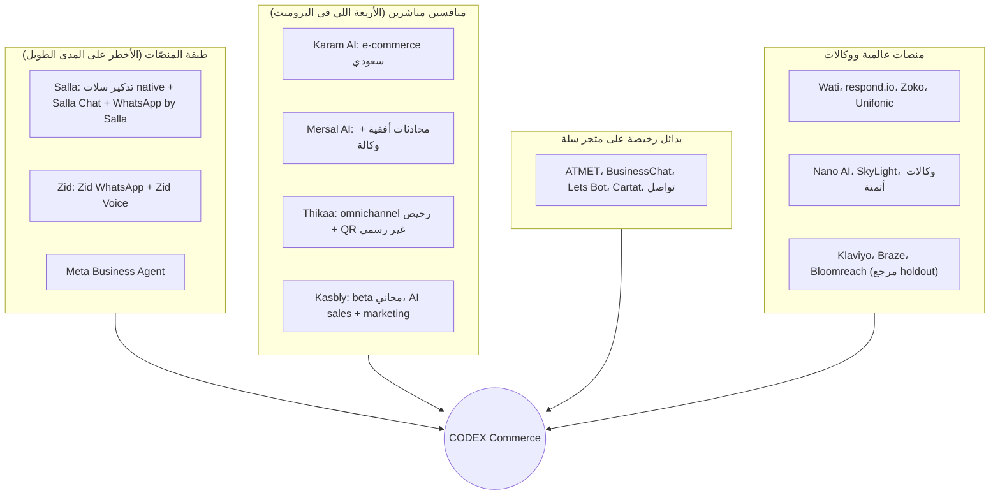
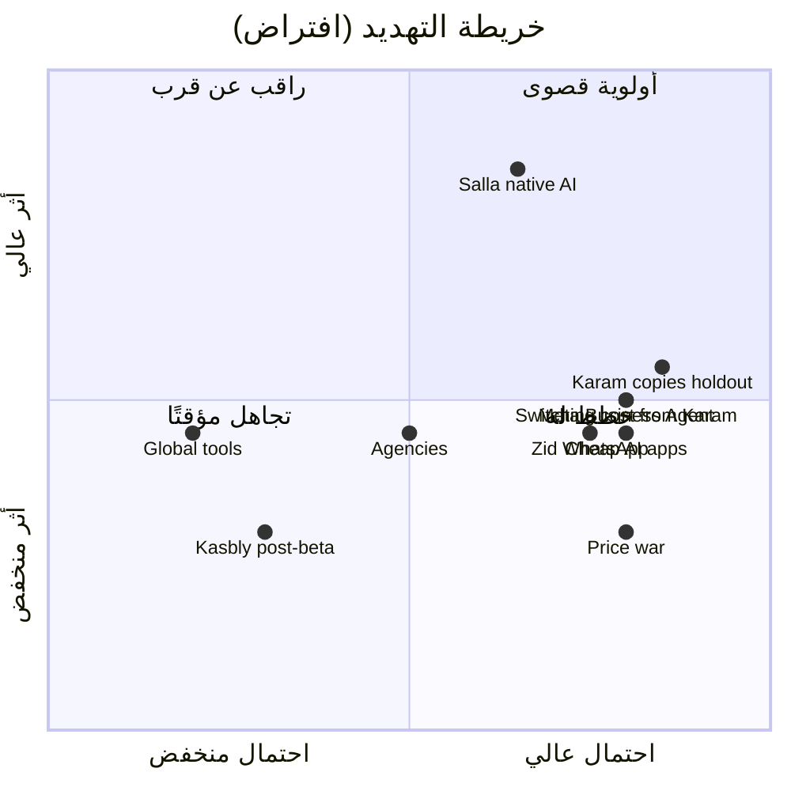

# 3. Competitor Analysis

> الحالة: مسودة v1.0 — بانتظار موافقة المؤسس (2026-10-21)

**نطاق القسم:** تجميع ونقد للبحث الموجود عن المنافسين، **مش** بحث جديد من الصفر. التفاصيل الكاملة والمصادر كلها في:
[thikaa.md](../research/thikaa.md) · [kasbly.md](../research/kasbly.md) · [karam-ai.md](../research/karam-ai.md) · [mersal-ai.md](../research/mersal-ai.md) · [competitive-feature-matrix.md](../research/competitive-feature-matrix.md) · [market-and-pricing.md](../research/market-and-pricing.md) · [salla-platform.md](../research/salla-platform.md) · [cart-recovery-incrementality.md](../research/cart-recovery-incrementality.md) · [whatsapp-business-platform.md](../research/whatsapp-business-platform.md)

**مفتاح التصنيف:**
- **[مؤكدة]**: عليها مصدر (رابط + تاريخ اطلاع 2026-10-21). أغلبها من مواقع المنافسين نفسهم، يعني بتأكد إن **الشركة بتقول كده**، مش إن الميزة اتجربت وشغالة.
- **[افتراض]**: محتاجة تتختبر مع التجار أو بالبيانات.
- **[اقتراح]**: توصية مننا.
- **غير مؤكدة**: ملقيناش دليل في أي اتجاه. ده **مش** معناه إن الميزة مش موجودة.

**حدود التحليل (لازم تتقري قبل أي حكم):**
- مجربناش ولا منتج من الأربعة من جوه. كل الكلام عن الـUX مبني على الصفحات العامة. [مؤكدة: منهجية ملفات البحث]
- مفيش reviews مستقلة لأي منافس على G2 أو Capterra. [مؤكدة: ملفات البحث]
- صفحة Thikaa على متجر سلة رجعت 404، وصفحة Karam على زد بتشتغل بـJavaScript بس، وموقع Mersal اتقرا عن طريق reader وسيط. [مؤكدة: competitive-feature-matrix.md]
- المعلومات دي بتتقادم بسرعة (Karam بيطلّع changelog كل شهر). لازم تتراجع كل ربع سنة. [اقتراح]

---

## 3.0 الخلاصة في 7 نقط

1. **Karam AI هو المنافس المباشر الأخطر** [افتراض]: سعودي، على سلة وزد، بالريال، وعنده تقريبًا كل الـMVP اللي في البرومبت الأصلي (AI agent، inbox، استرجاع سلات، COD، حملات، Autopilot) بسعر فعلي 268–698 ريال/شهر [مؤكدة: https://karamai.co/en/pricing، 2026-10-21].
2. **أخطر منافس غير مباشر هو سلة نفسها** [افتراض]: تذكير سلات native بخصم ولحد 5 تذكيرات [مؤكدة: https://help.salla.sa/en/article/abandoned-cart-reminders-with-a-discount/vzit7tzwz9e5pcv37nnenyqv، 2026-10-21]، ورسالة تسويق عن طريق Salla Chat بحوالي 0.16 ريال [مؤكدة: help.salla.sa، 2026-10-21]، وبتعمل vertical integration واضح (Ads وPayments ومسرّع AI "سبّاق") [مؤكدة: salla-platform.md].
3. **Meta نفسها بقت منافس** [افتراض]: Meta Business Agent بـ$2 لكل 1M token من 2026-07-01 [مؤكدة: https://developers.facebook.com/docs/whatsapp/pricing، 2026-10-21]. "AI بيرد بالعربي على أسئلة المنتجات" بقى سلعة.
4. **ولا منافس من الأربعة بيقدّم control groups أو incrementality أو خصم مربوط بالهامش أو cart scoring بشكل مؤكد** [غير مؤكدة عند الأربعة: competitive-feature-matrix.md]. لكن **الأدوات العالمية** (Klaviyo، Braze، Bloomreach، Postscript) عندها holdouts [مؤكدة: cart-recovery-incrementality.md]، وKaram بيكتب عن الفكرة في دليل تعليمي [مؤكدة: https://karamai.co/en/guides/abandoned-carts، 2026-10-21]. يعني الفكرة **مش جديدة**، والسبق ممكن يكون في التنفيذ للتاجر الصغير والمتوسط بس.
5. **Approval workflows ومراحل الاستقلالية Parity مش ميزة** [مؤكدة: Kasbly عنده shadow mode ومستويات استقلالية وسقف خصم، https://docs.kasbly.com/ar/ai-agent/overview/، 2026-10-21].
6. **سوق "واتساب للسلات" مزدحم وسقفه السعري واطي** [افتراض]: تطبيقات بـ49–119 ريال [مؤكدة: apps.salla.sa، 2026-10-21] وATMET بـAI بلهجة سعودية بـ49/99/249 [مؤكدة: https://apps.salla.sa/en/app/931067979، 2026-10-21]. أي رسالة تسويقية بتقول "استرجاع سلات" هتخسر مقارنة السعر.
7. **الخلاصة الاستراتيجية** [اقتراح]: نبني الـParity بأقل تكلفة (P1–P2)، ونراهن على **Profit-Proven Recovery** (holdout إجباري + Incremental Profit Report + أرضية هامش للخصم + قرار "الرسالة دي تستاهل ولا لأ"). الرهان ده نفسه **فرضية** لحد ما P0 تثبت إن التاجر هيدفع مقابل رقم أصغر وأصدق. التفاصيل في [القسم 4](04-positioning-differentiation.md).

---

## 3.1 خريطة المنافسة

> ترتيب الطبقات من حيث الخطر [افتراض]. الترتيب التفصيلي في §3.8.

---

## 3.2 نظرة عامة على المنافسين المباشرين الأربعة

| | Karam AI | Mersal AI | Thikaa | Kasbly |
|---|---|---|---|---|
| المقر والكيان | الرياض، سجل تجاري 1009089390 [مؤكدة: https://karamai.co/en/terms] | الرياض، تبع وكالة "مكاسب" [مؤكدة: https://apps.shopify.com/mersal-ai] | البحرين 2023 + LLC في Delaware [مؤكدة: https://thikaa.com/about] | Kasbly, LLC في Delaware [مؤكدة: https://kasbly.com/ar/terms] |
| المرحلة | شغّال، بيدّعي 500+ متجر [مؤكدة كادعاء: https://karamai.co/en/] | جديد، app الـShopify نزل 2026-09-24 [مؤكدة: https://apps.shopify.com/mersal-ai] | شغّال، بيدّعي 500+ شركة [مؤكدة كادعاء: https://thikaa.com/about] | **Beta مجاني** [مؤكدة: https://kasbly.com/ar/terms] |
| التركيز | **E-commerce سعودي** (سلة، زد، Shopify) | منصة محادثات لـ7 قطاعات | Omnichannel أفقي لـMENA | AI Sales + Marketing studio لـSMB الخليج |
| دليل على عملاء حقيقيين | 35 review على سلة بمتوسط ~4.94 [مؤكدة: https://apps.salla.sa/ar/app/864133974] + خبر Mubasher | 15 case study من غير أسماء [مؤكدة: https://mersal.ai/case-studies] | ادعاءات وشعارات بس | مفيش (الأرقام "illustrative") [مؤكدة: https://kasbly.com/en] |
| WhatsApp | رسمي + Coexistence [مؤكدة: https://karamai.co/en/whatsapp] | رسمي [مؤكدة كادعاء: https://mersal.ai/] | رسمي + Coexistence **+ QR غير رسمي** [مؤكدة: https://thikaa.com/llms.txt] | رسمي، ربط يدوي بالـtoken [مؤكدة: https://docs.kasbly.com/ar/channels/whatsapp/] |
| PDPL | ادعاء توافق، والـLLM providers مش معلنين [مؤكدة: https://karamai.co/en/privacy] | Privacy بتذكر GDPR/CCPA ومش PDPL، وTerms بقانون بريطاني [مؤكدة: https://mersal.ai/privacy-policy] | Opt-out في الـTerms بس [مؤكدة: https://thikaa.com/terms-conditions.html] | مفيش ذكر لـPDPL ولا data residency [مؤكدة: https://kasbly.com/ar/privacy] |
| خطورته علينا | **عالية** [افتراض] | متوسطة [افتراض] | منخفضة–متوسطة [افتراض] | منخفضة حاليًا [افتراض] |

> الترتيب في الأقسام الجاية حسب الخطورة، مش حسب ترتيب البرومبت.

---

## 3.3 Karam AI (كرم): المنافس المباشر الأخطر

المصدر الكامل: [karam-ai.md](../research/karam-ai.md). كل المصادر بتاريخ اطلاع 2026-10-21.

| البُعد | الخلاصة | التصنيف والمصدر |
|---|---|---|
| **الخدمات والمنتجات** | 4 أجزاء: AI Agent (اتسمّى "Smart Agent" في أكتوبر 2026، وإضافة مدفوعة)، Inbox، Journeys، Campaigns، وفوقهم **Autopilot** جديد بيقترح "الخطوة الجاية" وينفذها بضغطة. ومعاهم تطبيق موبايل، وإعداد رقم WhatsApp، وSuccess manager للباقات السنوية | [مؤكدة] https://karamai.co/en/ ، https://help.karamai.co/changelog ، https://karamai.co/en/pricing |
| **الميزات المعلنة** | Agent بيجاوب من المنتجات والسياسات، بيرشّح بالصور، **بيضيف للسلة ويبعت Salla checkout link** (سبتمبر 2026)، "وين طلبي؟"، handoff بالسياق، تبويب Knowledge "Gaps". Inbox فيه SLA وTickets وauto-tagging وملف عميل. Journeys: سلة متروكة (ساعة ← تذكير ← يوم ← تذكير تاني)، **COD confirmation بيحدّث الطلب في سلة وزد**، back-in-stock، win-back بعد 60 يوم، reorder، follow-up بعد 23 ساعة. Campaigns: 8 segments بتتحدث لوحدها وتقارير delivered/clicked/replied | [مؤكدة] https://karamai.co/en/ai-agent ، https://karamai.co/en/journeys ، https://karamai.co/en/campaigns ، https://karamai.co/en/inbox ، changelog |
| **الجمهور** | متاجر D2C على سلة وزد وShopify، SMB بوضوح (حد أقصى 12 user). القطاعات من الشعارات: أزياء، ألعاب، صيدليات، عسل، إلكترونيات. السعودية أساسًا | [مؤكدة] https://karamai.co/en/ ، https://karamai.co/en/pricing |
| **الـUX** | Self-serve من متاجر التطبيقات: تثبيت ← مراجعة "الفرص" ← تفعيل وتجربة. موقع ومركز مساعدة عربي بلهجة سعودية. RTL جوه اللوحة: غير مؤكدة (متشافتش) | [مؤكدة] https://karamai.co/en/salla ، https://help.karamai.co/ |
| **الـAI Agents** | Agent واحد لكل قناة، 5 تعليمات مخصصة، ضبط معدل التحويل للبشر، اختبار قبل التشغيل. "يفهم اللهجة السعودية" كادعاء. مخزون لحظي كادعاء (آلية التزامن غير مؤكدة). مزوّد الـLLM غير مؤكد، والمعالجة ممكن تكون برّه السعودية | [مؤكدة] https://karamai.co/en/ai-agent ، https://apps.salla.sa/ar/app/864133974 ، https://karamai.co/en/privacy |
| **التكاملات** | سلة (app رسمي)، زد (app #3363)، Shopify (0 تقييمات من مايو 2026)، Woo/Magento بـdemo بس. WhatsApp وInstagram وEmail وweb chat. Messenger وSMS وPublic API: غير مؤكدة | [مؤكدة] https://karamai.co/en/zid ، https://apps.shopify.com/karam-ai |
| **الأسعار** | Starter 119 / Business 299 ريال (من غير VAT). **الـAI إضافة**: 149 (600 محادثة)، 399 (1,800)، Professional مخصص. Overage 0.25–0.40 ريال/محادثة تلقائي. رسوم Meta على التاجر مباشرة. تجربة 7 أيام | [مؤكدة] https://karamai.co/en/pricing ، https://apps.salla.sa/ar/app/864133974 |
| **السعر الفعلي** | **268–698 ريال/شهر** مع الـAI | [مؤكدة: حساب من https://karamai.co/en/pricing ، 2026-10-21: Starter 119 + AI 149 = 268، وBusiness 299 + AI 399 = 698] |
| **مزاياه التنافسية** | توزيع رخيص من 3 متاجر تطبيقات، تقييم عالي (عينة صغيرة)، سعر دخول شفاف، منتج متكامل، **سرعة تطوير** (changelog شهري)، ميزات محلية (COD، Coexistence، شرح خطأ 131049)، هوية سعودية | [مؤكدة] karam-ai.md §8 |
| **الضعف والفرص** | القياس "طلبات بعد محادثة" من غير منهجية ولا control، رغم إن دليلهم بيعترف إن "مش كل طلب بعد رسالة سببه الرسالة". الخصم يدوي، ومنطق الهامش غير مؤكدة. التذكير لكل السلات بنفس التوقيت. Approval workflow رسمي: غير مؤكدة (ملقيناهوش في الصفحات العامة). تكلفة AI بتتصاعد بالـoverage. غموض في الـLLM والاستضافة. تناقض في أرقامهم (مليون رسالة/يوم مقابل 4 مليون إجمالي) | [مؤكدة] https://karamai.co/en/guides/abandoned-carts ، https://karamai.co/en/journeys . التناقض [افتراض] |
| **نتعلم منه** | COD بأزرار وكتابة الحالة في المتجر (→ E16)، follow-up قبل قفل نافذة الـ24 ساعة، تبويب Knowledge Gaps (→ E09)، بطاقة "اقتراح + تنفيذ + Later"، شرح أسعار Meta وخطأ 131049 بشفافية، Coexistence (→ E03)، changelog عام | [اقتراح] |
| **نعمل أحسن منه** | holdout افتراضي وIncremental Profit Report (→ E06، E07)، أرضية هامش لكل فئة (→ E05، E08)، scoring بقواعد بدل "ابعت للكل" (→ E05)، consent ledger بمصدر ووقت وفئة (→ E04)، الـAI مدمج في الباقة بدل add-on بـoverage مفاجئ (→ باقة Sell & Recover 699)، شفافية الـsub-processors والاستضافة | [اقتراح] |
| **ممنوع ندّعيه كابتكار** | AI agent على WhatsApp بالعربي، تكامل سلة وزد، inbox، استرجاع سلات، COD، checkout link من سلة، حملات وsegments، "اقتراحات ذكية بضغطة"، STOP وقائمة استبعاد | [مؤكدة] karam-ai.md §12 |

**الحكم النقدي:**
- [افتراض] Karam **فاهم المشكلة** اللي إحنا بنراهن عليها (دليله التعليمي بيشرح فكرة الـincrementality). المسافة بين الدليل والميزة ممكن تتقفل في أسابيع (R05 في [القسم 13](13-risks-mitigation.md)، احتمال عالي).
- [افتراض] نقطة ضعفه الحقيقية مش في الميزات، في **نموذج القياس** و**تسعير الـAI المنفصل**. ده اللي بنهاجم بيه، مش عدد الميزات.
- [اقتراح] منحاولش نسابقه في عرض الميزات (inbox كامل، journeys كتير، Autopilot). ده سباق خسران لمؤسس بيكتب الكود (Rules 5 و12).

---

## 3.4 Mersal AI (مرسال)

المصدر الكامل: [mersal-ai.md](../research/mersal-ai.md). كل المصادر بتاريخ اطلاع 2026-10-21.

| البُعد | الخلاصة | التصنيف والمصدر |
|---|---|---|
| **الخدمات والمنتجات** | منصة SaaS واحدة: AI agent، inbox موحّد، Workflows، Broadcasts، Contacts (CRM خفيف)، Mersal Forms، تطبيق موبايل، مساعد إعداد "سند"، حاسبة تكلفة WhatsApp. ومعاهم خدمات بشرية (مدير حساب وتدريب) | [مؤكدة] https://mersal.ai/ ، https://mersal.ai/features/ai-agents ، https://mersal.ai/whatsapp-pricing |
| **الميزات المعلنة** | **Workflow builder بـ17+ node**، triggers من سلة (16 event) وزد (12) وShopify (11) وWoo (11)، **تحديث حالة طلب في سلة**، فروع "لا رد" و"فشل"، Versions وتحقق قبل النشر. Broadcasts فيها **circuit breaker** ودفعة اختبار 10 مستلمين، وإيقاف الحملات لو العميل رد "غير مهتم". Audit log على جهات الاتصال | [مؤكدة] https://mersal.ai/features/workflows ، https://mersal.ai/features/broadcasts ، https://mersal.ai/features/contacts |
| **الجمهور** | SMB في الخليج ومصر، 7 قطاعات (e-commerce، SaaS، صحة، فنادق، تعليم، وكالات، اتصالات). 8 من 15 case study تجزئة أو e-commerce | [مؤكدة] https://mersal.ai/case-studies ، https://mersal.ai/#pricing |
| **الـUX** | عربي فقط وRTL، ومفيش إنجليزي. البيع بيقوده فريق مبيعات (ديمو ~15 دقيقة). التسجيل الذاتي غير مؤكد على الموقع، وموجود على Shopify بتجربة 7 أيام | [مؤكدة] https://apps.shopify.com/mersal-ai ، https://mersal.ai/request-demo?src=home ، https://chat.mersal.ai/auth |
| **الـAI Agents** | وكلاء متعددين، اختيار ومقارنة النماذج، فهم صوت وصور، معرفة الإعلان اللي العميل جه منه (CTWA)، handoff بملخص. **تحليلات الوكيل**: knowledge gaps، أسباب التحويل، **التكلفة لكل محادثة**. بيسجّل "طلب للمراجعة" مش cart أو order. Payment link وتعديل الطلب: غير مؤكدة. اللهجات: غير مؤكدة | [مؤكدة] https://mersal.ai/features/ai-agents |
| **التكاملات** | سلة وزد وShopify وWoo (الـlisting في متجري سلة وزد غير مؤكد)، Google Sheets اتجاهين، Odoo، Google Calendar، Naim. API trigger وارد، وتوثيق API عام غير مؤكد | [مؤكدة] https://mersal.ai/features/workflows |
| **الأسعار** | $999.99 / $1,999.99 / $2,999.99 سنويًا (≈312–937 ريال/شهر)، 5k–20k محادثة، رصيد AI $10–40/شهر ($5 ≈ 1,000 رسالة AI). $10 لكل 1k محادثة زيادة و$10 لكل seat. Shopify: $105 / $300 شهريًا بالـactive contacts (تناقض في وحدة القياس) | [مؤكدة] https://mersal.ai/#pricing ، https://apps.shopify.com/mersal-ai |
| **مزاياه التنافسية** | أوسع workflow builder **معلن** بين الأربعة (17+ node)، أكتر triggers معلنة لسلة وزد (16 و12 event)، أمان حملات، تحليلات تكلفة الوكيل، كل الميزات في كل الباقات، **قناة توزيع من وكالة مكاسب** | [مؤكدة] للميزات المعلنة https://mersal.ai/features/workflows ؛ المقارنة "أوسع/أكتر" والتوزيع [افتراض] (مجربناش المنتج) |
| **الضعف والفرص** | التحليلات المعلنة تشغيلية مش ربحية (ROI وholdout: غير مؤكدة). الـAgent بيسجّل "طلب للمراجعة" ومش بيقفل البيعة جوه المتجر. استرجاع السلات مهلة ثم رسالة. Terms بقانون بريطاني، والـPrivacy مش بتذكر PDPL، والـconsent ledger غير مؤكدة. منتج جديد ومن غير إثبات مستقل. رصيد الـAI صغير (≈2,000 رسالة في باقة النمو) | [مؤكدة] mersal-ai.md §9؛ رصيد الـAI [افتراض حسابي] |
| **نتعلم منه** | فروع "لا رد/فشل" و"مرة واحدة لكل عميل" في الـrecovery workflow (→ E05)، circuit breaker للإرسال (→ E05/E14)، كشف "غير مهتم" كـopt-out (نعممه لكلمات opt-out عربي → E04)، التكلفة لكل محادثة (→ E10 metering)، حاسبة تكلفة WhatsApp علنية كأداة تسويق | [اقتراح] |
| **نعمل أحسن منه** | Incremental Profit Report بدل "سلات مسترجعة"، agent بيوصل لـ`checkout_url` (→ E11)، consent ledger وDPA عربي (→ E04، E15)، واجهة عربي/إنجليزي | [اقتراح] |
| **ممنوع ندّعيه كابتكار** | Agent متعدد القنوات بـhandoff، تكامل سلة وزد وShopify وWoo، استرجاع سلات بـworkflows، segments، تحليلات تكلفة الوكيل، فهم الصوت والصور، Audit log | [مؤكدة] mersal-ai.md §12 |

**الحكم النقدي:**
- [افتراض] الخطر مش في المنتج نفسه، في **نموذج التوزيع**: وكالة بتدير متاجر وعندها ثقة التاجر وبتبيع له منتجها. ده بيأكد إن قناة الوكالات (M20، referral في P3) ممكن تبقى منافس مش شريك (Mersal تبع وكالة مكاسب [مؤكدة: https://apps.shopify.com/mersal-ai، 2026-10-21]؛ وقرار الـreferral المحدود في [القسم 4](04-positioning-differentiation.md) §4.8 [اقتراح]).
- [افتراض] سعره (312–937 ريال) قريب من باقاتنا المقترحة، فهو مرجع إن التاجر المتوسط بيدفع في النطاق ده لما يكون فيه خدمة بشرية معاه.

---

## 3.5 Thikaa (ثقه)

المصدر الكامل: [thikaa.md](../research/thikaa.md). كل المصادر بتاريخ اطلاع 2026-10-21.

| البُعد | الخلاصة | التصنيف والمصدر |
|---|---|---|
| **الخدمات والمنتجات** | AI chatbot + unified inbox لـ9+ قنوات، **3 طرق ربط WhatsApp منها QR غير رسمي**، Voice call agent، كتالوج وcheckout بـ13 بوابة دفع، حجوزات، Social media manager، تطبيق موبايل، REST API وwebhooks وMCP، إضافة WordPress، إعداد WABA بـ$200 | [مؤكدة] https://thikaa.com/llms.txt ، https://thikaa.com/ ، https://thikaa.com/messaging-api.php |
| **الميزات المعلنة** | لهجات خليجي/مصري/شامي/مغاربي/عراقي + Arabizi، تفريغ voice notes مجاني، Vision، RAG من ملفات ومصادر حية، **التعلم من سجل المحادثات بموافقة المالك واستثناء الأسعار**، guardrails ضد اختلاق الأسعار وأكواد الخصم، اختيار النموذج وBYOK، workflow builder، broadcasts، "anti-ban" وproxies دوّارة لحسابات QR | [مؤكدة] https://thikaa.com/llms.txt ، https://thikaa.com/features/ai-chatbot ، https://thikaa.com/changelog |
| **الجمهور** | أفقي: عيادات، صالونات، سفر، مطاعم، متاجر... في MENA. السعر بيقول إنه SMB صغير جدًا [افتراض] | [مؤكدة] https://thikaa.com/ |
| **الـUX** | Self-serve، تجربة 7 أيام من غير كارت، **Demo "امسح وجرّب"** بيتعلم من آخر أسبوعين من محادثاتك. سلة: OAuth ← إيميل بكلمة سر مؤقتة ← widget تلقائي. البنية بتبان قديمة (مسارات tenant في الـURL) [افتراض] | [مؤكدة] https://thikaa.com/pricing ، https://thikaa.com/docs/salla.php?lang=en |
| **الـAI Agents** | RAG + Q&A matching من غير استهلاك credits، توصية منتجات من سلة، "وين طلبي؟"، voice (رد صوتي $0.03/د، مكالمات WhatsApp $0.06/د، هاتف $0.50/د). **إنشاء cart في سلة غير مؤكد** (الصلاحيات قراءة فقط). Approval على الرسائل والخصومات: غير مؤكدة | [مؤكدة] https://thikaa.com/features/ai-chatbot ، https://thikaa.com/docs/salla.php?lang=en |
| **التكاملات** | سلة (**قراءة فقط**)، WooCommerce، Shopify. **زد: "not supported yet"** حسب llms.txt. 13 بوابة دفع (Tap، Moyasar، Tabby، Tamara...)، Zapier/n8n/Make/HubSpot | [مؤكدة] https://thikaa.com/llms.txt |
| **الأسعار** | $9.99 / $19.99 / $29.99 / $49.99 شهريًا (≈37–187 ريال)، 5k–40k محادثة bot، من غير per-seat. رسوم Meta منفصلة | [مؤكدة] https://thikaa.com/pricing |
| **مزاياه التنافسية** | أرخص سعر، اتساع قنوات، قوة عربي متعددة الوسائط، time-to-value سريع، بوابات دفع خليجية، API وMCP | [مؤكدة] thikaa.md §8 |
| **الضعف والفرص** | **الاعتماد على QR غير رسمي** (خطر حظر رقم التاجر)، سلة قراءة فقط، تحليلات تشغيلية بس وأرقام الاسترجاع mockup، استرجاع سلات بدائي (في Woo معطّل افتراضيًا وكان فيه bug وقّف التذكيرات بصمت)، مفيش زد، consent في الـTerms بس، إثبات اجتماعي ضعيف وتناقضات في الموقع | [مؤكدة] https://thikaa.com/llms.txt ، https://wordpress.org/plugins/thikaa-ai-chat/ ، https://thikaa.com/features/analytics |
| **نتعلم منه** | Demo سريع على بيانات التاجر الحقيقية (نسختنا: **Cart Truth Audit** read-only على سلة، E17)، استخراج Q&A بموافقة المالك واستثناء الأسعار (→ E09، **جوه الـtenant بس**، ومن غير تدريب نموذج مشترك على بيانات WhatsApp)، Q&A matching من غير LLM لتقليل التكلفة (→ E10)، guardrails ضد اختلاق الأسعار والكوبونات (→ E10 validator)، تفريغ voice notes (مرشّح لـP2 لو المقابلات أكدت) | [اقتراح] |
| **نعمل أحسن منه** | "Official WhatsApp only" كميزة ثقة (Rule 8)، استرجاع سلات بـholdout وقواعد، Incremental Profit Report، consent ledger كميزة منتج مش بند في الـTerms | [اقتراح] |
| **ممنوع ندّعيه كابتكار** | Agent عربي متعدد اللهجات، inbox موحّد، تكامل سلة، payment links، voice notes، handoff، workflow builder، broadcasts، MCP، **guardrails ضد اختلاق الأسعار** | [مؤكدة] thikaa.md §12 |

**الحكم النقدي:**
- [افتراض] سعره ($10–50) **مش مرجع عادل** لمنتج قايم على API رسمي بس، لأن جزء من رخصه قايم على QR غير رسمي من غير رسوم Meta.
- [افتراض] خطره علينا في شريحة المتاجر الصغيرة جدًا، وهي أصلًا **برّه الـICP** (أقل من 300 طلب/شهر).
- [اقتراح] أي حظر أرقام يحصل لعملاء أدوات الـQR يبقى مادة تسويقية لـ"Official-only"، من غير ما نذكر اسم منافس.

---

## 3.6 Kasbly (كسبلي)

المصدر الكامل: [kasbly.md](../research/kasbly.md). كل المصادر بتاريخ اطلاع 2026-10-21.

| البُعد | الخلاصة | التصنيف والمصدر |
|---|---|---|
| **الخدمات والمنتجات** | 3 منتجات: Kasbly Marketing (صور وفيديو UGC ونصوص بالـAI + جدولة نشر)، Kasbly Sales (inbox + agent + CRM + تحليلات)، Kasbly MCP (مسودات بس). بيقدّم نفسه "موظف AI يغني عن فريق تسويق ومبيعات" | [مؤكدة] https://kasbly.com/ar/products/create ، https://kasbly.com/ar/products/sell ، https://kasbly.com/ar/mcp |
| **الميزات المعلنة** | inbox لـ10+ قنوات منها حراج ودكان مزاد وReddit، follow-up sequences، CRM بـdeals وlead scoring بـdecay، HubSpot/Pipedrive. **Shadow mode، إطلاق مرحلي، مستويات استقلالية، سجل إصدارات، سقف خصم**، "إجراءات تحتاج موافقة"، audit log، compliance (consent status، retention، حذف)، **حدود تنبيه وإيقاف للإنفاق** وتقرير تكلفة AI | [مؤكدة] https://docs.kasbly.com/ar/ ، https://docs.kasbly.com/ar/ai-agent/launch-history/ ، https://docs.kasbly.com/ar/settings/billing/ |
| **الجمهور** | SMB وأصحاب المتاجر في السعودية والخليج (المدوّنة)، ومعارض سيارات وبائعين على حراج | [مؤكدة] https://kasbly.com/ar/about ، https://kasbly.com/ar/blog |
| **الـUX** | تسجيل ذاتي مجاني من غير كارت. "5 دقايق" على الموقع مقابل "ظهيرة" في المدوّنة (تناقض). **ربط WhatsApp يدوي** (Phone number ID + WABA ID + token) من غير Embedded Signup. onboarding بمساعدة بشرية | [مؤكدة] https://kasbly.com/ar ، https://docs.kasbly.com/ar/channels/whatsapp/ |
| **الـAI Agents** | من الـKB والكتالوج، اقتراح منتجات، سعر ومخزون لحظي (ادعاء)، **إنشاء الطلب متناقض** بين الصفحة الإنجليزية والمدوّنة، payment links عن طريق **Stripe Connect بس**، تذكير بروابط الدفع غير المدفوعة، handoff يدوي، "اسأل الذكاء الاصطناعي" للتحليلات، مكالمات عن طريق Telnyx | [مؤكدة] https://kasbly.com/en ، https://kasbly.com/ar/products/sell ، https://docs.kasbly.com/ar/inbox/handoff/ |
| **التكاملات** | سلة وزد وShopify وWoo **كادعاء في مدوّنة بس**، من غير توثيق ولا app على متجر سلة. **مش بيقرا السلات المتروكة من المتجر** (نص صريح). Stripe بس، وStripe مش متاح في السعودية | [مؤكدة] https://kasbly.com/ar/blog/salla-zid-whatsapp-integration ؛ Stripe: [مؤكدة] https://stripe.com/global |
| **الأسعار** | **مفيش أسعار منشورة**، مجاني في الـbeta. الشروط بتقول إن الباقات المدفوعة جاية مع إشعار مسبق | [مؤكدة] https://kasbly.com/ar/terms |
| **مزاياه التنافسية** | اتساع قنوات (منها قنوات محلية نادرة)، تسويق + مبيعات في منتج واحد، **ضوابط AI ناضجة على الورق**، MCP آمن، CRM integrations، محتوى SEO عربي قوي، دخول مجاني | [مؤكدة] kasbly.md §8 |
| **الضعف والفرص** | **مفيش استرجاع سلات من المتجر** (نص صريح إنه مش بيقرا السلات المتروكة)، Stripe بس (مدى/Tap/Moyasar وCOD: غير مؤكدة، مفيش ذكر لهم)، تكامل متاجر سطحي، ربط WhatsApp يدوي، attribution من غير منهجية، كيان أمريكي من غير PDPL، صفر إثبات اجتماعي، تسعير مجهول بعد الـbeta، منتج واسع جدًا لفريق صغير [افتراض] | [مؤكدة] kasbly.md §9 |
| **نتعلم منه** | Shadow mode ← Assisted mode ≥4 أسابيع ثم Scoped Autonomous (→ E11)، سقف خصم وقائمة "إجراءات تحتاج موافقة" (→ E05 discount policy engine)، حدود تنبيه وإيقاف للإنفاق (→ E10 + E13)، سجل إصدارات الـagent، Knowledge gaps وquality review (→ E10 golden set)، MCP بصلاحية مسودات (P5+)، اختبار "10 رسائل صعبة" كأداة بيع لجودة اللهجة | [اقتراح] |
| **نعمل أحسن منه** | سلات من المتجر نفسه بـwebhooks وreconciliation (→ E02، E05)، أرضية هامش بدل سقف ثابت، holdout، `checkout_url` من سلة بدل Stripe، Embedded Signup (→ E03)، opt-out بكلمات عربي (→ E04) | [اقتراح] |
| **ممنوع ندّعيه كابتكار** | Agent على WhatsApp، ROI/attribution dashboard، **approval workflows، shadow mode، مستويات الاستقلالية، سقف الخصم**، NL analytics، audit log، تقرير تكلفة AI | [مؤكدة] kasbly.md §12 |

**الحكم النقدي:**
- [افتراض] مش تهديد مباشر النهارده (beta، ومفيش دليل منشور على عملاء، ومش بيقرا السلات). لكنه **أوضح دليل إن "ضوابط الـAI والموافقات" بقت Parity**، فمينفعش تبقى جزء من الـpositioning بتاعنا.
- [افتراض] لما يطلّع أسعاره، ممكن يضغط على السعر لو دخل بسعر منخفض. نراقب.

---

## 3.7 Competitive Feature Matrix (مختصرة)

النسخة الكاملة في [competitive-feature-matrix.md](../research/competitive-feature-matrix.md). عمود CODEX هنا **[اقتراح]** ومربوط بالـPhases والـEpics الرسمية في [القسم 06](06-mvp-vs-future-matrix.md) (وده بيحدّث عمود CODEX في الملف الكامل، شوف "ملاحظات للمراجعة").

**المفتاح:** ✅ مؤكد (معلن ومعاه مصدر) · ⚠️ جزئي/متناقض · ❓ غير مؤكدة (مش معناها مش موجودة).

| الميزة | Karam | Mersal | Thikaa | Kasbly | CODEX [اقتراح] |
|---|---|---|---|---|---|
| WhatsApp رسمي | ✅ | ✅ | ✅ (+ QR غير رسمي) | ✅ (ربط يدوي) | P1 (E03)، رسمي فقط للأبد (Rule 8) |
| Embedded Signup / Coexistence | ✅ Coexistence | ❓ | ✅ | ❓ (يدوي) | P1 (E03) |
| Instagram / Messenger | ✅ / ❓ | ✅ / ✅ | ✅ / ✅ | ✅ / ✅ | P5 (M03) |
| Email / Web chat | ⚠️ / ✅ | ❓ / ✅ | ✅ / ✅ | ✅ / ✅ | P5–P6 |
| Voice | ❓ | ❓ (voice notes بس) | ✅ | ✅ (Telnyx) | P6 gated (M19) |
| Inbox + handoff | ✅ (SLA وtickets) | ✅ | ✅ | ✅ (handoff يدوي) | P1 lite / P2 (E12): queue وassign وnotes وstatus بس |
| لهجات عربية | ⚠️ سعودي (ادعاء) | ❓ | ✅ (5 + Arabizi) | ⚠️ | P2: رد سعودي، فهم سعودي + مصري، golden set ≥300 (E10) |
| بحث وترشيح منتجات | ✅ | ⚠️ | ✅ | ✅ | P2 (E09، E11) |
| سعر ومخزون حي | ⚠️ | ⚠️ | ✅ (سلة) | ⚠️ | P2، **دقة 100%** بـvalidator حتمي (E10) |
| إنشاء cart في سلة | ✅ (checkout link) | ❓ (طلب للمراجعة) | ❓ (قراءة فقط) | ⚠️ (متناقض) | **Cut**. نستخدم `checkout_url` (E11) |
| Payment links | ✅ | ❓ | ✅ (13 بوابة) | ⚠️ (Stripe بس) | **ممنوع على الـagent** (custom payment links). `checkout_url` من سلة بس |
| استرجاع سلات | ✅ | ✅ | ✅ | ⚠️ (مش بيقرا سلات المتجر) | P1 (E05) = الـwedge، ومعاه holdout |
| COD confirmation | ✅ (بيحدّث سلة وزد) | ❓ | ⚠️ | ❓ | P2 مشروط بنتيجة P0 (E16) |
| Win-back / repeat | ✅ | ⚠️ | ❓ | ✅ | P4 (M08) |
| Campaigns / broadcasts | ✅ | ✅ (circuit breaker) | ✅ | ✅ | P5 (M15) بموافقة صريحة |
| CRM / segments | ✅ / ✅ | ✅ / ✅ | ⚠️ / ❓ | ✅ / ⚠️ | P4 lite (M13) |
| Workflow builder | ✅ | ✅ (17+ node) | ✅ | ⚠️ | P6 (M17). الـMVP workflows ثابتة بالكود |
| Analytics dashboard | ⚠️ | ⚠️ | ✅ (تشغيلي) | ✅ | **مش هنبني dashboards عامة**. تقرير واحد (E07) |
| Revenue attribution | ⚠️ (أي طلب بعد محادثة) | ⚠️ | ⚠️ | ✅ (من غير منهجية) | P1: إيراد منسوب **ومعاه** إيراد إضافي تقديري (E07) |
| **Holdout / incrementality** | ❓ (فكرة في دليل تعليمي) | ❓ | ❓ | ❓ | **P1 (E06)، 10% افتراضي وإجباري في الـpilots** |
| **خصم بأرضية هامش** | ❓ (يدوي) | ❓ | ❓ | ⚠️ (سقف ثابت) | **P1 (E05، E08)**، والـAI عمره ما بيقرر الخصم |
| **Cart scoring** | ❓ (كل السلات بنفس التوقيت) | ⚠️ (فرع "قيمة > X") | ❓ | ❓ | **P1 بقواعد مش ML** (E05)؛ uplift models P4+ |
| **Cost ledger (Meta + خصم + LLM)** | ❓ | ⚠️ (تكلفة لكل محادثة) | ❓ | ⚠️ (تكلفة AI) | **P1 (E06)** |
| NL analytics | ❓ | ❓ | ❓ | ✅ | P5 (M14) |
| Approval workflows | ⚠️ | ⚠️ | ⚠️ | ✅ | P1–P2، **Parity إجبارية** (E05، E11) |
| Consent / opt-out | ⚠️ (STOP + قائمة) | ⚠️ ("غير مهتم") | ⚠️ (Terms) | ⚠️ (consent status) | P1 (E04): ledger بالمصدر والوقت والفئة، opt-out عربي <24 ساعة، quiet hours |
| Salla | ✅ | ✅ (listing ❓) | ✅ (قراءة) | ⚠️ (ادعاء) | P1 private app ثم P3 public (E02، E18) |
| Zid | ✅ | ✅ | ❓ ("not supported yet") | ⚠️ | P4 |
| Shopify / Woo | ✅ / ⚠️ | ✅ / ✅ | ✅ / ✅ | ⚠️ / ⚠️ | P5 حسب الطلب |
| Public API / webhooks | ❓ | ⚠️ | ✅ (HMAC، MCP) | ✅ (MCP) | P5 (M18) |
| Agency / white label | ❓ | ⚠️ | ❓ | ❓ | Referral P3، dashboard P5، white label P6 gated بعد شهر 24 |
| أسعار منشورة | ✅ | ✅ | ✅ | ❓ (beta) | 399 / 699 / 999+ و Proof Pilot 1,500 [اقتراح، يتختبر] |

**قراءة الجدول [افتراض]:**
- في **31 من 32 صف**، واحد على الأقل من الأربعة عنده الميزة أو جزء منها (✅ أو ⚠️). الصف الوحيد الفاضي تمامًا (❓ عند الأربعة) هو **holdout / incrementality**. وخصم الهامش وcart scoring والـcost ledger موجودين بشكل **جزئي ضعيف** بس (سقف خصم ثابت عند Kasbly، وفرع "قيمة السلة > X" عند Mersal، وتكلفة AI لكل محادثة عند Mersal وKasbly). المكوّنات الأربعة دي مع بعض هي Profit-Proven Recovery، والتمايز في **تجميعها حوالين holdout**، مش في أي واحدة لوحدها.
- إحنا **متأخرين عمدًا** في القنوات والـinbox والـworkflows والحملات. ده قرار (Rules 2 و5 و12)، مش ثغرة. لازم الرسالة البيعية متتقارنش بعدد الميزات.

---

## 3.8 ما لا يجوز اعتباره ابتكارًا لـCODEX (Rule 3)

### 3.8.1 حاجات موجودة فعلًا في السوق (Parity)

| اللي ممكن نتغرّ ونقول إنه ميزتنا | مين عنده (مؤكد) | الحكم [اقتراح] |
|---|---|---|
| AI Sales Agent عربي على WhatsApp | الأربعة + ATMET + Meta Business Agent | Parity. لازم يبقى دقيق، مش "مختلف" |
| استرجاع السلات المتروكة على WhatsApp | Karam، Mersal، Thikaa، سلة native، زد native، عشرات التطبيقات | Parity، وهو الـwedge بتاعنا بس **مش** رسالة البيع |
| تأكيد COD | Karam (بيكتب في سلة وزد) | Parity لو دخلنا فيه (E16) |
| Approval workflows، shadow mode، مستويات استقلالية، سقف خصم | Kasbly ✅، والباقيين جزئي | Parity إجبارية ([القسم 4](04-positioning-differentiation.md) §4.1.2، بند 8) |
| شرح التوصيات و"اقتراح + تنفيذ بضغطة" | Karam Autopilot | Parity ([القسم 4](04-positioning-differentiation.md) §4.1.2، بند 7) |
| Guardrails ضد اختلاق الأسعار والكوبونات | Thikaa، وMersal بيدّعي | Parity. اللي يفرق هو الـvalidator الحتمي **والـexit criterion المُعلن** (دقة 100% على ≥300 حالة) |
| Revenue / ROI dashboard | Kasbly ✅، والباقيين جزئي | Parity. الفرق في المنهجية بس |
| تحليلات تكلفة الـAI لكل محادثة | Mersal، Kasbly | Parity |
| "Holdout / control groups" كفكرة | Klaviyo، Braze، Bloomreach، Postscript، Rejoiner [مؤكدة: cart-recovery-incrementality.md §6.1]؛ Karam بيشرحها في دليل [مؤكدة: https://karamai.co/en/guides/abandoned-carts] | **مش ابتكار.** ممنوع "أول من يقيس الـincrementality" ([القسم 4](04-positioning-differentiation.md) §4.5) |
| تسعير مربوط بالنتيجة أو ضمان قياس | Zoko Sello 3% من قيمة الطلب [مؤكدة: https://www.zoko.io/pricing]؛ Nano AI بيرجّع رسوم الإعداد لو تقرير القياس متسلّمش بعد 30 يوم [مؤكدة: https://www.nano-ai.net/en/services/salla-zid-whatsapp-ai] | ضمان الـProof Pilot (الشهر التالت مجاني) **مش جديد كفكرة**. اللي ممكن يفرق إن الضمان مربوط بـholdout مش بتقرير |

### 3.8.2 اللي فاضل كتمايز مرشّح (Profit-Proven Recovery)

| المكوّن | حالته عند الأربعة | حالته عالميًا | الحكم ([القسم 4](04-positioning-differentiation.md) §4.1.2) |
|---|---|---|---|
| Holdout افتراضي 10% على مستوى العميل، إجباري في الـpilots | غير مؤكدة عند الأربعة | موجود كـenterprise feature (Klaviyo محتاج 400k profile [مؤكدة: https://help.klaviyo.com/hc/en-us/articles/18138290642971]) | **Keep، قلب الميزة.** الجديد الممكن: default ومفهوم ومتاح لمتجر 300–3,000 طلب، بـpooled priors [افتراض] |
| Incremental Profit Report (4 أرقام: منسوب، إضافي تقديري، تكلفة، ربح إضافي) | الكل بيعرض إيراد منسوب أو "طلبات بعد محادثة" [مؤكدة: competitive-feature-matrix.md] | Klaviyo بيعرض lift وwin probability [مؤكدة: https://help.klaviyo.com/hc/en-us/articles/18138290642971] | **Keep = المنتج الأساسي** |
| خصم بأرضية هامش لكل فئة + approval فوق السقف | Kasbly سقف ثابت بس | Bloomreach "targeted discounting" كادعاء من غير منهجية [مؤكدة: https://www.bloomreach.com/en/use-cases/targeted-discounting-with-loomi-ai] | **Shrink لقواعد**، والـAI مبيقررش الخصم |
| Suppression: "الرسالة دي تستاهل تكلفتها؟" | غير مؤكدة | غير مؤكدة | **Keep**. أوضح قيمة بتتقاس بالفلوس بعد زيادات Meta |
| Cart scoring بقواعد | Mersal فرع "قيمة > X" بس | — | **Keep كقواعد مش ML** |

**تقييم الاستدامة [افتراض]:** كل المكوّنات دي **قابلة للنسخ** في أسابيع من Karam أو سلة. الحماية الوحيدة الحقيقية: (1) priors مجمّعة من نتائج طلبات سلة لمتاجر العطور والتجميل (ADR-009: من غير نصوص WhatsApp)، (2) منهجية منشورة، (3) سمعة "الأرقام الصادقة"، (4) الوقت. يعني السبق في **البيانات والتنفيذ**، مش في الفكرة.

---

## 3.9 مقارنة الأسعار وموقعنا

كل الأسعار شهرية بالريال، من غير VAT ومن غير رسوم Meta (1 USD = 3.75 SAR).

| الشريحة | أمثلة | النطاق | التصنيف والمصدر |
|---|---|---|---|
| Native شبه مجاني | Salla Chat (نقاط، رسالة تسويق ~0.16 ريال)، Zid WhatsApp (مجاني في الاحترافية، و109 غيرها) | 0–109 + رسائل | [مؤكدة] help.salla.sa ؛ https://zid.sa/en/solutions/zid-whatsapp/ |
| تطبيقات سلة رخيصة | BusinessChat (599/سنة، 514 تقييم)، Lets Bot (49/119)، ATMET (49/99/249)، تواصل (50/99/999) | 49–119 (ATMET لحد 249) | [مؤكدة] https://apps.salla.sa/en/app/338190499 ، https://apps.salla.sa/en/app/1550834079 ، https://apps.salla.sa/en/app/931067979 |
| Thikaa | $9.99–49.99 | 37–187 | [مؤكدة] https://thikaa.com/pricing |
| Kasbly | Beta | 0 | [مؤكدة] https://kasbly.com/ar/terms |
| **Karam AI مع الـAI** | Starter+Basic إلى Business+Advanced | **268–698** | [مؤكدة] https://karamai.co/en/pricing |
| Mersal AI | $999.99–2,999.99/سنة | 312–937 | [مؤكدة] https://mersal.ai/#pricing |
| منصات عالمية | Wati، respond.io | 221–1,309 | respond.io [مؤكدة] https://respond.io/pricing ؛ Wati: هيكل الباقات [مؤكدة] https://www.wati.io/pricing/ والأرقام [مؤكدة — مصدر ثانوي] https://www.getmacha.com/blog/wati-pricing-explained |
| AI agent مُدار | Nano AI | 746–1,500 + إعداد 1,838–5,063 | [مؤكدة] https://www.nano-ai.net/en/services/salla-zid-whatsapp-ai |
| **CODEX** | Recover 399 / Sell & Recover 699 / Pro 999+ / Proof Pilot 1,500 مقدم لـ90 يوم | 399–999+ | **[اقتراح]** [القسم 4](04-positioning-differentiation.md) §4.9، يتختبر في P0–P1 |

**ملاحظات نقدية:**
- [افتراض] الأسعار مش قابلة للمقارنة المباشرة: كل منافس بيحسب على وحدة مختلفة (محادثات bot، template messages، محادثات AI، active contacts).
- [افتراض] 699 عند سقف Karam الفعلي (698) **ومعاه الـagent مدمج**. أي سعر فوق 700 لازم يبرره دليل مالي ([القسم 4](04-positioning-differentiation.md) §4.9).
- **[افتراض، نقطة ضعف لازم تتقال بوضوح]:** باقة Recover (399) **من غير AI agent**، وأرخص Karam **مع** الـagent بـ268 (119 + 149)، وKaram Starter لوحده (119) فيه journey السلة المتروكة [مؤكدة: https://karamai.co/en/pricing ، https://karamai.co/en/journeys]. يعني على الاسترجاع بس إحنا **حوالي 3.4 ضعف** Karam Starter، و**~49% أغلى** من أرخص Karam بـAI ومعانا ميزات أقل. الفرق الوحيد اللي بيبرّر ده هو الـholdout والـIncremental Profit Report، ولو التاجر مش شايف قيمتهم (أخطر افتراض في المشروع، [القسم 2](02-critical-assessment.md) §2.3) الـ399 مش هتتباع. عشان كده مقابلات P0 لازم تختبر 399 **قدام Karam Starter 119 مباشرة**، مش قدام Karam مع الـAI بس ([القسم 4](04-positioning-differentiation.md) §4.9.4) [اقتراح].
- [افتراض] على متجر سلة بعمولة ~30%: 399 ← ~280 صافي، و699 ← ~490 صافي. العمولة دي بتنطبق على Karam كمان لو اتباع من متجر سلة، فهي مش ميزة ولا عيب نسبي، لكنها بتقلل الهامش بتاعنا والـAI COGS لازم يتحسب على الصافي مش الإجمالي. إحنا **مش أرخص من Karam للتاجر**، فالقيمة لازم تتشاف في التقرير، مش في السعر.
- [اقتراح] منتنافسش على السعر مع تطبيقات الـ49 ريال ولا مع Thikaa. التجار دول برّه الـICP.

---

## 3.10 المنافسين غير المباشرين والمجاورين

### 3.10.1 حلول المنصات (Native)

| المنافس | بيقدّم إيه | ليه مهم لينا | التصنيف والمصدر |
|---|---|---|---|
| **سلة: تذكير السلات** | تذكير بخصم أو من غير، مدة الترك، حد أدنى لقيمة السلة، لحد 5 تذكيرات، قنوات SMS وEmail وPush وWhatsApp (لمشتركي WhatsApp by Salla). "معدل الاسترداد" محسوب على المرسل، من غير holdout | موجود عند كل تاجر سلة من غير تثبيت. ده **المرجع اللي التاجر هيقارننا بيه** | [مؤكدة] https://help.salla.sa/en/article/abandoned-cart-reminders-with-a-discount/vzit7tzwz9e5pcv37nnenyqv ؛ تقرير الاسترداد: [مؤكدة] help.salla.sa (تقارير السلات المتروكة) |
| **Salla Chat / WhatsApp by Salla** | تنبيهات طلبات، روابط دفع، تذكير سلات، توفر منتج، طلب تقييم، بالنقاط | سعر الرسالة ~0.16 ريال. هل فيه AI أو رسمي: **غير مؤكدة** (بحث إضافي 2026-10-21 ملقاش مصدر رسمي) | [مؤكدة] help.salla.sa (تنبيهات الواتساب)؛ التفاصيل غير مؤكدة |
| **سلة كمنصة** | Salla Ads (Sweply 2025)، Paylink (سبتمبر 2026)، fraud detection وStore Analyst بالـAI، مسرّع "سبّاق" لمنتجات AI | Vertical integration واضح. AI sales agent native: **غير مؤكدة** (مش معناه مش جاي) | [مؤكدة] https://entarabi.com/en/2026/09/salla-acquires-paylink-to-expand-payment-solutions-for-merchants/ ، https://salla.com/en-ae/ai-info ، https://salla.com/en-ae/sabbaq-2 |
| **Zid WhatsApp** | سلات متروكة (قيمة، مرحلة، توقيت، كوبون أو شحن مجاني)، حملات، 9 حالات طلب، inbox مشترك، توثيق مجاني | **أقوى من سلة native**. الضغط على "استرجاع السلات" في زد أعلى، ومهم لقرار P4 | [مؤكدة] https://zid.sa/en/solutions/zid-whatsapp/ ، https://help.zid.sa/auto-cart-reminders/ |
| **Zid Voice** | حل صوتي لاسترجاع السلات | السعر غير مؤكدة | [مؤكدة: وجوده] https://zid.sa/pricing/ |
| **Meta Business Agent** | رسائل non-template بـagent من Meta، $2 لكل 1M token (~4–5 سنت/رسالة)، من 2026-07-01 | صاحب المنصة بقى منافس في "الرد على أسئلة المنتجات". ميزتنا لازم تبقى في اللي Meta مش بتعمله: ربط الطلب بسلة، سياسات الخصم، القياس | [مؤكدة] https://developers.facebook.com/docs/whatsapp/pricing ؛ أعداد الاستخدام: غير مؤكدة |

### 3.10.2 تطبيقات رخيصة على متجر سلة

| التطبيق | السعر (ريال) | نقطة مهمة | التصنيف والمصدر |
|---|---|---|---|
| BusinessChat | 599/سنة | 514 تقييم، مخصص لمتاجر 300+ طلب (نفس حد الـICP بتاعنا)، تقرير "إيرادات مسترجعة" | [مؤكدة] https://apps.salla.sa/en/app/338190499 |
| ATMET Chat | 49 / 99 / 249 | **AI بلهجة سعودية/خليجية**، handoff، كوبون باسم العميل. API رسمي + QR غير رسمي. 6 تقييمات بس | [مؤكدة] https://apps.salla.sa/en/app/931067979 |
| Lets Bot | 49 / 119 + AI مدفوع | "من غير انتظار موافقات" (مؤشر محتمل لربط غير رسمي [افتراض]) | [مؤكدة] https://apps.salla.sa/en/app/1550834079 |
| Cartat (كارتات) | غير مؤكدة | سلة بتعرضه: "6,000+ متجر" | [مؤكدة كادعاء] https://partners.salla.com/en/apps |
| WhatsApp Line، Social Lab، WhatsApp Direct | من 20 / 29 / 35 | تطبيقات WhatsApp بسيطة بأقل من 50 ريال | [مؤكدة] https://apps.salla.sa/en/app/1662840947 ، https://apps.salla.sa/en/app/412425472 ، https://apps.salla.sa/en/app/602421879 |

[افتراض] الشريحة دي بتعمل **سقف نفسي** عند التاجر الصغير لأي حاجة اسمها "واتساب للسلات". ده سبب إضافي إن الـICP يبدأ من 300 طلب/شهر وإن الـpositioning يبعد عن "استرجاع سلات".

### 3.10.3 منصات عالمية ووكالات وأدوات retention

| الفئة | أمثلة | ليه مهمين | التصنيف والمصدر |
|---|---|---|---|
| Inbox / CPaaS عالمي | Wati ($69–349)، respond.io ($99–349)، Zoko ($49.99–499.99، Sello 3% من قيمة الطلب)، Interakt | للمتاجر الأكبر اللي عايزة inbox قوي. مش متخصصين في سلة | [مؤكدة] https://respond.io/pricing ، https://www.zoko.io/pricing ، https://www.interakt.shop/pricing/ ؛ أرقام Wati [مؤكدة — مصدر ثانوي] https://www.getmacha.com/blog/wati-pricing-explained |
| CPaaS سعودي | Unifonic، Bevatel، Deewan | Enterprise وعروض أسعار. منافسة في الـenterprise بس (برّه نطاقنا لحد P6) | [مؤكدة — من ملخص البحث] market-and-pricing.md §7.4 و§7.6 |
| AI agent مُدار ووكالات | Nano AI، مكاسب/Mersal، SkyLight Chat، Automation KSA | بيملكوا علاقة التاجر وبيبيعوا بسعر عالي مع إعداد. Nano AI عنده ضمان قياس | [مؤكدة] https://www.nano-ai.net/en/services/salla-zid-whatsapp-ai ، https://skylightchat.com/en/resources/saudi-ecom-automation-zid-salla |
| لاعبين صغار ظهروا | Orki، Zoe Agent، answerforme.io، ChatMaxima (من $19) | السوق بيتملي بسرعة | [مؤكدة — من ملخص البحث] market-and-pricing.md §7.6 |
| Retention عالمي بـholdouts | Klaviyo (global holdout، 400k profile)، Braze (control 1–15%)، Bloomreach (A/B في سيناريو السلة)، Postscript (holdout 60 يوم) | **المرجع المنهجي.** بيثبتوا إن الـholdout مش ابتكار، وبيدّونا لغة التقرير (lift، win probability). تأثيرهم على تجار سلة ضعيف [افتراض] | [مؤكدة] https://help.klaviyo.com/hc/en-us/articles/18138290642971 ، https://www.braze.com/docs/user_guide/engagement_tools/testing/global_control_group/ ، https://documentation.bloomreach.com/engagement/docs/cart-reactivation-email-campaign ، https://postscript.io/infinity-testing |

---

## 3.11 ترتيب التهديدات

كل الاحتمالات والآثار **[افتراض]** لحد ما تتراقب. الـIDs بين قوسين هي IDs سجل المخاطر الرسمي في [القسم 13](13-risks-mitigation.md).

| # | التهديد | الاحتمال (12–24 شهر) | الأثر | إشارة الإنذار المبكر | ردّنا [اقتراح] | الـPhase |
|---|---|---|---|---|---|---|
| 1 | **Karam ينسخ الـholdout والـmargin logic** (R05) | عالي | متوسط | أي ذكر لـ"control group" أو "incremental" في changelog بتاعهم | السرعة، pooled priors قطاعية، منهجية منشورة، سمعة. ميزتنا مش "الفكرة" | P1–P4 |
| 2 | **سلة تطلق AI agent أو holdout native، أو تغيّر سياسة التطبيقات** (R13، R14) | متوسط–عالي | عالي | إعلانات "سبّاق"، تحديثات Salla Chat، changelog سلة | Commerce Adapter (ADR-011)، زد في P4، بيانات مجمّعة، عمق رأسي في العطور والتجميل | P1 → P4 |
| 3 | **Meta Business Agent يخلّي "AI بيرد" ببلاش تقريبًا** | عالي | متوسط | انتشاره عند تجار سلة، أسعار الـtokens | منبيعش "AI بيرد". نبيع ربح مُثبت + checkout من سلة + سياسات خصم | P2 |
| 4 | **تطبيقات رخيصة بـAI (ATMET) تضغط سعر الـagent** | عالي | متوسط | عدد تقييمات ATMET وأمثاله | ICP ≥300 طلب، الـagent مدمج في 699 مش منتج لوحده | P2–P3 |
| 5 | **Zid WhatsApp native قوي** يقلل قيمة دخول زد | عالي (على زد) | متوسط | تحديثات Zid WhatsApp وZid Voice | ندخل زد بالقياس والربح، مش بالتذكير. نعيد تقييم الأولوية قبل P4 | P4 |
| 6 | **وكالات بتبني منتجها (مكاسب/Mersal) أو بتمسك علاقة التاجر** | متوسط | متوسط | تطبيقات وكالات على متجر سلة | referral محدد المدة (P3)، من غير white label قبل شهر 24 | P3–P5 |
| 7 | **حرب أسعار** (Thikaa $10، Kasbly ببلاش، Karam عروض موسمية زي "السنة التانية مجانًا" [مؤكدة: https://karamai.co/en/salla]) | عالي | منخفض–متوسط (على الـICP) | أسعار Kasbly بعد الـbeta | منتنافسش تحت 399. Proof Pilot مدفوع بيفلتر الجادّين | P0–P3 |
| 8 | **صعوبة التحويل** من Karam (journeys وtemplates جاهزة) | عالي | متوسط | اعتراضات في مقابلات P0 | Cart Truth Audit read-only كأداة بيع بتورّي "الرقم الحقيقي" من غير ما يسيب أداته الحالية؛ تشغيل جنب الأداة الحالية لو ممكن تقنيًا [افتراض، يتأكد في P0] | P0b–P1 |
| 9 | **Kasbly يطلع من الـbeta بسعر عدواني وتكامل سلة حقيقي** | منخفض–متوسط | منخفض–متوسط | listing على متجر سلة | مراقبة بس | — |
| 10 | **أدوات عالمية (Klaviyo/Wati) تدخل سلة بجدية** | منخفض | متوسط | apps على متجر سلة | Arabic-first، PDPL، عمق سلة | — |

> الـquadrant فيه التهديدات العشرة كلها بنفس قيم الجدول. التسميات جوه الرسم بالإنجليزي عشان الـMermaid quadrantChart ممكن ميعرضش النقط العربي صح؛ العنوان والمحاور العربي محتاجين تجربة عرض في الـviewer المستهدف.

---

## 3.12 إزاي نستخدم التحليل ده في P0 (من غير بناء)

### 3.12.1 أسئلة عن المنافسين في مقابلات P0 [اقتراح]

| السؤال | بيختبر إيه |
|---|---|
| بتستخدم إيه دلوقتي للسلات والردود؟ (سلة native / Karam / تطبيق رخيص / يدوي) وبتدفع كام شامل رسوم Meta؟ | الـbaseline والسعر الحقيقي |
| الأداة الحالية بتقولك استرجعت كام؟ مصدّق الرقم ده؟ | هل فيه ألم في القياس أصلًا |
| لو قلنالك إن الرقم الحقيقي أقل بكتير، هتدفع عشان تعرفه؟ (مع عرض Proof Pilot) | أخطر افتراض في المشروع (Rule 10) |
| إيه اللي يخليك تسيب أداتك الحالية؟ أو تشغّلنا جنبها؟ | تكلفة التحويل (تهديد #8) |
| بتعرف هامشك لكل فئة؟ ومستعد تدخله (5–10 فئات)؟ | جدوى أرضية الهامش (E08) |
| COD بيكلفك قد إيه؟ | قرار الـwedge (E16) |

### 3.12.2 مراقبة المنافسين (خفيفة) [اقتراح]

| إيه | مين | كل قد إيه |
|---|---|---|
| changelog بتاع Karam ([https://help.karamai.co/changelog](https://help.karamai.co/changelog)) | المؤسس | شهريًا |
| تحديثات سلة: Salla Chat، "سبّاق"، الـchangelog وسياسات متجر التطبيقات | المؤسس (مع متابعة الـchangelog التقني الأسبوعية، R15 في [القسم 13](13-risks-mitigation.md)) | شهريًا |
| أسعار Kasbly بعد الـbeta، وlisting جديد لأي منافس على متجر سلة | المؤسس | ربع سنوي |
| مراجعة كاملة لـ[competitive-feature-matrix.md](../research/competitive-feature-matrix.md) | المؤسس + أي مساعد | ربع سنوي، وقبل كل Gate |

ممنوع نبني أداة مراقبة أو "competitor tracker" جوه المنتج (Rule 12).

---

## 3.13 الفجوات والأسئلة المفتوحة

| الفجوة | ليه مهمة | هنقفلها إزاي |
|---|---|---|
| مفيش تجربة فعلية لأي منتج منافس | الـUX وجودة اللهجة وجودة الـagent كلها ادعاءات | [اقتراح] تجربة 7 أيام لـKaram على demo store في P0b (تكلفة 0–268 ريال) |
| "WhatsApp by Salla": رسمي؟ فيه AI؟ سعره؟ | ده المنافس اللي التاجر شايفه كل يوم | سؤال مباشر لفريق شركاء سلة في P0a |
| هل سلة ناوية تطلق AI agent native؟ | تهديد #2 | مراقبة "سبّاق" + سؤال غير مباشر لفريق الشركاء |
| نصوص reviews Karam (35) مش ظاهرة | منعرفش شكاوى العملاء | مقابلات مع تجار بيستخدموا Karam في P0 |
| منهجية "orders after a chat" عند Karam | بنقارن بيها في الـpitch | تجربة المنتج |
| أسعار Kasbly بعد الـbeta | ضغط سعري محتمل | مراقبة |
| حجم وجودة Mersal على سلة وزد | الـlisting مش ظاهر | بحث متجر التطبيقات في P0 |
| هل تشغيل CODEX **جنب** أداة تانية على نفس رقم WhatsApp ممكن تقنيًا (Multi-Partner / Coexistence) | بيحدد صعوبة التحويل | spike في P0b |

---

## ملاحظات للمراجعة

1. **تحديث مطلوب لملف [competitive-feature-matrix.md](../research/competitive-feature-matrix.md):** عمود CODEX فيه اتكتب قبل الـspine، وبيقول إن Zid في "Phase 2"، وإنشاء Cart "MVP؟"، وPayment links "MVP؟"، وCOD "لاحق". الـspine حسمها: Zid في **P4**، إنشاء Cart **Cut** (نستخدم `checkout_url`)، payment links مخصصة **ممنوعة على الـagent**، COD **P2 مشروط**. الجدول في §3.7 ماشي على الـspine. [اقتراح] نحدّث الملف الكامل علشان ميحصلش تعارض. ده مش خلاف مع الـspine.
2. **رقم "تطبيقات استرجاع رخيصة 49–119 ريال" في الـspine §7.1:** [salla-platform.md](../research/salla-platform.md) بيذكر تطبيقات WhatsApp أبسط من 20 و29 و35 ريال. التزمنا برقم الـspine (49–119) لتطبيقات **الاسترجاع**، وذكرنا تطبيقات الـ20–35 لوحدها في §3.10.2. [اقتراح] لو الـspine قصد "أي تطبيق WhatsApp على سلة"، يبقى الحد الأدنى 20 مش 49.
3. **ملاحظة عن "نتعلم من Thikaa":** استخراج Q&A من سجل المحادثات مسموح لنا **جوه الـtenant بس** وكـknowledge base للتاجر نفسه. أي تجميع أو تدريب على نصوص WhatsApp بين التجار ممنوع (شروط Meta + ADR-009). محتاج تأكيد في الرأي القانوني في P0 [افتراض].
