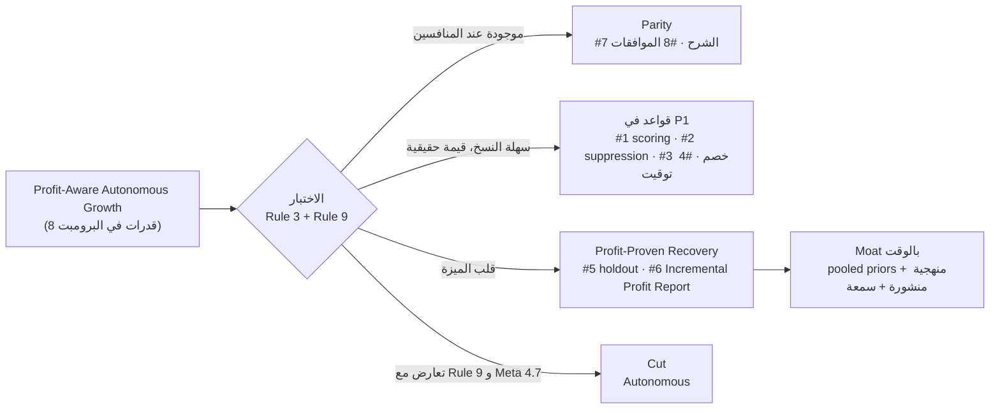
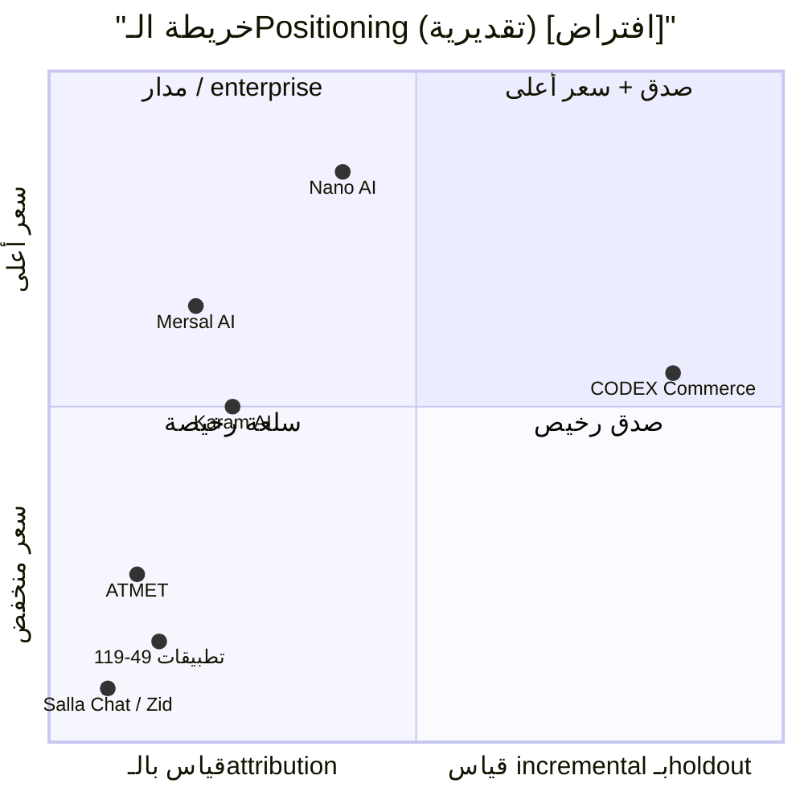

# 4. Product Positioning & Differentiation

> الحالة: مسودة v1.0 — بانتظار موافقة المؤسس (2026-10-21)

> **المراجع:** [00-master-prompt.md](../00-master-prompt.md) (القسم 3 و5)، [03-competitor-analysis.md](03-competitor-analysis.md)، [competitive-feature-matrix.md](../research/competitive-feature-matrix.md)، [cart-recovery-incrementality.md](../research/cart-recovery-incrementality.md)، [market-and-pricing.md](../research/market-and-pricing.md)، [salla-platform.md](../research/salla-platform.md)، [whatsapp-business-platform.md](../research/whatsapp-business-platform.md). كل الروابط الخارجية اتطّلع عليها 2026-10-21.
>
> **مفتاح التصنيف:** [مؤكدة] = عليها مصدر. [افتراض] = محتاجة اختبار مع عملاء أو ببيانات. [اقتراح] = توصية مننا. [غير مؤكدة] = ملقيناش دليل في أي اتجاه. في جداول المنافسين: ✅ معلن بمصدر، ⚠️ جزئي أو متناقض، ❓ غير مؤكدة (**مش** معناها "غير موجودة").

---

## 4.0 الخلاصة في 6 سطور

1. **"Profit-Aware Autonomous Growth" كما هي مكتوبة مش ميزة تنافسية قابلة للدفاع.** 2 من الـ8 عناصر (الشرح والموافقات) موجودين عند المنافسين [مؤكدة: القسم 4.1.1]، و4 (الـscoring، الـsuppression بالتكلفة، الخصم، التوقيت) قواعد سهلة النسخ [افتراض]، والـ2 الباقيين (holdout والتقرير المالي) هما بس اللي ممكن يبقوا تمايز، وكلمة "Autonomous" بتعارض Rule 9 وبتزوّد خطر تصنيف Meta (بند 4.7 في شروط Meta).
2. **الحكم: Narrow + Reframe**، مش إلغاء. الاسم الرسمي من دلوقتي **Profit-Proven Recovery**، والمنتج الأساسي اللي بنبيعه هو **Incremental Profit Report** قايم على **holdout 10% إجباري**.
3. **الـCategory:** "Profit Recovery لمتاجر سلة". مش "AI Chatbot" ولا "Omnichannel Inbox" ولا "Revenue OS" (دي رؤية، مش category نبيع بيها النهارده).
4. **الـmoat الحقيقي مش الفكرة.** Karam يقدر ينسخ الـholdout في أسابيع [افتراض]. اللي ممكن يصعب نسخه: **pooled priors** من متاجر العطور والتجميل على سلة، ومنهجية منشورة، وسمعة "الأرقام الصادقة". وده كله بيتبني بالوقت والبيانات، مش بالكود.
5. **التسعير [اقتراح]:** Proof Pilot 1,500 ريال مقدم لـ90 يوم، ثم Recover 399 / Sell & Recover 699 / Pro 999+، ورسوم Meta **pass-through** على كارت التاجر من غير markup.
6. **أخطر افتراض:** التاجر هيدفع مقابل رقم **أصغر وأصدق**. لو P0 فشل فيه، البديل زاوية "بنوفّر عليك رسائل وخصومات ملهاش لازمة" أو COD (القسم 4.9.4).

---

## 4.1 الاختبار النقدي لـ"Profit-Aware Autonomous Growth"

البرومبت (القسم 5) طالب نختبر 8 قدرات من غير ما نفترض إنها مش موجودة عند المنافسين (Rule 3). الاختبار هنا على 4 محاور: هل حد بيدّعيها؟ هل ممكن نعملها تقنيًا لتاجر سعودي صغير/متوسط؟ هل تتنسخ؟ وإمتى نبنيها؟

### 4.1.1 هل المنافسين بيدّعوها؟

| # | القدرة | Thikaa | Kasbly | Karam AI | Mersal AI | Native / عالمي | المصادر (اطّلاع 2026-10-21) |
|---|---|---|---|---|---|---|---|
| 1 | يكتشف السلات الأكثر قابلية للاسترجاع | ❓ | ❓ | ❓ (التذكير لكل السلات بنفس التوقيت) | ⚠️ (فرع "قيمة السلة > حد" بالقواعد، مش scoring) | Zid WhatsApp ⚠️ (قيمة السلة والمرحلة) | https://karamai.co/en/journeys ، https://mersal.ai/features/workflows ، https://zid.sa/en/solutions/zid-whatsapp/ |
| 2 | يحدد هل المتابعة تستاهل تكلفتها | ❓ | ⚠️ (تقرير تكلفة AI، مش قرار إرسال) | ❓ | ⚠️ ("التكلفة لكل محادثة" كتقرير بس) | ❓ | https://docs.kasbly.com/ar/analytics/overview/ ، https://mersal.ai/features/ai-agents |
| 3 | لا يقترح خصمًا يخسّر الصفقة | ❓ (الـguardrails بتمنع *اختلاق* كود خصم بس) | ⚠️ (سقف خصم ثابت يحدده التاجر) | ❓ (الخصم يدوي. Autopilot بيقترح شحن مجاني من غير منطق هامش معلن) | ❓ ("كود خصم" في mockup) | Salla native: خصم ثابت بتاريخ انتهاء. Bloomreach Loomi ⚠️ "targeted discounting" بادعاء من غير control | https://thikaa.com/features/ai-chatbot ، https://kasbly.com/ar/products/sell ، https://karamai.co/en/ ، https://www.bloomreach.com/en/use-cases/targeted-discounting-with-loomi-ai |
| 4 | يحدد التوقيت المناسب للتواصل | ⚠️ ("أوقات ذكية" من غير تفاصيل) | ❓ | ⚠️ (جدول ثابت: ساعة ثم يوم) | ⚠️ (شرط ساعات العمل) | Zid ⚠️ (إعداد التوقيت) | https://thikaa.com/features/ecommerce ، https://karamai.co/en/journeys ، https://mersal.ai/features/workflows |
| 5 | يقارن الأداء بـControl Groups | ❓ | ❓ | ❓ (الفكرة مذكورة في دليل تعليمي بس) | ❓ | ✅ عالميًا: Klaviyo (≥400k profile)، Braze (≥1,000 مستخدم)، Bloomreach، Postscript، Rejoiner | https://karamai.co/en/guides/abandoned-carts ، https://help.klaviyo.com/hc/en-us/articles/18138290642971 ، https://www.braze.com/docs/user_guide/engagement_tools/testing/global_control_group/ |
| 6 | يعرض النتايج المالية بوضوح | ⚠️ (mockup "إيرادات مستردة") | ⚠️ (Revenue/ROI من غير منهجية معلنة) | ⚠️ ("Orders after a chat") | ⚠️ ("سلات مسترجعة"، "طلبات من الحملة") | Nano AI ⚠️ (تقرير قياس بعد 30 يوم أو استرجاع رسوم الإعداد) | https://thikaa.com/features/analytics ، https://docs.kasbly.com/ar/analytics/revenue/ ، https://karamai.co/en/ ، https://www.nano-ai.net/en/services/salla-zid-whatsapp-ai |
| 7 | يشرح أسباب توصياته | ❓ | ⚠️ (اقتراحات تحسين للوكيل، فجوات معرفة) | ✅ (Autopilot: اقتراح "الخطوة التالية" + تنفيذ بضغطة) | ❓ | — | https://karamai.co/en/ ، https://docs.kasbly.com/ar/ai-agent/launch-history/ |
| 8 | Approval workflows للإجراءات الخطرة | ⚠️ (موافقة على Q&A وصلاحيات MCP، مش على الرسائل/الخصومات) | ✅ (shadow mode، مستويات استقلالية، إجراءات تحتاج موافقة) | ⚠️ (اختبار قبل الإطلاق، "القرار لك") | ⚠️ (مراجعة الطلبات المسجّلة بس) | — | https://thikaa.com/llms.txt ، https://docs.kasbly.com/ar/ai-agent/overview/ ، https://karamai.co/en/ai-agent ، https://mersal.ai/features/ai-agents |

**القراءة:** [مؤكدة كادعاءات منافسين، والتجميع اقتراح مننا]
- **#7 و#8 عند المنافسين فعلًا** (Karam وKasbly). يعني دول **Parity** إجبارية، مش ميزة.
- **#4 و#6 موجودين بشكل جزئي عند الكل.** أي منافس بيقول "توقيت ذكي" أو "إيراد مسترجع". التمايز مش في الوجود، في **الصدق والمنهجية**.
- **#1 و#2 و#3 موجودين بشكل بدائي (⚠️) عند بعضهم:** Mersal بيفرّع بقيمة السلة، وKasbly عنده سقف خصم ثابت، وKasbly وMersal بيعرضوا تكلفة المحادثة كتقرير. اللي **مش** ظاهر عند أي حد هو ربطها بالهامش وبقرار إرسال/منع. يعني الفرق في الدرجة، مش في النوع.
- **#5** مفيش دليل عليه عند الأربعة (❓). لكن **#5 موجود عالميًا** كميزة enterprise، و**Karam بيكتب عن الفكرة** في الدليل بتاعه ("not every order after it came because of it")، فاحتمال إنه يضيفها حقيقي [افتراض].

### 4.1.2 الجدوى التقنية، الدفاعية، والقرار

> أرقام الـpower من [cart-recovery-incrementality.md](../research/cart-recovery-incrementality.md) القسم 4، وكلها [افتراض: حسابات مننا، two-proportion z-test، α=0.05، power 80%].

| # | القدرة | الجدوى لتاجر سعودي صغير/متوسط (حجم البيانات والـpower) | الدفاعية (moat أو تتنسخ) | القرار (حسب الـspine) | الـPhase |
|---|---|---|---|---|---|
| 1 | السلات الأكثر قابلية للاسترجاع | **ممكن كقواعد، مش ML.** خصائص السلة (عمرها، قيمتها، تركيزها في فئة واحدة) شرحت التباين أحسن من تاريخ الشراء [مؤكدة: MSI 21-133، https://www.msi.org/wp-content/uploads/2021/09/MSI_Report_21-133-1.pdf]. تاجر بـ400–1,500 سلة مؤهلة/شهر مش هيدّي بيانات تكفي لموديل خاص بيه [افتراض] | **تتنسخ في أيام** (قواعد). ممكن تبقى أقوى بعدين لو اتغذّت من pooled data | **Keep كقواعد** (عمر السلة، القيمة، التركيز، هامش الفئة) | P1 (قواعد في E05). ML/uplift: P4+ بعد بيانات مجمّعة كفاية |
| 2 | هل المتابعة تستاهل تكلفتها | **ممكن وواضح.** التكلفة معروفة بالريال (Meta + خصم + LLM في الـcost ledger). الصعب هو "الفايدة"، ودي محتاجة #5. قرار الـsuppression يتاخد بالقواعد ويتقاس أثره بالـholdout | **تتنسخ** كمنطق. القيمة البيعية عالية لأن رسوم Meta بتزيد (+~27% في 7 شهور) [مؤكدة كاتجاه: whatsapp-business-platform.md] | **Keep.** أوضح قيمة بتتقاس بالفلوس (suppression) | P1 (E05 + E06) |
| 3 | خصم ميخسّرش الصفقة | **ممكن كسياسة، مش كتحسين.** سلة غالبًا مبتوفّرش COGS [افتراض]، فالتاجر بيدخل هامش لـ5–10 فئات (E08). الخصم بيزوّد الشراء قصير المدى [مؤكدة: MSI] بس ممكن يخسّر على الناس اللي كانوا هيشتروا كده كده (مثال توضيحي في البحث: +29% تحويل = خسارة صافية) [افتراض]. خطر تعليم العميل الحالي يستنى الخصم [مؤكدة: Anderson & Simester 2004، قطاع مختلف] | **تتنسخ** كقواعد. الجديد هو ربطها بالهامش والـholdout، مش القواعد نفسها | **Shrink لقواعد:** مفيش خصم في أول رسالة، أرضية هامش لكل فئة، لا خصم للعميل الحالي إلا بموافقة، أي حاجة فوق السقف = approval. **الـAI عمره ما بيقرر الخصم** (Rule 9، ADR-014) | P1 (policy engine + approvals في E05) |
| 4 | التوقيت المناسب | **ممكن كقاعدة افتراضية.** تذكير بعد 30–60 دقيقة **قلّل** الشراء مقابل التحكم، وبعد يوم–3 أيام كان إيجابي [مؤكدة: Li et al. 2021، DOI 10.1177/0022242920959043]. "تحسين التوقيت لكل تاجر" محتاج آلاف السلات لكل ذراع، ومستحيل للمتجر المتوسط [افتراض] | **تتنسخ** فورًا | **Keep كقاعدة:** أول رسالة ≥60 دقيقة، quiet hours 22:00–09:00 (رمضان 01:00–12:00). التحسين بالـholdout المجمّع | P1 قاعدة. التحسين المجمّع P4 |
| 5 | Control groups | **ممكن تقنيًا وبسيط** (hash ثابت على مستوى العميل). **الصعب إحصائي:** فرق 5%→7% محتاج ~10,700 عميل بتقسيم 90/10، و~6,300 بـ80/20. متجر بـ500 سلة مؤهلة/شهر ≈ **سنة** بـ80/20، و**~21 شهر** بالـholdout الافتراضي (90/10). متجر بـ3,000+ يوصل في ~2 شهر بـ80/20 و~3.5 شهر بـ90/10. لذلك التقدير الفردي في أول شهر **مستحيل**، والحل pooled priors + CUPED + win probability | **الفكرة تتنسخ في أسابيع** [افتراض]. اللي صعب يتنسخ: **pooled priors** من متاجر نفس القطاع (network effect)، ومنهجية منشورة، وسمعة. وده مشروط بـADR-009 (نتائج طلبات سلة وتخصيص المجموعات بس، مش نصوص WhatsApp) | **Keep = قلب الميزة.** holdout 10% افتراضي، **إجباري في الـpilots** | P1 (E06). pooled priors بنطاقات أضيق ≥30%: exit criterion في P4 |
| 6 | نتايج مالية واضحة | **ممكن**، بشرط التقرير يفصل 4 أرقام: إيراد منسوب، إيراد إضافي تقديري (نطاق)، تكلفة الرسائل والخصومات، ربح إضافي تقديري. الربح محتاج هامش الفئات (E08) | **العرض يتنسخ.** الرقم الصادق نفسه صعب يتنسخ من غير #5 | **Keep = المنتج الأساسي** (Incremental Profit Report) | P1: يدوي أول 4 أسابيع (SQL + template)، ثم صفحة واحدة في المنتج (E07) |
| 7 | شرح أسباب التوصيات | **سهل** لو القرارات بالقواعد: كل رسالة اتبعتت أو اتمنعت ليها "reason code" مقروء (مثلًا: "اتمنعت: السلة أقل من 80 ريال وهامش الفئة 15%") | **تتنسخ، وموجودة** (Karam Autopilot) | **Parity** | P1 (reason codes للقواعد). شرح بالـAI للتحليلات: P5–P6 (M14) |
| 8 | Approval workflows | **سهل وإجباري.** موافقة على أي خصم فوق السقف، وأي خصم لعميل حالي، وAssisted mode للـagent ≥4 أسابيع قبل Scoped Autonomous | **موجودة** (Kasbly) | **Parity إجبارية** | P1 (خصومات). P2 (Assisted mode للـagent، E11) |
| — | "Autonomous" | تعارض مباشر مع Rule 9، وبتزوّد خطر Meta 4.7، وخطر الهلوسة | — | **Cut** من الاسم والـMVP | — |

### 4.1.3 الحكم النهائي على الميزة

| السؤال | الإجابة |
|---|---|
| هل الميزة جديدة؟ | **لأ كفكرة.** الـholdouts موجودة عالميًا (Klaviyo، Braze، Bloomreach، Postscript) [مؤكدة]. **الجديد الممكن** إنها تبقى **default ومفهومة ومتاحة لتاجر سلة المتوسط بالعربي**، ومربوطة بالهامش والتكلفة [افتراض] |
| هل ممكنة للمتجر الصغير؟ | **جزئيًا.** التقدير الفردي محتاج حجم. للمتجر المتوسط بنعتمد على pooled estimate من متاجر شبهه، ونقول ده بوضوح [افتراض] |
| هل قابلة للدفاع؟ | **بالوقت والبيانات بس.** أول 12–18 شهر السبق في عدد التجار في نفس الـvertical وفي المنهجية المنشورة. لو Karam سبقنا لنفس الـvertical بنفس الصدق، الميزة تضعف جامد [افتراض] |
| الاسم الجديد | **Profit-Proven Recovery.** "Profit-Aware Autonomous Growth" يتذكر بس كأصل الفكرة |

---

## 4.2 الـPositioning Statement النهائي [اقتراح، يتختبر في P0]

> لمتاجر العطور والتجميل على سلة اللي بتصرف على رسائل واتساب وخصومات من غير ما تعرف عائدها الحقيقي: **CODEX Commerce منصة مبيعات واسترجاع على واتساب الرسمي، بتقولك كام ربحت فعلًا بسببها.** كل تدخّل له مجموعة مقارنة، وكل خصم محكوم بأرضية هامش، وكل رد مبني على كتالوج متجرك الحي. بعكس الأدوات اللي بتحسب أي طلب بعد الرسالة على إنه نجاح.

تفكيك الـstatement:

| العنصر | المحتوى | ليه |
|---|---|---|
| For (الشريحة) | متاجر العطور والتجميل والـPersonal Care على سلة، 300–3,000 طلب/شهر | عمق رأسي ضد الـagent العام، وحجم كافي للقياس (القسم 4.4) |
| Who (الألم) | بيدفعوا رسوم Meta وخصومات ومش عارفين العائد | [افتراض] الألم الأساسي ([القسم 2](02-critical-assessment.md) §2.1)، يتختبر في P0 |
| Category | Profit Recovery لمتاجر سلة | القسم 4.3 |
| Key benefit | "كام ربحت فعلًا بسببنا" | مفيش منافس من الأربعة بيدّعيها بشكل مؤكد (❓). **تحفّظ:** Nano AI بيوعد بـ"تقرير قياس بعد 30 يوم" في باقة Growth (⚠️، منهجيته غير مؤكدة) [مؤكدة: https://www.nano-ai.net/en/services/salla-zid-whatsapp-ai]، فالمساحة مش فاضية تمامًا |
| Reasons to believe | holdout، أرضية هامش، كتالوج حي، WhatsApp رسمي فقط | كل واحدة ليها proof point لازم نكسبه (القسم 4.6) |
| Unlike | الأدوات اللي بتعرض attribution بـlast-touch | Klaviyo نافذة 5 أيام، Karam "orders after chat" [مؤكدة] |

---

## 4.3 اختيار الـCategory

| الـCategory المرشّحة | مين واخدها | مكسبنا لو اخترناها | خسارتنا | القرار |
|---|---|---|---|---|
| AI Chatbot / AI Agent لواتساب | Karam، ATMET، Thikaa، Meta Business Agent ($2/1M token) [مؤكدة] | التاجر بيفهمها فورًا | سلعة، حرب أسعار (ATMET 49–249 ريال)، وخطر تصنيف Meta كـAI Provider (بند 4.7 في شروط Meta) | **مرفوضة** |
| Omnichannel / Shared Inbox | Thikaa، Mersal، Wati، respond.io | — | مزدحمة، ومحتاجة قنوات مش في الـMVP | **مرفوضة** |
| WhatsApp Marketing / Cart Recovery | Salla Chat (~0.16 ريال/رسالة)، Zid WhatsApp (مجاني في Professional)، تطبيقات 49–119 ريال [مؤكدة] | سهلة البيع كـwedge | **سقف سعر نفسي 49–119 ريال** [افتراض] والمنصة نفسها بتقدمها | **مرفوضة كـcategory**، ومقبولة كـ**wedge** جوه الـcategory بتاعتنا |
| Revenue OS / AI Revenue Operating System | — | الرؤية طويلة المدى | مفيش منتج يسندها النهارده، والتاجر الصغير مش بيشتري "OS" | **مؤجلة** لـP6 (اسم المنصة يفضل CODEX Revenue OS، لكن مش رسالة البيع) |
| **Profit Recovery لمتاجر سلة** | ❓ مفيش منافس محلي بيدّعيها بشكل مؤكد | بتنقل المقارنة من "سعر الرسالة" لـ"ربح الشهر"، وبتبرر سعر 399–699 | محتاجة تعليم السوق، وبتعتمد على افتراض إن التاجر عايز الصدق | **المختارة** [اقتراح] |

**قاعدة تسمية:** في أي landing أو listing على سلة، العنوان الرئيسي عن **الربح الإضافي**، والـAI بيظهر كـ"أداة" جوه المنتج، مش كهوية المنتج (بند 4.7 في شروط Meta).

---

## 4.4 الـICP والـAnti-ICP

### 4.4.1 الـICP (للـpilot وحتى P3)

| البُعد | التحديد | التصنيف |
|---|---|---|
| المنصة | **سلة فقط** حتى P4 | [اقتراح] |
| القطاع | **العطور والـBeauty والـPersonal Care أولًا.** الـFashion في المقابلات للمقارنة بس، والـagent مش متضبط ليه قبل P4 (مقاسات ومرتجعات) | [اقتراح] |
| الحجم | 300–3,000 طلب/شهر، و**≥400 سلة مؤهلة (فيها موبايل) في الشهر** | [اقتراح]؛ نسبة التجار اللي عندهم الحجم ده [افتراض] |
| السلوك | بيستخدم WhatsApp فعلًا (يدوي أو Karam أو Salla Chat أو تطبيق رخيص)، وبيصرف على خصومات أو رسائل | [افتراض] |
| صاحب القرار | المالك أو مدير التسويق/العمليات، وبيبص على الهامش | [افتراض] |
| مؤشرات جاهزية | يعرف هامشه التقريبي لـ5–10 فئات، يقبل holdout 10%، يقدر يضيف كارت لـMeta (Tech Provider مالوش credit line [مؤكدة: https://developers.facebook.com/docs/whatsapp/solution-providers]) | [افتراض] يتسأل في كل مقابلة |
| حجم السوق | SAM حوالي 2,000–5,700 متجر على سلة وزد، والهدف الواقعي 50–150 متجر بيدفع في 18 شهر | [افتراض: market-and-pricing.md] |

### 4.4.2 الـAnti-ICP (منبعلهمش دلوقتي، ونقولها بصراحة)

| الشريحة | ليه لأ | التصنيف |
|---|---|---|
| أقل من 300 طلب/شهر | سقف السعر عندهم 49–119 ريال، والحجم مش كفاية لأي قياس، والدعم هياكل الهامش | [افتراض] |
| تاجر عايز "يبعت لكل الناس" (bulk blasts) أو بيستخدم ربط QR غير رسمي ومش ناوي يسيبه | Rule 8، وبيعرّض جودة الأرقام والـportfolio للخطر | [اقتراح] |
| تاجر عايز الـAI يقرر الخصومات لوحده | Rule 9 | [اقتراح] |
| تاجر رافض أي holdout | المنتج كله قايم عليه. نقبل نزّل النسبة لـ5% بعد الـpilot، لكن مش صفر | [اقتراح] |
| Enterprise / براندات بفروع وERP | تقيلة على فريق صغير، ومفيش طلب مثبت (Enterprise في P6) | [اقتراح] |
| متاجر Fashion كأولوية | الـagent محتاج منطق مقاسات ومرتجعات قبل P4 | [اقتراح] |
| متاجر برّه سلة (Zid، Shopify، Woo) | Zid في P4، Shopify/Woo في P5 | [اقتراح] |
| وكالات عايزة White label | مرفوض لحد شهر 24 | [اقتراح] |
| تاجر مش مستعد يدّي هامش ولو تقريبي | من غيره، "الربح" مش ممكن يتحسب، والتقرير يرجع "إيراد" زي المنافسين | [افتراض: احتكاك الـonboarding لازم يتقاس] |

---

## 4.5 الـMessage Hierarchy

> كل الصياغات هنا [اقتراح] ولازم تتختبر في مقابلات P0 (gate 3: ≥60% بيفضّلوا "ربح إضافي صادق" على "إيراد مسترجع"). الصياغة الموجّهة للتاجر مكتوبة بعربي مبسط قريب من السعودي، وهتتراجع مع متحدث سعودي قبل أي نشر.

### المستوى 1: Core message (جملة واحدة)
> **"اعرف كم ربحت فعلًا من رسائل واتساب، مو بس كم طلب جاء بعدها."**

### المستوى 2: Elevator pitch (حوالي 30 ثانية)
> "أغلب أدوات واتساب تحسب أي طلب يجي بعد الرسالة على إنه نجاح. لكن جزء من العملاء كانوا بيرجعون ويشترون بدون رسالة، وأنت تدفع لـMeta وتعطي خصم على طلبات كانت بتجيك أصلًا. CODEX Commerce يشتغل على واتساب الرسمي مع متجرك في سلة: يرسل للسلات اللي تستاهل، ويمنع الخصم اللي يأكل هامشك، ويخلي جزء صغير من العملاء بدون رسالة كمجموعة مقارنة. وكل شهر يعطيك تقرير واحد: كم ربح إضافي جاك بسببنا، وكم كلفك. نبدأ بـ90 يوم تجربة مدفوعة، ولو التقدير طلع مو إيجابي، الشهر الثالث علينا."

### المستوى 3: Value proposition والـpillars

| الـPillar | الوعد للتاجر | الـReason to believe | الـProof point المطلوب (القسم 4.6) |
|---|---|---|---|
| 1. ربح صادق | "رقم ربح إضافي تقديري، في صورة نطاق، يتحسّن مع الوقت" | holdout 10% على مستوى العميل، pooled estimate من متاجر شبهك | أول pooled estimate بـinterval معلن (P1) + منهجية منشورة |
| 2. صرف أقل على اللي ملهوش لازمة | "ما ترسل ولا تخصم إلا لما تستاهل" | قواعد suppression، مفيش خصم في أول رسالة، أرضية هامش لكل فئة | توفير رسائل وخصومات بالريال في تقارير الـpilots |
| 3. بيع جوه المحادثة من غير مفاجآت | "يرد من كتالوجك الحي، وما يخترع سعر ولا خصم" | validator حتمي، Assisted mode ≥4 أسابيع، handoff لموظف | دقة سعر ومخزون 100% على ≥300 حالة سعودي (P2) |
| 4. آمن ورسمي | "واتساب الرسمي فقط، وموافقات العملاء محفوظة" | Tech Provider، consent ledger، opt-out <24 ساعة، quiet hours | صفر تقييد من Meta في P1، DPA عربي منشور |

### الرسالة حسب الشخص

| الشخص | اللي يهمه | الرسالة | الدليل اللي هيطلبه |
|---|---|---|---|
| المالك | الربح والكاش | "كم ريال ربح إضافي، وكم صرفت عشانه" | التقرير الشهري، ضمان الـpilot |
| مدير التسويق | إثبات أثر شغله | "رقم تقدر تدافع عنه قدام المالك" | منهجية الـholdout، مقارنة بالرقم القديم |
| مدير العمليات / خدمة العملاء | وقت الفريق والمشاكل | "الموظف يكمّل على تطبيق WhatsApp Business، والـAI يحوّل له لما يلزم" | Coexistence (دعمه في السعودية [غير مؤكدة]، يتأكد في spikes الـP0b قبل ما نوعد بيه)، handoff queue |

### ممنوع في أي رسالة تسويقية (القائمة الموحّدة للـBlueprint، ومتكررة في [القسم 14](14-key-decisions.md) D-G04)

| الجملة الممنوعة | السبب |
|---|---|
| "AI Chatbot" أو "AI Agent" كعنوان رئيسي | خطر تصنيف Meta كـAI Provider (بند 4.7 في شروط Meta) [مؤكدة: الشرط، https://www.facebook.com/legal/Meta-Terms-for-WhatsApp-Business-Platform؛ غير مؤكدة: تطبيقه علينا] |
| "أول من يقيس الـincrementality" | Klaviyo وBraze وBloomreach وPostscript عندهم holdouts، وKaram بيكتب عن الفكرة [مؤكدة] |
| "بياناتك كلها في السعودية" | WhatsApp Cloud API مفيهوش تخزين في السعودية، والـLLMs بتعالج برّه المملكة [مؤكدة] |
| "Autonomous" | Rule 9، ومش قيمة إضافية |
| "رقم ربحك الدقيق من أول شهر" | مستحيل إحصائيًا للمتجر المتوسط [افتراض: حسابات power] |
| "% استرجاع" من غير holdout | نفس الخطأ اللي بننتقده |

الصيغة المسموحة للبيانات: **"PDPL by design + البيانات الأساسية مستضافة في السعودية (بعد ترحيل Dammam)"**.

### إيه اللي بنوعد بيه وإيه اللي مش بنوعد بيه

| بنوعد | مش بنوعد |
|---|---|
| تقدير صادق للربح الإضافي كنطاق مع win probability، بيتحسن مع الوقت، ومبني على بيانات متاجر شبهك | رقم incrementality خاص بالمتجر في أول شهر |
| تقرير بيفصل 4 أرقام: منسوب، إضافي تقديري، تكلفة، ربح إضافي تقديري | uplift model لكل تاجر |
| خصومات محكومة بقواعد وموافقات | COGS لكل SKU، أو قرارات خصم مستقلة بالـAI |
| واتساب رسمي فقط | "مفيش أي خطر حظر" (Meta هي اللي بتقرر) |

---

## 4.6 الـProof Points اللي لازم نكسبها

الـpositioning ده **وعد من غير دليل** لحد ما نكسب الأدلة دي. ترتيبها مهم: من غير 1–3، أي تسويق للـcategory يبقى ادعاء زي ادعاءات المنافسين.

| # | الـProof point | المقياس | الـPhase | لو فشل |
|---|---|---|---|---|
| 1 | التجار بيدفعوا قبل ما نبني | ≥5 Proof Pilots مدفوعة مقدمًا (1,500 ريال) من ≥8 LOI | P0 | Kill/pivot لـ"التوفير" أو COD |
| 2 | الصدق ليه طلب | ≥60% بيفضّلوا "ربح إضافي صادق" على "إيراد مسترجع" | P0 | نقدّم زاوية التوفير (pillar 2) كرسالة أولى |
| 3 | الحجم يكفي | ≥5 متاجر عندها ≥400 سلة مؤهلة/شهر (من Cart Truth Audit، E17) | P0b | نوسّع الـICP لأعلى، أو نعتمد pooled بس |
| 4 | أول تقدير مجمّع | ≥4,000 سلة مؤهلة اتعالجت (علاج + تحكم)، وتقدير بـinterval معلن | P1 | لو الأثر ≈ صفر: pivot حسب Kill criteria. **تنبيه [افتراض: حسابات power]:** 4,000 أقل من الـ~10,700 اللي محتاجينها لكشف فرق نقطتين بـ90/10، فالـinterval الأول هيبقى واسع وغالبًا هيعدّي الصفر. ده متوقع، ولازم نقوله للتجار، ومينفعش يتقري كـ"فشل" ولا كـ"نجاح" |
| 5 | التقرير بيغيّر قرارات | ≥3 تجار غيّروا قرار خصم أو إرسال بسبب التقرير | P1 | التقرير "لطيف" بس مش منتج. نراجع شكله |
| 6 | الناس بتجدد بسعر كامل | ≥3 من أول 5 جددوا بسعر كامل ≥399 | P1 | التسعير أو القيمة غلط (القسم 4.9) |
| 7 | الامتثال | صفر تقييد أو quality warnings من Meta، 100% opt-out <24 ساعة | P1 | وقف التوسع لحد ما يتصلح |
| 8 | الـagent مبيخترعش | دقة سعر ومخزون 100% على ≥300 حالة سعودي، وصفر حوادث خصم أو سعر غلط | P2 | مفيش Scoped Autonomous |
| 9 | case studies قابلة للنشر | 3 case studies بأسماء (بموافقة) وبـholdout | P2–P3 | نبيع بالـpooled estimate من غير أسماء |
| 10 | منهجية منشورة | نسخة عامة من ADR-013 (holdout، hash assignment، pooled estimates، win probability) | قبل P3 | — |
| 11 | الـnetwork effect حقيقي | pooled priors بنطاقات ثقة أضيق ≥30% من تقدير التاجر لوحده | P4 | الـmoat أضعف من المتوقع. نعتمد على السرعة والعمق الرأسي |

---

## 4.7 Table Stakes مقابل التمايز الحقيقي

| الطبقة | العناصر | ليه | هل بنسوّق بيها؟ |
|---|---|---|---|
| **Table stakes (لازم تبقى موجودة وإلا التاجر مش هيبص علينا)** | WhatsApp رسمي، ربط سلة، استرجاع سلات، handoff لموظف، consent/opt-out، ردود بالعربي، `checkout_url` للعميل، شرح بسيط للقرارات (#7)، موافقات (#8) | كل المنافسين الأربعة عندهم أغلبها، وSalla/Zid بيقدموا الاسترجاع native [مؤكدة: competitive-feature-matrix.md] | لأ، بنذكرها كمسلّمات |
| **Parity بتنفيذ أنضف** | AI Sales Agent محصور في الكتالوج بـvalidator، Assisted mode، Inbox lite مع Coexistence | Karam عنده agent وcart وpayment links وCOD [مؤكدة] | بشكل ثانوي ("ما يخترع سعر") |
| **تمايز ممكن، سهل النسخ** | قواعد scoring للسلات (#1)، suppression بالتكلفة (#2)، خصم بأرضية هامش (#3)، توقيت افتراضي مبني على بحث (#4) | ❓ عند الأربعة، لكن قواعد تتنسخ في أيام [افتراض] | أيوه، كـ"reasons to believe" جوه pillar 2 |
| **التمايز الأساسي** | holdout افتراضي وإجباري (#5) + Incremental Profit Report (#6) | ❓ عند الأربعة محليًا، و✅ عالميًا للـenterprise بس (Klaviyo ≥400k profile) | **أيوه، ده العنوان** |
| **Moat (بيتبني بالوقت)** | pooled priors لكل قطاع على سلة، منهجية منشورة، سمعة الأرقام الصادقة، عمق رأسي في العطور (نوتات، مناسبات، ثبات من بيانات التاجر) | محتاج تجار كتير في نفس الـvertical وقت طويل [افتراض] | بعد P4 لما يبقى فيه دليل ("مبني على بيانات X متجر عطور") |

> مواقع المنافسين على الخريطة تقديرية [افتراض] مبنية على الأسعار المعلنة في [market-and-pricing.md](../research/market-and-pricing.md) وطريقة القياس المعلنة في ملفات المنافسين. مش قياس.

---

## 4.8 تقييم نماذج الإيراد الـ8

| النموذج | القرار | التوقيت | السبب |
|---|---|---|---|
| Monthly Subscriptions | **Now** | P1 | الأساس. بيتباع مباشرة (Moyasar/Tap) في P1–P2، وعن طريق Salla billing من P3 |
| Usage-Based Pricing | **Now (metering) / Later (overage billing)** | metering P1، billing P3–P4 | الـService بقت بفلوس بعد 1,000 رسالة/رقم/شهر من 2026-10-01 [مؤكدة: https://developers.facebook.com/docs/whatsapp/pricing]، وتكلفة الـLLM متغيرة، فلازم نقيس من أول يوم. **لكن** مسموحية usage billing عن طريق سلة [غير مؤكدة: salla-platform.md] |
| Annual Subscriptions | **Later** | P3 | بخصم = شهرين، بعد قياس churn ≥3 شهور. الاستثناء: الـProof Pilot بيتخصم من أول اشتراك سنوي |
| Premium AI Agents | **Later، ومدمج في الباقات** | P4–P5 | الـAI كـadd-on منفصل هو نقطة الضعف اللي بنهاجم بيها Karam (149/399 ريال إضافي [مؤكدة: karam-ai.md]). الـagent جوه Sell & Recover بحصة |
| Agency Partnerships | **Later، referral فقط** | P3 (referral)، P5 (dashboard) | عمولة محددة بمدة. Mersal (تبع وكالة "مكاسب") بيوضح إن الوكالة ممكن تبقى منافس [مؤكدة: mersal-ai.md] |
| Enterprise Plans | **Later** | P6 | مفيش طلب مثبت، وتقيل على فريق صغير (SLA، RBAC متقدم، deployment options) |
| Custom Integrations | **Reject** لحد P5 | — | فخ الخدمات (Rule 12). استثناء: مدفوع بالكامل وبيتحول لـfeature عامة |
| White Label | **Reject** لحد شهر 24 على الأقل | P6 gated | بيضعف البراند، ويعقّد علاقتنا بـMeta (مين الـTech Provider ومين المسؤول عن الجودة)، وبيحوّل الـmoat (سمعة الأرقام) لبراند حد تاني |
| (إضافي) Outcome fee 2–5% على الربح الإضافي المثبت | **Later، اختياري** | P4 | Zoko Sello بياخد 3% من قيمة الطلب [مؤكدة: https://www.zoko.io/pricing]. عندنا هيبقى على **الإضافي المثبت** بس، ومحتاج pooled estimate موثوق الأول. بيحوّل الميزة نفسها لنموذج تسعير |

---

## 4.9 فرضية التسعير بالريال [اقتراح، تتختبر في P0–P1]

### 4.9.1 الباقات

الأسعار شهرية، من غير VAT. **رسوم Meta دايمًا على WABA وكارت التاجر مباشرة، من غير markup.**

| الباقة | السعر | لمين | المحتوى | الحدود |
|---|---|---|---|---|
| **Proof Pilot** | **1,500 ريال مقدم لـ90 يوم** | أول 5–10 design partners | holdout إجباري، تقرير أسبوعي، onboarding بإيدنا (WABA، templates، BV)، case study | بيتخصم من أول اشتراك سنوي. **ضمان:** لو التقدير المجمّع للربح الإضافي طلع مش موجب، الشهر التالت مجاني (تعريف "مش موجب" وآلية الاسترداد أو الرصيد لسه مفتوحين، شوف 4.12 ملاحظة 6). **الضمان نفسه مش ابتكار:** Nano AI بيرجّع رسوم الإعداد لو تقرير القياس متسلّمش بعد 30 يوم [مؤكدة: https://www.nano-ai.net/en/services/salla-zid-whatsapp-ai ، 2026-10-21]. الفرق إن ضماننا مربوط بنتيجة holdout مش بتسليم تقرير |
| **Recover** | **399** | 300–800 طلب/شهر | استرجاع بـholdout، Incremental Profit Report، handoff inbox | لحد **1,500 سلة مؤهلة**/شهر. رقم WhatsApp واحد [اقتراح] |
| **Sell & Recover** | **699** | 800–3,000 طلب/شهر | فوق Recover: AI Sales Agent | حصة **1,000 محادثة AI**/شهر. الزيادة **0.25 ريال/محادثة** من P3/P4. حد السلات المؤهلة [اقتراح: 4,000/شهر، يتأكد في P1] |
| **Pro** | **999+** | 3,000+ | حجم أكبر، COD، أكتر من رقم، مراجعة شهرية، أولوية دعم | حسب الحجم. الـspine مش محدد حصة محادثات؛ [اقتراح] 2,000 محادثة AI/شهر زي ما [القسم 11](11-budget-timeline.md) افترض، ويتأكد ببيانات P2 |

**مرجع السوق** [مؤكدة: market-and-pricing.md و https://apps.salla.sa/en/app/864133974]: Karam فعليًا 268–698 ريال مع الـAI، وتطبيقات الاسترجاع الرخيصة 49–119، وZid WhatsApp مجاني في Professional أو 109. أي سعر فوق 700 لازم يبرره دليل مالي.

**ليه 399 مش 299:** [افتراض] تحت 299 بندخل منطقة Karam وتطبيقات الـ49 ريال، وبعد عمولة سلة ~30% الـAI والدعم مش هيغطوا نفسهم. و399 أعلى من أقل سعر فعلي لـKaram (268) بحوالي 50%، وجوه نطاقه (268–698). الفرق ده لازم التقرير يبرّره، وده بالظبط اللي اختبار P0 بيقيسه.

### 4.9.2 الـUnit economics لكل باقة [افتراض]

| الباقة | السعر | الصافي بعد عمولة سلة ~30% | سقف AI COGS + دعم (≤35% من الصافي) | AI COGS المتوقع |
|---|---|---|---|---|
| Recover | 399 | ~280 | ~98 | قليل جدًا (مفيش agent، الـrecovery workflows حتمية) |
| Sell & Recover | 699 | ~490 | ~171 | 1,000 محادثة × ≤$0.03 = ≤~112 ريال في أسوأ حالة، و~19 ريال بموديل رخيص ($0.005) |
| Pro | 999+ | ~700 | ~245 | Medium–Heavy: $15–60 (56–225 ريال) نطاق تخطيط |
| Overage | 0.25 ريال/محادثة | ~0.175 | — | ≤~0.11 ريال (سقف $0.03) |

- الـpilots والعقود السنوية تتباع **مباشرة** (Moyasar/Tap) فمفيش عمولة سلة عليها [افتراض: مسموحية ده لتطبيق public بعد P3 غير مؤكدة].
- القاعدة: **AI COGS + دعم ≤35% من الصافي**، وgross margin ≥60% كـexit criterion في P3.
- **نقطة ضعف [افتراض: حساب]:** الـoverage (0.25 ريال) بعد عمولة سلة صافيه ~0.175، وتكلفته عند السقف ($0.03) ~0.11، يعني الـAI COGS ≈ 64% من صافي المحادثة الإضافية، وده بيكسر قاعدة الـ35%. يا إما سعر الـoverage يتراجع (~0.35–0.40، قريب من Karam 0.30–0.40 [مؤكدة: karam-ai.md])، يا إما تكلفة المحادثة الفعلية تبقى قريبة من $0.005 مش $0.03. يتحسم من بيانات P2.
- **في Sell & Recover أسوأ حالة:** 112 ريال AI من سقف 171 بيسيب ~59 ريال بس للدعم، يعني أقل من ساعة دعم في الشهر. الباقة دي مربحة بس لو الـrouting للموديل الرخيص اشتغل [افتراض].

### 4.9.3 تمرير رسوم WhatsApp (pass-through)

| البند | مين بيدفع | إزاي | ليه |
|---|---|---|---|
| رسائل Marketing (كل رسائل الاسترجاع) | التاجر لـMeta مباشرة | كارت التاجر على WABA بتاعته (مسار Tech Provider). Multi-Partner مع Solution Partner كبديل لو الكارت طلع عائق | Tech Provider مالوش credit line [مؤكدة: https://developers.facebook.com/docs/whatsapp/solution-providers]. وبيخلّي اشتراكنا مش متأثر بزيادات Meta |
| Service بعد أول 1,000/رقم/شهر | التاجر لـMeta | نفس الكارت | [مؤكدة] من 2026-10-01: https://developers.facebook.com/docs/whatsapp/pricing/updates-to-pricing. مهم لـSell & Recover: لو المحادثة ~6 ردود Service [افتراض]، 1,000 محادثة ≈ 6,000 رسالة، يعني ~5,000 × 0.040 ≈ **~200 ريال/شهر إضافية** على التاجر |
| Utility (COD مثلًا) | التاجر لـMeta | نفس الكارت | التصنيف لازم يتأكد لكل template [افتراض] |
| LLM | إحنا | جوه الباقة + overage | الـmetering في `AiGateway` (E10، E13) |

**مثال تكلفة Meta على التاجر** [افتراض]: متجر بـ1,000 سلة مؤهلة × رسالتين marketing. الـspine بيقدّرها **~320 ريال/شهر** (على سعر ~0.16 ريال، وهو سعر Salla Chat بالنقاط). على سعر Meta المباشر 0.0576 USD (~0.216 ريال) [مؤكدة، مصادر ثانوية] بعد استبعاد 10% holdout: 900 × 2 × 0.216 ≈ **~390 ريال**. يعني تكلفة Meta **تقرب من سعر Recover نفسه (399)، وتعدّيه من غير holdout (~432)**. والتكلفة الكلية اللي التاجر شايفها لـSell & Recover ممكن توصل ~699 + ~390 + ~200 (Service) ≈ **~1,300 ريال/شهر** [افتراض]، ولازم صفحة البيع تقولها صراحةً. وده سبب إن الـsuppression (pillar 2) قيمة بيعية مش تفصيلة. (التعارض في الرقم متسجّل في "ملاحظات للمراجعة").

**إزاي نعرضها للتاجر:** في التقرير الشهري سطر "تكلفة Meta المقدّرة" من الـcost ledger (E06) جنب الربح الإضافي، حتى لو الفلوس مش بتعدّي علينا.

### 4.9.4 إزاي نختبر التسعير

| الاختبار | إمتى | الطريقة | معيار النجاح |
|---|---|---|---|
| الصرف الحالي | P0a (كل مقابلة) | نسأل عن: اشتراك التطبيقات، رسوم Meta/نقاط سلة، الخصومات الشهرية على السلات | نقدر نحسب "الصرف اللي ممكن نوفّره" لكل متجر |
| تفضيل الرسالة | P0a | عرض صفحتين: "ربح إضافي صادق" مقابل "إيراد مسترجع" (و"توفير" كتالت) | ≥60% يفضّلوا الصدق (gate 3) |
| الاستعداد للدفع الحقيقي | P0b | Proof Pilot 1,500 ريال مقدم، مش LOI بس | ≥5 دفعوا (gate 2). أقل من 5 = Kill/pivot |
| حساسية السعر | P0a | سؤال مباشر عن 399 و699 بعد شرح الـpilot (من غير Van Westendorp كامل، العينة صغيرة). **مقارنة صريحة بـKaram Starter 119** (فيه journey السلة المتروكة من غير AI [مؤكدة: https://karamai.co/en/pricing ، 2026-10-21])، لأن Recover 399 ≈ 3.4 ضعفه ([القسم 3](03-competitor-analysis.md) §3.9) | ≥50% من الـICP يقبلوا 399 كسعر بعد الـpilot [اقتراح] |
| التجديد بسعر كامل | نهاية P1 | التجديد بعد الـpilot من غير خصم | ≥3 من أول 5 جددوا بـ≥399 (exit criterion P1) |
| ضمان الشهر التالت | P1 | نتابع كام تاجر استخدمه | لو >50% استخدموه، المشكلة في المنتج أو الـICP مش في السعر |
| Overage والـagent | P2–P3 | نقيس استهلاك المحادثات الفعلي لكل tenant | ≥70% من عملاء Sell & Recover جوه الـ1,000 محادثة |
| Listing على سلة | P3 | trial → paid، وchurn شهري | logo churn ≤5%/شهر، MRR 15–30 ألف |

**مسارات بديلة لو التسعير فشل [اقتراح]:** (1) زاوية "التوفير": سعر مربوط بالرسائل والخصومات اللي اتمنعت. (2) COD Confirmation كـwedge (Karam عنده [مؤكدة]، فلازم يتباع بالقياس برضه). القرار حسب Kill criteria في [07-master-development-phases.md](07-master-development-phases.md).

---

## 4.10 الـGTM Motion (باختصار)

| المرحلة | الـMotion القائد | ليه | اللي مش بنعمله |
|---|---|---|---|
| P0–P1 | **Founder-led sales** + Cart Truth Audit كـlead magnet | 60 متجر مستهدف، المنتج محتاج شرح، وبيع الصدق محتاج ثقة شخصية [اقتراح] | إعلانات مدفوعة، self-serve |
| P2 | Founder-led + case studies من الـpilots | الدليل لسه بيتبني | — |
| P3 | **Ecosystem (Salla App Store)** + referral من الوكالات | التوزيع الطبيعي لتطبيقات سلة، والـlisting هو القناة | White label، reseller |
| P4–P5 | Ecosystem (Salla + Zid) + Partners + محتوى مبني على benchmarks القطاع | الـpooled data تبقى مادة تسويق | Enterprise sales |

التفصيل في [12-first-90-days.md](12-first-90-days.md) و[07-master-development-phases.md](07-master-development-phases.md).

---

## 4.11 أكبر مخاطر الـPositioning

| الخطر | الاحتمال / الأثر | التخفيف |
|---|---|---|
| التاجر بيفضّل الرقم الكبير (attribution) على الصادق | [افتراض] متوسط–عالي / قاتل للـpositioning | التقرير بيعرض الرقمين جنب بعض (منسوب وإضافي)، واختبار زاوية "التوفير" بالتوازي في P0 |
| الرقم الصادق طلع ≈ صفر لأغلب المتاجر | [افتراض] متوسط / عالي | ده نفسه insight بيوفّر فلوس (suppression). لو حصل في P1 = pivot حسب Kill criteria |
| Karam ينسخ الـholdout والـmargin logic | [افتراض] عالي / متوسط | السرعة، benchmarks قطاعية، منهجية منشورة، سمعة |
| سلة تطلق holdout أو AI agent native | [افتراض] متوسط–عالي في 12–24 شهر / عالي | Commerce Adapter، Zid في P4، عمق رأسي، بيانات مجمّعة |
| Meta تصنّفنا AI Provider (بند 4.7 في شروط Meta) | [غير مؤكدة] منخفض–متوسط / قاتل | positioning كـcommerce/profit platform، الـrecovery شغال من غير AI (P1)، رأي قانوني وسؤال مكتوب لـMeta في P0 |
| الـpooling يحوّلنا من Processor لـController تحت PDPL | [افتراض] / عالي | ADR-009 (نتائج سلة وتخصيص المجموعات بس)، بند DPA، رأي قانوني |

---

## 4.12 ملاحظات للمراجعة

1. **تعارض رقمي في الـspine (تكلفة Meta):** الـspine (7.2) بيقول "1,000 سلة × رسالتين ≈ 320 ريال/شهر"، والرقم ده محسوب على ~0.16 ريال (سعر Salla Chat بالنقاط). نفس الجدول بيدّي سعر Meta المباشر 0.0576 USD ≈ 0.216 ريال، يعني ~432 ريال من غير holdout و~390 بعد 10% holdout. التزمنا برقم الـspine وذكرنا الحساب البديل. **توصية:** الـspine يوضّح إن 320 مبني على سعر سلة، أو يتحدّث لـ~390–430.
2. **وصف الـProof Pilot:** الـspine بيقول 1,500 ريال "≈50% من Sell & Recover". 3 شهور × 699 = 2,097، فالـ1,500 ≈ **72%** منه. الـ50% بتنطبق على Pro (3 × 999 = 2,997). التزمنا بالسعر (1,500) وشلنا الوصف. **توصية:** تتعدّل الصياغة لـ"≈70% من Sell & Recover لـ90 يوم".
3. **حدود إضافية مش في الـspine:** اقترحنا "رقم واحد" لـRecover وسقف 4,000 سلة مؤهلة لـSell & Recover. متعلّمين [اقتراح] ومحتاجين قرار المؤسس، أو يتحددوا من بيانات P1.
4. **قاعدة التوقيت ≥60 دقيقة:** Li et al. 2021 لقوا إن التذكير بعد 30–60 دقيقة **قلّل** الشراء، والأثر الإيجابي كان بعد يوم–3 أيام. يعني 60 دقيقة على **حافة** النافذة الضارة. التزمنا بالـspine كقاعدة افتراضية، لكن **نوصي** إن P1 يختبر ذراعين (60 دقيقة مقابل ~24 ساعة) جوه الـholdout المجمّع، أو يتراجع في ADR-013.
5. **باقة Recover والـpower:** متجر بـ500 سلة مؤهلة/شهر محتاج ~سنة لتقدير فردي بـ80/20، و~21 شهر بالـ90/10 الافتراضي. يعني عملاء Recover (300–800 طلب) عمليًا هيعتمدوا على الـpooled estimate بالكامل. ده مش خلاف مع الـspine، لكنه لازم يبان صراحةً في صفحة البيع والـonboarding عشان منعملش نفس الوعد اللي بننتقده.
6. **ضمان الـProof Pilot غامض:** "لو التقدير المجمّع طلع مش موجب، الشهر التالت مجاني" محتاج تعريف قبل ما يتباع: (أ) الـpoint estimate ≤ صفر، ولا win probability <50%؟ (ب) "مجاني" لـpilot مدفوع مقدمًا = استرداد 500 ريال، ولا خصم من الاشتراك اللي بعده؟ ومع ~4,000 سلة في نهاية P1 الـinterval هيبقى واسع (proof point 4)، فالتعريف بيحدد إذا كان الضمان هيتفعّل كتير. **محتاج قرار المؤسس + صياغة في ADR-013.**
7. **تعارض في البحث نفسه:** market-and-pricing.md بيقول إن سعر Salla Chat (~0.16 ريال) أعلى من سعر Meta بـ~7%، وده معناه إن سعر Meta ~0.15 ريال، مش 0.216. غالبًا رقم سلة محسوب قبل زيادة 2026-10-01. يتراجع قبل ما أي رقم تكلفة يدخل صفحة البيع.
8. **Annual Subscriptions:** الـspine (6.2) بيحطها في P3، لكن جدول المراحل في الـspine (P4) بيذكر "M11 (overage، annual، outcome fee)". التزمنا بـP3 هنا، وده نفس اللي ماشيين عليه الأقسام [06](06-mvp-vs-future-matrix.md) و[07](07-master-development-phases.md) و[11](11-budget-timeline.md) و[13](13-risks-mitigation.md) و[14](14-key-decisions.md). التعارض جوه الـspine نفسه محتاج توحيد (يتشال "annual" من بنود P4، أو يتكتب "توسيع السنوي").
9. **سعر الـoverage (0.25 ريال/محادثة):** عند سقف التكلفة ($0.03) بيكسر قاعدة "AI COGS + دعم ≤35% من الصافي" (4.9.2). **محتاج قرار المؤسس:** نرفعه لـ~0.35–0.40 من دلوقتي، ولا نستنى بيانات تكلفة P2. الـoverage نفسه مش هيتفوتر قبل P3/P4، فالقرار مش مستعجل قبل P2.
