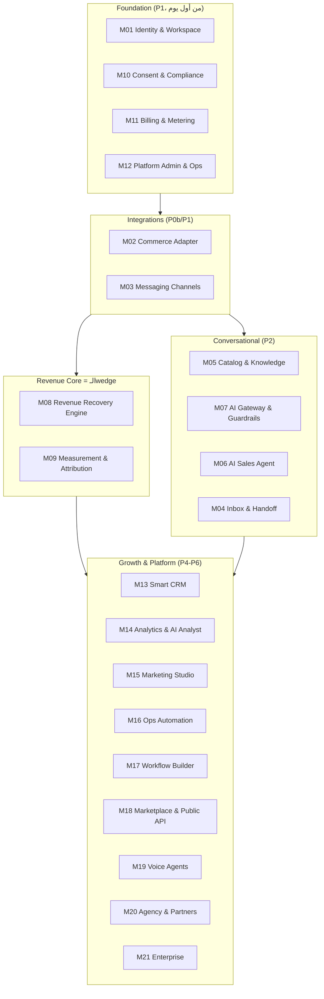
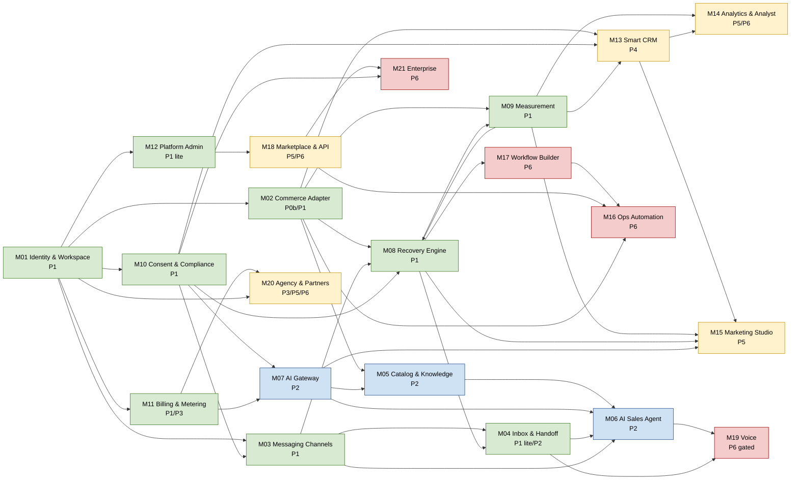
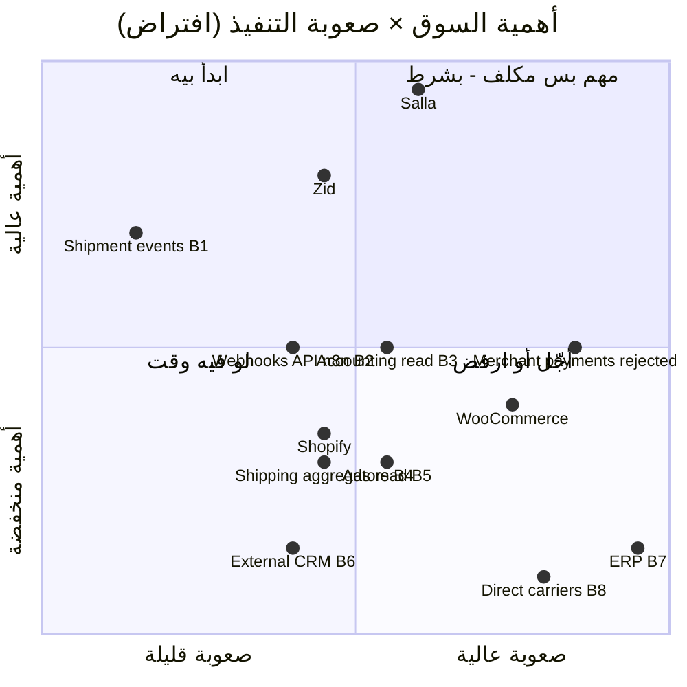

# 5. Complete Product Modules Map

> الحالة: مسودة v1.0 — بانتظار موافقة المؤسس (2026-10-21)

> **المرجع الإلزامي:** الأسماء والـIDs (M01..M21، E01..E18، P0..P6) والأرقام كلها منقولة من الـDecision Spine من غير تعديل. أي خلاف مكتوب صراحةً في آخر القسم ("ملاحظات للمراجعة").
> **Rule 1:** ده تخطيط بس. مفيش كود. التفاصيل الهندسية الدقيقة لكل Module بتتكتب في PRD الـPhase بتاعها لما نوصلها، مش هنا.
> **التصنيف:** [مؤكدة] = عليها مصدر (اطّلاع 2026-10-21). [افتراض] = محتاجة اختبار. [اقتراح] = توصية مننا. [غير مؤكدة] = ملقيناش دليل في أي اتجاه.
> **أقسام مرتبطة:** [4. Positioning](04-positioning-differentiation.md) · [6. MVP vs Future](06-mvp-vs-future-matrix.md) · [7. Phases](07-master-development-phases.md) · [8. Dependencies](08-phase-dependencies.md) · [9. Architecture](09-technical-architecture.md) · [14. Decisions](14-key-decisions.md) · [Competitive matrix](../research/competitive-feature-matrix.md)

---

## 5.1 الخلاصة في 6 نقط

1. الـ13 Module اللي في البرومبت **اتعاد تقسيمهم لـ21 Module (M01..M21)**. مفيش Module اتشال بالكامل، لكن فيه **features جوه الـModules اتشالت أو اتأجلت** (القسم 5.9).
2. اتضاف **8 Modules** مكانوش موجودين كـModules مستقلة: M01، M02 (كـAdapter)، M03 (منفصل عن الـInbox)، M05، M07، M09، M10، ومعاهم فصل M11 عن M12. السبب في كل حالة واحد: **حاجة بيعتمد عليها الـMVP أو الميزة التنافسية، وكانت مدفونة جوه Module تاني** فمكانتش هتاخد أولوية ولا owner.
3. **الـMVP = M01..M12 بس** (P1 + P2، ويتعتبر "اتطلق واتسيّل" عند نهاية P3). **مفيش Module من M13 لـM21 بيتبني قبل ما P3 exit criteria تتحقق**، وكل Module في P6 له gate منفصلة (≥5–10 عملاء ملتزمين يدفعوا تمنه).
4. **قلب المنتج 3 Modules:** M08 (Revenue Recovery Engine) + M09 (Measurement & Attribution) + M10 (Consent & Compliance). ده اللي بيطلّع **Profit-Proven Recovery** و**Incremental Profit Report**. الـAI Sales Agent (M06) مهم للسعر والقيمة، بس **مش** هو الـwedge، ومتأجل لـP2 عمدًا (خطر Meta القسم 4.7).
5. أغلب اللي في البرومبت **Parity مش تميّز**: inbox، handoff، WhatsApp رسمي، AI بيرد بالعربي، workflow builder، broadcasts، كلها موجودة عند منافس واحد على الأقل [مؤكدة: [competitive-feature-matrix.md](../research/competitive-feature-matrix.md)]. التميّز المرشّح محصور في M08 (scoring وأرضية الهامش) وM09 (holdout وربح إضافي)، وده نفسه **ممكن يتنسخ** [افتراض].
6. **Rule 9** بتنطبق على 9 Modules (10 صفوف في جدول 5.7، لأن M08 ليه صفين). القاعدة الموحّدة: **الـAI عمره ما بيقرر خصم ولا معاملة مالية ولا ميزانية إعلانية.** الخصم من محرك سياسات بالكود (ADR-014)، وأي حاجة فوق السقف = approval بشري (القسم 5.7).

---

## 5.2 من 13 Module في البرومبت لـ21 Module

| # | Module في البرومبت | القرار | راح فين | السبب |
|---|---|---|---|---|
| 1 | AI Sales Agents | **Keep + Shrink + تأجيل لـP2** | M06 (+ M05، M07) | الـagent من غير كتالوج موثوق (M05) وguardrails (M07) هيهلوس في الأسعار. اتفصلوا عشان يتبنوا ويتختبروا لوحدهم |
| 2 | Omnichannel Communication | **Split** | M03 (القنوات) + M04 (الـInbox) | القناة (WABA، templates، webhooks، MM API) حاجة، وواجهة الموظف حاجة تانية. M03 لازم كامل من P1، وM04 lite بس |
| 3 | Smart CRM | **Defer لـP4 (lite)** | M13. الـconsent راح M10 | الـCRM الكامل Parity عند Karam وMersal [مؤكدة: competitive-feature-matrix.md]، ومش هيكسب أول صفقة. الحد الأدنى من بيانات العميل جوه نموذج M02 الداخلي |
| 4 | Revenue Recovery Engine | **Keep = الـwedge، Split** | M08 + M09 | القياس (holdout، cost ledger، incremental profit) هو الميزة نفسها، فاتعمل له Module مستقل عشان ميتاكلش جوه "التحليلات" |
| 5 | AI Marketing Studio | **Defer لـP5** | M15 | حملات = تكلفة عالية + خطر Rule 9 + Parity عند الأربعة [مؤكدة: competitive-feature-matrix.md] |
| 6 | AI Business Analyst | **Shrink لتقرير واحد في P1، والباقي P5–P6** | M09 (التقرير، E07) + M14 (P5–P6) | التقرير الواحد (Incremental Profit Report) هو اللي التاجر بيدفع عليه. الـNL analytics في P5، والـAnalyst الكامل P6 |
| 7 | AI Operations Automation | **Defer لـP6** | M16 | خارج الـwedge. الـCOD (أقرب حاجة ليه) اتنقل لـM08 كـP2 مشروط |
| 8 | AI Voice Agents | **Defer لـP6 (gated)** | M19 | تكلفة وقوانين مكالمات غير مدروسة. Thikaa وKasbly عندهم [مؤكدة: competitive-feature-matrix.md]، فهو مش تميّز. ومفيش دليل على طلب من الـICP [افتراض] |
| 9 | Automation Workflow Builder | **Defer لـP6** | M17 | الـMVP بيستخدم workflows ثابتة بالكود فوق `scheduled_actions`. الـbuilder بيتبني فوق نفس المحرك بعدين، مش محرك جديد |
| 10 | Integrations Marketplace | **Split** | M02 (التجارة) + M03 (القنوات) + M18 (API/marketplace) | Salla جوه الـMVP لازم يكون Adapter منفصل (ADR-011). الباقي P4–P6 بترتيب الأهمية × الصعوبة في القسم 5.8.1 |
| 11 | Agency & White Label | **Shrink + Defer** | M20 | referral في P3، dashboard في P5، white label P6 gated (مش قبل شهر 24) |
| 12 | Enterprise Platform | **Defer لـP6**، والـAudit Logs بتتسحب لـMVP | M21 (+ M01، M10، M12) | Audit logs وsecurity controls مش "enterprise feature" عندنا، دي baseline من أول يوم (Rule 7، E15) |
| 13 | SaaS Platform Administration | **Split + Shrink** | M01 + M11 + M12 | الـworkspace والـbilling والـadmin ليهم إيقاع مختلف: metering من P1، billing آلي P3، admin Filament داخلي |

### 5.2.1 الـModules المضافة (أو المفصولة) وسبب كل واحدة

| ID | Module | كان فين | ليه Module مستقل | لو مكانش اتعمل |
|---|---|---|---|---|
| M01 | Identity, Access & Workspace | جزء من 13 و12 | الـtenancy (Team = Tenant) والـauth أساس كل حاجة وأي غلطة فيها = تسريب بين التجار (Rule 7) | كانت هتتبني "على الماشي" جوه الـadmin |
| M02 | Commerce Integrations (Commerce Adapter) | جزء من 10 | نموذج بيانات داخلي مستقل عن payloads سلة (ADR-011). سلة بتغيّر الـAPI بمُهَل أسبوعين–17 يوم [مؤكدة: https://docs.salla.dev/421127m0، 2026-10-21]، وزد جاي في P4 | كل Module كان هيقرا payload سلة مباشرة، وزد كان هيبقى إعادة كتابة |
| M03 | Messaging Channels | جزء من 2 | WABA لكل تاجر، templates، MM API، webhooks بتتكرر لحد 7 أيام [مؤكدة: whatsapp-business-platform.md]. ده شغل منصّاتي تقيل مالوش علاقة بالـUI | كان هيتدفن جوه "Inbox" ويتأجل معاه |
| M05 | Catalog & Knowledge (RAG) | **جديد** | الـagent مينفعش يقول سعر أو مخزون إلا من مصدر حي. ده شرط الـexit بتاع P2 (دقة **100%**) | الـagent كان هيبقى chatbot بيهلوس، وده خطر #8 في الـspine |
| M07 | AI Gateway & Guardrails | **جديد** | metering لكل tenant، routing بين موديلات، price validator، golden set، PII pseudonymization. تكلفة المحادثة لازم ≤$0.03 [اقتراح] | مفيش طريقة نعرف بيها AI COGS لكل تاجر، ولا نغيّر provider من غير ما نكسر الـagent |
| M09 | Measurement & Attribution | **جديد** (كان جوه 4) | ده الـdifferentiator. لو فضل جوه M08 هيتعامل كـ"report" مش كـ"engine" | كنا هنبني نفس الـlast-touch attribution اللي بننتقده |
| M10 | Consent & Compliance | **جديد** (كان جوه 3 و13) | سلة مش بتدي consent للتسويق [مؤكدة: salla-platform.md]، وغرامة PDPL لحد 5 مليون ريال/مخالفة [مؤكدة: saudi-regulatory-pdpl.md] | كان هيتأجل مع الـCRM لـP4، وده غير قانوني لأول رسالة تسويق |
| M11 | Billing, Plans & Usage Metering | جزء من 13 | الـmetering لازم من أول يوم (رسوم Meta والـLLM متغيرة) حتى لو الفوترة يدوية | مكناش هنعرف gross margin لكل تاجر قبل P3 |

---

## 5.3 تعريف الـPriority والـComplexity

**الـPriority** (على مستوى الـModule، ومختلفة عن أولوية الـEpics P0/P1/P2 في الـspine):

| القيمة | المعنى |
|---|---|
| **حرج** | من غيره الـMVP مش بيشتغل end-to-end، أو مش قانوني، أو بيخالف شروط Meta/سلة |
| **عالي** | جوه الـMVP، والـMVP يقدر يشتغل بنسخة lite منه لفترة قصيرة |
| **متوسط** | بعد الـMVP، وله أثر مباشر على الـretention أو تقليل الاعتماد على سلة |
| **منخفض** | توسّع، يتبني بس لو الطلب اتثبت |
| **Gated** | ميتبنيش إلا بعد business case منفصل وعملاء ملتزمين يدفعوا (P6) |

**الـComplexity** [افتراض: تقدير أوّلي لمهندس Laravel full-stack واحد، بيتراجع في PRD كل Phase]:

| القيمة | تقريبًا |
|---|---|
| S | ≤2 أسبوع |
| M | 2–6 أسابيع |
| L | 6–12 أسبوع |
| XL | >12 أسبوع، أو فيه مجاهيل منصّاتية/قانونية كبيرة |

لكل Module بنكتب قيمتين: **شريحة أول Phase** و**النطاق الكامل**. الفرق بينهم هو اللي بيخلّي الـMVP ممكن بفريق صغير (Rule 5).

> **تحذير صريح (Rule 5):** لو جمعنا شرايح P1 بس (M01، M02، M03، M04 lite، M08، M09، M10، M11 metering، M12 lite، أساس M07، فئات الهامش في M05) بسلّم S/M/L/XL اللي فوق، الناتج **~21–70 أسبوع-مهندس** [افتراض: جمع حسابي لنطاقات خشنة]. الرقم ده نطاق من نطاقات، وأعلاه مبالغ فيه لأن M03 (L) أغلبه **انتظار** Meta مش شغل. **رقم التخطيط المعتمد** هو تقدير الـEpics في [القسم 6، B.2](06-mvp-vs-future-matrix.md): **P1 ≈ 15.5 person-week صافي، و≈18 بالـbuffer**، مقابل طاقة **~15–18 person-week** (مهندس full-time + المؤسس بنص وقته على 10–12 أسبوع) [افتراض]. يعني P1 **على الحافة** حتى بالتقدير الأدق، وأي إضافة لـP1 لازم يتشال قصادها حاجة. ترتيب التأجيل المقترح في القسم 6: صفحة التقرير في المنتج (E07، والتقرير يفضل يدوي) ثم E12a. والقرار ده لازم يتحسم مع [القسم 7](07-master-development-phases.md) و[القسم 11](11-budget-timeline.md) قبل بداية P1.

---

## 5.4 الصورة الكلية (Layers)

> الطبقة الـConversational (L4) **مش** معتمدة على الـRevenue Core (L3): الاتنين قاعدين على نفس الـFoundation والـIntegrations، وده اللي بيسمح إن P1 يشتغل من غير agent. M14 بيظهر في L5 لأنه كـModule بيبدأ P5. التقرير الواحد بتاع P1 (E07) **بيتبني جوه M09**، ومفيش كود لـM14 قبل P3 exit (نفس الاتفاق في [القسم 9](09-technical-architecture.md)). M18 اتنقل لـL5 لأنه P5–P6.

---

## 5.5 بطاقات الـModules (M01..M21)

> كل بطاقة فيها حقول Task 2 بالكامل. صف "عند المنافسين" عشان Rule 3، وصف "Rule 9" لما يكون فيه gate.

### M01 — Identity, Access & Workspace

| الحقل | المحتوى |
|---|---|
| المقابل في البرومبت | جزء من 13 (Tenant Management) + 12 (RBAC). **جديد كـModule مستقل** |
| Purpose | حساب التاجر (Workspace = Tenant = Team)، تسجيل الدخول، دعوة الفريق، والأدوار. الأساس اللي كل بيانات تانية بتتربط بيه بـ`tenant_id` |
| Target Users | صاحب المتجر (Owner)، موظف خدمة العملاء (Agent)، وفريق CODEX الداخلي (عن طريق M12) |
| Core Features (MVP) | تسجيل ودخول (من Laravel React starter kit)، Team = Tenant، **دوران بس: Owner وAgent**، دعوة أعضاء، 2FA للـOwner [اقتراح]، ربط الـworkspace بمتجر سلة واحد |
| Advanced Features (لاحقًا) | multi-workspace لوكالة (P5 مع M20)، أدوار مخصصة وAdvanced RBAC وSSO (P6 مع M21) |
| Business Value | مش بيبيع لوحده. قيمته إنه **يمنع أسوأ حادثة ممكنة**: بيانات تاجر تظهر لتاجر تاني. ده كفيل يقفل الشركة في سوق صغير بيتكلم مع بعضه [افتراض] |
| Technical Requirements | DB واحدة + `tenant_id` + Global Scope، Jobs بتحمل `tenant_id` صريح، **isolation tests إجبارية في CI**، **ممنوع** schema/DB-per-tenant (ADR-004). RLS طبقة دفاع تانية بعد الاستضافة. Pennant flags scoped على الـTeam |
| Dependencies | مفيش (Module أساسي) |
| عند المنافسين | multi-user موجود عند الكل (Karam 4 أو 12 user [مؤكدة: https://karamai.co/en/pricing، 2026-10-21]). Parity |
| Priority | **حرج** |
| Estimated Complexity | شريحة P1: **S–M** (الـstarter kit بيوفّر أغلبه، الشغل في الـisolation tests). كامل: **L** (مع RBAC متقدم وSSO) |
| MVP / Phase | **MVP — P1** (E01). توسيع في P5 وP6 |

### M02 — Commerce Integrations (Commerce Adapter)

| الحقل | المحتوى |
|---|---|
| المقابل في البرومبت | جزء من 10 (E-commerce integrations) |
| Purpose | طبقة واحدة بتترجم بيانات منصات التجارة (سلة أولًا) لنموذج بيانات داخلي ثابت: products، orders، abandoned carts، customers. باقي الـModules **مبتقراش payload سلة مباشرة** |
| Target Users | داخلي (كل الـModules)، والتاجر وقت التثبيت والربط |
| Core Features (MVP) | Salla **private app** (P0b/P1): OAuth Easy Mode، token refresh في job واحدة بـdistributed lock، webhooks (سلات، طلبات، منتجات، عملاء) + **reconciliation polling**، قراءة products/orders/abandoned carts/customers، استخدام `checkout_url`. Cart Truth Audit read-only (E17، P0b). Public listing على Salla App Store (E18، P3) |
| Advanced Features (لاحقًا) | تحديث حالة الطلب لـCOD (P2 لو P0 أكدت)، **Zid (P4)**، Shopify/WooCommerce (P5 حسب الطلب) |
| Cut صريح | **إنشاء cart من الـAPI: Cut**. مفيش endpoint موثّق [غير مؤكدة: salla-platform.md]. `POST /orders` بـ`pending_payment` محتاج spike قبل أي وعد |
| Business Value | من غيره مفيش منتج. وقيمته الاستراتيجية: يقلل الاعتماد على سلة (خطر #3 في الـspine) لأن زد بيبقى adapter تاني مش إعادة كتابة |
| Technical Requirements | ADR-011. جدول `webhook_events` بـunique (provider, event_id)، تحقق HMAC-SHA256 من `X-Salla-Signature`، معالجة async في queue. سلة بتعيد الـwebhook **3 محاولات بس**، بين كل محاولة والتانية ~5 دقايق (يعني نافذة ~15 دقيقة) [مؤكدة: https://docs.salla.dev/doc-421119، 2026-10-21] فالـpolling إجباري. Access token 14 يوم، refresh token شهر **ومرة واحدة بس** (إعادة الاستخدام = إعادة تثبيت) [مؤكدة: salla-platform.md]. احترام rate limits (Plus 120، Pro 360، Special 720 req/min) [مؤكدة: salla-platform.md]. متابعة الـchangelog أسبوعيًا |
| Dependencies | M01 |
| عند المنافسين | ربط سلة عند Karam وMersal، وThikaa (قراءة بس)، وKasbly جزئي (blog بس) [مؤكدة: competitive-feature-matrix.md]. Karam بيعمل cart وpayment links [مؤكدة: competitive-feature-matrix.md، مصدرها https://karamai.co/en/ai-agent، 2026-10-21]. Parity، والـAdapter نفسه ميزة داخلية مش بيعية |
| Priority | **حرج** |
| Estimated Complexity | شريحة P0b/P1: **M–L** (الـtoken refresh الأحادي والـreconciliation أصعب مما يبانوا). كامل (Zid + Shopify + Woo): **XL** |
| MVP / Phase | **MVP — P0b/P1** (E02، E17)، public في **P3** (E18)، Zid **P4**، Shopify/Woo **P5** |

### M03 — Messaging Channels

| الحقل | المحتوى |
|---|---|
| المقابل في البرومبت | جزء من 2 (Omnichannel) + جزء من 10 (Communication) |
| Purpose | إرسال واستقبال الرسائل على القنوات **الرسمية بس**. WhatsApp أولًا |
| Target Users | داخلي (M08، M06، M04)، والتاجر وقت الـonboarding |
| Core Features (MVP) | CODEX كـ**Tech Provider**، Embedded Signup v4، **Coexistence** (التاجر يفضل على تطبيق WhatsApp Business)، WABA وbusiness portfolio **لكل تاجر**، **رسوم Meta على كارت التاجر من غير markup**، إدارة templates واعتمادها، **Marketing على MM API من أول يوم**، webhooks الحالة (delivered/read/failed)، معالجة error 131049 |
| Advanced Features (لاحقًا) | Instagram DM وMessenger وEmail (P5، بس لو المقابلات أكدت الطلب)، Website live chat (P5–P6)، أكتر من رقم للتاجر (باقة Pro) |
| مرفوض للأبد | أي WhatsApp غير رسمي (QR/web automation). **Rule 8**. Thikaa وATMET بيقدّموا ربط QR [مؤكدة: thikaa.md، https://apps.salla.sa/en/app/931067979] وده بالنسبالنا خطر مش ميزة |
| Business Value | القناة اللي التاجر السعودي شغّال عليها فعلًا. الامتثال لـMeta هنا = بقاء الشركة |
| Technical Requirements | ADR-006 (يتحدد **قبل أول رقم**): Tech Provider، data localization region (السعودية مش متاحة؛ المتاح في المنطقة الإمارات AE والبحرين BH، وفي القايمة كمان ZA برّه المنطقة) [مؤكدة: https://developers.facebook.com/docs/whatsapp/cloud-api/reference/registration، 2026-10-21، ملخّص في [saudi-regulatory-pdpl.md](../research/saudi-regulatory-pdpl.md)] — قرار irreversible. Idempotency keys للإرسال، `webhook_events` لأن Meta بتعيد لحد 7 أيام ومكررة [مؤكدة: whatsapp-business-platform.md]. حدود: 250 مستخدم/24 ساعة → 2,000 بعد BV، Embedded Signup 10 عملاء/7 أيام → 200 بعد التحقق [مؤكدة: whatsapp-business-platform.md]. الإرسال التسويقي على Cloud API بيتوقف 2027-04-13 للحسابات الجديدة و2027-10-13 للكل [مؤكدة: https://developers.facebook.com/documentation/business-messaging/whatsapp/marketing-messages/overview.md، 2026-10-21] |
| Dependencies | M01، M10 (لازم consent قبل أي Marketing)، M11 (عدّاد الرسائل) |
| عند المنافسين | WhatsApp رسمي عند الأربعة، Instagram عند الأربعة [مؤكدة: competitive-feature-matrix.md]. **Parity كامل.** الفرق الوحيد: "رسمي بس" مقابل Thikaa |
| Priority | **حرج** |
| Estimated Complexity | شريحة P1: **L** (Meta BV وApp Review على المسار الحرج ومش في إيدنا). كامل (كل القنوات): **XL** |
| MVP / Phase | **MVP — P1** (E03). قنوات تانية **P5** |

### M04 — Conversation Inbox & Handoff

| الحقل | المحتوى |
|---|---|
| المقابل في البرومبت | جزء من 2 (Unified Inbox، Assignment، Notes، Tags، Status، Response Analytics) + MVP #5 (Shared Inbox) |
| Purpose | مكان الموظف ياخد المحادثة من الـAI أو من الـrecovery، ويشوف السجل |
| Target Users | موظف خدمة العملاء (Agent)، صاحب المتجر |
| Core Features (MVP lite) | handoff queue، assign، internal notes، status (open/pending/closed)، **سجل محادثات الـAI**، زرار takeover. والموظف يرد من تطبيق WhatsApp Business نفسه عن طريق Coexistence |
| Advanced Features (P5) | Inbox كامل: tags متقدمة، SLA وResponse analytics، قنوات متعددة في واجهة واحدة، saved replies، collision detection |
| Cut من الـMVP | tags متقدمة، SLA analytics، Response analytics. **مش Cut بالكامل**: الـhandoff شرط في سياسة Meta للـAI [مؤكدة: whatsapp-business-platform.md] |
| Business Value | Parity إلزامي. مش هيكسب صفقة، بس غيابه بيخسّرها (التاجر مش هيسيب AI يرد من غير مخرج بشري) |
| Technical Requirements | Real-time بسيط (polling أو broadcasting عن طريق Laravel Reverb [اقتراح])، RTL/LTR بـlogical properties بس، صلاحيات Agent محصورة في الـtenant |
| Dependencies | P1: M01، M03، M08 (ردود العملاء على رسائل الاسترجاع). P2: بيستقبل الـhandoff من M06، والعلاقة في الاتجاه ده (M04 لازم يكون موجود قبل M06، زي ما في الـgraph 5.6) |
| عند المنافسين | Unified inbox + handoff عند الأربعة [مؤكدة: competitive-feature-matrix.md]. **Parity** |
| Priority | **عالي** |
| Estimated Complexity | شريحة P1: **S–M**. كامل (P5): **L** |
| MVP / Phase | **MVP — P1 (lite)/P2** (E12). كامل **P5** |

### M05 — Catalog & Knowledge (RAG)

| الحقل | المحتوى |
|---|---|
| المقابل في البرومبت | **جديد** (كان ضمنيًا جوه Module 1: "البحث في المنتجات"، "عدم اختراع معلومات") |
| Purpose | المصدر الوحيد اللي الـagent بيجيب منه معلومات المنتج والسياسات. السعر والمخزون **دايمًا** من tool حي، مش من الـembeddings |
| Target Users | داخلي (M06)، والتاجر (بيرفع الـFAQ والسياسات ويراجعها) |
| Core Features (MVP) | مزامنة الكتالوج من M02، FAQ وسياسات الشحن والاسترجاع، **hybrid search** (Postgres FTS/trigram + pgvector) مع normalization عربي، بيانات رأسية للعطور (نوتات، مناسبة، ثبات) **من بيانات التاجر بس**. شريحة P1: **هامش لكل فئة (5–10 فئات)** وقت الـonboarding (E08) |
| Advanced Features (لاحقًا) | تقارير "gaps" (أسئلة الـagent ملقاش لها إجابة)، استخراج FAQ من سجل المحادثات **بموافقة التاجر**، verticals تانية (Fashion: مقاسات ومرتجعات، P4) |
| Business Value | هو اللي بيحوّل الـagent من "بوت عام" لـ"بياع عارف المحل". ضد Meta Business Agent ($2/1M token [مؤكدة: https://developers.facebook.com/docs/whatsapp/pricing، 2026-10-21])، الميزة في ربط الكتالوج والهامش والسياسات، مش في "بيرد بالعربي" [افتراض] |
| Technical Requirements | pgvector جوه نفس Postgres (ADR-003)، embeddings عن طريق API (التكلفة مهملة [مؤكدة: tech-stack-options.md])، re-sync على webhook المنتج + polling، كل chunk عليه `tenant_id`. **ممنوع** استخدام محادثات WABA لتدريب أو تحسين أي نموذج [مؤكدة: شروط Meta، ADR-009] |
| Dependencies | M02 (الكتالوج)، M07 (embeddings وmetering)، M01 |
| عند المنافسين | Karam بيجاوب من المنتجات والسياسات وقاعدة المعرفة [مؤكدة: https://karamai.co/en/ai-agent، 2026-10-21]، وعنده تبويب Gaps [مؤكدة: https://help.karamai.co/changelog (يوليو 2026)، اطّلاع 2026-10-21]. Kasbly كمان عنده تقرير "فجوات المعرفة" [مؤكدة: kasbly.md]. يعني فكرة الـgaps اللي في Advanced Features هنا Parity مش ميزة. **Parity**، والعمق الرأسي في العطور [افتراض] هو الفرق المحتمل |
| Priority | **حرج** (لـP2) |
| Estimated Complexity | شريحة P1 (فئات الهامش): **S**. P2: **M**. كامل: **L** |
| MVP / Phase | **MVP — P2** (E09)، وشريحة الهامش في **P1** (E08، مشتركة مع M09) |

### M06 — AI Sales Agent

| الحقل | المحتوى |
|---|---|
| المقابل في البرومبت | Module 1 + MVP #4 |
| Purpose | يرد على أسئلة الشراء على WhatsApp، يرشّح من الكتالوج، ويودّي العميل لصفحة الدفع، ويحوّل لإنسان لما يلزم |
| Target Users | عميل المتجر النهائي (مباشرة)، والتاجر وموظفه (Assisted mode) |
| Core Features (MVP) | **Assisted mode ≥4 أسابيع** (الـagent يكتب مسودة والموظف يوافق) ثم **Scoped Autonomous**: بحث وترشيح من الكتالوج، سعر ومخزون من tool حي، إجابات الشحن والاسترجاع من الـFAQ، إرسال `checkout_url`، handoff، الاحتفاظ بسياق المحادثة. **الرد باللهجة السعودية، والفهم سعودي + مصري** |
| ممنوع في الـMVP | خصومات، payment links مخصصة، أسئلة عامة خارج المتجر، طلب بيانات كارت، إنشاء cart |
| Advanced Features (لاحقًا) | follow-up بعد المحادثة (P4 مع M08)، ترشيح cross-sell بسياسة (P4)، قنوات تانية (P5)، golden set مصري مع دخول مصر (P6)، voice (M19) |
| Business Value | بيبرر باقة **Sell & Recover 699** (حصة 1,000 محادثة، الزيادة 0.25 ريال/محادثة من P3/P4) [اقتراح]. سعر الزيادة ده ممكن يكسر قاعدة "AI COGS + دعم ≤35% من الصافي" عند سقف $0.03/محادثة، ومحتاج قرار (شوف [القسم 4](04-positioning-differentiation.md) و[القسم 11](11-budget-timeline.md)). وهو نقطة الضعف اللي بنهاجم بيها Karam: الـAI عندهم add-on منفصل (149 ريال/600 محادثة، 399/1,800) [مؤكدة: https://karamai.co/en/pricing، 2026-10-21] |
| Technical Requirements | **Agent واحد + tools** بـLaravel AI SDK v1 ورا `AiGateway` (ADR-007). مفيش Python/LangGraph في الـMVP. السعر في الرد placeholders بيعوّضها الكود. **Approvable tools** لأي حاجة فيها خصم أو كوبون (مقفولة في الـMVP أصلًا) |
| Exit criteria (P2) | دقة السعر والمخزون **100%** على ≥300 حالة سعودي، الـvalidator بيمنع 100% من الأرقام اللي مش من الـtools، تكلفة المحادثة **≤$0.03**، handoff rate **≤40%**، صفر حوادث خصم أو سعر غلط [اقتراح: من الـspine؛ ده مقتطف، والقايمة الكاملة (منها ≥10–15 متجر بيدفع وretention ≥80%) في [القسم 7](07-master-development-phases.md)] |
| Rule 9 | **نعم.** الـagent **مش بيقرر خصم أبدًا**. لو خصم اتعرض مستقبلًا، بيجي من محرك سياسات M08 بس، وفوق السقف = approval |
| مخاطر خاصة | Meta القسم 4.7: مزوّد AI يكون الـAI وظيفته **الأساسية** = ممنوع [مؤكدة: https://www.facebook.com/legal/Meta-Terms-for-WhatsApp-Business-Platform، 2026-10-21]. انطباقه علينا [غير مؤكدة]. عشان كده: agent محصور في الكتالوج، handoff واضح، positioning كـcommerce platform، وP1 كله شغال من غير agent |
| Dependencies | M05، M07، M03، M04، M10، M02 |
| عند المنافسين | AI agent عربي + ترشيح منتجات عند الأربعة، Thikaa بـ5 لهجات، Karam بيقفل الطلبات [مؤكدة: competitive-feature-matrix.md]. ATMET بـ49–249 ريال [مؤكدة: https://apps.salla.sa/en/app/931067979]. **Parity**، والفرق المحتمل في الدقة المثبتة والربط بالقياس |
| Priority | **حرج** (لـP2) |
| Estimated Complexity | P2: **L** (الصعوبة في الـeval والـgolden set، مش في الكود). كامل: **XL** |
| MVP / Phase | **MVP — P2** (E11) |

### M07 — AI Gateway & Guardrails

| الحقل | المحتوى |
|---|---|
| المقابل في البرومبت | **جديد** (كان ضمنيًا في "AI Tool Permissions" و"Usage Metering" في متطلبات المعمارية) |
| Purpose | بوابة واحدة لأي نداء LLM: مين بيدفع، أنهي موديل، إيه اللي يتبعت، وإيه اللي يتمنع يطلع |
| Target Users | داخلي (M06، M05، لاحقًا M14 وM15)، وفريق CODEX (مراقبة التكلفة والجودة) |
| Core Features (MVP) | interface `AiGateway`، **metering لكل tenant**، routing (موديل رخيص افتراضي: Haiku 5.5 أو GPT-6 Luna، وتصعيد لـSonnet 5.5 بقواعد)، **price/stock validator حتمي**، **golden set eval ≥300 حالة سعودي**، **PII pseudonymization** (الـLLM مبيشوفش الاسم ولا الرقم)، عقود zero-retention/no-training، failover بين providers |
| Advanced Features (لاحقًا) | eval مستمر على عينات الإنتاج، budget caps لكل tenant مع إيقاف تلقائي، A/B بين موديلات |
| Business Value | بيحمي الـgross margin (هدف ≥60% في P3، ≥65% في P4 [افتراض: exit criteria من الـspine]). AI COGS للمتجر المتوسط $9–45/شهر مع routing رخيص [افتراض]، والقاعدة: AI COGS + دعم ≤35% من الصافي [اقتراح]. الأسعار بتتغير كل 1–2 شهر [مؤكدة: ai-llm-costs-arabic.md] فالـrouting ضروري |
| Technical Requirements | Laravel AI SDK v1 (فيه failover وusage reporting وmiddleware لكل خطوة وapprovable tools [مؤكدة: https://laravel.com/blog/introducing-laravel-ai-sdk-v1، 2026-10-21]) ملفوف بـinterface خاص بينا. ADR-007، ADR-008. أساس P1: الـinterface والـpseudonymization والـmetering (حتى لو مفيش LLM في P1) |
| Rule 9 | الـvalidator هو آخر خط دفاع: أي رقم (سعر، خصم، مبلغ) مش جاي من tool result **بيتمنع** |
| Dependencies | M01، M10 (سياسة PII)، M11 (usage events) |
| عند المنافسين | Kasbly عنده تقارير تكلفة الـAI وshadow mode [مؤكدة: kasbly.md]. Karam بيختبر قبل الإطلاق، ومزوّد الـLLM مش معلن [مؤكدة: https://karamai.co/en/privacy]. الشفافية في المعالجين ممكن تبقى ميزة ثقة [افتراض] |
| Priority | **حرج** (لـP2) |
| Estimated Complexity | أساس P1: **S**. P2: **M**. كامل: **L** |
| MVP / Phase | **MVP — P2** (E10)، **أساسه P1** |

### M08 — Revenue Recovery Engine

| الحقل | المحتوى |
|---|---|
| المقابل في البرومبت | Module 4 (ماعدا القياس اللي راح M09) + MVP #6 |
| Purpose | يقرر **أنهي سلة تستاهل رسالة، إمتى، وبأنهي عرض**، وينفّذ بشكل حتمي (workflow، مش agent) |
| Target Users | صاحب المتجر/مدير التسويق (السياسات والموافقات)، عميل المتجر (بيستقبل الرسائل) |
| Core Features (MVP، P1) | Abandoned Cart Recovery: eligibility (consent، موبايل، مش اشترى، مش في holdout)، **rule-based scoring** (عمر السلة، قيمتها، تركيزها، هامش الفئة)، **أول رسالة بعد ≥60 دقيقة**، **quiet hours 22:00–09:00 (رمضان 01:00–12:00)**، **مفيش خصم في أول رسالة**، تصنيف Marketing دايمًا، **discount policy engine** (أرضية هامش لكل فئة، لا خصم للعميل الحالي إلا بموافقة، فوق السقف = approval)، suppression (منبعتش لما الرسالة متستاهلش تكلفتها) |
| Advanced Features | **COD Confirmation (P2، مشروط بنتيجة P0)** (E16). Failed payment، win-back، repeat purchase، cross-sell/upsell (**P4**). Uplift/ML scoring (**P4+** بعد بيانات مجمّعة كفاية) |
| Business Value | **الـwedge.** القيمة الأوضح ماليًا هي الـsuppression: متجر 1,000 سلة × رسالتين ≈ 320 ريال/شهر لـMeta حسب رقم الـspine [افتراض]، والحساب المباشر بسعر Meta (0.0576 USD ≈ 0.216 ريال للرسالة) بيدّي **~432 ريال** [افتراض: حساب؛ الـ320 بيفترض ضمنيًا إن ~25% من الرسائل مش بتتبعت، شوف [القسم 11](11-budget-timeline.md)]. لكن الاسترجاع لوحده commodity: سلة عندها تذكير native بخصم ولحد 5 تذكيرات [مؤكدة: https://help.salla.sa/en/article/abandoned-cart-reminders-with-a-discount/vzit7tzwz9e5pcv37nnenyqv، 2026-10-21]، وتطبيقات بـ49–119 ريال [مؤكدة: apps.salla.sa]. **M08 من غير M09 مش بيتباع** [افتراض] |
| الأدلة ورا القواعد | تذكير بعد 30–60 دقيقة **قلّل** الشراء مقارنةً بالتحكم [مؤكدة: Li et al. 2021، DOI 10.1177/0022242920959043]. تذكير SMS من غير خصم لسلة 4–28 يوم مكانش له أثر معنوي (1.21% مقابل 1.41%) [مؤكدة: https://www.msi.org/wp-content/uploads/2021/09/MSI_Report_21-133-1.pdf]. الخصم الأكبر قلّل مشتريات العملاء الحاليين لاحقًا [مؤكدة: Anderson & Simester 2004، https://ideas.repec.org/a/inm/ormksc/v23y2004i1p4-20.html]. كل الأدلة من برّه الخليج [مؤكدة] |
| Technical Requirements | ADR-010: جدول `scheduled_actions` + Scheduler كل دقيقة بـ`SKIP LOCKED` + **إعادة فحص الشروط وقت التنفيذ** (اشترى؟ سحب الـconsent؟ دخل quiet hours؟). Redis + Horizon. Idempotency keys. ADR-014 للـdiscount policy. كل قرار (أرسل/متبعتش وليه) بيتسجل في `audit_events` |
| Rule 9 | **نعم، الأهم.** الخصم من محرك سياسات بالكود بس. **الـAI عمره ما بيقرر الخصم.** أي خصم فوق السقف أو لعميل حالي = approval بشري. الـCOD: تحديث حالة الطلب لـ"ملغي" محتاج سياسة صريحة من التاجر |
| Dependencies | M02، M03، M10، M09 (تخصيص الـholdout قبل الإرسال)، M01 |
| عند المنافسين | Abandoned cart عند Thikaa وKaram وMersal، وKasbly جزئي (مش بيقرا سلات المتجر) [مؤكدة: competitive-feature-matrix.md]. COD عند Karam بيحدّث الطلب في سلة وزد [مؤكدة: karam-ai.md]. **Cart scoring وprofit-aware discounts: غير مؤكدة عند الأربعة** (Kasbly عنده حد أقصى ثابت للخصم، وMersal فرع "قيمة السلة > X" بس) [مؤكدة: competitive-feature-matrix.md]. **لكن** Bloomreach بيعلن عن ميزة مشابهة (خصم مربوط بالهامش) على مستوى enterprise [مؤكدة: cart-recovery-incrementality.md]، فالفكرة مش جديدة عالميًا، الجديد المحتمل هو تطبيقها لمتاجر سلة المتوسطة → مرشّح للتميّز محليًا، وقابل للنسخ [افتراض] |
| Priority | **حرج** |
| Estimated Complexity | شريحة P1: **M–L**. COD P2: **S–M**. كامل (P4): **L** |
| MVP / Phase | **MVP — P1** (E05)، COD **P2 مشروط** (E16)، باقي الـflows **P4** |

### M09 — Measurement & Attribution

| الحقل | المحتوى |
|---|---|
| المقابل في البرومبت | **جديد** (كان جوه 4: Campaign Cost Tracking، Revenue Attribution، Control Groups & Incrementality) |
| Purpose | يجاوب على سؤال واحد بصراحة: **التدخل ده جاب ربح إضافي ولا لأ، وبكام؟** |
| Target Users | صاحب المتجر (بيقرا التقرير)، فريق CODEX (pooled estimates والـcase studies) |
| Core Features (MVP، P1) | **holdout افتراضي 10% على مستوى العميل بـhash ثابت، إجباري في الـpilots**، experiment assignment، **cost ledger** (رسوم Meta، الخصومات، الـLLM)، **Incremental Profit Report** (E07: يدوي SQL + template أول 4 أسابيع، بعدين صفحة واحدة في المنتج)، 4 أرقام منفصلة: إيراد منسوب، إيراد إضافي تقديري (نطاق)، تكلفة الرسائل والخصومات، ربح إضافي تقديري، **win probability**. إدخال الهامش لكل فئة (E08، مع M05) |
| Advanced Features | **pooled priors** من متاجر العطور والتجميل (P4، هدف: نطاقات ثقة أضيق ≥30%)، CUPED [مؤكدة: ~50% تقليل تباين في Bing، https://exp-platform.com/cuped/، 2026-10-21؛ أثره على السلات غير مؤكدة، وكتير من أصحاب السلات معندهمش تاريخ شراء]، experiments على التوقيت والعرض، Outcome fee 2–5% (P4، مع M11) |
| مش بنوعد بيه | رقم incrementality خاص بالمتجر في أول شهر، uplift model لكل تاجر، COGS لكل SKU [اقتراح: من الـspine 3.4] |
| Business Value | **الـdifferentiator.** كل الأدوات بتعرض last-touch (Klaviyo نافذة 5 أيام) [مؤكدة: cart-recovery-incrementality.md]، وKaram بيعرض "orders after chat" [مؤكدة: https://karamai.co/en/guides/abandoned-carts]. **لكن:** Klaviyo وBraze وBloomreach وPostscript عندهم holdouts [مؤكدة: cart-recovery-incrementality.md]، فمينفعش نقول "أول من يقيس". والخطر الأكبر: التاجر مش هيدفع لرقم أصغر وأصدق [افتراض، خطر #2] |
| Technical Requirements | ADR-013 (المنهجية). Power: 5%→7% محتاج ~4,400 (50/50)، 6,300 (80/20)، 10,700 (90/10) سلة؛ متجر 500 سلة/شهر ≈ سنة بـ80/20 [افتراض: حسابات]. عشان كده التقرير **نطاقات + win probability**، مش رقم واحد. **ADR-009:** الـpooling من نتائج طلبات سلة وتخصيص المجموعات **بس**، مش من نصوص WhatsApp [مؤكدة: شروط Meta]، ولازم رأي قانوني (خطر التحوّل من Processor لـController [افتراض]). الحسابات بالـSQL في Postgres؛ Python worker يتراجع بس في P4+ بـADR |
| Dependencies | M02 (نتائج الطلبات)، M08 (التدخلات)، M03 وM07 (التكاليف)، M05 (الهامش) |
| عند المنافسين | Control groups / incrementality: **غير مؤكدة عند الأربعة**. Karam بيذكر الفكرة في الـguide [مؤكدة: competitive-feature-matrix.md]. Karam ممكن ينسخ في أسابيع [افتراض] → السبق في **البيانات والوقت**، مش الفكرة |
| Priority | **حرج** |
| Estimated Complexity | P1: **M** (المنطق بسيط، الصعب المنهجية والشرح للتاجر). كامل (pooled priors): **L** |
| MVP / Phase | **MVP — P1** (E06، E07، E08)، pooled priors **P4** |

### M10 — Consent & Compliance

| الحقل | المحتوى |
|---|---|
| المقابل في البرومبت | **جديد** (كان جوه 3: Marketing Consent Management، و13/12: Audit Logs، Data Retention) + MVP #10 |
| Purpose | يضمن إن كل رسالة تسويق ليها consent مثبت، وكل opt-out بيتنفذ، وكل بيانات شخصية متعاملة حسب PDPL وعقودنا |
| Target Users | صاحب المتجر (Controller)، فريق CODEX (Processor)، المستشار القانوني، عميل المتجر (حقوقه) |
| Core Features (MVP) | **consent ledger** (المصدر، النص، الوقت، القناة، الفئة)، **opt-out بكلمات عربي** ("إلغاء"، "وقف"، "STOP") **تنفيذ <24 ساعة**، quiet hours افتراضية، **`audit_events` append-only**، PII pseudonymization قبل الـLLM (مع M07)، retention قابلة للضبط، DPA عربي، سياسة خصوصية، DPIA template، ROPA وقائمة sub-processors، incident runbook (إخطار التاجر خلال 24 ساعة) |
| Advanced Features (لاحقًا) | DSAR self-serve (طلبات الوصول والحذف)، retention policies متقدمة لكل tenant (P6 مع M21)، مساعدة التاجر في التسجيل في السجل الوطني لو المسودة اتعتمدت |
| Business Value | مش ميزة بيعية مباشرة، بس **شرط بقاء**: غرامة PDPL لحد 5 مليون ريال/مخالفة وتتضاعف [مؤكدة: saudi-regulatory-pdpl.md]. وممكن تبقى ميزة ثقة لأن Mersal Terms منسوخة من قالب بقانون بريطاني ومفيش PDPL [مؤكدة: mersal-ai.md] |
| الأساس القانوني | CST: موافقة صريحة، إثبات، إيقاف خلال 24 ساعة، منع الترويج 22:00–09:00 [مؤكدة: https://www.stc.com.sa/content/dam/corporatesite/common/business/pdf/RegulationsforCurbingSPAMMessagesCallspdfEN.pdf، 2026-10-21]؛ انطباقه على WhatsApp [غير مؤكدة]، فبنطبقه كإعداد افتراضي [اقتراح]. إخطار الاختراق: 72 ساعة لـSDAIA (مسودة)، 3 أيام للمستهلك والوزارة [مؤكدة: saudi-regulatory-pdpl.md]، و24 ساعة للتاجر في عقدنا [اقتراح] |
| مسموح نقوله | "PDPL by design + البيانات الأساسية مستضافة في السعودية (بعد ترحيل Dammam)". **ممنوع** "بياناتك كلها في السعودية" (WhatsApp Cloud API والـLLMs بتعالج برّه المملكة [مؤكدة]) |
| Technical Requirements | ADR-008، ADR-009، ADR-015. فحص الـconsent **وقت التنفيذ** مش وقت الجدولة. سلة مش بتدي consent [مؤكدة: salla-platform.md]، فالمصادر: checkbox في الـcheckout لو ينفع، أو التاجر، أو رد العميل [اقتراح] |
| Dependencies | M01. وكل الـModules اللي بتبعت أو بتعالج بيانات بتعتمد عليه (M03، M06، M08، M15، M19) |
| عند المنافسين | Consent/opt-out جزئي عند الأربعة؛ Karam عنده STOP و"No-promotion list" [مؤكدة: https://karamai.co/en/whatsapp]. consent ledger بإثبات: غير مؤكدة عند الأربعة |
| Priority | **حرج — مفيش تفاوض** |
| Estimated Complexity | P1: **M** (تقني) + شغل قانوني بـ15–30 ألف ريال في P0 [افتراض]. كامل: **L** |
| MVP / Phase | **MVP — P1** (E04، E15) |

### M11 — Billing, Plans & Usage Metering

| الحقل | المحتوى |
|---|---|
| المقابل في البرومبت | جزء من 13 (Subscription Management، Plan Limits، Usage Tracking، Billing) + MVP #8 |
| Purpose | نعرف كل تاجر بيستهلك إيه (رسائل، محادثات AI، سلات مؤهلة)، ونحاسبه، ونحسب الـgross margin بتاعه |
| Target Users | صاحب المتجر (الفاتورة والحدود)، فريق CODEX (الإيراد والهامش) |
| Core Features | **P1:** metering آلي من أول يوم + فواتير يدوية وروابط دفع (Moyasar/Tap). Proof Pilot **1,500 ريال مقدم لـ90 يوم** [اقتراح]. **P3:** Salla billing للـpublic app، plan entitlements (Recover **399**، Sell & Recover **699**، Pro **999+**) [اقتراح: فرضية تتختبر] |
| Advanced Features | overage billing (P3 لو سلة سمحت، وإلا P4)، annual (P3، خصم = شهرين)، outcome fee 2–5% (P4)، agency billing (P5 مع M20) |
| Business Value | من غيره مفيش unit economics. على متجر سلة بعمولة ~30% [افتراض]: 699 → ~490 صافي، و399 → ~280 |
| Technical Requirements | ADR-012. **رسوم Meta دايمًا على WABA وكارت التاجر مباشرة، من غير markup.** Entitlements منفصلة عن الـfeature flags (Pennant). Stripe مش متاح لكيانات في السعودية [مؤكدة: https://stripe.com/global، 2026-10-21، عن tech-stack-options.md]. Usage billing عن طريق سلة [غير مؤكدة] وBilling برّه سلة لتطبيق public [غير مؤكدة: salla-platform.md] → سؤال رسمي لسلة في P0. ZATCA/VAT حسب BDR-001 |
| Rule 9 | سقف استهلاك لكل tenant + تنبيه قبل أي overage [اقتراح]. مفيش خصم من كارت التاجر على استهلاك مش متفق عليه |
| Dependencies | M01، M03 وM07 (usage events)، M02 (Salla billing في P3) |
| عند المنافسين | الكل بيحسب على حاجة مختلفة (محادثات bot، templates، محادثات AI) [مؤكدة: competitive-feature-matrix.md]. Karam بيحاسب عن طريق متجر التطبيقات [مؤكدة] |
| Priority | **عالي** (metering = حرج، billing آلي = عالي) |
| Estimated Complexity | P1: **S**. P3: **M**. كامل: **L** |
| MVP / Phase | **MVP — P1 (metering) / P3 (billing)** (E13، E18) |

### M12 — Platform Administration & Ops

| الحقل | المحتوى |
|---|---|
| المقابل في البرومبت | Module 13 (Super Admin، Integration/Error Monitoring، Support Tools، System Health، Feature Flags) + MVP #9 |
| Purpose | فريق CODEX يشوف ويشغّل المنصة: مين متصل، مين مكسور، مين قرب يتقفل من Meta |
| Target Users | فريق CODEX الداخلي بس |
| Core Features (MVP lite) | **Filament panel داخلي**: tenants، صحة التكاملات، حالة الـtokens (سلة)، quality rating للرقم (Meta)، الاستهلاك، feature flags، impersonation مقيّد ومسجّل في `audit_events` [اقتراح]. Sentry + Nightwatch **بـPII redaction إجباري** |
| Advanced Features (لاحقًا) | SaaS revenue analytics (**بعد 30 عميل**)، support tooling متكامل، OpenTelemetry/Grafana، status page |
| Cut من الـMVP | "Revenue Analytics for SaaS Owners" قبل 30 عميل (spreadsheet كفاية) |
| Business Value | بيقلل وقت الفريق اليدوي (exit P1: ≤4 ساعات/تاجر/أسبوع) وبيكشف المشاكل قبل التاجر. شرط P1: صفر webhooks ضايعة من غير reconciliation، وصفر تقييد من Meta |
| Technical Requirements | ADR-015. Filament جوه نفس الـmonolith، بصلاحيات منفصلة عن تطبيق التاجر. الداتا بتاعة Sentry/Nightwatch بتروح US/EU [مؤكدة: tech-stack-options.md] فالـredaction إلزامي |
| Dependencies | M01، M02، M03، M11 |
| عند المنافسين | داخلي، مش ظاهر. غير مؤكدة |
| Priority | **عالي** |
| Estimated Complexity | P1: **S–M**. كامل: **M–L** |
| MVP / Phase | **MVP — P1 (lite)** (E14، E15)، توسيع **P3** |

### M13 — Smart CRM

| الحقل | المحتوى |
|---|---|
| المقابل في البرومبت | Module 3 (ماعدا الـconsent اللي راح M10) |
| Purpose | ملف عميل موحّد وsegments مبنية على بيانات سلة، تخدم recovery وwin-back والحملات |
| Target Users | صاحب المتجر، مدير التسويق |
| Core Features (P4 lite) | customer profiles، purchase history، timeline (طلبات + رسائل + consent)، segments بسيطة (RFM [اقتراح])، customer tags |
| Advanced Features (P5–P6) | lifecycle stages، follow-up tasks، retention workflows (فوق M17)، lead management وlead scoring (**بس لو دخلنا قطاعات غير e-commerce**، P6) |
| Business Value | بيغذّي M08 (win-back، repeat) وM15. لوحده Parity: Karam وMersal وKasbly عندهم profiles [مؤكدة: competitive-feature-matrix.md] |
| Technical Requirements | مبني على نموذج M02 الداخلي (مش DB منفصلة)، segments كـqueries محفوظة، مفيش CDP |
| Dependencies | M02، M10، M09 |
| عند المنافسين | Profiles عند 3 من 4، segmentation عند Karam وMersal، lead scoring عند Kasbly (rule-based) [مؤكدة: competitive-feature-matrix.md]. **Parity** |
| Priority | **متوسط** |
| Estimated Complexity | P4 lite: **M**. كامل: **L** |
| MVP / Phase | **Future — P4 (lite)** |

### M14 — Revenue Analytics & AI Business Analyst

| الحقل | المحتوى |
|---|---|
| المقابل في البرومبت | Module 6 + MVP #7 (Basic Revenue Analytics) |
| Purpose | **P1:** صفحة واحدة = Incremental Profit Report (مع M09). **لاحقًا:** يجاوب "ليه المبيعات قلت الأسبوع ده؟" بأدلة، ويقول صراحةً لما الأدلة مش كفاية |
| Target Users | صاحب المتجر، مدير التسويق/العمليات |
| Core Features (P1) | تقرير واحد (E07)، **بيتبني ويعيش جوه M09** لحد ما M14 يتبني في P5 (مفيش folder لـM14 قبل P3 exit، [القسم 9](09-technical-architecture.md)). **مفيش dashboards عامة** |
| Advanced Features | **P5:** NL analytics (سؤال بالعربي → query محكوم على بيانات الـtenant). **P6:** AI Business Analyst كامل: sales/conversion/product performance، inventory insights، marketing ROI، profit margin analysis، alerts، توصيات بأسبابها |
| Business Value | التقرير الواحد هو المنتج اللي بيتدفع عليه. الـdashboards العامة Parity [مؤكدة: Thikaa وKasbly عندهم]. NL analytics عند Kasbly ("Ask AI") [مؤكدة: kasbly.md] |
| Rule 9 | **نعم (P6).** الـAnalyst **بيوصّي بس**، ومبينفذش. أي توصية فيها خصم أو حملة أو إنفاق بتتحول لـdraft بيعدّي على ضوابط M08 (سياسة الخصم) أو M15 (approval الحملة)، مش زرار "Run it" مباشر [اقتراح] |
| Technical Requirements | NL analytics لازم يشتغل على **semantic layer محدود** (metrics معرّفة مسبقًا)، مش text-to-SQL حر على الـDB، عشان الـtenant isolation وعدم الهلوسة [اقتراح]. كل إجابة فيها الأرقام المصدر وحدود الثقة |
| Dependencies | M09، M13، M07، M05 |
| عند المنافسين | analytics تشغيلي عند الكل؛ NL عند Kasbly؛ "orders after chat" عند Karam [مؤكدة] |
| Priority | التقرير (E07، جوه M09) = **حرج**. M14 نفسه في P5–P6 = **متوسط** |
| Estimated Complexity | التقرير: **S** (محسوب على M09). P5: **M–L**. P6: **XL** |
| MVP / Phase | **Future — P5 (NL)، P6 (Analyst)**. الـspine كاتب M14 "P1 (تقرير واحد)"، واحنا بنفسّرها كده: التقرير جزء من الـMVP بس بيتسلّم من M09 (E07) |

### M15 — AI Marketing Studio & Campaigns

| الحقل | المحتوى |
|---|---|
| المقابل في البرومبت | Module 5 |
| Purpose | التاجر يخطط حملات WhatsApp لـsegments، بمساعدة AI في الكتابة، **وكل حملة بتتقاس بـholdout** |
| Target Users | مدير التسويق، الوكالات (مع M20) |
| Core Features (P5) | broadcasts لـsegments (من M13) بـconsent بس، copy generation بالعربي، scheduling، **holdout إجباري لكل حملة** (M09)، cost estimate قبل الإرسال، campaign performance (إيراد إضافي، مش منسوب بس) |
| Advanced Features (P6) | content assistance للسوشيال، retargeting، تكامل مع منصات إعلانات (**قراءة الأداء بس**) |
| مرفوض | **تغيير ميزانيات إعلانية تلقائيًا.** أي تكامل إعلاني يبدأ read-only [اقتراح، Rule 9] |
| Rule 9 | **نعم.** كل حملة = approval صريح من التاجر بعد ما يشوف: عدد المستلمين، التكلفة التقديرية لـMeta، والخصم لو فيه. حد أعلى للتكلفة لكل حملة. مفيش حملة بيطلقها الـAI لوحده |
| Business Value | Parity: Campaigns/Broadcasts عند الأربعة [مؤكدة: competitive-feature-matrix.md]. القيمة المضافة الوحيدة: الحملة بتتقاس صح [افتراض]. Kasbly عنده marketing studio كامل [مؤكدة: kasbly.md] |
| Technical Requirements | فوق M03 (MM API، max price [مؤكدة: whatsapp-business-platform.md])، M08 engine للتنفيذ، M09 للقياس، M07 للكتابة. Rate limiting على مستوى الـportfolio |
| Dependencies | M13، M10، M03، M09، M07، M08 |
| عند المنافسين | عند الأربعة [مؤكدة] |
| Priority | **متوسط** |
| Estimated Complexity | P5: **L**. كامل: **XL** |
| MVP / Phase | **Future — P5** |

### M16 — Operations Automation

| الحقل | المحتوى |
|---|---|
| المقابل في البرومبت | Module 7 |
| Purpose | أتمتة العمليات اليومية حوالين الطلب: إشعارات شحن، تنبيهات مخزون، مهام داخلية |
| Target Users | مدير العمليات، فريق خدمة العملاء |
| Core Features (P6) | order workflows، shipping notifications (Utility templates)، inventory alerts، internal tasks، human approval workflows |
| Advanced Features | تكامل ERP وCRM خارجي (عن طريق M18)، API-based actions |
| ملاحظة | **COD Confirmation مش هنا**، اتنقل لـM08 (P2 مشروط) لأنه أقرب ألم مالي ومتعلق بالـrevenue |
| Rule 9 | **نعم** لأي action بيكتب في سلة أو نظام خارجي (إلغاء طلب، تعديل مخزون، refund). Refund: **مش بيتنفذ آليًا أبدًا** [اقتراح] |
| Business Value | سلة بتدي إشعارات طلبات native عن طريق Salla Chat [مؤكدة: market-and-pricing.md]، فالقيمة الإضافية محدودة قبل ERP/shipping [افتراض] |
| Technical Requirements | فوق نفس محرك `scheduled_actions`، وM17 لما يتبني. مفيش محرك تاني |
| Dependencies | M02، M03، M08 (المحرك)، M17، M18 |
| عند المنافسين | Mersal بيحدّث حالة طلب في سلة وعنده Odoo [مؤكدة: https://mersal.ai/features/workflows]؛ Karam journeys [مؤكدة] |
| Priority | **منخفض** |
| Estimated Complexity | **L** |
| MVP / Phase | **Future — P6** (gate: ≥5–10 عملاء ملتزمين) |

### M17 — Automation Workflow Builder

| الحقل | المحتوى |
|---|---|
| المقابل في البرومبت | Module 9 |
| Purpose | التاجر يبني automations بنفسه: Trigger → Conditions → Actions → Delays → Branching، بـretries وexecution logs وapproval gates |
| Target Users | مدير التسويق/العمليات، الوكالات |
| Core Features (P6) | visual builder، triggers من أحداث M02، conditions (قيمة السلة، consent، اشترى؟)، actions (template، assign، tag، webhook)، delays، branching، retries، error handling، execution logs، **approval gate node** |
| في الـMVP بدلًا منه | workflows **ثابتة بالكود** (recovery، COD) فوق `scheduled_actions`. مثال البرومبت نفسه (سلة > 300 ريال، استنى 60 دقيقة، اتأكد من الـconsent، ابعت template، وقّف لو اشترى) **بيتنفذ في P1 كـworkflow ثابت** بإعدادات بيعدّلها التاجر |
| Rule 9 | **نعم.** أي action مالي أو بتكلفة عالية لازم يعدّي على approval gate node أو سياسة مسبقة. الـbuilder **مينفعش** يبقى طريق خلفي لتجاوز سياسات M08 (حدود الخصم والـconsent والـquiet hours بتتفرض على مستوى المحرك، مش الـbuilder) |
| Business Value | Parity: Mersal (17+ node) وKaram وThikaa [مؤكدة: competitive-feature-matrix.md]. بيقلل طلبات الـcustom work على المدى الطويل |
| Technical Requirements | نفس محرك التنفيذ (ADR-010) + تعريف الـworkflow كـdata (versioned). مفيش Temporal أو n8n داخلي في الـMVP (Rule 6) |
| Dependencies | M08 (المحرك)، M10، M02، M03، M12 |
| عند المنافسين | عند Mersal وKaram وThikaa ✅، Kasbly جزئي [مؤكدة] |
| Priority | **منخفض** |
| Estimated Complexity | **XL** |
| MVP / Phase | **Future — P6** |

### M18 — Integrations Marketplace & Public API

| الحقل | المحتوى |
|---|---|
| المقابل في البرومبت | جزء من 10 (Business + Automation integrations) + جزء من 12 (Enterprise APIs) |
| Purpose | التاجر والوكالة يربطوا CODEX بأنظمتهم: webhooks صادرة، REST API، n8n، وبعدين shipping وERP وaccounting |
| Target Users | الوكالات، التجار الأكبر، شركاء التكامل |
| Core Features (P5) | outbound webhooks (موقّعة HMAC)، REST API بـAPI keys scoped على الـtenant، n8n node |
| Advanced Features (P6) | بالترتيب (القسم 5.8.1): accounting (قراءة COGS) ← shipping aggregator ← ads (قراءة) ← CRM خارجي ← ERP (gated) ← شركات شحن مباشرة (غالبًا لأ)، وmarketplace listing لتكاملات. Payment providers للتاجر **Rejected** |
| مرفوض | **Custom Integrations مدفوعة لحد P5** (فخ الخدمات، Rule 12). استثناء: مدفوع بالكامل وبيتحول لـfeature عامة |
| Business Value | مطلوب للوكالات (M20). Thikaa عنده API وwebhooks وMCP [مؤكدة: https://thikaa.com/docs]، Kasbly MCP [مؤكدة] → Parity |
| Technical Requirements | rate limiting لكل key، versioning، audit لكل نداء، مفيش PII في الـwebhooks إلا بموافقة صريحة |
| Dependencies | M01، M02، M12، M10 |
| عند المنافسين | Public API/Webhooks عند Thikaa وKasbly ✅، Karam غير مؤكدة، Mersal جزئي [مؤكدة: competitive-feature-matrix.md] |
| Priority | **منخفض–متوسط** |
| Estimated Complexity | P5: **M**. P6 (ERP/shipping/accounting): **XL** (كل تكامل له شغل) |
| MVP / Phase | **Future — P5 (webhooks/API/n8n)، P6 (ERP/shipping/accounting)** |

### M19 — AI Voice Agents

| الحقل | المحتوى |
|---|---|
| المقابل في البرومبت | Module 8 |
| Purpose | مكالمات inbound (حالة الطلب، دعم)، transfer لإنسان، transcripts وvoice analytics |
| Target Users | متاجر بحجم مكالمات كبير، وقطاعات غير e-commerce لاحقًا |
| Core Features (لو اتفتحت الـgate) | inbound order status، human transfer، transcripts |
| Cut/مرفوض | **Appointment booking** مش مناسب للـe-commerce (ينفع بس مع قطاعات تانية). **Outbound calls تسويقية**: مرفوضة لحد دراسة قانونية (CST بتنظّم المكالمات الترويجية [مؤكدة: لائحة CST]) |
| Rule 9 | **نعم.** مفيش مكالمات outbound بتكلفة من غير سياسة وسقف وموافقة |
| Business Value | [غير مؤكدة] مفيش دليل على طلب من الـICP. Thikaa بيحاسب $0.03–$0.50/دقيقة [مؤكدة: https://thikaa.com/pricing] وKasbly عن طريق Telnyx [مؤكدة] → مش تميّز |
| Technical Requirements | ممكن يبرر worker منفصل (Python) بـADR وقتها، لأن الـreal-time audio مختلف عن الـmonolith [اقتراح] |
| Dependencies | M06، M07، M04، M10، M11 |
| عند المنافسين | Thikaa وKasbly ✅، Karam غير مؤكدة، Mersal voice notes بس [مؤكدة] |
| Priority | **Gated** |
| Estimated Complexity | **XL** |
| MVP / Phase | **Future — P6 (gated):** business case منفصل + دراسة تكلفة وقوانين المكالمات + ≥5–10 عملاء ملتزمين |

### M20 — Agency & Partner Program

| الحقل | المحتوى |
|---|---|
| المقابل في البرومبت | Module 11 |
| Purpose | قناة توزيع عن طريق الوكالات، مش منتج منفصل |
| Target Users | وكالات التسويق وشركات تطوير متاجر سلة |
| Core Features | **P3:** referral program بعمولة محددة بمدة (يدوي/spreadsheet). **P5:** agency dashboard (إدارة workspaces العملاء، usage reports، client permissions، agency billing) |
| Advanced Features | **P6 gated:** white label وreseller accounts وrevenue sharing |
| مرفوض حاليًا | **White label لحد شهر 24 على الأقل**: بيضعف البراند ويعقّد علاقتنا بـMeta (Tech Provider والـWABA باسم مين) |
| Business Value | exit P5: ≥20% من العملاء الجداد من partners [اقتراح]. Mersal تبع وكالة "مكاسب" [مؤكدة: competitive-feature-matrix.md] → الوكالة ممكن تبقى منافس، فالعمولة محددة بمدة |
| Technical Requirements | multi-workspace membership في M01، تقارير استهلاك من M11 |
| Dependencies | M01، M11، M12 |
| عند المنافسين | Agency/White label غير مؤكدة عند 3، Mersal جزئي (حسابات منفصلة للعملاء) [مؤكدة] |
| Priority | **متوسط** (referral) / **منخفض** (dashboard) / **Gated** (white label) |
| Estimated Complexity | P3: **S**. P5: **M**. P6 white label: **L** |
| MVP / Phase | **P3 (referral) / P5 (dashboard) / P6 (white label، gated)** |

### M21 — Enterprise Platform

| الحقل | المحتوى |
|---|---|
| المقابل في البرومبت | Module 12 (ماعدا audit logs وsecurity controls الأساسية اللي اتسحبت لـMVP في M10/M12) |
| Purpose | متطلبات الشركات الأكبر: صلاحيات دقيقة، SLA، سياسات بيانات، خيارات نشر |
| Target Users | براندات كبيرة، مجموعات متاجر |
| Core Features (P6) | advanced RBAC، SSO، SLA support، retention policies لكل tenant، advanced reporting، approval chains متعددة المستويات، enterprise APIs (فوق M18) |
| Advanced Features | enterprise deployment options (dedicated DB أو region) **بس بـADR وعقد يغطي التكلفة** |
| Business Value | مفيش طلب مثبت، وتقيل على فريق صغير. الـICP مستبعد منه الـenterprise صراحةً |
| Technical Requirements | الـshared DB + `tenant_id` بيفضل الافتراضي. أي dedicated deployment = استثناء موثّق |
| Dependencies | M01، M10، M12، M18 |
| عند المنافسين | Karam مفيش باقة Enterprise منشورة [مؤكدة: karam-ai.md]؛ الباقي غير مؤكدة |
| Priority | **Gated** |
| Estimated Complexity | **XL** |
| MVP / Phase | **Future — P6** |

---

## 5.6 Module Dependency Graph

> السهم A --> B معناه "A لازم يكون موجود (ولو lite) قبل B". الألوان حسب أول Phase: أخضر = P0b/P1، أزرق = P2، أصفر = P3–P5، أحمر = P6. الـgraph بيعرض الاعتماديات الحاكمة بس؛ القايمة الكاملة في صف Dependencies في كل بطاقة.

**ملاحظات على الـgraph:**
- **M08 ↔ M09 علاقة دائرية مقصودة:** M09 بيخصص الـholdout **قبل** ما M08 يقرر يبعت، وM08 بيسجّل التدخل اللي M09 بيقيسه. الاتنين بيتبنوا مع بعض في P1 ومينفعش واحد يتسلّم من غير التاني.
- **المسار الحرج للـMVP:** M01 → M10 → M03 (Meta BV وApp Review) → M08 + M09. المسار ده فيه مُهَل خارجية (Meta، سلة) أطول من الكود.
- **M06 آخر حاجة في الـMVP عمدًا:** بيعتمد على 4 Modules، وكلهم لازم يكونوا مستقرين قبله. ده كمان بيخلّي P1 شغال من غير AI (حماية من خطر Meta 4.7).
- **M17 مش محرك جديد:** بيتبني فوق محرك M08 (`scheduled_actions`). نفس الكلام لـM16 وM15 (التنفيذ).

---

## 5.7 أين تنطبق Rule 9 (Approval Gates)

| Module | الإجراء الخطر | الضابط | الـPhase | المرجع |
|---|---|---|---|---|
| M08 | خصم في رسالة استرجاع | محرك سياسات بالكود: مفيش خصم في أول رسالة، أرضية هامش لكل فئة، **فوق السقف = approval**، لا خصم لعميل حالي إلا بموافقة. **الـAI عمره ما بيقرر الخصم** | P1 | E05، ADR-014 |
| M08 | COD: تحديث حالة الطلب (إلغاء) في سلة | سياسة صريحة من التاجر قبل التفعيل، وسجل في `audit_events` | P2 (مشروط) | E16 |
| M06 | أي رد فيه سعر أو خصم | Assisted ≥4 أسابيع قبل Autonomous، validator حتمي، الخصومات **ممنوعة** على الـagent في الـMVP، approvable tools | P2 | E11، ADR-007 |
| M07 | تكلفة LLM غير متوقعة | metering وbudget cap لكل tenant، routing لموديل رخيص | P2 | E10 |
| M11 | overage على التاجر | سقف + تنبيه قبل التجاوز، رسوم Meta على كارت التاجر مباشرة من غير markup | P3–P4 | E13، ADR-012 |
| M14 | توصية من الـAI Analyst فيها خصم أو حملة | الـAnalyst بيوصّي بس، والتنفيذ بيعدّي على ضوابط M08 أو M15. مفيش "Run it" مباشر | P6 | — |
| M15 | حملة/broadcast | approval صريح بعد عرض المستلمين والتكلفة التقديرية، حد أعلى للتكلفة، holdout إجباري. **مفيش تغيير ميزانيات إعلانية تلقائيًا** | P5 | — |
| M16 | كتابة في سلة/ERP (إلغاء، مخزون، refund) | approval لكل action مالي، refund مش آلي أبدًا | P6 | — |
| M17 | actions بتكلفة جوه workflow مخصص | approval gate node، وسياسات M08 بتتفرض على مستوى المحرك | P6 | ADR-010 |
| M19 | مكالمات outbound | مرفوضة لحد دراسة قانونية، وبعدها سقف + موافقة | P6 gated | — |

**قاعدة موحّدة [اقتراح]:** أي approval بيتسجّل في `audit_events` (مين وافق، إمتى، على إيه، بأي قيمة). والموافقات في الـMVP بتتعمل من M04/لوحة التاجر، مش من WhatsApp.

---

## 5.8 جدول ملخص كل الـModules

| ID | Module | المقابل في البرومبت | Priority | Complexity (أول Phase / كامل) | أول Phase | النطاق الكامل | MVP؟ | Epics |
|---|---|---|---|---|---|---|---|---|
| M01 | Identity, Access & Workspace | 13 + 12 (جديد كمستقل) | حرج | S–M / L | P1 | P5–P6 | ✅ | E01 |
| M02 | Commerce Integrations (Commerce Adapter) | 10 (جزء) | حرج | M–L / XL | P0b/P1 | P4 (Zid)، P5 | ✅ | E02، E17، E18 |
| M03 | Messaging Channels | 2 (جزء) | حرج | L / XL | P1 | P5 | ✅ | E03 |
| M04 | Conversation Inbox & Handoff | 2 (جزء) | عالي | S–M / L | P1 (lite) | P5 | ✅ lite | E12 |
| M05 | Catalog & Knowledge (RAG) | جديد | حرج (P2) | M / L | P2 (الهامش P1) | P4 | ✅ | E08، E09 |
| M06 | AI Sales Agent | 1 | حرج (P2) | L / XL | P2 | P5–P6 | ✅ | E11 |
| M07 | AI Gateway & Guardrails | جديد | حرج (P2) | M / L | P2 (أساس P1) | P4–P5 | ✅ | E10 |
| M08 | Revenue Recovery Engine | 4 | حرج | M–L / L | P1 | P4 | ✅ | E05، E16 |
| M09 | Measurement & Attribution | جديد (من 4) | حرج | M / L | P1 | P4 | ✅ | E06، E07 (التقرير)، E08 |
| M10 | Consent & Compliance | جديد (من 3، 13) | حرج | M / L | P1 | P6 | ✅ | E04، E15 |
| M11 | Billing, Plans & Usage Metering | 13 (جزء) | عالي | S / L | P1 (metering) / P3 (billing) | P4–P5 | ✅ | E13، E18 |
| M12 | Platform Administration & Ops | 13 | عالي | S–M / M–L | P1 (lite) | P3+ | ✅ lite | E14، E15 |
| M13 | Smart CRM | 3 | متوسط | M / L | P4 (lite) | P5–P6 | ❌ | — |
| M14 | Revenue Analytics & AI Business Analyst | 6 | متوسط | M–L / XL | P5 (NL)؛ التقرير في P1 جوه M09 | P6 | ❌ (التقرير MVP بس من M09) | — (E07 على M09) |
| M15 | AI Marketing Studio & Campaigns | 5 | متوسط | L / XL | P5 | P6 | ❌ | — |
| M16 | Operations Automation | 7 | منخفض | L / L | P6 | P6 | ❌ | — |
| M17 | Automation Workflow Builder | 9 | منخفض | XL / XL | P6 | P6 | ❌ | — |
| M18 | Integrations Marketplace & Public API | 10 (جزء) + 12 | منخفض–متوسط | M / XL | P5 | P6 | ❌ | — |
| M19 | AI Voice Agents | 8 | Gated | XL / XL | P6 (gated) | P6 | ❌ | — |
| M20 | Agency & Partner Program | 11 | متوسط / منخفض / Gated | S / L | P3 (referral) | P5، P6 (gated) | ❌ (referral بس P3) | — |
| M21 | Enterprise Platform | 12 | Gated | XL / XL | P6 | P6 | ❌ | — |

**توزيع الـModules على الـPhases:**

| Phase | Modules جديدة بتبدأ | Modules بتتوسّع |
|---|---|---|
| P0 | — (P0b: spikes + E17 على M02) | — |
| P1 | M01، M02، M03، M04 (lite)، M08، M09 (ومعاه التقرير E07)، M10، M11 (metering)، M12 (lite) | — |
| P2 | M05، M06، M07 | M04، M08 (COD) |
| P3 | M20 (referral) | M02 (public)، M11 (billing، annual)، M12 |
| P4 | M13 (lite) | M02 (Zid)، M08، M09 (pooled priors)، M11 (overage، outcome fee) |
| P5 | M14 (NL)، M15، M18 | M03، M04، M02 (Shopify/Woo)، M20 |
| P6 | M16، M17، M19 (gated)، M21 | M14، M18، M20 (gated) |

### 5.8.1 ترتيب التكاملات (Module 10 في البرومبت): أهمية السوق × صعوبة التنفيذ

> **ليه القسم ده موجود:** البرومبت طالب ترتيب التكاملات بالأهمية والصعوبة مع بعض. ترتيب الـPhases في الـspine (جدول 9) ثابت ومش بيتغير هنا. اللي بنضيفه: **ترتيب جوه كل Phase**، وتقدير صعوبة لكل تكامل، وتفكيك بند "Shipping / ERP / Accounting (P6)" اللي كان مجمّع. كل الدرجات تقديرات من الكاتب **[افتراض]** وبتتراجع في PRD الـPhase بتاعتها.

**طريقة التقييم [اقتراح]:**

| المحور | بيتقاس بإيه | السلّم |
|---|---|---|
| **أهمية السوق** | (1) نسبة الـICP اللي بيستخدم النظام ده. (2) هل بيخدم الـwedge (M08/M09: استرجاع وقياس ربح) ولا ميزة جانبية؟ (3) هل منافس بيكسب صفقات بيه؟ | عالية / متوسطة / منخفضة |
| **صعوبة التنفيذ** | جودة الـAPI وتوثيقه، نموذج الـauth، مراجعة أو شراكة مطلوبة، rate limits، الـmapping على نموذج M02 الداخلي، **وتكلفة الصيانة والدعم بعد الإطلاق** | S / M / L / XL (نفس سلّم 5.3) |
| **الحكم** | أهمية عالية + صعوبة قليلة = بدري. أهمية قليلة + صعوبة عالية = آخر حاجة أو مرفوض. والأهمية لوحدها مش كفاية: أي تكامل في P5–P6 لازم يعدّي على gate الطلب المدفوع (Rule 10) | — |

#### أ) منصات التجارة (M02)

| الترتيب | المنصة | أهمية السوق | الدليل | الصعوبة | ليه الصعوبة دي | Phase (من الـspine) | شرط البدء |
|---|---|---|---|---|---|---|---|
| 1 | **Salla** | عالية | 68,000+ متجر معلن مقابل 12,000–13,500 لزد [مؤكدة: [salla-platform.md](../research/salla-platform.md)، https://salla.com/ · https://zid.sa/ar/about-zid/، 2026-10-21]، وقرار المؤسس | **M–L** | refresh token بيتستخدم مرة واحدة، والـwebhook بيتعاد 3 مرات بس فالـpolling إجباري [مؤكدة: salla-platform.md]، وdata-handling review أشد لأننا قناة تواصل + AI [مؤكدة: https://docs.salla.dev/playbook/foundations/intro-salla-partners، 2026-10-21] | P0b/P1 | — (قرار متاخد) |
| 2 | **Zid** | عالية–متوسطة | StoreLeads بيعد 12,990 متجر زد live في السعودية مقابل 8,563 لسلة، وده عكس الأرقام المعلنة [مؤكدة، متناقضة، موثوقية ضعيفة: https://storeleads.app/reports/zid · https://storeleads.app/reports/salla، 2026-10-21]. وقيمته الأكبر استراتيجية: تحوّط ضد خطر سلة (#3 في الـspine) | **M** (لو الـAdapter اتبنى صح في P1) | الـAdapter (ADR-011) بيخلّيه mapping مش إعادة كتابة. بس الـrate limit 60 req/min لكل تطبيق لكل متجر [مؤكدة: https://docs.zid.sa/rate-limiting-644369m0، 2026-10-21] أضيق من سلة، فميزانية الـreconciliation لازم تتصمم من جديد. في المقابل زد عنده APIs لاسترجاع الـwebhooks المعطلة [مؤكدة: https://docs.zid.sa/webhooks، 2026-10-21] | P4 | P3 exit متحقق + ≥15% من الإيراد من زد هدف P4 (الـspine) |
| 3 | **Shopify** | منخفضة–متوسطة في السعودية | 6.81% من المتاجر اللي بتشحن فعلًا في السعودية [مؤكدة، موثوقية ضعيفة: https://shoprank.com/countries/saudi-arabia، 2026-10-21]. Karam وMersal نزلوا apps على Shopify في 2026 وعندهم 0 تقييمات [مؤكدة: [karam-ai.md](../research/karam-ai.md)، [mersal-ai.md](../research/mersal-ai.md)] = إشارة طلب ضعيفة لحد دلوقتي. أهميته بتزيد مع الخليج (P5) [افتراض] | **M** | أحسن توثيق وAPI في القايمة، وفيه app store مركزي. الصعوبة الحقيقية مش تقنية: منافسة مع apps عالمية ناضجة (Klaviyo، Zoko، Postscript) [مؤكدة: [market-and-pricing.md](../research/market-and-pricing.md)، [cart-recovery-incrementality.md](../research/cart-recovery-incrementality.md)] وشروط الـbilling الخاصة بالمنصة [غير مؤكدة، تتراجع قبل P5] | P5 حسب الطلب | ≥5–10 عملاء ملتزمين يدفعوا، أو صفقات خسرناها بسبب غيابه متسجلة في الـCRM |
| 4 | **WooCommerce** | متوسطة في العدد، منخفضة في الجودة | 14.56% من المتاجر اللي بتشحن [مؤكدة، موثوقية ضعيفة: shoprank.com، 2026-10-21]، بس جزء كبير منهم متاجر صغيرة أو مشاريع وكالات [افتراض] | **L** | مفيش منصة مركزية: كل متجر self-hosted بإصدارات وplugins مختلفة، ومفيش OAuth موحّد ولا app store بيوزّع لنا، والسلات المتروكة مش جزء أساسي من الـcore (غالبًا محتاجة plugin) [افتراض، يتأكد في spike]. **تكلفة الدعم لكل متجر هي الخطر الأكبر** (Rule 5، Rule 12) | P5 حسب الطلب | نفس شرط Shopify. **الافتراضي [اقتراح]:** Shopify قبل Woo، إلا لو pipeline الـP4 وراه طلب Woo مدفوع ≥2 ضعف طلب Shopify |

#### ب) تكاملات الـBusiness (كانت مجمّعة تحت "P6" في M18 والقسم 6 A.3)

> **ملاحظة جوهرية [اقتراح]:** جزء كبير من قيمة "تكامل الشحن والدفع" **بيوصلنا من منصة التجارة نفسها** من غير ما نربط كل شركة لوحدها. سلة بتبعت events زي `order.shipment.created`، و`order.shipment.return.created`، و`order.payment.updated`، و`shipment.*` [مؤكدة: [salla-platform.md](../research/salla-platform.md)، https://docs.salla.dev/doc-433812، 2026-10-21]، وسلة بتقول إن عندها 200+ شريك شحن [مؤكدة: salla-platform.md]. عشان كده أول خطوة في "الشحن" هي **قراءة events الشحن من M02**، مش تكامل مع شركات الشحن.

| الترتيب | التكامل | أمثلة في السوق | أهمية السوق | الصعوبة | السبب | Phase | شرط البدء |
|---|---|---|---|---|---|---|---|
| B1 | **Shipment & return events من منصة التجارة** (قراءة بس) | سلة الأول، زد مع P4 | عالية للـwedge | **S** | جوه M02 ومن غير شركاء جداد. بيخدم M09 مباشرة: طلب COD اترفض عند الاستلام أو رجع **مش ربح إضافي**، ولو اتحسب كده التقرير (E07) هيكدب [افتراض: حجم الأثر يتقاس]. وبيخدم إشعارات الشحن في M16 بعدين | جزء من P2 مع COD (لو P0 أكدت) وإلا P4، **من غير ما يغيّر ترتيب الـspine** | P0 تأكد إن COD/المرتجعات مشكلة عند الـICP [افتراض: سؤال المقابلات في market-and-pricing.md] |
| B2 | **Outbound webhooks / REST API / n8n** | n8n | متوسطة (الوكالات) | **M** | هو "صمام الأمان": بيغطي الـlong tail (ERP، CRM خارجي، شركات شحن) من غير ما نبني كل تكامل native. **وبيقيس الطلب:** عدد العملاء اللي بيعملوا flow لنظام معيّن = دليل الطلب على التكامل الـnative بتاعه | P5 (الـspine) | P3 exit + طلب وكالات (M20) |
| B3 | **Accounting** (قراءة بس: تكلفة البضاعة COGS، المصاريف) | Qoyod، Wafeq، Daftra، Zoho Books [افتراض: أسماء معروفة في السوق، توفر API عام لكل واحد غير متحقق منه في البحث] | متوسطة، **والأقرب للميزة التنافسية** | **M–L** | الهامش في الـMVP يدوي لكل فئة (E08). قراءة الـCOGS من نظام المحاسبة بتحسّن دقة "Incremental Profit" (M09) وبتقلل شغل الـonboarding. بس غالبًا التاجر الصغير مش ماسك COGS لكل SKU في نظام محاسبة [افتراض، يتسأل في المقابلات]، والـmapping بين SKU المنصة وبنود المحاسبة يدوي | P6 (أول تكامل Business) | ≥5–10 عملاء ملتزمين + دليل إن ≥30% من العملاء عندهم COGS منظم في نظام محاسبة [افتراض كرقم] |
| B4 | **Shipping aggregators** (قراءة حالات + إشعارات) | Torod، OTO [افتراض: أسماء، غير متحقق منها في البحث] | منخفضة–متوسطة | **M** | مفيد بس للتاجر اللي بيشحن **برّه** تكاملات المنصة. aggregator واحد بيغطي كذا شركة، فهو أرخص من الشركات واحدة واحدة | P6 | B1 مش كفاية لـ≥5–10 عملاء ملتزمين |
| B5 | **Ads platforms** (قراءة الأداء بس) | Meta Ads، Snapchat Ads، TikTok Ads [افتراض: أهمية كل منصة للـICP] | منخفضة–متوسطة | **M–L** | جوه M15 (P6)، لـmarketing ROI. **قراءة بس**، وتغيير الميزانيات **Rejected** (Rule 9، القسم 5.9) | P6 مع M15 | نفس gate الـP6 |
| B6 | **CRM خارجي native** | HubSpot، Zoho CRM [افتراض] | منخفضة | **M** | بيكرر M13. الـICP (متجر 300+ طلب) غالبًا معندوش CRM خارجي [افتراض]. Karam: غير مؤكدة [مؤكدة: karam-ai.md] = مش بيكسب صفقات. n8n (B2) بيغطيه | P6 | n8n flows لنفس الـCRM عند ≥5–10 عملاء |
| B7 | **ERP** | Odoo، SAP Business One، Microsoft Dynamics [افتراض] | منخفضة للـICP | **XL** | كل deployment مختلف (customization)، وده بالظبط فخ الخدمات (Rule 12). الكتابة فيه (مخزون، إلغاء) بتعدّي على approval لكل action مالي (جدول 5.7، M16) | P6 gated (آخر حاجة) | عقد مدفوع بالكامل + بيتحوّل لـfeature عامة (نفس استثناء Custom Integrations) |
| B8 | **شركات الشحن مباشرة** | SMSA، Aramex، SPL، Naqel، J&T [افتراض] | منخفضة | **L لكل شركة** | كل شركة API وعقد ومشاكل عنوان مختلفة، والمنصة (B1) والـaggregator (B4) بيغطوا معظم الحالات | P6 gated، **والأرجح ميتبنيش** [اقتراح] | business case منفصل لكل شركة |
| — | **Payment providers للتاجر** | Moyasar، Tap، HyperPay، Tabby، Tamara | متوسطة (Karam عنده 13 بوابة [مؤكدة: [competitive-feature-matrix.md](../research/competitive-feature-matrix.md)]، يعني دي **فجوة Parity** معترفين بيها) | **L** + نطاق أمان (PCI) وتنظيم | **Rejected** للتاجر: الدفع بيعدّي على `checkout_url` بتاع سلة، وحالة الدفع بتيجي من `order.payment.updated` (B1). أي ربط مباشر بيدخّلنا في معاملات مالية (Rule 9) | **Rejected** (القسم 6 A.3) | يتراجع بس بعد spike الـ`pending_payment` (Payment links مخصصة P4 مشروط، القسم 6) |

> **متلخبطش بين حاجتين:** Moyasar/Tap في M11 (ADR-012) هما **فوترة CODEX نفسها** للتاجر، ومش تكامل بيستخدمه التاجر مع عملائه. ده مقبول من P1، والرفض فوق خاص بدفع عملاء التاجر بس.

#### ج) الصورة على محورين

> القيم نفس تقديرات الجداول فوق [افتراض]، والتسميات بالإنجليزي لنفس سبب [القسم 3](03-competitor-analysis.md). Salla في quadrant "مكلف" ومع ذلك أول حاجة، لأنه شرط وجود المنتج مش اختيار.

#### د) الترتيب النهائي المقترح [اقتراح]

| # | التكامل | Phase | Module |
|---|---|---|---|
| 1 | Salla private ثم public | P0b/P1 → P3 | M02 |
| 2 | Shipment/return/payment events من سلة (قراءة) | P2 مع COD لو اتأكد، وإلا P4 | M02 → M09 |
| 3 | Zid (بنفس الـevents) | P4 | M02 |
| 4 | Outbound webhooks / REST API / n8n | P5 | M18 |
| 5 | Shopify (افتراضيًا قبل Woo) | P5 حسب الطلب | M02 |
| 6 | WooCommerce | P5 حسب الطلب | M02 |
| 7 | Accounting (قراءة COGS) | P6 (أول واحد) | M18 → M09 |
| 8 | Shipping aggregator واحد | P6 | M18 → M16 |
| 9 | Ads platforms (قراءة بس) | P6 مع M15 | M15 |
| 10 | CRM خارجي native | P6 لو n8n مش كفاية | M18 |
| 11 | ERP | P6 gated | M18 → M16 |
| 12 | شركات شحن مباشرة | P6 gated، غالبًا لأ | M18 |
| ✗ | Payment providers للتاجر | Rejected (مشروط) | — |

**قواعد ثابتة لأي تكامل في P5–P6 [اقتراح]:**
1. **قراءة الأول، والكتابة بعدين.** أي كتابة في نظام خارجي (مخزون، إلغاء، قيد محاسبي، refund) بتعدّي على approval زي صف M16 في جدول 5.7 (Rule 9).
2. **gate الطلب المدفوع:** ≥5–10 عملاء ملتزمين يدفعوا (نفس gate الـP6 في الـspine). والـn8n flows (B2) هي طريقة قياس الطلب قبل البناء (Rule 10).
3. **كل تكامل = adapter منفصل** جوه الـModular Monolith، بـcredentials متشفّرة لكل tenant ومعزولة (Rule 6، Rule 7). مفيش service منفصلة لكل تكامل.
4. **تكلفة الصيانة جزء من القرار:** تكامل بيكسب 3 عملاء ومحتاج يوم دعم في الأسبوع خسارة (Rule 12) [افتراض كمعيار].

---

## 5.9 Features اتشالت أو اتأجلت أو اترفضت (جوه الـModules)

| Feature (من البرومبت) | Module الأصلي | القرار | السبب |
|---|---|---|---|
| إنشاء سلات الشراء | 1 | **Cut** (نستخدم `checkout_url`) | مفيش endpoint موثّق [غير مؤكدة: salla-platform.md] |
| إرسال روابط دفع مخصصة | 1 | **Defer** (بعد spike على `pending_payment`) | قيمة الـlink نفسه [غير مؤكدة]، والعميل محتاج عنوان وطني كامل [افتراض] |
| فهم اللهجات الخليجية كلها | 1 | **Shrink** (رد سعودي، فهم سعودي + مصري) | golden set لكل لهجة مكلف. مصري في P6 مع مصر |
| Website Live Chat، Email | 2 | **Defer P5–P6** | الـICP على WhatsApp [افتراض] |
| Response Analytics، Tags متقدمة | 2 | **Defer P5** | مش هيكسب صفقة |
| Lead Management، Lead Scoring | 3 | **Defer P6** (مع قطاعات غير e-commerce) | الـe-commerce مفيهوش "lead" بالمعنى ده غالبًا [افتراض] |
| Uplift/ML scoring | 4 | **Defer P4+** | محتاج بيانات مجمّعة. القواعد كفاية للبداية [مؤكدة: MSI، خصائص السلة شرحت التباين أحسن] |
| تغيير ميزانيات إعلانية تلقائيًا | 5 | **Reject** | Rule 9 |
| Appointment Booking | 8 | **Reject للـe-commerce** | مش متعلق بالـICP |
| Custom Integrations | 10، 12 | **Reject لحد P5** | فخ الخدمات (Rule 12) |
| White Label، Reseller | 11 | **Reject لحد شهر 24، ثم P6 gated** | البراند وعلاقة Meta |
| Enterprise Deployment Options | 12 | **Defer P6، بـADR وعقد** | Rule 6 |
| Revenue Analytics for SaaS Owners | 13 | **Defer لحد 30 عميل** | spreadsheet كفاية |
| أي WhatsApp غير رسمي | 2، 10 | **Reject للأبد** | Rule 8 |
| "Autonomous" كاسم وكوعد | الميزة التنافسية | **Cut** | Rule 9، Meta 4.7 |

---

## 5.10 ملاحظات للمراجعة

> الكاتب اتبع الـspine في كل الأسماء والـIDs والـPhases والأرقام. النقط دي مش خلاف صريح، لكنها تفسيرات أو ثغرات محتاجة قرار من المؤسس أو تعديل في الـspine.

1. **تعارض صغير جوه الـspine في M05:** جدول 1.2 بيقول M05 أول Phase = **P2**، بينما E08 (الهامش لكل فئة، M05/M09) في **P1**. هنا كتبنا M05 "P2، وشريحة الهامش في P1". **اقتراح:** E08 يتنسب لـM09 بس عشان M05 يفضل P2 نظيف.
2. **"Priority" للـModules مش معرّفة في الـspine** (اللي فيه أولوية Epics P0/P1/P2). استخدمنا سلّم منفصل (حرج/عالي/متوسط/منخفض/Gated) عشان ميتلخبطش مع IDs الـPhases. محتاج اعتماد.
3. **الـComplexity (S/M/L/XL) تقديرات من الكاتب** مش من الـspine [افتراض]، وبتتراجع في PRD كل Phase وفي [القسم 11](11-budget-timeline.md).
4. **الحد الأدنى من بيانات العميل في الـMVP:** M13 (CRM) في P4، لكن الـholdout على مستوى العميل والـconsent ledger محتاجين customer entity من P1. افترضنا إنه جزء من نموذج M02 الداخلي (ADR-011) ومش "CRM". محتاج يتوضح في ADR-011.
5. **Approval capability مشتركة:** الـspine بيحط الـapprovals جوه M08 (E05، ADR-014). من P5 (M15) وP6 (M16، M17) هتبقى مطلوبة في أكتر من Module. **اقتراح:** ADR-014 يصمم الـapproval كخدمة داخلية مشتركة من الأول (من غير ما تبقى Module جديد)، عشان منكتبهاش 3 مرات.
6. **M04 والـRealtime:** ذكرنا Laravel Reverb كاقتراح للـinbox، وده مش موجود في قرارات المعمارية في الـspine (القسم 8). لو اتعتمد، يتضاف لـADR-002 أو ADR-010.
7. **M14 مقسوم على مرحلتين** (P5 NL، P6 Analyst)، والتقرير بتاع P1 جوه M09 (ملاحظة 10). الـNL analytics اقترحنا له semantic layer محدود بدل text-to-SQL حر؛ ده اقتراح جديد مش في الـspine، ويتقرر في PRD الـP5.
8. **سعة P1 مقابل نطاقه (أهم ملاحظة):** اتوحّد الرقم مع القسم 6: تقدير الـEpics ≈18 person-week بالـbuffer مقابل ~15–18 متاحة [افتراض]، يعني P1 على الحافة (مجموع S/M/L/XL الخشن ~21–70 بيأكد نفس الاتجاه بس مش رقم تخطيط). **محتاج قرار المؤسس:** اعتماد ترتيب التأجيل (E07 كصفحة، ثم E12a)، أو تطويل P1 (وده مطروح أصلًا بسبب شرط الـ60 يوم، [القسم 7](07-master-development-phases.md) ملاحظة 8)، أو تعيين تاني. التفاصيل تحت 5.3.
9. **Rule 9 في M14:** الـspine مبيذكرش Rule 9 لـM14، بس الـAI Analyst في P6 (زي Karam Autopilot بزرار "Run it") بيقرب من تنفيذ خصومات وحملات. ضفناه في جدول 5.7 كـ"توصية بس" [اقتراح].
10. **M14 وE07 (اتحسمت كتفسير، محتاجة تأكيد):** الـspine كاتب M14 "P1 (تقرير واحد)" وفي نفس الوقت "مفيش Module من M13 لـM21 قبل P3 exit". وحّدنا مع [القسم 9](09-technical-architecture.md): E07 بيتبني جوه M09، وM14 بيبدأ P5. لو المؤسس وافق، جدول 1.2 في الـspine يتعدّل لـ"M14: P5 (NL) / P6".
11. **ترتيب التكاملات جوه الـPhase (القسم 5.8.1):** الـspine (جدول 9) بيحط "Shipping / ERP / Accounting" كبند واحد في P6. فكّكناه لترتيب (accounting الأول، ERP وشركات الشحن المباشرة آخر حاجة) من غير ما نغيّر أي Phase. **إضافة محتاجة قرار:** قراءة events الشحن والمرتجعات من سلة (B1) مع COD في P2 أو في P4، لأن من غيرها التقرير (E07) ممكن يحسب طلب COD مرفوض كربح إضافي. ده توسيع صغير في M02/M09 مش Epic جديد [اقتراح]. وأسماء شركات الشحن والمحاسبة والـERP **مش متحقق منها في البحث** [افتراض]، ومحتاجة بحث قصير قبل PRD الـP6.
