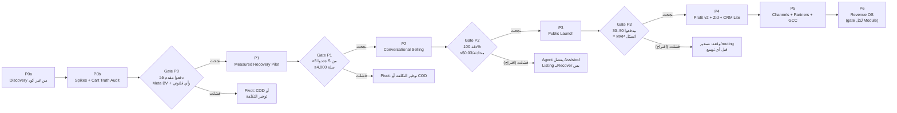

# 7. Master Development Phases

> الحالة: مسودة v1.0 — بانتظار موافقة المؤسس (2026-10-21)

> **المرجع:** الأسماء والـIDs (M01..M21، E01..E18، P0..P6) والأرقام هنا منقولة من الـDecision Spine. خريطة الـModules في [05-product-modules-map.md](05-product-modules-map.md)، وتقسيم MVP/Future في [06-mvp-vs-future-matrix.md](06-mvp-vs-future-matrix.md)، والاعتماديات بين المراحل بالتفصيل في [08-phase-dependencies.md](08-phase-dependencies.md)، والفريق في [10-team-structure.md](10-team-structure.md)، والميزانية في [11-budget-timeline.md](11-budget-timeline.md)، وأول 90 يوم في [12-first-90-days.md](12-first-90-days.md).
>
> **التصنيف:** [مؤكدة] = عليها مصدر (اطلاع 2026-10-21). [افتراض] = محتاجة اختبار. [اقتراح] = توصية مننا. [غير مؤكدة] = ملقيناش دليل في أي اتجاه.
>
> **Rule 1:** القسم ده تخطيط بس. مفيش كود منتج قبل اعتماد الـBlueprint، وأول كود (spikes وCart Truth Audit) بيتكتب في P0b.

---

## 7.0 منطق التقسيم

التقسيم مبني على سؤال واحد: **إيه أرخص حاجة نبنيها عشان نعرف إذا كان فيه بيزنس، وبعدين نكبّر؟** مش على "إيه الـModules اللي محتاجينها للرؤية الكاملة".

| المبدأ | التطبيق في المراحل | الـRule |
|---|---|---|
| كل Phase بتطلّع قيمة لعميل حقيقي بيدفع | من P1 فيه تجار بيدفعوا. P0 نفسها بتطلّع Cart Truth Audit مفيد للتاجر | 10، 12 |
| كل Phase ليها Gate رقمي، ولو فشلت منكملش | Exit criteria رقمية + Kill/Pivot criteria (القسم 7.9) | 11 |
| أكبر المخاطر الأول، حتى لو مش تقنية | P0 بتختبر الدفع وتصنيف Meta وشروط سلة قبل أي كود منتج | 1، 3، 10 |
| الـAI بييجي بعد ما الأساس يثبت | P1 **من غير** AI agent. الـagent في P2 وAssisted الأول | 8، 9 |
| الأمان والـtenancy والـconsent من أول يوم | E04 وE15 جوه P1، ومش بيتأجلوا أبدًا | 7 |
| مفيش Module متقدم قبل ما الـMVP يتسيّل | M13–M21 ممنوعين قبل P3 exit. التقرير الواحد (E07) **بيتبني جوه M09** مش M14 (نفس الاتفاق في [القسم 5](05-product-modules-map.md) و[القسم 9](09-technical-architecture.md))، والاستثناء الوحيد هو referral من M20 من غير dashboard في P3 (الـspine نفسه). أي استثناء تاني محتاج قرار مكتوب من المؤسس | 2، 12 |
| معمارية واحدة بسيطة | Laravel Modular Monolith لحد P5 على الأقل. أي service منفصل محتاج ADR | 6 |

**تعريف الـMVP (من الـspine):** الـMVP = اللي بيتسلّم في P1 + P2، ويتعتبر "اتطلق واتسيّل" عند نهاية **P3**.

---

## 7.1 نظرة عامة

> كل المدد والفرق والميزانيات [افتراض]. الميزانية بالريال **من غير راتب المؤسس**، وبافتراض مهندسين في مصر (الفريق في السعودية ≈ 2x). Burn = شهري. الـGates [اقتراح].

| ID | الاسم | الهدف في سطر | القيمة اللي العميل بيشوفها | المدة | الفريق | الميزانية | الـGate الأهم |
|---|---|---|---|---|---|---|---|
| **P0** | Discovery & Platform Gates | نقتل أكبر المجاهيل التجارية والمنصّاتية قبل كود المنتج | Cart Truth Audit: "كام سلة عندك فعلًا مؤهلة، وكام بتصرف عليها" | 5–7 أسابيع | المؤسس + مستشار قانوني بالساعة + (اختياري) باحث part-time في السعودية | 25–50 ألف إجمالي | **≥5 تجار دفعوا Proof Pilot مقدمًا** |
| **P1** | Measured Recovery Pilot (Private Salla App) | استرجاع end-to-end بـholdout وتقرير ربح، **من غير AI agent** | سلات بتترجع + Incremental Profit Report صادق | 10–12 أسبوع (الـspine). **الواقعي ~14–18 لو exit #1 و#2 فضلوا بنصهم** (ملاحظة 8، R33) | المؤسس + 1 Laravel full-stack full-time + مصمم part-time | burn 25–45 ألف ≈ 75–135 ألف | **≥3 من أول 5 جددوا بسعر كامل ≥399** |
| **P2** | Conversational Selling MVP | Agent بيقفل البيعة جوه المحادثة + COD لو اتأكد | ردود بيع دقيقة على الكتالوج 24/7 + (مشروط) تأكيد COD | 8–12 أسبوع | فوقهم: مهندس AI/QA part-time + CS part-time بيتكلم سعودي | burn 35–55 ألف ≈ 90–140 ألف | **دقة السعر والمخزون 100% على ≥300 حالة** |
| **P3** | Public Launch & Monetization (Salla App Store) | توزيع قابل للتكرار عن طريق متجر سلة + فوترة | تثبيت self-serve وتشغيل في ≤48 ساعة | 8–12 أسبوع (مراجعة سلة 3–6 أسابيع بالتوازي) | فوقهم: CS/Support عربي full-time | burn 45–70 ألف ≈ 110–175 ألف + تسويق 10–20 ألف | **30–50 متجر بيدفع، MRR 15–30 ألف** |
| **P4** | Profit Engine v2 + Zid + CRM Lite | تقليل الاعتماد على سلة وتعميق الميزة | زد، win-back/repeat/failed payment، تقديرات أدق من بيانات مجمّعة | 4–6 شهور | 4–6 أشخاص | burn 70–120 ألف | **≥15% من الإيراد من زد، NRR ≥100%** |
| **P5** | Channels, Partners & GCC Expansion | قنوات وشركاء وسوق تاني | Instagram/Messenger/Email، حملات بموافقة، API للوكالات | 6–12 شهر | 7–10 أشخاص | burn 120–200 ألف | **≥300 متجر، ARR ≥2.5–3 مليون** |
| **P6** | Revenue OS Platform | المنصة الكاملة، Module بـModule بـbusiness case | AI Business Analyst، Ops، Workflow builder، Enterprise | 12–24 شهر | 10+ | حسب الإيراد/التمويل | **gate منفصلة لكل Module: ≥5–10 عملاء ملتزمين يدفعوا** |

**الجدول الزمني التقريبي [افتراض]:** P0: أواخر أكتوبر–منتصف ديسمبر 2026. P1: ديسمبر 2026–مارس 2027 (أو لحد ~أبريل 2027 لو P1 اتمدت لـ14–18 أسبوع، وكل اللي بعدها بيتزق بنفس المدة، ملاحظة 8). P2: مارس–مايو 2027. P3: يونيو–أغسطس 2027. P4: سبتمبر 2027–فبراير 2028. P5: 2028. P6: من 2029 (أو أبدر لو الأرقام سمحت).

### توزيع الـModules على المراحل

| Module | P0 | P1 | P2 | P3 | P4 | P5 | P6 |
|---|---|---|---|---|---|---|---|
| M01 Identity, Access & Workspace | | ● | | | | | M21 بيكمّله |
| M02 Commerce Integrations | spikes + E17 | ● Salla private | | ● public | ● Zid | ● Shopify/Woo | |
| M03 Messaging Channels | BV | ● WhatsApp | | | | ● IG/Messenger/Email | |
| M04 Inbox & Handoff | | ● lite | ● | | | ● كامل | |
| M05 Catalog & Knowledge (RAG) | | E08 (الهامش) | ● | | | | |
| M06 AI Sales Agent | | | ● | | | | |
| M07 AI Gateway & Guardrails | | أساس (metering) | ● | | | | |
| M08 Revenue Recovery Engine | | ● Cart | ● COD (مشروط) | | ● win-back/repeat/failed payment | | |
| M09 Measurement & Attribution | E17 | ● + التقرير (E07) | | | ● pooled priors | | |
| M10 Consent & Compliance | قانوني | ● | | | | | |
| M11 Billing & Usage | | metering + يدوي | | ● Salla billing + annual | ● overage/outcome fee | | |
| M12 Platform Admin & Ops | | ● lite | | ● | | | |
| M13 Smart CRM | | | | | ● lite | | |
| M14 Analytics & AI Analyst | | (التقرير جوه M09) | | | | ● NL | ● Analyst |
| M15 Marketing Studio | | | | | | ● | |
| M16 Operations Automation | | | | | | | ● |
| M17 Workflow Builder | | | | | | | ● |
| M18 Marketplace & API | | | | | | ● webhooks/API/n8n | ● ERP/shipping/accounting |
| M19 Voice Agents | | | | | | | ● gated |
| M20 Agency & Partner | | | | ● referral | | ● dashboard | ● white label gated |
| M21 Enterprise | | | | | | | ● |

---

## 7.2 P0 — Discovery & Platform Gates

> أهم Phase في الخطة. لو فشلت، الخسارة ≤50 ألف ريال وأسابيع، مش 6 شهور بناء [افتراض].

### 1. Phase Name
**P0: Discovery & Platform Gates.** متقسمة لـ:
- **P0a (أسبوع 1–3):** من غير أي كود.
- **P0b (أسبوع 3–7):** spikes تقنية + Cart Truth Audit (E17)، **بعد اعتماد الـBlueprint بس** (Rule 1).

### 2. Main Objective
نقتل أكبر 3 مخاطر قاتلة، وكلها **مش تقنية**:
1. [افتراض] التاجر هيدفع مقابل رقم ربح أصغر وأصدق بدل "إيراد مسترجع".
2. [غير مؤكدة] Meta ممكن تصنّفنا AI Provider تحت القسم 4.7. الشرط نفسه [مؤكدة] https://www.facebook.com/legal/Meta-Terms-for-WhatsApp-Business-Platform (2026-10-21).
3. [افتراض] شروط سلة (عمولة ~30%، المراجعة، usage billing) تسمح باقتصاد صحي.

وكمان بنبدأ المسارات الطويلة اللي مش في إيدنا (Meta BV، Salla Partner، GCP Dammam، الرأي القانوني)، وبناخد القرارات اللي مينفعش نرجع فيها (WhatsApp data region، الكيان، الاستضافة).

### 3. Included Modules
- P0a: مفيش Modules.
- P0b: **M02** (spikes على Salla) و**M09** (جزء القياس في Cart Truth Audit). M03 على مستوى الإجراءات بس (BV وApp Review)، من غير بناء.

### 4. Included Features

| Feature | الوصف | Epic |
|---|---|---|
| مقابلات Discovery | سكريبت: الألم، السعر، قبول الـholdout، COD، كارت Meta الدولي، عدد السلات. قايمة 60 متجر مستهدف | — |
| عرض Proof Pilot | صفحة واحدة: 1,500 ريال مقدم لـ90 يوم، holdout إجباري، ضمان "الشهر التالت مجاني لو التقدير المجمّع مش موجب" [اقتراح] | — |
| Cart Truth Audit | read-only على سلة، **من غير WhatsApp ولا LLM**. بيطلّع: عدد السلات المتروكة، نسبة اللي فيها موبايل، توزيع القيمة والعمر، تقدير تكلفة Meta والخصومات الحالية. بيشتغل كـlead magnet ومصدر بيانات حقيقية (2–3 أسابيع) | E17 |
| Salla spikes | `checkout_url`/`pending_payment`، webhooks السلات، token refresh بـlock، Easy Mode | E02 |
| WhatsApp spike | إرسال template على MM API من demo WABA | E03 (spike بس) |
| الإجراءات المنصّاتية | تقديم Meta BV وApp Review، فتح Salla Partners + demo store، طلب GCP Invoiced Billing (Dammam) في **أول أسبوعين** | — |
| القانوني | رأي مكتوب: Meta 4.7، دور CODEX تحت PDPL (Processor ولا Controller)، الكيان والضريبة. مسودة DPA عربي | — |
| الـADRs | ADR-001..011 | — |

### 5. Dependencies

| الاعتمادية | النوع | ملاحظة |
|---|---|---|
| موافقة المؤسس على الـBlueprint | داخلية | شرط لبداية P0b بس. P0a تبدأ فورًا |
| وصول المؤسس لـ60 متجر في الـICP | تجارية | قنوات: LinkedIn، مجتمعات تجار سلة، معارف [افتراض] |
| Meta Business Verification | خارجية، مدتها مش في إيدنا | البداية 250 مستخدم/24 ساعة، و2,000 بعد BV [مؤكدة] https://developers.facebook.com/documentation/business-messaging/whatsapp/messaging-limits.md (2026-10-21) |
| Salla Partners + demo store | خارجية | Easy Mode إجباري للتطبيقات المنشورة [مؤكدة] https://docs.salla.dev/doc-421118 (2026-10-21) |
| GCP Dammam Invoiced Billing عن طريق CNTXT | خارجية | لو اتأخر → Frankfurt مؤقت (ADR-005) |
| استطلاع تعديلات لائحة PDPL | تنظيمية | الاستطلاع 6 أكتوبر–5 نوفمبر 2026 [مؤكدة] https://www.clydeco.com/en/insights/2026/10/sdaia-publishes-draft-amendments-to-the-pdpl (2026-10-21). بيقفل جوه نافذة P0 |

### 6. Technical Deliverables
- كود spikes مرمي (throwaway) على demo store، مع تقرير نتيجة لكل spike (نجح/فشل/قيود).
- Cart Truth Audit شغال read-only على ≥5 متاجر حقيقية.
- ADR-001..011 معتمدة في [`docs/adr/`](../adr/).
- قرار WhatsApp data localization region مكتوب في ADR-006 **قبل أول رقم**، لأنه مينفعش يتغيّر بعدين. السعودية مش متاحة، والمتاح في المنطقة الإمارات والبحرين، وZA (جنوب أفريقيا) متاحة كمان برّه المنطقة [مؤكدة: [saudi-regulatory-pdpl.md](../research/saudi-regulatory-pdpl.md)، https://developers.facebook.com/docs/whatsapp/cloud-api/reference/registration وhttps://developers.facebook.com/docs/whatsapp/cloud-api/overview/local-storage (2026-10-21)].
- تصميم أولي لنموذج البيانات الداخلي (`CommerceAdapter`، ADR-011) مستقل عن payloads سلة.

### 7. Business Deliverables
- ≥20 مقابلة موثّقة (هدف 25) + synthesis.
- ≥8 LOIs و≥5 Proof Pilots مدفوعة (≈7,500 ريال مقدم) [افتراض].
- رأي قانوني مكتوب + مسودة DPA عربي + سياسة خصوصية أولية.
- قرار الـwedge: Recovery لوحده، ولا Recovery + COD (بيحدد E16 في P2).
- قرار مبدئي على الكيان القانوني (BDR-001) قبل أول فاتورة.
- تأكيد أو رفض فرضية التسعير 399/699/999 [اقتراح].

### 8. Estimated Timeline
**5–7 أسابيع [افتراض]:** أواخر أكتوبر–منتصف ديسمبر 2026.

| الأسبوع | الشغل |
|---|---|
| 1–2 | تقديم BV، Salla Partners، طلب Dammam، التعاقد القانوني، السكريبت، قايمة 60 متجر |
| 2–3 | أول 10 مقابلات، عرض Proof Pilot، اعتماد الـBlueprint |
| 3–5 | Spikes، Cart Truth Audit على أول متاجر، باقي المقابلات |
| 5–7 | تحصيل الـdeposits، ADRs، الرأي القانوني، قرار الـwedge، Gate review |

### 9. Team Requirements
| الدور | الالتزام | المهمة |
|---|---|---|
| المؤسس | full-time | المقابلات والبيع **بنفسه (إلزامي)**، الـspikes، الـADRs |
| مستشار قانوني | بالساعة (15–30 ألف ريال) | Meta 4.7، PDPL، الكيان، DPA |
| باحث في السعودية | part-time، اختياري | ترتيب مقابلات |

### 10. Completion Criteria (كلها لازم تتحقق) [اقتراح]
| # | المعيار |
|---|---|
| 1 | ≥20 مقابلة في الـICP (هدف 25) |
| 2 | ≥8 design partners موقعين LOI، و**≥5 منهم دفعوا Proof Pilot مقدمًا** (1,500 ريال) |
| 3 | ≥60% بيفضّلوا "ربح إضافي صادق" على "إيراد مسترجع" |
| 4 | ≥5 متاجر عندهم ≥400 سلة مؤهلة/شهر (بيانات حقيقية من Cart Truth Audit) |
| 5 | ≥5 قبلوا holdout 10% |
| 6 | Meta BV مقبولة وApp Review متقدّم |
| 7 | رأي قانوني مكتوب: Meta 4.7، دور CODEX تحت PDPL، الكيان والضريبة |
| 8 | Spikes ناجحة على demo store: `checkout_url`، webhooks السلات، token refresh، إرسال template على MM API |
| 9 | ADR-001..011 معتمدة. ADR-006 (WhatsApp data region) وADR-007 (AI orchestration) بيتعتمدوا **كمبدأ** هنا، وADR-007 بيتراجع بتفاصيله قبل P2 بعد بيانات P1 (نفس تفسير [القسم 9](09-technical-architecture.md) 9.20، وخيار (ب) في [القسم 8](08-phase-dependencies.md) 8.2.2، وتوصية [القسم 14](14-key-decisions.md)) [اقتراح] |
| 10 | قرار الـwedge (Recovery / +COD) |

### 11. Risks
| الخطر | الأثر | التخفيف |
|---|---|---|
| التجار بيقولوا "عجبتني الفكرة" ومش بيدفعوا | قاتل | معيار الدفع المقدم، مش الكلام. Kill criterion: <5 دفعوا |
| Meta BV أو App Review بيتأخروا | بيأخر P1 | تقديم في أسبوع 1، وMulti-Partner مع Solution Partner كبديل |
| [افتراض] نسبة السلات اللي فيها موبايل وconsent أقل من المتوقع | الحجم مش كفاية للقياس | Cart Truth Audit بيقيسها قبل البناء |
| [افتراض] التاجر معندوش كارت دولي لرسوم Meta | بيكسر نموذج "رسوم Meta على كارت التاجر" | سؤال في كل مقابلة |
| Scope creep: المؤسس يبدأ يبني منتج في P0b | يكسر Rule 1 و10 | E17 read-only ومن غير WhatsApp ولا LLM |

### 12. What Can Be Deferred
كل كود المنتج، الواجهات، الـbilling، الكيان نفسه (القرار بس هنا)، اسم وبراند نهائي، موقع تسويق، أي تكامل غير سلة وواتساب.

---

## 7.3 P1 — Measured Recovery Pilot (Private Salla App)

### 1. Phase Name
**P1: Measured Recovery Pilot.** تطبيق سلة private، بيخدم الـdesign partners اللي دفعوا في P0.

### 2. Main Objective
استرجاع سلات end-to-end على WhatsApp الرسمي، بـholdout وتقرير ربح إضافي، **من غير AI agent**. الهدف إثبات إن (أ) التجار بيجددوا بسعر كامل، (ب) الأساس التقني (tenancy، consent، idempotency، القياس) متين قبل ما نحط عليه AI.

**ليه من غير agent؟** P1 من غير agent بيقلل خطر Meta 4.7، وبيخلّي الـrecovery خطة بديلة لو الـagent اتمنع [اقتراح: الـspine القسم 13].

### 3. Included Modules
M01، M02، M03، M04 (lite)، M08، M09، M10، M11 (metering)، M12 (lite). وأساس M07 (metering بس، مفيش LLM في المسار).

### 4. Included Features

| Epic | Feature | أولوية | ملاحظة |
|---|---|---|---|
| E01 | Workspace, Auth & Tenancy | P0 | Tenant = Team، دوران (Owner, Agent) |
| E02 | Salla Adapter | P0 | OAuth (Easy Mode)، token refresh في job واحدة بـdistributed lock، webhooks، reconciliation polling |
| E03 | WhatsApp Tech Provider onboarding | P0 | Embedded Signup v4، WABA للتاجر، Coexistence (دعمه في السعودية [غير مؤكدة]، لازم يتأكد في الـspike)، templates، MM API من أول يوم |
| E04 | Consent ledger + opt-out بكلمات عربي + quiet hours | P0 | Quiet hours افتراضي 22:00–09:00 (رمضان 01:00–12:00) [اقتراح]. مبني على نص CST [مؤكدة]، وانطباقه على WhatsApp [غير مؤكدة] |
| E05 | Recovery workflow | P0 | `scheduled_actions`، eligibility، scoring بقواعد، discount policy engine + approvals. أول رسالة ≥60 دقيقة، مفيش خصم في أول رسالة، تصنيف Marketing دايمًا |
| E06 | Holdout & Experiment engine + Cost ledger | P0 | holdout 10% على مستوى العميل بـhash ثابت. التكلفة: Meta وخصومات وLLM |
| E07 | Incremental Profit Report | P0 | **يدوي أول 4 أسابيع** (SQL + template)، بعدين صفحة واحدة في المنتج قبل نهاية P1 |
| E08 | إدخال الهامش لكل فئة | P0 | 5–10 فئات وقت الـonboarding |
| E12 | Handoff Inbox lite | P1 | queue، assign، notes، status، زرار takeover |
| E13 | Usage metering + فوترة يدوية | P1 | روابط دفع Moyasar/Tap. Stripe مش متاح لكيانات في السعودية [مؤكدة] https://stripe.com/global (2026-10-21) |
| E14 | Internal admin (Filament) | P1 | tenants، integration health، حالة الـtokens، quality rating للرقم |
| E15 | Security baseline | P0 | `audit_events` append-only، PII pseudonymization، isolation tests في CI، Sentry/Nightwatch بـredaction |

**مستبعد صراحةً من P1:** AI agent، أي LLM في مسار إرسال الرسائل، COD، dashboards عامة، self-serve onboarding، Zid.

### 5. Dependencies
| الاعتمادية | المصدر |
|---|---|
| P0 Gate كاملة (خصوصًا ≥5 دفعوا، BV، spikes) | P0 |
| ADR-002..005، 008، 009، 010، 013، 014، 015 معتمدين قبل بداية P1 | الـspine 8.1 |
| ADR-006 قبل أول رقم واتساب | الـspine 8.1 |
| App Review من Meta **مقبول** (مش بس متقدّم كما في P0 exit #6) قبل أول تاجر على Embedded Signup | من غيره مفيش وصول لـWABA التاجر عن طريق الـAPI [مؤكدة] https://developers.facebook.com/docs/whatsapp/solution-providers/get-started-for-tech-providers (2026-10-21). لو اتأخر: Multi-Partner مع Solution Partner كبديل مؤقت [اقتراح]. ده ممكن يأخّر أسابيع 1–4 |
| قرار الاستضافة: Dammam لو جاهز، وإلا Frankfurt بتصميم portable | ADR-005 |
| تعيين Laravel full-stack full-time مع بداية P1 | قرار المؤسس #13 |
| BDR-001 (الكيان) قبل أول فاتورة اشتراك | قرار المؤسس #6 |
| MM API: الإرسال التسويقي عبر Cloud API بيتوقف للحسابات الجديدة 2027-04-13 وللكل 2027-10-13 | [مؤكدة] https://developers.facebook.com/documentation/business-messaging/whatsapp/marketing-messages/overview.md (2026-10-21) |

### 6. Technical Deliverables
- Laravel 13 Modular Monolith بحدود Modules مفروضة بـPest arch tests، وInertia 3 + React (RTL/LTR بـlogical properties).
- PostgreSQL بـ`tenant_id` + Global Scope + isolation suite إجبارية في CI.
- جداول `webhook_events` (unique على provider + event_id) و`scheduled_actions` (Scheduler كل دقيقة بـ`SKIP LOCKED` وإعادة فحص الشروط وقت التنفيذ) و`audit_events` و`consent_records`.
- Reconciliation polling لسلة، لأن webhooks سلة بتعمل 3 محاولات بس [مؤكدة: salla-platform.md].
- Holdout assignment + cost ledger + صفحة Incremental Profit Report.
- Filament admin + مراقبة الـtokens وجودة الأرقام.
- Runbook للحوادث (إخطار التاجر خلال 24 ساعة [اقتراح]).
- البنية $150–400/شهر [افتراض].

### 7. Business Deliverables
- ≥6 متاجر live، ≥4 بيدفعوا.
- تقرير أسبوعي لكل تاجر، وأول **تقدير مجمّع** للأثر بنطاق ثقة معلن.
- 2–3 case studies أولية (بموافقة التاجر).
- DPA عربي موقّع مع كل تاجر، سياسة خصوصية، ROPA وقائمة sub-processors.
- Onboarding بإيدنا كخدمة (WABA، templates، BV) موثّق كـplaybook، عشان يتحول لـself-serve في P3.
- بيانات تسعير حقيقية: مين جدد بـ399، ومين اعترض.

### 8. Estimated Timeline
**10–12 أسبوع [افتراض: الـspine]:** ديسمبر 2026–مارس 2027. **الرقم ده مش متسق مع exit #1 و#2:** لو اتسابوا بنصهم، P1 الواقعية ~14–18 أسبوع (ملاحظة 8، و[R33 في القسم 13](13-risks-mitigation.md)). المؤسس لازم يختار **قبل بداية P1**: يمد P1، أو يليّن exit #1.

| الأسابيع | الشغل |
|---|---|
| 1–4 | E01، E02، E15، E04، E03 (أول تاجر على WABA) |
| 4–7 | E05، E06، E08. أول 2–3 تجار live. التقرير يدوي |
| 7–10 | باقي التجار، E12، E14، E13 |
| 10–12 | صفحة التقرير في المنتج، أول تقدير مجمّع، مفاوضات التجديد، Gate review |

> الجدول ده تقريبي. التفاصيل في PRD الـP1 بعد اعتماد الـBlueprint. **تنبيه:** بالجدول ده، exit #1 (60 يوم live) وexit #3 (4,000 سلة) مش هيتحققوا قبل أسبوع ~16–18 (وفي أحسن حالة ~14، لو الـ6 متاجر طلعوا live مع بعض في أسبوع 5–7، [القسم 8](08-phase-dependencies.md)). شوف "ملاحظات للمراجعة" #8.

### 9. Team Requirements
| الدور | الالتزام |
|---|---|
| المؤسس | dev + بيع + إدارة الـpilots |
| Laravel full-stack | full-time (أول تعيين) |
| مصمم | part-time (التقرير والـonboarding) |
| مستشار قانوني | بالساعة (DPA، مراجعة الـtemplates) |

الميزانية: burn 25–45 ألف ≈ 75–135 ألف للمرحلة [افتراض].

### 10. Completion Criteria (كلها لازم تتحقق) [اقتراح]
| # | المعيار |
|---|---|
| 1 | ≥6 متاجر live ≥60 يوم |
| 2 | ≥4 منهم بيدفعوا، و≥3 من أول 5 جددوا بسعر كامل ≥399 |
| 3 | ≥4,000 سلة مؤهلة اتعالجت (علاج + تحكم) |
| 4 | أول تقدير مجمّع للأثر بـinterval معلن |
| 5 | صفر تسريب cross-tenant في isolation suite |
| 6 | 100% opt-out <24 ساعة |
| 7 | صفر تقييد أو quality warnings من Meta |
| 8 | صفر webhooks ضايعة من غير reconciliation |
| 9 | ≥3 تجار بيقولوا إنهم غيّروا قرار (خصم أو إرسال) بسبب التقرير |
| 10 | وقت الفريق اليدوي ≤4 ساعات/تاجر/أسبوع |

### 11. Risks
| الخطر | التخفيف |
|---|---|
| [افتراض] الـpower الإحصائي ضعيف: 5%→7% محتاج ~10,700 سلة بـ90/10 | التقدير **مجمّع** على كل المتاجر ونطاق مع win probability، مش رقم لكل متجر |
| [افتراض] الأثر الإضافي ≈ صفر | ده نفسه نتيجة: زاوية "بنوفّر عليك رسائل وخصومات" (Kill/Pivot) |
| هشاشة سلة: refresh token بيتستخدم مرة واحدة، وإعادة استخدامه = إعادة تثبيت [مؤكدة] https://docs.salla.dev/doc-421118 (2026-10-21) | job واحدة بـlock + monitoring + reconciliation |
| حد الإرسال 250 مستخدم/24 ساعة قبل BV التاجر، على مستوى الـbusiness portfolio [مؤكدة] https://developers.facebook.com/documentation/business-messaging/whatsapp/messaging-limits.md (2026-10-21) | BV لكل تاجر جزء من الـonboarding |
| منحنى تعلم PostgreSQL للمؤسس (خبرته MySQL) | محسوب في المدة [افتراض] |
| Founder bandwidth (بيع + كود) | الـdev full-time، والتقرير اليدوي محدود بـ4 أسابيع |

### 12. What Can Be Deferred
AI agent (P2)، COD (P2 مشروط)، self-serve onboarding وSalla App Store (P3)، فوترة آلية (P3)، RBAC أكتر من دورين، tags وSLA في الـinbox (P5)، أي dashboards غير التقرير، RLS كطبقة تانية (بعد اختيار الاستضافة النهائي)، OpenTelemetry/Grafana.

---

## 7.4 P2 — Conversational Selling MVP

### 1. Phase Name
**P2: Conversational Selling MVP.**

### 2. Main Objective
Agent بيرد على أسئلة البيع ويقفل البيعة جوه المحادثة بـ`checkout_url`، محصور في كتالوج التاجر الحي، من غير هلوسة في السعر أو المخزون. + COD Confirmation **لو** P0 أكدت إنه ألم حقيقي.

### 3. Included Modules
M05، M06، M07، M04 (توسيع الـhandoff)، M08 (COD).

### 4. Included Features
| Epic | Feature | ملاحظة |
|---|---|---|
| E09 | Catalog sync & Knowledge base + hybrid search | FAQ وشحن واسترجاع. Postgres FTS/trigram + pgvector، normalization عربي |
| E10 | AiGateway | metering لكل tenant، routing (رخيص افتراضي + تصعيد لـSonnet بقواعد)، price/stock validator حتمي، golden set ≥300 حالة سعودي |
| E11 | AI Sales Agent | **Assisted ≥4 أسابيع** (مسودة والموظف يوافق) ثم Scoped Autonomous. ترشيح العطور (نوتات/مناسبة/ثبات من بيانات التاجر)، `checkout_url`، handoff. الرد سعودي، والفهم سعودي + مصري |
| E12 | Handoff Inbox (تكملة) | سجل محادثات الـAI + takeover |
| E16 | COD Confirmation | **مشروط بنتيجة P0**. لو مش متأكد، يتأجل لـP4 |

**ممنوع على الـagent (Rule 9):** خصومات، payment links مخصصة، أسئلة عامة برّه الكتالوج، طلب بيانات كارت. الخصم بيجي من محرك السياسات بالكود بس (ADR-014)، والـAI عمره ما بيقرره.

### 5. Dependencies
| الاعتمادية | ملاحظة |
|---|---|
| P1 Gate | خصوصًا ≥3 جددوا وصفر حوادث Meta |
| ADR-007 (Laravel AI SDK + AiGateway، من غير Python/LangGraph) | Rule 6 |
| E08 (الهامش) وبيانات الكتالوج من P1 | |
| عقود LLM بـzero-retention/no-training + PII pseudonymization (ADR-008) | [افتراض قانوني] |
| رأي قانوني P0 عن Meta 4.7 | الـagent محصور في الكتالوج + handoff = positioning كـcommerce platform |
| حالات طلب سلة (لـCOD) | التصنيف كـUtility [افتراض: لازم يتأكد] |

### 6. Technical Deliverables
- `AiGateway` ورا interface داخلي، Agent واحد + tools، approvable tools لأي حاجة فيها فلوس.
- Validator حتمي: أي رقم في الرد لازم ييجي من نتيجة tool، والـplaceholders بيعوّضها الكود.
- Golden set ≥300 حالة باللهجة السعودية + eval pipeline بيشتغل قبل كل تغيير model أو prompt.
- Metering للتوكنز والتكلفة لكل tenant ولكل محادثة.
- إعداد المستوى (Assisted / Scoped Autonomous) لكل tenant بـLaravel Pennant.
- LLM $100–500/شهر [افتراض].

### 7. Business Deliverables
- ترقية الـpilots من Recover (399) لـSell & Recover (699) [اقتراح].
- ≥10–15 متجر بيدفع.
- case study بيقارن handoff rate وتحويل المحادثات.
- تحديث الـDPA وقائمة الـsub-processors بمزوّدي الـLLM.

### 8. Estimated Timeline
**8–12 أسبوع [افتراض]:** مارس–مايو 2027. الـAssisted mode وحده ≥4 أسابيع لكل tenant، فأول tenant لازم يبدأ Assisted بدري في المرحلة.

### 9. Team Requirements
الفريق الحالي + مهندس AI/QA part-time (eval وgolden set) + CS part-time بيتكلم سعودي. Burn 35–55 ألف ≈ 90–140 ألف [افتراض].

### 10. Completion Criteria (كلها لازم تتحقق) [اقتراح]
| # | المعيار |
|---|---|
| 1 | دقة السعر والمخزون **100%** على ≥300 حالة باللهجة السعودية |
| 2 | الـvalidator بيمنع 100% من الأرقام اللي مش من نتائج الـtools |
| 3 | تكلفة المحادثة ≤$0.03 |
| 4 | handoff rate ≤40% |
| 5 | ≥4 أسابيع Assisted قبل Autonomous لأي tenant |
| 6 | ≥10–15 متجر بيدفع |
| 7 | retention ≥80% بعد 3 شهور للي بدأوا في P1 |
| 8 | صفر حوادث خصم أو سعر غلط اتبعت لعميل |

مرجع التكلفة: محادثة بيع (8 رسائل) ~$0.005 على Haiku 5.5/GPT-6 Luna و~$0.088 على Sonnet 5.5 [افتراض: ai-llm-costs-arabic.md]، وأسعار Haiku 5.5 $0.10/$0.50 لكل 1M [مؤكدة] https://platform.claude.com/docs/en/about-claude/pricing (2026-10-21). يعني سقف $0.03 بيسمح بتصعيد لـSonnet في **~30% من المحادثات كحد أقصى** (0.005 × 0.7 + 0.088 × 0.3 ≈ $0.030) [افتراض: مبني على تقديرات تكلفة المحادثة]. أي routing بيصعّد أكتر من كده بيكسر الـgate.

### 11. Risks
| الخطر | التخفيف |
|---|---|
| هلوسة السعر أو الخصم | validator + Assisted ≥4 أسابيع + دقة 100% كـgate |
| Meta تعتبر الـagent "AI assistant عام" | محصور في الكتالوج، handoff واضح، الـrecovery شغال من غيره |
| Meta Business Agent بـ$2/1M token من 2026-07-01 [مؤكدة] https://developers.facebook.com/docs/whatsapp/pricing (2026-10-21) بيخلّي "AI بيرد بالعربي" سلعة | قيمتنا في الربط بالهامش والقياس، مش الرد نفسه. لو التجار مش شايفين فرق، الـagent يفضل add-on جوه Sell & Recover مش سبب الشراء |
| الـmodels وأسعارها بتتغير بسرعة (أغلب الـmodels الحالية طلعت في آخر 1–3 شهور، وفيه أسعار ترويجية بتنتهي) [مؤكدة: [ai-llm-costs-arabic.md](../research/ai-llm-costs-arabic.md)] | `AiGateway` + eval بيخلّي التبديل رخيص |
| فهم اللهجات ضعيف | golden set سعودي، والمصري فهم بس |
| المؤسس لازم يبيع 4–9 متاجر جديدة بإيده (من ≥6 في P1 لـ≥10–15) وهو بيبني الـagent، ومن غير listing عام | تقسيم واضح: الـdev full-time على E09–E11، والمؤسس على البيع والـpilots. لو البيع وقف، ده إشارة طلب ضعيف مش مشكلة وقت [افتراض] |

### 12. What Can Be Deferred
Uplift/ML models، توصيات cross-sell، multi-agent، Voice، Instagram/Messenger، الـFashion (مقاسات ومرتجعات، P4)، golden set مصري (P6)، fine-tuning (ممنوع على بيانات WABA أصلًا، ولو مجمّعة [مؤكدة: شروط Meta، الـspine 3.4]).

---

## 7.5 P3 — Public Launch & Monetization (Salla App Store)

### 1. Phase Name
**P3: Public Launch & Monetization.** آخر مرحلة في الـMVP. نهايتها = **"الـMVP اتطلق واتسيّل"**.

### 2. Main Objective
تحويل اللي اشتغل يدوي مع 10–15 تاجر لتوزيع قابل للتكرار: listing عام على Salla App Store، onboarding self-serve، وفوترة آلية.

### 3. Included Modules
M11، M02 (public)، M12، M20 (referral بس).

### 4. Included Features
| Feature | Epic | ملاحظة |
|---|---|---|
| Salla App Store listing + self-serve onboarding | E18 | Easy Mode، wizard للـWABA والـtemplates والهامش |
| Salla billing | E13 | + Moyasar/Tap tokenization للعقود المباشرة والسنوي (ADR-012) |
| Annual subscriptions | — | خصم = شهرين، بعد قياس churn ≥3 شهور [اقتراح] |
| Usage overage | E13 | لو سلة سمحت بـusage billing [غير مؤكدة]، وإلا P4 مباشر |
| Referral program | M20 | عمولة محددة بمدة، من غير dashboard |
| Admin + monitoring للحجم | E14 | تنبيهات صحة التكاملات لكل tenant |
| ترحيل الإنتاج لـGCP Dammam | — | لو P1 بدأت على Frankfurt. لو اللائحة النهائية لـPDPL اعتمدت المادة 23 ونفاذها وقع قبل P3، الترحيل بيتقدّم ومبقاش جزء من P3 (ملاحظة 14) |

### 5. Dependencies
| الاعتمادية | ملاحظة |
|---|---|
| P2 Gate | |
| مراجعة سلة: 3–6 أسابيع، مفيش SLA | [افتراض] مبني على [مؤكدة] شكوى pending ~15 يوم. والـdata-handling review أشد علينا (قنوات تواصل + AI) [مؤكدة: salla-platform.md] |
| سياسة تطبيقات سلة | [مؤكدة] https://partners.salla.com/legal/apps-policy (2026-10-21). مستحقات سلة بتتصرف بعد ~15 يوم |
| ADR-012 (Billing) | |
| Embedded Signup: 10 عملاء/7 أيام → 200 بعد التحقق | [مؤكدة: whatsapp-business-platform.md]. لازم نكون اتحققنا قبل الإطلاق وإلا الـonboarding هيتخنق |

### 6. Technical Deliverables
- Onboarding self-serve كامل (من التثبيت لأول رسالة).
- تكامل Salla billing + Moyasar/Tap، وربط الـentitlements بالخطط (منفصل عن feature flags).
- الإنتاج على Dammam (أو ADR-005 محدّث بالبديل)، وbackup/DR في المكان اللي ADR-005 بيحدده. الـspine بيقول "region تانية"، لكن GCP مالهاش غير region سعودية واحدة، و[القسم 9](09-technical-architecture.md) بيوصي مبدئيًا بـmulti-zone جوه Dammam + نسخ مشفّرة offline (قرار مؤسس).
- Load/soak test على حجم 50 tenant [اقتراح].
- RLS كطبقة دفاع تانية لو الاستضافة اتحسمت [اقتراح].

### 7. Business Deliverables
- Listing منشور، صفحة التطبيق بالعربي، الـpositioning: "Profit Recovery لمتاجر سلة"، من غير "AI Chatbot" ولا "Autonomous" (الـspine 3.2).
- منهجية القياس منشورة (مصدر استدامة).
- Support عربي full-time + help center.
- برنامج referral.
- أسعار 399/699/999+ مُعتمدة أو مُعدّلة بناءً على بيانات P1–P2.

### 8. Estimated Timeline
**8–12 أسبوع [افتراض]:** يونيو–أغسطس 2027. التقديم لمراجعة سلة لازم يحصل في أول أسبوعين عشان الـ3–6 أسابيع تمشي بالتوازي.

### 9. Team Requirements
الفريق الحالي + CS/Support عربي full-time. Burn 45–70 ألف ≈ 110–175 ألف + تسويق 10–20 ألف [افتراض].

### 10. Completion Criteria (كلها لازم تتحقق) [اقتراح]
| # | المعيار |
|---|---|
| 1 | Listing منشور على Salla App Store |
| 2 | 30–50 متجر بيدفع |
| 3 | MRR 15–30 ألف ريال |
| 4 | gross margin ≥60% بعد عمولة سلة والـAI والاستضافة |
| 5 | logo churn ≤5%/شهر |
| 6 | self-serve onboarding ≤48 ساعة لـ70% من التجار |
| 7 | الإنتاج على GCP Dammam (أو قرار ADR-005 موثّق بالبديل). الموعد "قبل نهاية P3"، **إلا** لو اللائحة النهائية لـPDPL اعتمدت المادة 23 ونفاذها وقع قبل كده، ساعتها الموعد = **قبل النفاذ** (ملاحظة 14) |

### 11. Risks
| الخطر | التخفيف |
|---|---|
| [افتراض] عمولة سلة ~30% بتاكل الهامش (699 → ~490 صافي) | الـpilots والسنوي مباشر عبر Moyasar/Tap، ورسوم Meta على كارت التاجر |
| رفض أو تأخير المراجعة | تقديم بدري، ومتاجر P1–P2 بتكمل على الـprivate app |
| سلة تقدر توقف أي تطبيق [مؤكدة: salla-platform.md] | Commerce Adapter جاهز لزد في P4 |
| Self-serve بيكسر الـconsent أو جودة الرقم | الـconsent إجباري في الـwizard، وحدود إرسال افتراضية محافظة |
| الدعم بياكل وقت الفريق | Help center + قياس ساعات الدعم لكل تاجر |

### 12. What Can Be Deferred
Zid (P4)، outcome fee (P4)، agency dashboard (P5)، enterprise plans، white label، SaaS revenue analytics داخلية قبل 30 عميل، موقع تسويق بـNext.js (مسموح لاحقًا بس).

---

## 7.6 P4 — Profit Engine v2 + Zid + CRM Lite

> من هنا التفاصيل أقل عمدًا. الـPRD بييجي بعد P3 exit وبيانات حقيقية.

| الحقل | المحتوى |
|---|---|
| 1. Phase Name | P4: Profit Engine v2 + Zid + CRM Lite |
| 2. Main Objective | تقليل الاعتماد على سلة (خطر منصة) وتعميق الميزة بالبيانات المجمّعة |
| 3. Included Modules | M02 (Zid)، M08 (win-back، repeat، failed payment)، M09 (pooled priors)، M13 (lite)، M11 (overage، outcome fee). الـannual بيبدأ في P3 (الـspine 6.2 والقسمين 5 و6)، وهنا بس توسيعه لو احتاج |
| 4. Included Features | Zid Adapter (60 req/min لكل تطبيق لكل متجر [مؤكدة] https://docs.zid.sa/rate-limiting-644369m0 (2026-10-21))؛ win-back وrepeat purchase وfailed payment بنفس منطق الـholdout؛ pooled priors لكل قطاع؛ CRM lite (profiles وsegments وtimeline من بيانات المتجر)؛ outcome fee اختياري 2–5% على الربح الإضافي المثبت [اقتراح]؛ COD لو اتأجل من P2؛ دعم الـFashion لو المقابلات أكدت |
| 5. Dependencies | P3 Gate؛ ≥3 شهور بيانات من 30+ متجر للـpriors؛ ADR-009 (نتائج سلة/زد فقط، مش نصوص WABA)؛ رأي قانوني عن الـpooling (Processor/Controller) [افتراض]؛ Python worker بس لو batch statistics احتاجته، بـADR |
| 6. Technical Deliverables | Zid عبر نفس `CommerceAdapter`؛ محرك priors مجمّعة؛ workflows جديدة على `scheduled_actions`؛ overage billing |
| 7. Business Deliverables | Listing على زد؛ benchmarks قطاعية (عطور/تجميل) منشورة؛ مبيعات/شراكات بدوام |
| 8. Estimated Timeline | 4–6 شهور [افتراض]: سبتمبر 2027–فبراير 2028 |
| 9. Team Requirements | 4–6 أشخاص (+ مطوّر تكاملات + مبيعات/شراكات). Burn 70–120 ألف [افتراض] |
| 10. Completion Criteria [اقتراح] | (1) 100–150 متجر بيدفع. (2) ARR 0.5–1.25 مليون ريال. (3) ≥15% من الإيراد من زد. (4) NRR ≥100%. (5) pooled priors بنطاقات ثقة أضيق ≥30% من تقدير التاجر لوحده. (6) gross margin ≥65%. (7) CAC payback ≤6 شهور |
| 11. Risks | [افتراض] Karam ينسخ الـholdout في أسابيع (السبق في البيانات مش الفكرة)؛ سلة تطلق holdout أو agent native؛ الـpooling يحوّلنا لـController تحت PDPL؛ Zid بيستهلك وقت الفريق كله |
| 12. What Can Be Deferred | Uplift models لكل تاجر (لو الـpriors كفاية)، CRM كامل، Shopify/Woo، أي قناة غير واتساب |

---

## 7.7 P5 — Channels, Partners & GCC Expansion

| الحقل | المحتوى |
|---|---|
| 1. Phase Name | P5: Channels, Partners & GCC Expansion |
| 2. Main Objective | قنوات إضافية وشركاء وأول سوق خليجي، **بس اللي الطلب عليه مثبت** |
| 3. Included Modules | M03 (Instagram، Messenger، Email)، M04 (inbox كامل)، M15 (حملات بموافقة)، M14 (NL analytics)، M02 (Shopify/Woo حسب الطلب)، M18 (webhooks/API/n8n)، M20 (agency dashboard) |
| 4. Included Features | Inbox بـtags وSLA؛ حملات وbroadcasts **بموافقة صريحة فقط** ومن غير تغيير ميزانيات إعلانية تلقائيًا (Rule 9)؛ أسئلة بالعربي على البيانات؛ REST API وoutbound webhooks؛ agency dashboard؛ دخول الإمارات |
| 5. Dependencies | P4 Gate؛ طلب مثبت من المقابلات على IG/Messenger؛ دراسة قوانين التسويق وحماية البيانات في الإمارات؛ وجود براندات D2C أكبر قبل Shopify/Woo |
| 6. Technical Deliverables | Channel abstraction في M03؛ Public API بـversioning وrate limits لكل tenant؛ approval workflows للحملات |
| 7. Business Deliverables | برنامج وكالات؛ حضور في الإمارات؛ تسعير بالدرهم |
| 8. Estimated Timeline | 6–12 شهر [افتراض]: 2028 |
| 9. Team Requirements | 7–10 أشخاص. Burn 120–200 ألف (من الإيراد أو تمويل) [افتراض] |
| 10. Completion Criteria [اقتراح] | (1) ≥300 متجر. (2) ARR ≥2.5–3 مليون ريال. (3) NRR ≥100%. (4) ≥20% من العملاء الجداد من partners. (5) أول سوق خليجي (الإمارات) فيه ≥20 متجر |
| 11. Risks | تشتت الفريق على قنوات كتير؛ الوكالة ممكن تبقى منافس (Mersal غالبًا خارج من وكالة "مكاسب" [افتراض: [mersal-ai.md](../research/mersal-ai.md)]؛ وجود الوكالة نفسها وشراكتها مع سلة وزد [مؤكدة] https://makaseb.sa/ (2026-10-21))؛ حملات بتضر جودة رقم التاجر عند Meta |
| 12. What Can Be Deferred | Live chat، Shopify/Woo لو الطلب ضعيف، أسواق خليجية تانية، white label |

---

## 7.8 P6 — Revenue OS Platform

> P6 مش "مرحلة بناء واحدة". هي مجموعة Modules، **كل واحد بـgate مستقلة**: ≥5–10 عملاء ملتزمين يدفعوا تمنه قبل أول سطر كود.

| الحقل | المحتوى |
|---|---|
| 1. Phase Name | P6: Revenue OS Platform |
| 2. Main Objective | المنصة الكاملة اللي في الرؤية، Module بـModule بـbusiness case |
| 3. Included Modules | M14 (AI Business Analyst)، M16، M17، M18 (ERP، shipping، accounting)، M19 (Voice، gated)، M20 (White label، gated)، M21 (Enterprise)، مصر وباقي الخليج |
| 4. Included Features | Analyst بيقترح إجراءات (مش بينفّذ ماليًا)؛ order workflows وإشعارات شحن وتنبيهات مخزون؛ workflow builder؛ advanced RBAC وSLA وretention policies؛ Voice بعد دراسة؛ golden set مصري مع دخول مصر |
| 5. Dependencies | P5 Gate (أو أرقام تسمح بالبدء أبدر)؛ gate منفصلة لكل Module؛ ADR لأي service منفصل (مثلًا Python worker للـVoice) |
| 6. Technical Deliverables | بيتحدد لكل Module في PRD منفصل |
| 7. Business Deliverables | خطط Enterprise؛ شراكات ERP/shipping؛ دخول مصر |
| 8. Estimated Timeline | 12–24 شهر [افتراض]، من 2029 |
| 9. Team Requirements | 10+ |
| 10. Completion Criteria [اقتراح] | كل Module بيبدأ بس لو ≥5–10 عملاء ملتزمين يدفعوا تمنه. Voice محتاج دراسة تكلفة وقوانين مكالمات. White label بعد شهر 24 على الأقل. ومعيار نجاح لكل Module بيتحدد في الـbusiness case بتاعه |
| 11. Risks | التحول لـ"منتج لشركة فيها 50 شخص" قبل الأوان (Rule 12)؛ Voice عالي التكلفة وقانونيًا معقد؛ White label بيضعف البراند ويعقّد العلاقة مع Meta |
| 12. What Can Be Deferred | أي Module ماعداش الـgate بتاعه. Custom integrations مرفوضة إلا لو مدفوعة بالكامل وبتتحول لـfeature عامة |

---

## 7.9 قواعد الانتقال بين المراحل (Kill / Pivot) [اقتراح، تتعتمد رسميًا]

| النقطة | الشرط | القرار |
|---|---|---|
| آخر P0 | أقل من **5** تجار دفعوا مقدم | منبنيش. نراجع الـwedge (COD أو "توفير التكلفة") |
| أي وقت | Meta رفضت أو صنّفتنا AI Provider | recovery/COD من غير محادثة AI، أو قناة تانية |
| آخر P1 | أقل من **2** جددوا، أو الأثر الإضافي ≈ صفر والتجار مش هيدفعوا للصراحة | Pivot لـ"توفير التكلفة" أو COD |
| آخر P2 [اقتراح، مش في الـspine] | دقة السعر <100% أو أي حادثة خصم/سعر غلط | الـagent يفضل Assisted، ومنقدّمش لسلة بيه. لو التكلفة >$0.03 أو الـhandoff >40% بس: P3 بباقة Recover (399) لوحدها. التفاصيل في [القسم 8.4](08-phase-dependencies.md) |
| آخر P3 [اقتراح، مش في الـspine] | gross margin تحت الحد، أو أقل من 30 متجر بيدفع | منوسّعش (مفيش توظيف P4 ولا Zid) لحد ما التسعير أو الـrouting يتصلّح. سلة رفضت الـListing → بيع مباشر + تسريع Zid ([القسم 8.4](08-phase-dependencies.md)) |
| أي Gate | فشلت مرتين | وقفة مراجعة كاملة قبل أي إنفاق جديد |
| أي Gate | نجحت جزئيًا (مثلًا 4 من 5 دفعوا) | المؤسس يقرر صراحةً ويوثّق السبب، ومفيش انتقال تلقائي [اقتراح] |

### حاجات شغالة في كل المراحل ومش بتتأجل
| البند | من إمتى |
|---|---|
| Consent ledger وopt-out <24 ساعة وquiet hours | P1 |
| Isolation tests في CI وPII خارج الـLLM و`audit_events` | P1 |
| Usage metering لكل tenant | P1 |
| WhatsApp رسمي فقط (Rule 8) | للأبد |
| مفيش خصم أو إجراء مالي من الـAI من غير سياسة وموافقة (Rule 9) | للأبد |
| متابعة changelog سلة وMeta أسبوعيًا (مُهَل deprecation أسبوعين–17 يوم [مؤكدة: salla-platform.md]) | P0b |
| Holdout في كل تدخّل recovery | P1 |

### الأهداف التراكمية (من بداية P0) [افتراض]
| النقطة | العملاء | MRR (ريال) | الحالة |
|---|---|---|---|
| 30 يوم | 0 live، ≥10 مقابلات، ≥3 LOIs | 0 | BV مقدّمة، طلب Dammam مقدّم، مستشار قانوني متعاقد [اقتراح] |
| 90 يوم | ≥5 Proof Pilots مدفوعة، 2–4 live | 0–2,000 (+7,500 pilot fees مقدم) | P0 مقفولة، P1 في النص |
| 6 شهور | 6–10 بيدفعوا | 2,500–5,000 | P1 مقفولة، أول pooled estimate (لو P1 اتمدت لـ14–18 أسبوع، P1 بتقفل حوالي شهر 6–7، ملاحظة 8) |
| 12 شهر | 30–60 بيدفعوا | 15,000–35,000 | P3 مقفولة، Listing منشور، بداية P4 |
| 24 شهر | 120–250 بيدفعوا | 60,000–150,000 | P4 مقفولة، Zid ≥15% من الإيراد، P5 بدأت |
| Runway لحد نهاية P3 | — | — | **300–500 ألف ريال** (~9–11 شهر) [افتراض: الـspine، على P1 = 12 أسبوع. لو P1 اتمدت: +~17–62 ألف، ملاحظة 8] |

---

## ملاحظات للمراجعة

> الملاحظات دي **مش تعديل صامت** على الـspine. القسم ماشي بأرقامه بالنص، وده اللي محتاج المؤسس يحسمه. الملاحظات اللي اتحسمت اتشالت (مصدر Stripe، دول تخزين WhatsApp، مكان E07، توقيت الـannual في الجداول).

1. **توقيت تجديد الـProof Pilot مقابل P1 exit #2.** الـpilot 90 يوم. لو الـ90 يوم بتتحسب من الـgo-live (المنطقي)، أقرب تجديد حقيقي حوالي أسبوع 17–19 من P1، يعني **بعد** نهاية P1 بأسابيع. الخيارات (نفسها في [القسم 8](08-phase-dependencies.md)): (ج) "جدد" = وقّع أو دفع التجديد قبل نهاية الـpilot، حتى لو الاشتراك بيبدأ بعدين، أو (د) الـ90 يوم بتتحسب من تاريخ الدفع، وده بيقصّر التشغيل الفعلي قبل قرار التاجر لـ~5–6 أسابيع ويضعف الدليل. **توصيتنا (ج)** [اقتراح].
2. **الميزانية لحد نهاية P3.** [القسم 11](11-budget-timeline.md) حسبها 300–525 ألف صافي بعد الإيراد، والـ525 (الـAggressive) فوق سقف الـspine بـ~5% بسبب الكيان السعودي (~40–60 ألف [افتراض]). القسم 11 مخطط P1 وP2 على 12 أسبوع، فلو P1 اتمدت (ملاحظة 8) الرقم يزيد ~6–17 ألف لكل أسبوع [افتراض: burn أسبوعي]. **قرار مؤسس.**
3. **BDR-001 قبل أول فاتورة، وأول تحصيل بيحصل في P0b** (الـpilot deposits). يعني قرار الكيان (أو طريقة تحصيل مؤقتة موثّقة، مثلًا تحويل بنكي + فاتورة من الكيان الحالي) لازم يتحسم جوه P0 حوالي أسبوع 5، مش "قبل أول فاتورة" بشكل عام. نفس الملاحظة في القسم 8 (ملاحظة 2).
4. **P2 exit #6 "≥10–15 متجر"** نطاق مش رقم. للـGate لازم رقم واحد؛ اقتراحنا ≥10 كحد أدنى و15 كهدف.
5. **P1 exit #4 (تقدير مجمّع بـinterval):** بـ4,000 سلة وholdout 10% (~400 تحكم)، النطاق هيكون عريض جدًا (5%→7% محتاج ~10,700 بـ90/10 [افتراض: حسابات power]). المعيار بيتحقق شكليًا، لكن لازم نتفق مسبقًا إن النطاق العريض **مقبول** في P1 ومش فشل. [القسم 13](13-risks-mitigation.md) بيقترح holdout 20% في الـpilots بس.
6. **ADR-005:** AWS Saudi (ديسمبر 2026) وAzure Saudi East (نوفمبر 2026) [مؤكدة كإعلانات، الموعد الدقيق غير مؤكدة] هيبقوا متاحين أثناء P0–P1. الـspine بيقول Dammam أولًا وبيمنع UAE/Bahrain بس. نقترح ADR-005 يقارنهم بـDammam بدل ما يستبعدهم ضمنيًا.
7. **ZATCA Wave 25 (2027-02-01)** بتقع جوه P1. غالبًا مش هتنطبق علينا بالحجم ده (للمقيمين فوق 187,500 ريال)، لكن BDR-001 لازم يذكرها.
8. **مدة P1 مقابل exit #1 (≥6 متاجر live ≥60 يوم) و#3 (4,000 سلة).** أول 2–3 تجار live في أسبوع 4–7، فيكمّلوا 60 يوم (~8.5 أسبوع) في أسبوع 12.5–15.5. وباقي التجار live في أسبوع 7–10، فيكمّلوا في أسبوع 15.5–18.5. يعني **P1 الواقعية ~14–18 أسبوع**: ~14 في أحسن حالة ([القسم 8](08-phase-dependencies.md)، لو الـ6 طلعوا live مع بعض في أسبوع 5–7)، و16–18 بالجدول اللي فوق [افتراض: حساب من الجدول]. وexit #2 (التجديد بعد pilot 90 يوم) بيزوّد المشكلة (ملاحظة 1). الخيارين (نفسهم في القسمين 8 و12 وفي [R33 بالقسم 13](13-risks-mitigation.md)): (أ) P1 = 14–18 أسبوع وبيتحسب في الـrunway، أو (ب) المعيار يبقى "≥6 live، منهم ≥3 عدّوا 60 يوم"، مع تعريف "جدد" بخيار (ج) في ملاحظة 1. **أثر (أ) على الـrunway:** [القسم 11](11-budget-timeline.md) (ملاحظة 10 هناك) بيحسب التمديد 3–6 أسابيع بـ~17–62 ألف ريال إضافي [افتراض/حساب]، وكل الـgantt بيتأخر بنفس المدة، يعني الـrunway لحد نهاية P3 (300–500 ألف في جدول الأهداف التراكمية تحت 7.9) لازم يتراجع، والقسم 11 لسه ماشي على 12 أسبوع. (ب) مفيهوش تكلفة، لكنه بيضعف الدليل اللي الـGate بيعتمد عليه. **قرار مؤسس قبل بداية P1**، ولحد ما يتاخد الجداول هنا فضلت على أرقام الـspine.
9. **الـburn × المدة مش مطابق للمدد.** P1: 25–45 ألف × 10–12 أسبوع (2.3–2.8 شهر) = ~58–126 ألف، مش 75–135 (ده 3 شهور). P2: 35–55 × 8–12 أسبوع = ~65–150، مش 90–140. P3: 45–70 × 8–12 أسبوع = ~83–190، مش 110–175. الفرق صغير، والجداول هنا ماشية على أرقام الـspine. لو P1 اتمدت (ملاحظة 8)، الرقم يطلع.
10. **P3 exit #3 (MRR 15–30 ألف) مع #2 (30–50 متجر):** 30 متجر كلهم على Recover = 11,970 ريال بس، فالحد الأدنى محتاج ARPA ≥500. ولازم يتحدد: الـMRR **قبل ولا بعد** عمولة سلة (~30% [افتراض]).
11. **P3 exit #4 (gross margin ≥60%) معتمد على التعريف.** [القسم 11](11-budget-timeline.md) بيوري إنه ~72–76% على الصافي، و~60% على السعر الإجمالي عند نصيب سلة 60%، و~56% بالدعم، وبيوصي بتعريف full-COGS على الصافي بهدف ≥55% في P3 و≥60% في P4. ده **قرار مؤسس** ومش تعديل في الـspine.
12. **مسار فشل لـGate 2 وGate 3:** الـspine حدد Kill/Pivot لـP0 وP1 بس. ضفنا صفين في 7.9 (ومسارين في الرسم) متطابقين مع [القسم 8.4](08-phase-dependencies.md)، وكلهم [اقتراح] محتاج اعتماد.
13. **تعارضات صغيرة جوه الـspine:** (أ) P0 exit #9 بيطلب ADR-001..011 كلها، بينما جدول الـADRs بيقول ADR-006 "قبل أول رقم" وADR-007 "قبل P2". الخيارين (نفسهم في [القسم 8](08-phase-dependencies.md) تحت جدول 8.2.2): شرط (9) يبقى "ADR-001..006 و008..011" وADR-007 قبل P2، أو (ب) الاتنين يتعتمدوا في P0 كمبدأ وADR-007 يتراجع بتفاصيله قبل P2. **القسم ده ماشي على (ب)** زي [القسم 9](09-technical-architecture.md) 9.20 و[القسم 14](14-key-decisions.md)، واتكتب كده في P0 exit #9. محتاج تأكيد المؤسس. (ب) Annual subscriptions: الـspine 6.2 بيقول P3، وجدول المراحل بيحطها تحت M11 في P4. الأقسام 5 و6 و7 ماشيين على **P3**، وجدول المراحل في الـspine محتاج يتعدّل. (ج) الـProof Pilot "بيتخصم من أول اشتراك سنوي"، والسنوي مش متاح قبل P3 وبعد ≥3 شهور churn، يعني الخصم ده عمليًا مش هيتطبّق على أغلب الـpilots. (د) ضمان "الشهر التالت مجاني" على مبلغ اتدفع مقدمًا = استرداد ~500 ريال أو credit، ولازم يتكتب كده في العقد (ADR-013).

14. **موعد ترحيل Dammam (ADR-005، P3 exit #7) ممكن يتقدّم.** المكتوب "قبل نهاية P3". لو اللائحة النهائية لـPDPL اعتمدت المادة 23 بنصها، النفاذ بعد 60 يوم من النشر [مؤكدة كمسودة: https://www.clydeco.com/en/insights/2026/10/sdaia-publishes-draft-amendments-to-the-pdpl (2026-10-21)]، وده ممكن يقع جوه P1 (أقرب تقدير ~يناير–فبراير 2027 [افتراض: [القسم 8](08-phase-dependencies.md)]). ساعتها الموعد يبقى **"قبل النفاذ"**، وP3 exit #7 يتحول لتأكيد إن الترحيل حصل بالفعل. نفس الملاحظة في [القسم 9](09-technical-architecture.md) (9.18.2 وملاحظة 5)، و[القسم 11](11-budget-timeline.md) (ملاحظة 11: علاوة Dammam بتبدأ بدري، والـDevOps contractor ممكن يتقدّم لـP1)، و[القسم 13](13-risks-mitigation.md) (R16). التصميم الـportable بيخلّي الترحيل أسابيع مش شهور [اقتراح]. **قرار مؤسس** بعد نشر اللائحة والرأي القانوني.
