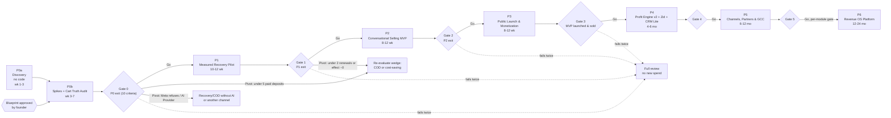
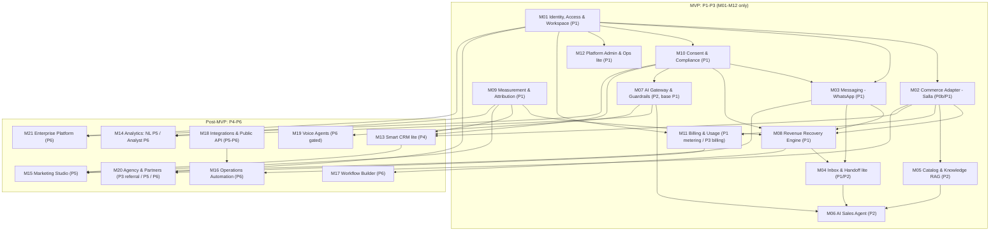
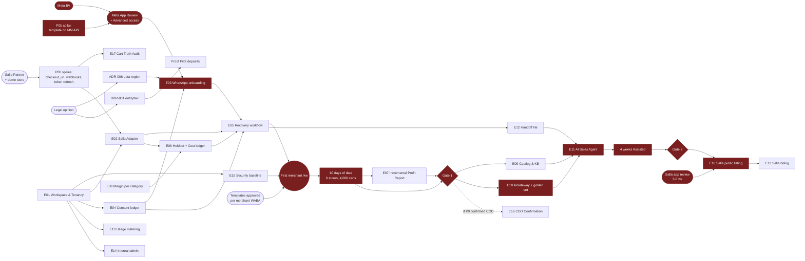
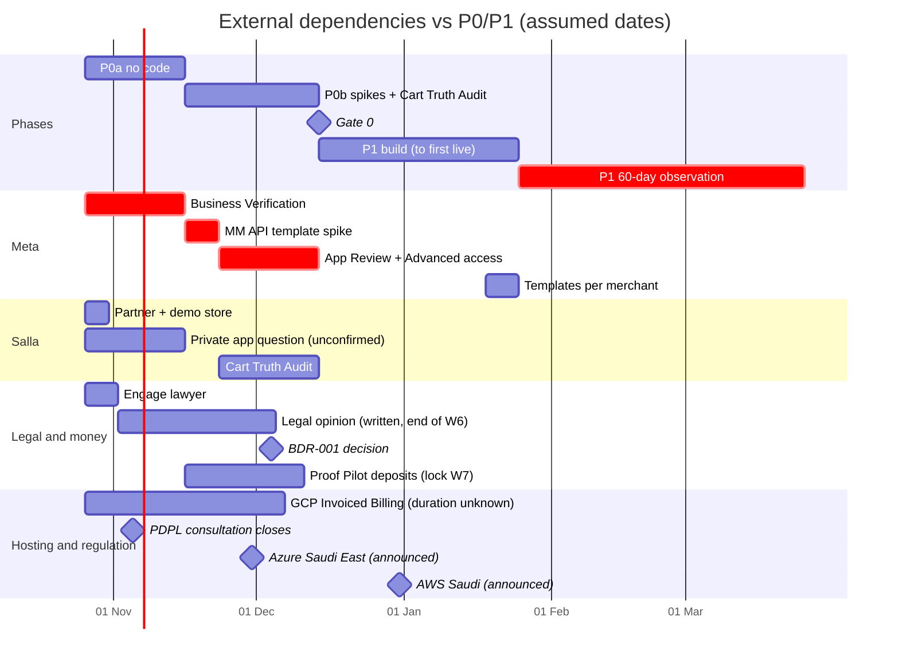

# 8. Phase Dependencies

> الحالة: مسودة v1.0 — بانتظار موافقة المؤسس (2026-10-21)

> **المراجع:** المراحل وExit Criteria الكاملة في [07-master-development-phases.md](07-master-development-phases.md). المخاطر العامة في [13-risks-mitigation.md](13-risks-mitigation.md). المعمارية والـADRs في [09-technical-architecture.md](09-technical-architecture.md). أول 90 يوم في [12-first-90-days.md](12-first-90-days.md). الميزانية في [11-budget-timeline.md](11-budget-timeline.md). قرارات المؤسس في [14-key-decisions.md](14-key-decisions.md).
> البحث: [whatsapp-business-platform.md](../research/whatsapp-business-platform.md) · [salla-platform.md](../research/salla-platform.md) · [saudi-regulatory-pdpl.md](../research/saudi-regulatory-pdpl.md) · [tech-stack-options.md](../research/tech-stack-options.md) · [market-and-pricing.md](../research/market-and-pricing.md).
> **التصنيف:** [مؤكدة] = عليها مصدر (تاريخ الاطلاع 2026-10-21 لكل الروابط). [افتراض] = محتاجة اختبار. [اقتراح] = توصية مننا. **غير مؤكدة** = ملقيناش دليل في أي اتجاه.
> **Rule 1:** القسم ده تخطيط بس. مفيش كود.

---

## 8.0 الخلاصة في 6 نقط

1. **المسار الحرج مش تقني، هو Meta.** أول تاجر مش هيبقى live غير لما يخلص: Business Verification ← App Review (ومحتاج فيديو من spike شغّال) ← Advanced access ← Embedded Signup للتاجر ← templates متوافق عليها. ولا سطر كود من بتوعنا بيقصّر السلسلة دي. [مؤكدة: ترتيب الخطوات] [افتراض: المدة الكلية 2–4 أسابيع]. **دقة مهمة:** Gate 0 محتاجة BV **مقبولة** وApp Review **متقدّم** بس (شرط P0 رقم 6)، فالـBV على المسار الحرج لـGate 0، لكن **موافقة** App Review عندها slack قد مدة البناء (حوالي 4–6 أسابيع) قبل ما تبقى هي اللي بتأخّر أول go-live. [افتراض: حسابات]
2. **فيه سلسلة حرجة تانية موازية: القانوني ← الكيان ← تحصيل الفلوس.** شرط P0 رقم (2) (≥5 دفعوا Proof Pilot مقدمًا) معناه إن أول فاتورة بتطلع **جوه P0**، فـBDR-001 (الكيان والضريبة) لازم يتحسم قبل الأسبوع 5–6 تقريبًا، مش "بعدين". [اقتراح]
3. **شرط "≥6 متاجر live ≥60 يوم" هو اللي بيحدد طول P1 فعليًا، مش البناء.** لو الـ6 متاجر طلعوا live مع بعض في أسبوع 5–7 من P1 (أحسن حالة)، أقرب exit هو أسبوع ~14–16، وبجدول [القسم 7](07-master-development-phases.md) (باقي التجار live في أسبوع 7–10) بيبقى 16–18. الاتنين أطول من الـ10–12 أسبوع المكتوبين في الـspine. والأسوأ: شرط P1 رقم (2) "≥3 من أول 5 جددوا" مربوط بنهاية الـProof Pilot (90 يوم)، فلو الـ90 يوم بتتحسب من الـgo-live، أقرب تجديد حقيقي حوالي أسبوع 17–19 من P1 (شوف ملاحظات المراجعة). [افتراض: حسابات]
4. **المراحل متسلسلة على مستوى الـGates، لكن التحضير ممكن يتوازى.** مسموح نبدأ prework لـP2 (golden set وcatalog sync) جوه فترة مراقبة P1، ونجهّز ملف مراجعة سلة في آخر P2. **ممنوع** أي Module من M13 لـM21 قبل P3 exit. [اقتراح] / [قاعدة الـspine]
5. **3 قرارات irreversible لازم تسبق أول رقم واتساب:** الـdata localization region للـWABA (ADR-006)، والكيان اللي بيتعمل عليه Business Verification، ونموذج دفع رسوم Meta (كارت التاجر). [مؤكدة: الـregion مش قابل للتغيير]
6. **أخطر dependency خارجية مالهاش بديل كامل:** تصنيف Meta لينا كـAI Provider (القسم 4.7). عشان كده P1 مبني **من غير AI agent**، والـrecovery شغّال لوحده لو الـagent اتمنع. [غير مؤكدة: تطبيق الشرط علينا]

---

## 8.1 Phase-to-Phase Graph (مع الـGates)

| الانتقال | نوع الاعتماد | اللي بيتنقل من المرحلة اللي فاتت للي بعدها | ممكن تبدأ قبل الـGate؟ |
|---|---|---|---|
| Blueprint → P0b | **Hard** (Rule 1) | موافقة المؤسس على الـBlueprint | لأ. P0a بس (من غير كود) |
| P0 → P1 | **Hard** | ≥5 deposits، قرار الـwedge، ADR-001..011، Meta BV مقبولة وApp Review متقدّم، spikes ناجحة، رأي قانوني | جزئيًا: التوظيف (إعلان ومقابلات) وتصميم الـschema على الورق [اقتراح] |
| P1 → P2 | **Hard** على الـagent | بيانات holdout حقيقية، consent ledger شغّال، handoff inbox lite، تجار بيجددوا | prework بس: golden set وتصميم E09 (شوف 8.5) [اقتراح] |
| P2 → P3 | **Hard** | دقة سعر 100%، تكلفة محادثة ≤$0.03، ≥10–15 متجر بيدفع | تجهيز ملف مراجعة سلة والـprivacy disclosure في آخر P2 [اقتراح] |
| P3 → P4 | **Hard** (قاعدة الـspine) | الـMVP اتطلق واتسيّل، Listing منشور، MRR 15–30 ألف | لأ. مفيش M13+ قبل P3 exit |
| P4 → P5 | Hard | Zid ≥15% من الإيراد، pooled priors، NRR ≥100% | مقابلات طلب القنوات (Instagram/Shopify) بس |
| P5 → P6 | **Soft، لكل Module لوحده** | ≥5–10 عملاء ملتزمين يدفعوا تمن الـModule | كل Module له gate منفصلة |

---

## 8.2 Module-to-Phase Dependency Graph

الأسهم معناها "لازم يكون موجود قبل". اللون الغامق = MVP (P1–P3).

### 8.2.1 جدول الاعتماد بين الـModules

| Module | بيعتمد على (Hard) | بيعتمد على (Soft) | ليه الاعتماد ده موجود |
|---|---|---|---|
| M01 Identity & Workspace | — | — | كل record لازم يحمل `tenant_id` من أول يوم (Rule 7) |
| M10 Consent & Compliance | M01 | — | مفيش رسالة تسويق من غير consent record، ومفيش opt-out من غير ledger |
| M02 Commerce Adapter | M01 | ADR-011 | نموذج بيانات داخلي مستقل عن payloads سلة عشان Zid في P4 |
| M03 Messaging (WhatsApp) | M01، M10، **Meta App Review** | ADR-006 | WABA لكل تاجر، والـregion قرار irreversible |
| M09 Measurement | M01، M02 | ADR-013 | الـholdout assignment لازم يتعمل **قبل** أول إرسال، مش بأثر رجعي |
| M08 Recovery Engine | M02، M03، M09، M10 | ADR-010، ADR-014 | الـworkflow بيقرا سلة، بيشيك consent، بيسأل الـholdout، وبعدين يبعت |
| M04 Inbox lite | M03 | M08 | شرط Meta للـhuman handoff، وردود العملاء على رسائل الاسترجاع |
| M11 Billing & Usage | M01 (metering من P1) | M02 (Salla billing في P3)، BDR-001 | الـmetering من أول يوم عشان نعرف الـCOGS قبل التسعير النهائي |
| M12 Admin lite | M01 | — | integration health وحالة الـtokens وquality rating للأرقام |
| M05 Catalog & RAG | M02 | ADR-003 (pgvector) | الـagent مينفعش يرد بسعر أو مخزون إلا من الكتالوج الحي |
| M07 AI Gateway | M01، M10 (PII) | ADR-007، ADR-008 | metering لكل tenant وvalidator وpseudonymization قبل أي LLM call |
| M06 AI Sales Agent | M05، M07، M04 | P1 data | من غير handoff ومن غير validator = خطر هلوسة السعر (Rule 9) |
| M13 Smart CRM lite | M02، M09، M10 | P3 exit | بيانات سلة + consent + نتايج القياس |
| M14 Analytics (NL/Analyst) | M09، M07 | M13 | لازم بيانات نضيفة ومجمّعة الأول |
| M15 Marketing Studio | M13، M09، M03 (MM API)، M10 | — | حملات بموافقة صريحة بس، وكل حملة ليها holdout |
| M16 Ops Automation | M02، M18 | — | shipping وinventory محتاجين تكاملات خارجية |
| M17 Workflow Builder | M08 (تعميم `scheduled_actions`) | M16 | الـMVP بيستخدم workflows ثابتة بالكود |
| M18 Integrations & API | M01، M02 | — | outbound webhooks وREST API للوكالات |
| M19 Voice | M07 | دراسة قانونية | gated: business case + قوانين المكالمات |
| M20 Agency & Partners | M11 (referral)، M01 (multi-workspace للـdashboard) | — | white label مرفوض قبل شهر 24 |
| M21 Enterprise | M01 (advanced RBAC)، M10 (retention) | — | مفيش طلب مثبت |

### 8.2.2 الـADRs كـdependencies

| ADR | لازم يتعتمد قبل | بيقفل إيه لو اتأخر |
|---|---|---|
| ADR-001 Modular Monolith، ADR-011 Commerce Adapter | P0b | الـspikes نفسها (منكتبش spike على شكل هنرميه) |
| ADR-002، ADR-003، ADR-004، ADR-005، ADR-008، ADR-009، ADR-010، ADR-013، ADR-014، ADR-015 | P1 | E01 وE02 وE05 وE06 وE15 |
| ADR-006 WhatsApp onboarding و data region | **أول رقم** (لكن فعليًا Gate 0، شوف الملاحظة تحت الجدول) | E03، وأول تاجر live |
| ADR-007 AI orchestration | P2 (لكن فعليًا Gate 0، شوف الملاحظة) | E10 وE11 |
| ADR-012 Billing & payments | P3 | E13 (Salla billing) وE18 |
| BDR-001 الكيان والضريبة | **أول فاتورة** = Proof Pilot deposits جوه P0 | شرط P0 رقم (2) |

**تعارض في الـspine:** شرط P0 رقم (9) بيقول "ADR-001..011 معتمدة"، وده بيشمل ADR-006 وADR-007 وADR-008 وADR-009 وADR-010. لكن جدول الـADRs في الـspine بيقول ADR-006 "قبل أول رقم" وADR-007 "قبل P2". لو طبّقنا شرط الـGate بالنص، الأقرب هو اللي بيحكم، يعني الـ11 كلهم قبل Gate 0 (أسبوع ~7)، وده بيحط ADR-007 (AI orchestration) قبل ما يكون عندنا أي بيانات من P1. [اقتراح] نطلب من المؤسس يختار: (أ) شرط (9) يبقى "ADR-001..006 و008..011"، وADR-007 يفضل قبل P2، أو (ب) ADR-007 يتعتمد في P0 كمسودة وبيتراجع قبل P2. لحد القرار، الجدول ده ماشي على مواعيد جدول الـADRs، وGate 0 ماشية على الشرط (9) بالنص.

---

## 8.3 الـMVP Epics: Dependency Graph والمسار الحرج

### 8.3.1 المسار الحرج (Critical Path)

الأسابيع من بداية P0 (الأسبوع 1 ≈ آخر أكتوبر 2026). كل المدد **[افتراض]** إلا لو مكتوب غير كده.

| # | الخطوة | بتعتمد على | المدة المتوقعة | أقرب نهاية (أسبوع) | Slack |
|---|---|---|---|---|---|
| 1 | تقديم Meta Business Verification | كيان قانوني موجود + دومين وموقع بنفس الاسم القانوني [مؤكدة، ثانوي: 360dialog] | 1–14 يوم عمل (**غير مؤكدة**، مصادر ثانوية) | 2–4 | صفر. لازم تتقدّم أسبوع 1 |
| 2 | Spike إرسال template على MM API من test number | Meta app + اعتماد الـBlueprint (P0b) | 1 أسبوع | 4 | صفر |
| 3 | Meta App Review (فيديو رسالة اتبعتت واتسلمت + فيديو إنشاء template) ثم Advanced access | (1) + (2). BV لازم تخلص **قبل** App Review [مؤكدة: Meta tech provider docs] | 1–3 أسابيع | تقديم: 4–5. موافقة: 5–7 | التقديم: صفر (شرط Gate 0). الموافقة: ~4–6 أسابيع لحد البند (7)، لأن Gate 0 محتاجة "متقدّم" بس |
| 4 | الرأي القانوني ← ADR-006 (region) | التعاقد مع المحامي أسبوع 1 | 3–5 أسابيع | 5–6 | 1 أسبوع |
| 5 | Gate 0 | (1) مقبولة + (3) متقدّم + (4) + deposits + Cart Truth Audit + ADR-001..011 | — | 7 | — |
| 6 | بناء E01، E15، E02، E04، E03، E05، E06، E08 (المؤسس + مطوّر Laravel) | Gate 0، ADRs | 4–6 أسابيع (**متفائل** [افتراض]: المؤسس بيبيع ويعمل onboarding في نفس الوقت، ووقت تعلّم PostgreSQL محسوب في P1 حسب الـspine) | P1 أسبوع 4–6 | صفر. ده أطول بند جوه سيطرتنا |
| 7 | Onboarding أول تاجر: Embedded Signup + كارت التاجر على Meta + templates | (3) + (6) + DPA متوقّع | 2–5 أيام لكل تاجر (templates لحد 24 ساعة لكل مراجعة [مؤكدة]) | P1 أسبوع 5–7 | صفر |
| 8 | 60 يوم بيانات على ≥6 متاجر، ≥4,000 سلة | (7) لكل متجر | 60 يوم ثابتة، بتتحسب من go-live **سادس** متجر مش أولهم | P1 أسبوع ~14–16 (لو الـ6 طلعوا live في نفس الأسبوعين تقريبًا، وده متفائل مع حد 10 تجار/7 أيام ووقت onboarding يدوي). بجدول القسم 7: 16–18 | **سالب** مقابل 10–12 أسبوع |
| 8b | تجديد ≥3 من أول 5 Proof Pilots بسعر كامل (شرط P1 رقم 2) | نهاية الـ90 يوم لكل pilot | 90 يوم ثابتة | P1 أسبوع 17–19 لو الـ90 يوم من الـgo-live. أسبوع ~8–10 لو من تاريخ الدفع في P0 (بس ساعتها التاجر بيجدد بعد ~5–6 أسابيع تشغيل بس) | **سالب** وده الشرط الحاكم فعليًا. محتاج قرار من المؤسس (ملاحظات المراجعة 1) |
| 9 | Gate 1 ← بناء E09 وE10 وE11 | Gate 1 (أو prework جوه (8)) | 4–6 أسابيع | P2 أسبوع 4–6 | — |
| 10 | ≥4 أسابيع Assisted قبل Autonomous لأي tenant | (9) | 4 أسابيع ثابتة | P2 أسبوع 8–10 | 0–2 أسبوع |
| 11 | Gate 2 ← تقديم سلة للمراجعة | (10) + privacy policy وdata-processing disclosure | 3–6 أسابيع (مفيش SLA) [افتراض مبني على شكوى ~15 يوم [مؤكدة]] | P3 أسبوع 3–6 | يتغطى لو الملف جاهز من P2 |
| 12 | Listing منشور ← بيع لـ30–50 متجر ← Gate 3 | (11) | باقي P3 | P3 أسبوع 8–12 | 0 |

**القراءة:** المسار الحرج = **Meta BV (1) + spike (2) + تقديم App Review ← Gate 0 ← البناء (6) ← go-live (7) ← 60 يوم و90 يوم تجديد (8، 8b) ← الـagent + Assisted (9→10) ← مراجعة سلة (11)**. موافقة App Review بتدخل المسار الحرج بس لو اتأخرت أكتر من مدة البناء. أي تأخير في أول go-live بيزق كل اللي بعده أسبوع بأسبوع، لأن فترات الـ60 يوم والـ90 يوم والـAssisted ثابتة ومينفعش تتضغط. [اقتراح]

### 8.3.2 مسارات حرجة ثانوية

| المسار | السلسلة | بيوقف إيه لو اتأخر |
|---|---|---|
| **الفلوس** | محامي ← BDR-001 ← وسيلة تحصيل (تحويل بنكي + فاتورة، أو Moyasar/Tap) ← deposits | شرط P0 رقم (2) = Gate 0 كلها |
| **الاستضافة** | طلب GCP Invoiced Billing أسبوع 1 ← قبول ← ADR-005 ← ترحيل من Frankfurt (لو اتأخر) | شرط P3 رقم (7) |
| **البيانات الحقيقية** | Salla Partner ← private app ← تجار يثبّتوه ← Cart Truth Audit 2–3 أسابيع | شرط P0 رقم (4) (≥5 متاجر عندها ≥400 سلة مؤهلة) |
| **الفريق** | قرار التوظيف ← إعلان ← مقابلات ← بداية المطوّر | البند (6) في المسار الحرج. لو المطوّر بدأ متأخر 4 أسابيع، P1 كله يتأخر 4 أسابيع [افتراض] |

---

## 8.4 الـGate Criteria (Go / Conditional Go / No-go / Pivot)

> الـExit Criteria نفسها منقولة من الـspine في [07-master-development-phases.md](07-master-development-phases.md). هنا بنحدد **قرار الانتقال**. قاعدة عامة من الـspine: **أي Gate فشلت مرتين → وقفة مراجعة كاملة قبل أي إنفاق جديد.**
> قواعد الـConditional Go والتمديد كلها **[اقتراح]**، ومحتاجة اعتماد المؤسس. وفي كل الـGates، الـConditional Go **مش عبور**: الـGate بتفضل مفتوحة، والشروط الناقصة لازم تتحقق في مهلة محددة وإلا تتحسب فشل (القاعدة مكتوبة في Gate 0 وبتنطبق على Gate 1 و2 كمان).

### Gate 0: P0 → P1

| القرار | الشرط |
|---|---|
| **Go** | الـ10 شروط بتوع P0 كلهم اتحققوا |
| **Conditional Go** [اقتراح] | الشروط التجارية (1–5) والقانوني (7) اتحققت، لكن شرط (6) ناقص (الـBV لسه pending فـApp Review متقدّمش)، أو spike الـMM API (جزء من 8) متعطّل بسبب Meta. **مسموح:** نبدأ E01 وE02 وE15 والتوظيف. **ممنوع:** أي تاجر live أو أي template باسم تاجر لحد موافقة App Review. ملاحظة: App Review "متقدّم ولسه pending" **بيحقق** شرط (6) أصلًا، فده Go عادي مش Conditional |
| **قاعدة عامة للـConditional Go** [اقتراح] | الـConditional Go **مش** عبور للـGate. الـGate بتفضل مفتوحة لحد ما الشروط الناقصة تتحقق، ولو متحققتش في المهلة بتتحسب "فشل" ضمن قاعدة "فشلت مرتين". ده عشان منحوّلش الاستثناء لطريقة نتخطى بيها Exit Criteria (Rule 11) |
| **تمديد** [اقتراح] | الشروط التجارية قريبة (مثلًا 4 deposits بدل 5، أو 18 مقابلة). تمديد واحد بحد أقصى 3 أسابيع ومن غير ميزانية جديدة غير الـburn |
| **No-go / Pivot** (من الـspine) | أقل من **5** تجار دفعوا مقدم → منبنيش، ونراجع الـwedge (COD أو "توفير التكلفة"). Meta رفضت أو صنّفتنا AI Provider → recovery/COD من غير محادثة AI، أو قناة تانية |
| **No-go** [اقتراح] | الرأي القانوني قال إن الـpooling بيحوّلنا لـController من غير حل تعاقدي، **أو** إن البيع من الكيان الحالي مش ممكن ضريبيًا قبل حل → وقفة لحد BDR-001 |

### Gate 1: P1 → P2

| القرار | الشرط |
|---|---|
| **Go** | الـ10 شروط بتوع P1 كلهم |
| **Conditional Go** [اقتراح] | الشروط التجارية والأمنية والتشغيلية (2، 5، 6، 7، 8، 9، 10) اتحققت، و(4) فيه تقدير أولي حتى لو الـinterval واسع، والحجم (1، 3) ناقص بسبب تأخر go-live بس. شرط التجديد (2) **مش** قابل للاستثناء لأنه الدليل الوحيد على الاستعداد للدفع (Rule 10). مسموح نبدأ P2 بالتوازي مع استكمال الـ60 يوم، بشرط الـtenants الجديدة تفضل في Assisted |
| **No-go (بدون استثناء)** [اقتراح] | أي تسريب cross-tenant (شرط 5)، أو أي quality warning أو تقييد من Meta (شرط 7)، أو opt-out اتأخر عن 24 ساعة (شرط 6). المشاكل دي بتتصلح الأول، مهما كانت الأرقام التجارية |
| **Pivot** (من الـspine) | أقل من **2** جددوا، أو الأثر الإضافي ≈ صفر والتجار مش هيدفعوا للصراحة → Pivot لـ"توفير التكلفة" أو COD |
| **قرار مربوط** | COD (E16) في P2 لو P0 أكدته، وإلا P4 |

### Gate 2: P2 → P3

| القرار | الشرط |
|---|---|
| **Go** | الـ8 شروط بتوع P2 كلهم |
| **No-go (بدون استثناء)** [اقتراح] | أي حادثة خصم أو سعر غلط اتبعت لعميل (شرط 8)، أو دقة السعر والمخزون أقل من 100% على الـgolden set (شرط 1). الـagent بيفضل Assisted ومنقدّمش لسلة بيه |
| **Conditional Go** [اقتراح] | تكلفة المحادثة فوق $0.03 أو الـhandoff فوق 40%: ينفع نقدّم Listing بباقة **Recover (399)** بس، والـagent يفضل لباقة Sell & Recover للتجار الحاليين لحد الإصلاح |
| **Pivot** [اقتراح، مبني على kill criterion Meta في الـspine] | Meta صنّفت الـagent AI Provider في أي وقت → نوقف M06، ونكمّل P3 بـRecovery (+COD لو موجود) |

### Gate 3: P3 → P4 (= "الـMVP اتطلق واتسيّل")

| القرار | الشرط |
|---|---|
| **Go** | الـ7 شروط بتوع P3. **قبلها مفيش أي Module من M13 لـM21** (قاعدة الـspine) |
| **No-go** [اقتراح] | gross margin تحت حد P3 (≥60% في الـspine، وتعريفه، على الصافي ولا الإجمالي وبالدعم ولا من غيره، قرار مؤسس في [القسم 11](11-budget-timeline.md)): نصلّح التسعير أو الـrouting قبل أي توسع. Zid في P4 مش هيصلّح الـunit economics |
| **Pivot** [اقتراح] | سلة رفضت الـListing أو أوقفت التطبيق → تسريع Zid والبيع المباشر (private app + Moyasar/Tap). ده سبب إن Commerce Adapter (ADR-011) لازم يتعمل من P0b |

### Gate 4 و5 و6 (مختصر، التفاصيل في PRD كل Phase)

| Gate | Go | Pivot / Stop [اقتراح] |
|---|---|---|
| P4 → P5 | شروط P4 السبعة (100–150 متجر، Zid ≥15%، NRR ≥100%، pooled priors أضيق ≥30%، CAC payback ≤6 شهور) | NRR أقل من 100% → منوسّعش قنوات ولا أسواق، نشتغل على retention |
| P5 → P6 | شروط P5 (≥300 متجر، ARR ≥2.5–3 مليون، ≥20% من partners، الإمارات ≥20 متجر) | لو الإمارات فشلت، منفتحش مصر وباقي الخليج |
| داخل P6 | **gate لكل Module لوحده:** ≥5–10 عملاء ملتزمين يدفعوا. Voice محتاج دراسة تكلفة وقوانين. White label بعد شهر 24 | Module من غير التزام دفع = منبنيهوش |

---

## 8.5 إيه اللي ممكن يمشي بالتوازي (وإيه اللي ممنوع)

### 8.5.1 جوه كل Phase

| Phase | Track A | Track B | Track C | ممنوع يتوازى |
|---|---|---|---|---|
| **P0a** (أسبوع 1–3) | Meta BV + Meta app | مقابلات (≥10) + قايمة 60 متجر + عرض Proof Pilot | المحامي + طلب GCP Invoiced Billing + Salla Partner/demo store | أي كود (Rule 1) |
| **P0b** (أسبوع 3–7) | Spikes: `checkout_url`، webhooks، token refresh، MM API template | Cart Truth Audit (E17) على متاجر حقيقية | ADR-001..011 + تحصيل الـdeposits + إعلان وظيفة المطوّر | App Review قبل ما الـspike يشتغل (محتاج الفيديو) |
| **P1** | المطوّر: E01 ← E02 ← E05/E06 | المؤسس: E03 + onboarding التجار + التقرير اليدوي (E07) | E04، E15، E14 (مين ما يفضى) | onboarding تاجر قبل consent ledger (E04) وقبل isolation tests (E15) |
| **فترة مراقبة P1** (الـ60 يوم) | تشغيل وتحسين E05 | **prework لـP2** [اقتراح]: تأليف golden set من FAQ التجار وأسئلة مصطنعة، وتصميم E09 | E07 كصفحة في المنتج + E12 lite | أي رد AI لعميل حقيقي قبل Gate 1 |
| **P2** | E09 + E10 | E11 (Assisted) | E16 COD (لو اتأكد) + تجهيز privacy policy وdata disclosure لسلة | Autonomous لأي tenant قبل 4 أسابيع Assisted |
| **P3** | مراجعة سلة (3–6 أسابيع) | E13 Salla billing + E18 self-serve onboarding | ترحيل Dammam (لو كنا على Frankfurt) + M20 referral | M13+ (ممنوع لحد Gate 3) |

### 8.5.2 بين الـPhases [اقتراح]

| تداخل مسموح | الشرط | ليه |
|---|---|---|
| توظيف مطوّر P1 جوه P0b | العرض الوظيفي مشروط بنجاح Gate 0 | التوظيف بياخد 3–6 أسابيع [افتراض]، ولو استنينا Gate 0 هنضيّع شهر |
| prework لـP2 جوه مراقبة P1 | من غير إرسال AI لعملاء، ومن غير استخدام نصوص محادثات WhatsApp لتحسين أي نموذج | شروط Meta بتمنع استخدام بيانات WABA لتدريب أو تحسين أي نموذج [مؤكدة: شروط Meta، شوف whatsapp-business-platform.md]. هل الـgolden set المبني من محادثات حقيقية يعتبر "تحسين"؟ **غير مؤكدة** → نسأل المحامي |
| تجهيز ملف مراجعة سلة في آخر P2 | التقديم نفسه بعد Gate 2 | مراجعة سلة أشد على تطبيقات التواصل والـAI [مؤكدة]، وأي رفض بيكلّف دورة كاملة |
| مقابلات طلب Zid/Instagram في P3 | مقابلات بس، من غير بناء | قرار P4/P5 لازم يتبني على طلب حقيقي |

**مش مسموح:** نبدأ P2 (الـagent) قبل ما P1 تثبت إن التجار بيجددوا. منطق الـspine إن الـrecovery من غير AI هو الخطة البديلة لو Meta منعت الـagent، فلازم يثبت قيمته لوحده الأول.

---

## 8.6 الـExternal Dependencies ومدد الانتظار

> العمود "ابدأ قبل" محسوب بالرجوع من أول لحظة محتاجين فيها الحاجة. المدد اللي من غير مصدر رسمي متعلّمة كده صراحةً.

| # | الـDependency | محتاجينها لـ | المدة المتوقعة | التصنيف والمصدر | ابدأ قبل | البديل لو اتأخرت |
|---|---|---|---|---|---|---|
| 1 | **Meta Business Verification** (لـCODEX) | App Review، ورفع حد onboarding لـ200 | 1–14 يوم عمل | **غير مؤكدة** (مصادر ثانوية متضاربة). نخطط 2–4 أسابيع للمسار كله (BV + App Review) [افتراض] | **P0a أسبوع 1** | مفيش بديل كامل. Multi-Partner مع Solution Partner (ADR-006) |
| 2 | **مستندات الـBV**: إثبات الكيان (في السعودية غالبًا السجل التجاري) + عنوان/هاتف + موقع ودومين بنفس الاسم القانوني | (1) | حسب جاهزية الكيان والموقع | [مؤكدة، ثانوي] https://docs.360dialog.com/docs/waba-management/whatsapp-business-verification/meta-business-verification. القائمة الرسمية للسعودية **غير مؤكدة** | **قبل** أسبوع 1 | لو الكيان مش جاهز، (1) كلها تتأخر |
| 3 | **App Review + Advanced access** (`whatsapp_business_messaging`، `whatsapp_business_management`) | Embedded Signup لتاجر مش بتاعنا. من غيرها الـAPI بيرجّع error 200 | ضمن الـ2–4 أسابيع | [مؤكدة: الشروط والترتيب] https://developers.facebook.com/docs/whatsapp/solution-providers/get-started-for-tech-providers. المدة [افتراض] | بعد spike الـMM API (P0b) | Multi-Partner / ISV فوق BSP (أغلى: Twilio 0.005 USD/رسالة [مؤكدة]) |
| 4 | **Access Verification** | حد الـ200 تاجر/أسبوع | — | **غير مؤكدة** إذا كانت لسه مطلوبة (مصادر بتقول اتلغت، وصفحة Meta لسه ذاكراها) | مش على المسار الحرج: الحد الافتراضي 10 تجار/7 أيام [مؤكدة] https://developers.facebook.com/docs/whatsapp/embedded-signup كفاية لـP1 وP2 | — |
| 5 | **قرار WhatsApp data region** (local storage: الإمارات أو البحرين، السعودية مش متاحة) | تسجيل أول رقم. **irreversible** | يوم بعد الرأي القانوني | [مؤكدة] https://developers.facebook.com/docs/whatsapp/cloud-api/overview/local-storage | قبل أول تاجر في P1 | مفيش. الغلط هنا دايم |
| 6 | **سؤال مكتوب لـMeta عن القسم 4.7** | ثقة في P2 | **غير مؤكدة** (ممكن ميجيش رد خالص) | الشرط [مؤكدة]، تطبيقه علينا **غير مؤكدة** | بعد ما نبقى Tech Provider (Direct Support) | الرأي القانوني + P1 من غير agent |
| 7 | **Templates لكل WABA تاجر** | أول رسالة استرجاع لكل تاجر | "لحد 24 ساعة" للمراجعة، والطعن خلال 24 ساعة | [مؤكدة] https://developers.facebook.com/documentation/business-messaging/whatsapp/templates/template-review.md. نخطط 1–3 أيام لكل تاجر مع الرفض وإعادة التقديم [افتراض] | مع الـonboarding | مكتبة templates مجرّبة مسبقًا لكل vertical [اقتراح] |
| 8 | **Marketing Messages API** | أي رسالة Marketing. Cloud API بيوقف Marketing للحسابات الجديدة 2027-04-13 وللكل 2027-10-13 | مدة الـonboarding **غير مؤكدة** | [مؤكدة] https://developers.facebook.com/documentation/business-messaging/whatsapp/marketing-messages/overview.md | spike في P0b | مفيش. لازم MM API من أول يوم |
| 9 | **جاهزية التاجر لـMeta**: كارت دفع على حساب Meta، وBV للتاجر نفسه (لو محتاج أكتر من 250 مستخدم/24 ساعة)، وتطبيق ≥2.24.17 لـCoexistence وhistory sync خلال 24 ساعة | go-live لكل تاجر | أيام لأسابيع حسب التاجر | [مؤكدة] Tech Provider = كارت التاجر، وحد 250 ← 2,000 بعد BV: https://developers.facebook.com/documentation/business-messaging/whatsapp/messaging-limits.md. Coexistence: https://developers.facebook.com/documentation/business-messaging/whatsapp/embedded-signup/onboarding-business-app-users.md. دعم Coexistence في السعودية **غير مؤكدة** | سؤال الكارت في مقابلات P0 | Multi-Partner (credit line من Solution Partner) |
| 10 | **Salla Partner + demo store** | الـspikes وE17 | أيام | [مؤكدة: الـdemo store موجود] https://partners.salla.com/en/apps. تكلفة الانضمام **غير مؤكدة** | P0a | — |
| 11 | **Salla private app** (هل بيعدّي على مراجعة؟ حد للتجار؟ Custom Mode؟) | Cart Truth Audit وP1 كلها | **غير مؤكدة** | **غير مؤكدة** (salla-platform.md، سؤال مفتوح 8) | سؤال مكتوب لفريق الشركاء أسبوع 1 | لو مش متاح: نستنى مراجعة المتجر من بدري، وده يكسر خطة P1 |
| 12 | **Salla App Store review** | شرط P3 رقم (1) | 3–6 أسابيع للتخطيط، مفيش SLA | المدة [افتراض]، مبنية على شكوى pending ~15 يوم [مؤكدة] https://ideas.salla.partners/ideas/SC-I-2328. مراجعة أشد للتطبيقات اللي بتلمس قنوات التواصل أو بتبعت بيانات لـAI providers [مؤكدة] https://docs.salla.dev/playbook/foundations/intro-salla-partners | أول P3، والملف من آخر P2 | البيع المباشر بالـprivate app + Moyasar/Tap |
| 13 | **شروط سلة التجارية**: العمولة (~30%)، usage billing، billing برّه سلة | التسعير وشرط gross margin في P3 | **غير مؤكدة** | العمولة [افتراض] محسوبة من https://partners.salla.com/en/apps. usage billing **غير مؤكدة** | سؤال رسمي في P0 | فصل رسوم Meta على كارت التاجر، والعقود السنوية مباشرة |
| 14 | **الرأي القانوني** (Meta 4.7، دور CODEX تحت PDPL، الـpooling، الكيان والضريبة) | شرط P0 رقم (7)، ADR-006، ADR-009، BDR-001 | 3–5 أسابيع [افتراض] | الميزانية 15–30 ألف ريال [افتراض، الـspine] | P0a أسبوع 1 | مفيش. من غيره منبعش ومنسجّلش رقم |
| 15 | **الكيان القانوني** | BDR-001، BV، بوابات الدفع، CNTXT | كيان سعودي (MISA + سجل تجاري): 8–16 أسبوع و40–60 ألف ريال | [مؤكدة كادعاء مزوّد، الأرقام الدقيقة غير مؤكدة] https://expandway.sa/misa-license-fees-saudi-arabia/ | القرار في P0. التنفيذ (لو سعودي) بعد نجاح الـpilots | البيع من الكيان الحالي، مع ممثل ضريبي إلزامي لغير المقيم [مؤكدة] https://zatca.gov.sa/en/RulesRegulations/VAT/Pages/tax-agentsrepresentatives.aspx. مدة تعيين الممثل **غير مؤكدة** |
| 16 | **بوابة الدفع** (Moyasar أو Tap) | روابط دفع في P1، tokenization في P3 | **غير مؤكدة**. [افتراض] 2–6 أسابيع، وغالبًا محتاجة سجل تجاري سعودي | Moyasar: tokenization "لازم تفعيل من الحساب"، والأسعار من فريق المبيعات [مؤكدة] https://docs.moyasar.com/guides/tokenization/overview. Tap: mada recurring [مؤكدة] https://developers.tap.company/docs/mada-recurring، و"مش بيقبل حسابات جديدة" من طرف تالت **غير مؤكدة ومتناقضة**. Stripe مش متاح لكيانات في السعودية [مؤكدة] https://stripe.com/global | P0 (عشان نعرف المتطلبات) | **تحويل بنكي + فاتورة** لأول 10–20 عميل [اقتراح، market-and-pricing.md]. ده بيفك ارتباط Gate 0 عن البوابة |
| 17 | **Cloud region: GCP Dammam** | ADR-005، وشرط P3 رقم (7) | **غير مؤكدة** (Invoiced Billing ممكن يحتاج سجل ائتماني) | الأجنبي محتاج Invoiced Billing، والسعودي لازم يشتري عن طريق CNTXT [مؤكدة] https://docs.cloud.google.com/docs/dammam-region-access | **P0a أسبوع 1** | Frankfurt بتصميم portable، وترحيل قبل نهاية P3. **ممنوع** AWS UAE/Bahrain (الـspine) |
| 18 | **Regions سعودية تانية**: Azure Saudi East (نوفمبر 2026)، AWS Saudi (ديسمبر 2026) | بدائل لـ(17) | خارج سيطرتنا | [مؤكدة كإعلانات] https://www.spa.gov.sa/en/w2665748 وhttps://meatechwatch.com/?p=46224. الموعد الدقيق **غير مؤكدة** | متابعة شهرية | — |
| 19 | **تعديلات PDPL النهائية** (المادة 23: التخزين جوه المملكة) | ADR-005، وصياغة الـDPA | الاستطلاع لحد 2026-11-05، والنفاذ بعد 60 يوم من النشر. أقرب نفاذ ~يناير–فبراير 2027 [افتراض] | [مؤكدة، ثانوي] https://www.clydeco.com/en/insights/2026/10/sdaia-publishes-draft-amendments-to-the-pdpl | متابعة من P0 | التصميم portable، والترحيل خلال أقل من شهر [اقتراح] |
| 20 | **عقود LLM zero-retention/no-training** | ADR-008، وP2 | **غير مؤكدة** | [افتراض قانوني] بيقلل خطر النقل عبر الحدود | P1 | Pseudonymization لوحدها (الـLLM مبيشوفش اسم ولا رقم) |
| 21 | **مطوّر Laravel full-time** | البند (6) في المسار الحرج | 3–6 أسابيع [افتراض] | — | P0b (عرض مشروط) | المؤسس لوحده = P1 أطول بكتير [افتراض] |

### 8.6.1 جدول زمني للـExternal Dependencies (P0 وبداية P1)

> التواريخ **[افتراض]** مبنية على بداية P0 يوم 2026-10-26 وجدول الـspine. اللي عليه "crit" على المسار الحرج.

**ملاحظة على الرسم:** فترة المراقبة (60 يوم) بتنتهي حوالي 2027-03-26 لو أول تاجر طلع live يوم 2027-01-25. ده جوه "ديسمبر 2026–مارس 2027" بتاع الـspine، لكنه **~15 أسبوع** من بداية P1، مش 10–12. ولو التجديد (90 يوم) بيتحسب من الـgo-live، أقرب تجديد حوالي 2027-04-25، يعني برّه نافذة P1 في الـspine. كمان الـspine بيستهدف "2–4 live" عند يوم 90 (حوالي 2027-01-24)، والرسم ده بيحط أول تاجر live يوم 2027-01-25، يعني هدف يوم 90 محتاج بناء في 4 أسابيع مش 6. [افتراض: حسابات]

**ملاحظة على تواريخ القانوني والفلوس:** الأسابيع في الرسم ده بتبدأ الاتنين (بداية P0 يوم 2026-10-26)، والقسم 12 ماشي بأسبوع شغل سعودي بيبدأ الأحد (W1 = 2026-10-25)، وده نفس الفرق المذكور في [12-first-90-days.md](12-first-90-days.md) (افتراض رقم 3). اتظبط الرسم على تقويم القسم 12: الرأي القانوني المكتوب بيخلص **آخر W6** (القسم 12: 11-29 → 12-03)، فـBDR-001 بعده مباشرةً (~2026-12-04) مش أول W6، والـdeposits بتبدأ من W4 (أول طلب deposit) وبتتقفل في **W7** قبل Gate 0. معنى كده إن أول deposits بتتحصّل **قبل** BDR-001، وده ماشي بس على رأي المستشار المبدئي في طريقة التحصيل (القسم 12، W4) [اقتراح]. التواريخ كلها [افتراض] ومحتاجة مراجعة أخيرة في القسمين 8 و12 مع بعض بمجرد ما المؤسس يثبّت تاريخ بداية P0.

---

## 8.7 جدول مخاطر الـDependencies

> المخاطر العامة للمشروع في [13-risks-mitigation.md](13-risks-mitigation.md). هنا بس المخاطر اللي بتيجي من **الترتيب والاعتماد**.

| # | الخطر | الـDependency | الاحتمال / الأثر | إشارة إنذار مبكر | التخفيف | خطة بديلة |
|---|---|---|---|---|---|---|
| D1 | BV أو App Review يتأخروا أو يترفضوا | Meta (1، 3) | [افتراض] متوسط / عالي: P1 كلها تقف | مفيش قرار BV بعد 10 أيام عمل، أو رفض أول مرة | التقديم أسبوع 1، مستندات وموقع مطابقين للاسم القانوني، الـspike جاهز قبل App Review | Multi-Partner مع Solution Partner، أو ISV فوق BSP (أغلى) |
| D2 | **الـBV اتعمل على كيان، والكيان اتغيّر بعدين** (مثلًا كيان سعودي بعد الـpilots) | (2) + (15) | [افتراض] متوسط / متوسط | BDR-001 بيميل لكيان جديد | نحسم في الرأي القانوني: هل الـbusiness portfolio والـapp يتنقلوا لكيان جديد؟ **غير مؤكدة** | إعادة BV وApp Review على الكيان الجديد، ونخطط لها 2–4 أسابيع قبل الترحيل |
| D3 | Meta تصنّف CODEX كـAI Provider | (6) | [غير مؤكدة] منخفض–متوسط / قاتل لـM06 | أسئلة من Meta في App Review عن الـAI، أو رد Direct Support | P1 من غير agent، positioning كـcommerce platform، agent محصور في الكتالوج + handoff | الـkill criterion في الـspine: recovery/COD من غير AI أو قناة تانية |
| D4 | P1 تتمدّد بسبب شرط الـ60 يوم | البناء ← go-live ← 60 يوم | [افتراض] عالي / متوسط: burn 25–45 ألف لكل شهر زيادة | أول تاجر مش live لحد P1 أسبوع 6 | onboarding أول 2–3 تجار فور جاهزية E05 حتى قبل باقي الـEpics، وConditional Go في Gate 1 | تمديد مُعلن ومحسوب في الـrunway بدل تقليل الشرط |
| D5 | Gate 0 تتعطل بسبب تحصيل الـdeposits (مفيش كيان أو بوابة) | (14)، (15)، (16) | [افتراض] متوسط / عالي | المحامي مرجعش بعد 4 أسابيع، أو Moyasar طلب سجل سعودي | تحويل بنكي + فاتورة للـpilots، ورأي مبدئي في طريقة التحصيل أسبوع 4، وBDR-001 قبل نهاية أسبوع 6 | LOI بتاريخ دفع ملزم، والـGate تتمدد 3 أسابيع مرة واحدة |
| D6 | الـprivate app مش متاح أو محتاج مراجعة | (11) | **غير مؤكدة** / عالي: E17 وP1 | مفيش رد من فريق الشركاء بعد أسبوعين | السؤال أسبوع 1، واستخدام الـdemo store للـspikes | تقديم مراجعة المتجر بدري بنطاق read-only (أقل حساسية) [اقتراح] |
| D7 | مراجعة سلة تطول أو ترفض بسبب AI والتواصل | (12) | [افتراض] متوسط / عالي على P3 | أسئلة data-handling، أو pending أكتر من 3 أسابيع | privacy policy وdisclosure لمزوّدي الـAI جاهزين من آخر P2، والتصنيف الصح (AI-Driven Solutions أو Chat) | البيع المباشر لحد القبول. شرط P3 رقم (1) مش هيتحقق، فالـGate تتأخر |
| D8 | قرار الـWhatsApp region يتاخد غلط أو متأخر | (5) | [افتراض] منخفض / عالي ودايم | تاجر جاهز والـADR-006 مش معتمد | ADR-006 شرط صريح قبل أول رقم، ونربطه بالرأي القانوني | مفيش. لو اتاخد غلط، الأرقام المسجلة بتفضل عليه |
| D9 | الـPDPL النهائية تفرض تخزين محلي، وDammam لسه مش متاح | (17)، (19) | [افتراض] متوسط / عالي | نشر اللائحة النهائية (~أول 2027) | طلب Invoiced Billing أسبوع 1، تصميم portable، متابعة Azure/AWS السعودية | Azure Saudi East أو AWS Saudi لو اتطلقوا، أو CNTXT بعد كيان سعودي |
| D10 | Template rejections أو إعادة تصنيف لـMarketing | (7) | [افتراض] عالي / متوسط: تكلفة أعلى وتأخير go-live | رفض templates أول تاجرين | مكتبة templates مجرّبة لكل vertical، وافتراض Marketing دايمًا في الحسابات | appeal خلال 24 ساعة [مؤكدة]، وصياغة بديلة |
| D11 | التاجر معندوش كارت دولي لـMeta أو مش عايز يعمل BV | (9) | [افتراض] متوسط / متوسط | المقابلات بتقول "مش معانا كارت" | سؤال الكارت في سكريبت مقابلات P0، والـonboarding بإيدنا كخدمة | Multi-Partner (credit line من Solution Partner) |
| D12 | تأخر توظيف مطوّر Laravel | (21) | [افتراض] متوسط / عالي | مفيش مرشح مناسب لحد أسبوع 6 من P0 | إعلان في P0b بعرض مشروط | المؤسس يبني E01/E02/E05 بس، ونأجل E14 وE07 للمنتج (يفضل يدوي) |
| D13 | Deprecations من سلة أو Meta بمهلة أسبوعين | سلة وMeta APIs | [مؤكدة: مُهَل أسبوعين–17 يوم في changelog سلة] / متوسط | changelog أسبوعي | متابعة changelog كل أسبوع، Commerce Adapter، `webhook_events` + reconciliation | — |
| D14 | الـgolden set مبني على محادثات WABA حقيقية ويتعتبر "تحسين نموذج" | prework P2 | **غير مؤكدة** / متوسط (مخالفة شروط Meta) | — | golden set من FAQ التاجر وأسئلة مصطنعة لحد ما المحامي يرد | — |

---

## 8.8 ملخّص: مين بيستنى مين (للاستخدام اليومي)

| لو اتأخر... | بيتأخر معاه | بنعمل إيه في الوقت ده |
|---|---|---|
| Meta BV/App Review | أول تاجر live، وكل اللي بعده | نكمّل E01/E02/E15 والمقابلات والـCart Truth Audit (مش محتاجين WhatsApp) |
| الرأي القانوني | ADR-006، BDR-001، deposits | نكمّل المقابلات والـspikes. منسجّلش رقم ومنصدّرش فاتورة |
| GCP Dammam | ترحيل الإنتاج | Frankfurt portable. منغيّرش الخطة |
| مطوّر P1 | البناء كله | المؤسس على أقل نطاق (E01، E02، E05) |
| مراجعة سلة | Gate 3 | بيع مباشر بالـprivate app، وتحسين الـagent للتجار الحاليين |
| أول go-live في P1 | Gate 1 وكل اللي بعده | دي أهم نقطة نحميها: أول 2–3 تجار live بأسرع وقت ممكن |

---

## ملاحظات للمراجعة

1. **مدة P1 (10–12 أسبوع) مش متسقة مع شرط الخروج رقم (1) (≥6 متاجر live ≥60 يوم).** عشان الشرط يتحقق في 12 أسبوع، كل الـ6 متاجر لازم يبقوا live قبل نهاية أسبوع 3–4 من P1، وده محتاج E01–E06 وE15 يخلصوا في 3–4 أسابيع بفريق من شخصين، وده [افتراض] مش واقعي. كمان الـspine نفسه بيقول في الـroadmap (7.7) إن عند يوم 90 هيبقى فيه "2–4 live" و"P1 في النص"، و"P1 مقفولة" عند 6 شهور، يعني P1 فعليًا ≈ 14–18 أسبوع (14–16 في أحسن حالة، و16–18 بجدول [القسم 7](07-master-development-phases.md)). **التزمنا بأرقام الـspine** في الجداول، لكن نوصي إن المؤسس يعتمد واحد من اتنين (نفس الصياغة في القسمين 7 و12): (أ) مدة P1 = 16–18 أسبوع ومحسوبة في الـrunway، أو (ب) الشرط يبقى "≥6 متاجر live، منهم ≥3 عدّوا 60 يوم". (النسخة الأولى من القسم ده كانت بتقترح ≥4؛ اتوحّدت على ≥3 زي القسمين 7 و12، والمؤسس ممكن يختار حد أعلى.) الحسبة دي بتأثر على الـrunway (300–500 ألف) لأن كل شهر زيادة = 25–45 ألف burn [افتراض، الـspine]. **وفيه قيد أشد:** شرط (2) "≥3 من أول 5 جددوا" مربوط بنهاية الـProof Pilot (90 يوم). لو الـ90 يوم من الـgo-live، أقرب تجديد حوالي أسبوع 17–19 من P1 (نفس الملاحظة في القسم 7، "توقيت تجديد الـProof Pilot"). الخيارات: (ج) "جدد" = وقّع أو دفع التجديد قبل نهاية الـpilot، حتى لو الاشتراك بيبدأ بعدين، أو (د) الـ90 يوم بتتحسب من تاريخ الدفع، وده بيقصّر وقت التشغيل الفعلي قبل قرار التاجر لـ~5–6 أسابيع ويضعف الدليل. نوصي بـ(ج) [اقتراح]. **لحد قرار المؤسس**، الرقم الرسمي لمدة P1 هو بتاع الـspine (10–12 أسبوع)، وده اللي ظاهر في جداول القسم ده وفي رسم التقسيم الكلي في [14-key-decisions.md](14-key-decisions.md) (14.7.1). القرار نفسه متسجّل كقرار رقم 7 في ملاحظات القسم 14 (البوابة C، قبل P1) وكخطر R33 في [13-risks-mitigation.md](13-risks-mitigation.md)، ولما يتاخد لازم يتعدّل في الأقسام 7 و8 و12 و14 مع بعض.
2. **BDR-001 مكتوب في الـspine "قبل أول فاتورة"، لكن أول فاتورة فعليًا جوه P0** (Proof Pilot deposits، شرط Gate 0 رقم 2). مش تعارض، بس معناه إن BDR-001 على المسار الحرج لـGate 0، ولازم يتحسم بحد أقصى آخر أسبوع 6 (بعد الرأي القانوني المكتوب في W6 وقبل قفل الـdeposits في W7، زي [القسم 12](12-first-90-days.md))، وأي deposit قبل كده بيمشي على رأي المستشار المبدئي. وبما إن الكيان السعودي بياخد 8–16 أسبوع، أول الفواتير هتطلع غالبًا من الكيان الحالي (مع ممثل ضريبي لو غير مقيم). نوصي يتكتب ده صراحةً في BDR-001.
3. **الـMeta Business Verification محتاجة كيان قانوني ودومين بنفس الاسم من أسبوع 1**، قبل BDR-001. الـspine مش بيحدد على أنهي كيان هيتعمل الـBV. محتاجين قرار من المؤسس: الـBV على الكيان الحالي لـCODEX AI Systems (لو موجود)، مع معرفة إذا كان ممكن ينتقل لكيان سعودي بعدين (**غير مؤكدة**، الخطر D2).
4. الـConditional Go وقواعد التمديد في 8.4 كلها **[اقتراح]** إضافي فوق الـspine، ومش بتغيّر أي Exit Criterion أو Kill criterion (الـGate بتفضل مفتوحة لحد ما كل الشروط تتحقق). محتاجة اعتماد.
5. **تعارض ADR-007 مع شرط P0 رقم (9)** (ADR-001..011 قبل Gate 0 مقابل ADR-007 "قبل P2" وADR-006 "قبل أول رقم"). التفاصيل والخيارين تحت جدول 8.2.2. محتاج قرار من المؤسس، وتنسيق مع القسم 7 والقسم 9.
