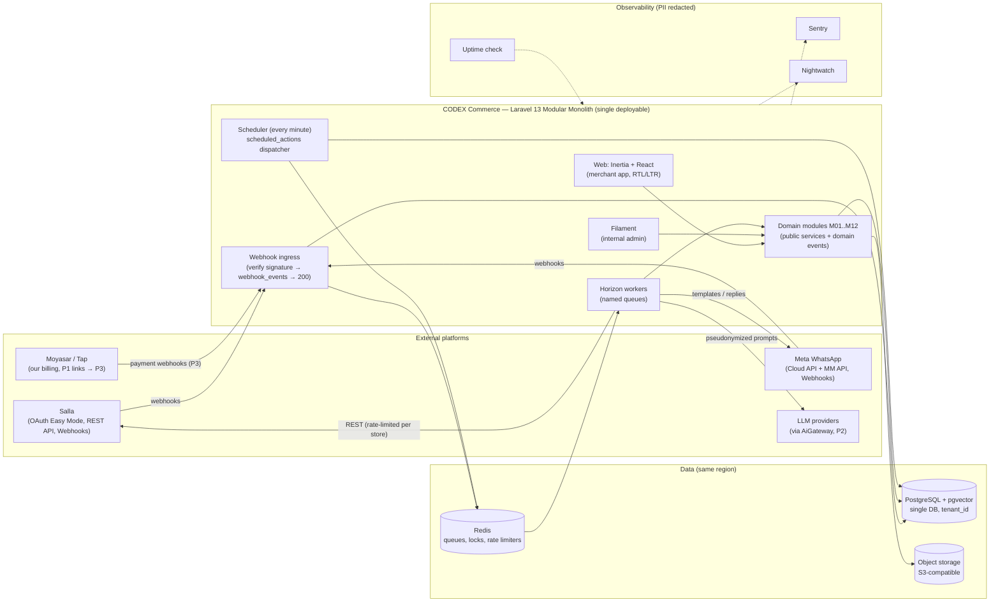
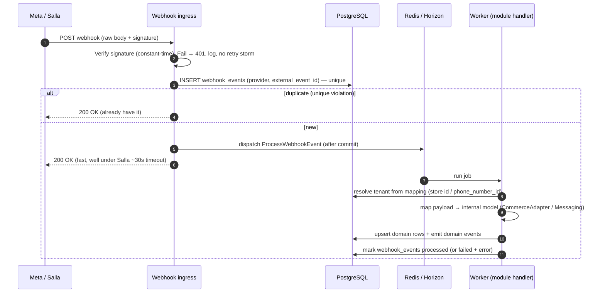
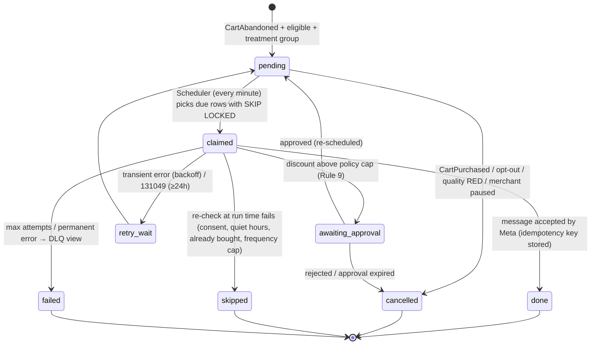
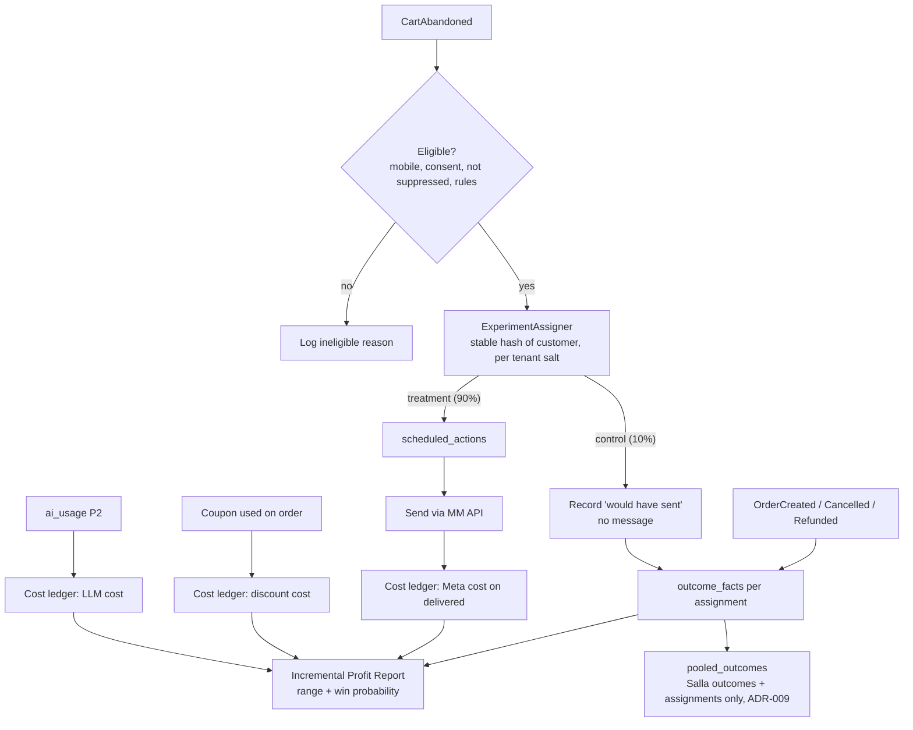
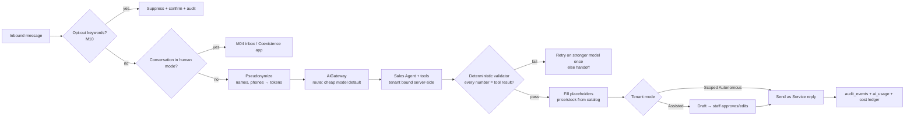

# 9. Initial Technical Architecture

> الحالة: مسودة v1.0 — بانتظار موافقة المؤسس (2026-10-21)

> **مرتبط بـ:** [05-product-modules-map.md](05-product-modules-map.md) · [06-mvp-vs-future-matrix.md](06-mvp-vs-future-matrix.md) · [07-master-development-phases.md](07-master-development-phases.md) · [08-phase-dependencies.md](08-phase-dependencies.md) · [13-risks-mitigation.md](13-risks-mitigation.md) · [14-key-decisions.md](14-key-decisions.md)
> **البحث اللي القسم ده مبني عليه:** [tech-stack-options.md](../research/tech-stack-options.md) · [salla-platform.md](../research/salla-platform.md) · [whatsapp-business-platform.md](../research/whatsapp-business-platform.md) · [saudi-regulatory-pdpl.md](../research/saudi-regulatory-pdpl.md) · [ai-llm-costs-arabic.md](../research/ai-llm-costs-arabic.md) · [cart-recovery-incrementality.md](../research/cart-recovery-incrementality.md)

**مفتاح التصنيف:** [مؤكدة] = معاها مصدر (رابط + تاريخ الاطلاع 2026-10-21، ومعظمها منقول من ملفات `docs/research/` اللي فيها الروابط كاملة). [افتراض] = محتاج اختبار أو spike. [اقتراح] = توصية مننا. **غير مؤكدة** = ملقيناش دليل كافي في أي اتجاه.

**حدود القسم ده:**
- ده تصميم **مبدئي** على مستوى الـMaster Blueprint. مفيش كود (Rule 1)، ومفيش schema تفصيلي ولا API contracts. التفاصيل دي بتتكتب في Architecture doc خاص بكل Phase بعد اعتمادها.
- أي حاجة بعد P3 (من M13 لـM21) مكتوبة هنا كـ"مكان محجوز" في المعمارية بس، مش تصميم.
- مجربناش أي API بإيدينا (سلة وMeta). كل سلوك منصّة هنا مأخوذ من الـdocs، وبيتأكد في spikes الـP0b.

---

## 9.0 الخلاصة في صفحة واحدة

| البند | القرار | التصنيف |
|---|---|---|
| شكل النظام | **Laravel 13 Modular Monolith** واحد: تطبيق واحد، repo واحد، DB واحدة، runtime واحد (PHP). مفيش Microservices | [اقتراح] Rule 6 |
| الواجهة | **Inertia 3 + React 19 + TS + Tailwind 4 + shadcn/ui** جوه نفس التطبيق. **Next.js مرفوض للتطبيق** | [اقتراح] (ADR-002) |
| البيانات | **PostgreSQL + pgvector**، DB واحدة مشتركة بـ`tenant_id` | [اقتراح] (ADR-003، ADR-004) |
| الشغل في الخلفية | **Redis + Horizon** للتنفيذ، و**جدول `scheduled_actions`** هو مصدر الحقيقة لأي تأخير أو جدولة | [اقتراح] (ADR-010) |
| التكاملات | `CommerceAdapter` (سلة أولًا) + WhatsApp Cloud API كـTech Provider + MM API للـMarketing من أول يوم | [اقتراح] (ADR-006، ADR-011) |
| الـAI | **Agent واحد + tools** بـLaravel AI SDK v1 ورا `AiGateway`، **في P2 بس**. الـrecovery = workflow حتمي بالكود من غير agent | [اقتراح] (ADR-007) |
| الخصومات | **محرك سياسات بالكود** + approvals. الـAI عمره ما بيقرر خصم | [اقتراح] Rule 9 (ADR-014) |
| Python / FastAPI / LangGraph | **لأ في الـMVP** | [اقتراح] Rule 6 |
| الاستضافة | **GCP Dammam** (طلب Invoiced Billing/CNTXT في أول أسبوعين من P0)، وFrankfurt مؤقت بتصميم portable لو اتأخر، وترحيل قبل نهاية P3 | [اقتراح] (ADR-005) |
| المراقبة | Sentry + Nightwatch بـPII redaction إجباري | [اقتراح] (ADR-015) |
| تكلفة البنية | **$150–400/شهر** في الـMVP | [افتراض] |

**الجملة اللي بتلخّص المعمارية:** أبسط نظام يقدر يثبت إن الرسالة كسّبت التاجر فلوس، من غير ما يسرّب بيانات تاجر لتاجر، ومن غير ما الـAI يقدر يدّي خصم أو يخترع سعر.

---

## 9.1 المبادئ الحاكمة

| # | المبدأ | ليه | القاعدة |
|---|---|---|---|
| 1 | **Monolith واحد بحدود Modules مفروضة بالـtests** | فريق 1–3 أشخاص. كل runtime زيادة = deploy وmonitoring وpatching زيادة [افتراض] | Rule 5، Rule 6 |
| 2 | **الـbusiness state في الـDB، مش في الـqueue** | الـdelay جوه الـqueue مش ظاهر ومينفعش يتلغي أو يتراجع (audit). وعلى SQS/Laravel Cloud أقصى delay 15 دقيقة [مؤكدة] | ADR-010 |
| 3 | **كل حاجة جاية من برّه ممكن تتكرر أو تضيع** | Meta بتعيد لحد 7 أيام ومكرر [مؤكدة]. سلة 3 محاولات بس بفاصل ~5 دقايق [مؤكدة]، يعني نافذة ~15 دقيقة [افتراض] | Idempotency + reconciliation |
| 4 | **الـtenant بيتحدد من السيرفر، مش من الـpayload ولا من الـLLM** | أشهر مصدر تسريب في single-DB tenancy [افتراض] | Rule 7 |
| 5 | **الأرقام (سعر، مخزون، خصم) عمرها ما بتطلع من النموذج** | الهلوسة في السعر = خسارة فلوس وثقة | Rule 9 |
| 6 | **نموذج بيانات داخلي مستقل عن payloads سلة** | deprecations بمُهَل أسبوعين لـ17 يوم [مؤكدة]، وزد جاي في P4 | ADR-011 |
| 7 | **Portable من أول يوم** | قرار الاستضافة ممكن يتقلب بسبب مسودة PDPL (المادة 23) [مؤكدة كمسودة] | ADR-005 |
| 8 | **القياس جزء من المعمارية، مش تقرير فوقها** | الـholdout والـcost ledger هما المنتج الأساسي (Profit-Proven Recovery) | ADR-013 |
| 9 | **اللي مش في P1–P3 مش بيتبني**، حتى لو "سهل" | Rule 2، Rule 10، Rule 12 | — |

---

## 9.2 High-level Architecture

**قراءة الرسم:**
- **Process types جوه نفس الـcodebase:** (1) web (Inertia + Filament + webhook ingress)، (2) Horizon workers، (3) Scheduler. التلاتة نفس الـDocker image ونفس الكود، بيختلفوا في أمر التشغيل بس. ده مش microservices. [اقتراح]
- **Webhook ingress** رقيق جدًا: يتحقق من التوقيع، يسجّل في `webhook_events`، يرد 200، ويحط job. مفيش business logic جوه الـrequest. [اقتراح]
- **مفيش LLM في P1.** السهم لـLLM providers بيتفعّل في P2 (M07، M06). [اقتراح، قرار من الـspine: P1 من غير AI agent]

---

## 9.3 مراجعة نقدية للـStack المقترح في البرومبت

البرومبت اقترح Next.js + Laravel + PostgreSQL + Redis + Python/FastAPI أو LangGraph عند الحاجة + Docker. المراجعة دي **مش تصديق تلقائي**: كل مكوّن اتقارن ببديل حقيقي.

| المكوّن | المقترح في البرومبت | البديل اللي اتقارن | الحكم | السبب |
|---|---|---|---|---|
| Backend | Laravel كـModular Monolith | Node/NestJS، أو Microservices | **Keep** | خبرة المؤسس PHP/Laravel [مؤكدة: البرومبت §6]. Laravel 13 مدعوم security لحد Q1 2028 [مؤكدة]. Microservices لفريق 1–3 = تكلفة تشغيل بلا عائد (Rule 6) [اقتراح] |
| تنظيم الـModules | (غير محدد) | `nwidart/laravel-modules` أو `internachi/modular` | **Domain folders عادية + Pest arch tests** | الـpackages دي تنظيم مش enforcement، ومش بتمنع module يلمس internals تاني [مؤكدة]. الـenforcement الحقيقي بـPest arch tests [مؤكدة] |
| Frontend | **Next.js** منفصل | Inertia 3 + React (React starter kit) | **Reject Next.js للتطبيق. Inertia بدله** | Next منفصل = Sanctum SPA + CORS + CSRF + نفس الـtop-level domain + deploy تاني + API layer كامل [مؤكدة: شروط Sanctum]. Inertia = تطبيق واحد، session auth، Teams جاهزة في الـstarter kit [مؤكدة]. المؤسس بيعرف React فمفيش خسارة مهارة كبيرة. **التكلفة الحقيقية:** المؤسس كاتب Next.js ضمن خبرته [مؤكدة: البرومبت §6]، فالرفض بيضيّع عليه أداة مألوفة، وInertia 3 نفسه جديد (اتطلق مارس 2026) [مؤكدة] ومحتاج تعلّم [افتراض: أيام مش أسابيع]. **Next مسموح بس لموقع تسويق لاحقًا** لو SEO بقى أولوية [اقتراح] |
| Database | PostgreSQL | MySQL (خبرة المؤسس) | **Keep PostgreSQL** | Laravel vector search الرسمي مبني على pgvector [مؤكدة]، وRLS متاح كطبقة دفاع لاحقة [مؤكدة]. التكلفة: منحنى تعلّم للمؤسس محسوب في P1 [افتراض] |
| Vector DB | (ضمني) | Qdrant / Pinecone | **pgvector جوه نفس الـDB** | صفر خدمة إضافية، نفس الـbackups ونفس الـtenant scoping. حجم RAG في الـMVP صغير (كتالوج + FAQ) [افتراض] |
| Cache/Queues | Redis | Laravel Cloud Managed Queues (SQS) | **Redis + Horizon** | Managed Queues: مفيش Horizon، delay أقصاه 15 دقيقة، مفيش `queue:retry` [مؤكدة]. Horizon محتاج Redis ومش متوافق مع Redis Cluster [مؤكدة] → Redis عادي (standalone) |
| AI orchestration | Python/FastAPI أو LangGraph "لو في مبرر" | Laravel AI SDK v1 | **Laravel AI SDK v1 ورا `AiGateway`. لا Python ولا LangGraph في الـMVP** | الـSDK رسمي، v1.0 في 2026-09-23، وآخر إصدار v1.3.0 في 2026-10-19، وفيه Agents وTool Calling و**Approvable tools** (human-in-the-loop) وQueueing وEmbeddings [مؤكدة]. LangGraph = Python بس ومفيش PHP SDK [مؤكدة]. الـflows عندنا خطية [افتراض]. **المخاطرة:** الـSDK مستقر من شهر واحد بس وجه بـbreaking changes [مؤكدة] → الـinterface الداخلي بيعزلها |
| LLM provider | LLM APIs | Self-host نموذج مفتوح على GPU سعودي | **APIs مع routing رخيص → غالي** | Self-host = تكلفة GPU ثابتة مرتفعة لمرحلة MVP [افتراض، saudi-regulatory-pdpl.md] وجودة لهجة غالبًا أقل [افتراض]. Haiku 5.5 أو GPT-6 Luna افتراضي ($0.10/$0.50 لكل 1M) [مؤكدة]، وSonnet 5.5 للتصعيد [مؤكدة]. الاختيار النهائي بعد eval [اقتراح] |
| Multi-tenancy package | (غير محدد) | `stancl/tenancy` v4 (RLS) | **Trait + Global Scope بتوعنا، من غير package** | الـRLS في stancl v4 "experimental"، والـFK cascades بتتخطاه [مؤكدة]. الـscoping بتاعنا = trait + middleware + tests [اقتراح] |
| Billing | (غير محدد) | Laravel Cashier (Stripe) | **Reject Cashier.** يدوي → Moyasar/Tap → Salla billing | Stripe مش متاح لكيانات سعودية، والإمارات بس في المنطقة [مؤكدة] https://stripe.com/global (2026-10-21، عن [tech-stack-options.md](../research/tech-stack-options.md)) |
| Admin | (Module 13) | لوحة React مبنية بإيدينا | **Filament داخلي** | أرخص طريق لشاشات CRUD داخلية [اقتراح]. **التكلفة:** stack واجهة تاني (Livewire) جوه نفس التطبيق، ومحصور في الـadmin الداخلي بس [افتراض] |
| Infra | Docker + Cloud | Kubernetes / multi-region | **Docker image للـportability، من غير Kubernetes** | Rule 6. Kubernetes يرجع بس لو فيه bottleneck مثبت بالقياس أو فريق كبير [اقتراح] |
| Observability | Monitoring | OpenTelemetry + Grafana | **Sentry + Nightwatch** | Sentry Developer مجاني (5k errors) وTeam $26–29 [مؤكدة]. Nightwatch Free 300k events وPro $20 [مؤكدة]. الاتنين data centers US/EU بس [مؤكدة: Nightwatch] → redaction إجباري. OTel/Grafana لما يبقى فيه أكتر من service [اقتراح] |

**الخلاصة النقدية:** الـStack في البرومبت سليم في جوهره (Laravel + Postgres + Redis)، لكن فيه **طبقتين زيادة عن حاجة الـMVP**: Next.js المنفصل وPython/LangGraph. شيلهم بيوفّر runtime كامل، وpipeline تاني، وauth layer، وAPI layer [اقتراح]. ده مطابق لقرار المؤسس رقم 9 في الـspine.

---

## 9.4 Backend Modules (حدود الـModular Monolith)

### 9.4.1 خريطة الـModules للـMVP (M01..M12)

كل Module = domain folder مستقل جوه `app/Modules/<Name>`، ليه public service layer (interfaces)، وevents، وجداوله الخاصة. [اقتراح]

| ID | الـModule | المسؤولية (داخل الحدود) | بيملك الجداول (مجالات) | بيكشف لغيره | أول Phase |
|---|---|---|---|---|---|
| M01 | Identity, Access & Workspace | Users، Teams (= Tenant)، العضوية، الأدوار (Owner/Agent)، الدعوات، 2FA، سياق الـtenant الحالي | users، teams، team_members، invitations | `TenantContext`، `CurrentTenant`، policies | P1 |
| M02 | Commerce Integrations | `CommerceAdapter` (سلة)، OAuth tokens، webhooks سلة، backfill، reconciliation polling، تحويل payloads لنموذجنا الداخلي | store_connections، products، product_variants، customers، carts، cart_items، orders، order_items | `CommerceAdapter` interface، domain events (CartAbandoned، OrderCreated…) | P0b/P1 |
| M03 | Messaging Channels | WhatsApp Tech Provider onboarding، WABA/أرقام، templates، الإرسال (MM API للـMarketing)، webhooks الحالة، quality rating | whatsapp_accounts، phone_numbers، message_templates، messages، message_status_events | `MessageSender`، `TemplateRegistry`، events (MessageDelivered، InboundMessageReceived) | P1 |
| M04 | Conversation Inbox & Handoff | محادثات، handoff queue، assign، notes، status، زرار takeover | conversations، conversation_assignments، notes | `HandoffService` | P1 (lite) |
| M05 | Catalog & Knowledge (RAG) | فهرسة الكتالوج للبحث، FAQ والسياسات، chunks وembeddings، هامش لكل فئة (E08) | knowledge_documents، knowledge_chunks، product_search_index، category_margins | `CatalogSearch`، `KnowledgeRetriever`، `MarginLookup` | P1 (هامش) / P2 (RAG) |
| M06 | AI Sales Agent | تعريف الـagent، الـtools، Assisted/Scoped Autonomous، drafts للموافقة | agent_configs، agent_runs، reply_drafts | `SalesAgent` | P2 |
| M07 | AI Gateway & Guardrails | `AiGateway`، routing، metering، PII pseudonymization، price/stock validator، golden set eval | ai_usage، ai_calls (metadata بس)، eval_runs | `AiGateway`، `ResponseValidator` | P2 (أساسه P1: interface + `ai_usage`) |
| M08 | Revenue Recovery Engine | Recovery workflow حتمي، eligibility، scoring بقواعد، `scheduled_actions`، محرك سياسات الخصم + approvals، COD (P2 لو اتأكد) | recovery_flows، recovery_steps، scheduled_actions، discount_policies، discount_approvals | `RecoveryOrchestrator`، `DiscountPolicyEngine` | P1 |
| M09 | Measurement & Attribution | holdout assignment، experiments، cost ledger (Meta، خصومات، LLM)، incremental profit، pooled priors | experiments، experiment_assignments، cost_ledger_entries، outcome_facts، pooled_outcomes | `ExperimentAssigner`، `CostLedger`، `ProfitReport` | P1 |
| M10 | Consent & Compliance | consent ledger، opt-out بكلمات عربي، quiet hours، retention jobs، `audit_events`، DPA acceptance | consent_records، suppression_list، audit_events، retention_policies، dpa_acceptances | `ConsentGate` (سؤال واحد: "مسموح نبعت؟")، `AuditLogger` | P1 |
| M11 | Billing, Plans & Usage Metering | metering من أول يوم، plans وentitlements، فواتير يدوية → Moyasar/Tap → Salla billing | usage_counters، plans، subscriptions، invoices، entitlements | `UsageMeter`، `Entitlements` | P1 (metering) / P3 (billing) |
| M12 | Platform Administration & Ops | Filament: tenants، integration health، حالة الـtokens، quality rating، الاستهلاك، DLQ replay، feature flags | integration_health_snapshots (+ قراءة من الباقي) | لوحة داخلية بس | P1 (lite) |

**M13..M21:** مالهمش folders ولا جداول قبل P3 exit (قاعدة الـspine). المعمارية بتسيب "نقاط تمديد" بس: `CommerceAdapter` (لـZid في P4)، و`MessageSender` بقنوات (لـInstagram/Messenger في P5)، وdomain events (لـM18 outbound webhooks في P5). [اقتراح]

### 9.4.2 قواعد التواصل بين الـModules

| القاعدة | التفاصيل | إزاي بتتفرض |
|---|---|---|
| القراءة | عن طريق public service الـModule التاني بس، مش models بتاعته | Pest arch test: models بتاعة كل Module متتستخدمش برّه namespace بتاعه [اقتراح] |
| الكتابة على Module تاني | ممنوعة. بتحصل بـdomain event، والـModule صاحب البيانات هو اللي يكتب | Arch test + code review |
| Joins عبر Modules | ممنوعة، **إلا** M09 (قراءة بس للتقارير). الـIncremental Profit Report (E07) بيعيش جوه M09 لحد ما M14 يتبني (مفيش folder لـM14 قبل P3 exit) | Arch test + read-only DB views للتقارير [اقتراح] |
| `withoutGlobalScopes` (تجاوز الـtenant scope) | مسموح بس في M12 (admin) وM09 (pooled jobs) | Arch test بيفشل الـCI لو اتستخدم في أي مكان تاني [اقتراح] |
| M09 pooling | ممنوع يقرا من M03/M04 (محتوى الرسائل). بيقرا نتائج الطلبات والـassignments بس | Arch test مخصوص لـADR-009 [اقتراح، بسبب شرط Meta: [مؤكدة] منع استخدام بيانات WhatsApp ولو مجمّعة لتدريب أو تحسين أي نموذج] |
| اتجاه الاعتماد | M01 ← الكل. M10 (`ConsentGate`) بيتنادى من M08 وM06 قبل أي إرسال. مفيش دوائر | Arch test لمنع الـcycles [اقتراح] |

---

## 9.5 Database Domains

DB واحدة (PostgreSQL)، و**كل جدول tenant-owned عليه `tenant_id` مباشرة** (حتى الجداول الفرعية زي cart_items)، وكل index وكل unique constraint بيبدأ بـ`tenant_id`. [اقتراح] السبب: منعتمدش على join paths للعزل، وده نفس نصيحة stancl لتقصير مسارات الـpolicies [مؤكدة].

| الـDomain | الـModule | أمثلة جداول | Tenant-owned؟ | PII؟ | ملاحظات |
|---|---|---|---|---|---|
| Identity & Tenancy | M01 | users، teams، team_members | teams = جذر الـtenant | أيوه (موظفي التاجر) | CODEX هنا Controller [افتراض قانوني] |
| Commerce mirror | M02 | store_connections، products، customers، carts، orders | أيوه | أيوه (عملاء المتجر) | نموذجنا الداخلي، مش نسخة من payload سلة. الـraw payload يتحفظ في `webhook_events` بس، بـretention قصيرة [اقتراح] |
| Messaging | M03، M04 | messages، conversations، message_templates | أيوه | أيوه (محتوى المحادثات) | محتوى الرسائل أعلى حساسية: retention قابلة للضبط، وممنوع يدخل M09 pooling |
| Knowledge | M05 | knowledge_chunks (vector)، category_margins | أيوه | لأ غالبًا | الهامش بيانات تجارية حساسة للتاجر |
| AI | M06، M07 | agent_runs، reply_drafts، ai_usage | أيوه | محدود (pseudonymized) | `ai_calls` بيحفظ metadata وتكلفة، مش الـprompt الكامل افتراضيًا [اقتراح] |
| Recovery & Policies | M08 | scheduled_actions، discount_policies، discount_approvals | أيوه | لأ (مراجع IDs بس) | `scheduled_actions` = state machine الـrecovery |
| Measurement | M09 | experiment_assignments، cost_ledger_entries، outcome_facts | أيوه | لأ (hashes وIDs) | **append-only** للـassignments والـledger عشان التقرير يبقى قابل للمراجعة |
| Pooled (cross-tenant) | M09 | pooled_outcomes | **لأ** (مجمّع، من غير هوية متجر أو عميل) | لأ | الجدول الوحيد اللي مفيهوش `tenant_id`. بيتملي بـjob من نتائج سلة والـassignments بس (ADR-009) |
| Consent & Audit | M10 | consent_records، suppression_list، audit_events | أيوه | أيوه | `audit_events` و`consent_records` **append-only** (مفيش update/delete من التطبيق) [اقتراح] |
| Billing & Usage | M11 | usage_counters، subscriptions، invoices | أيوه | محدود | الفواتير ممكن تحتاج توافق ZATCA لو الكيان سعودي وعدّى الحد [مؤكدة: Wave 25 من 2027-02-01] |
| Platform / Infra | M12، shared | webhook_events، failed_jobs، integration_health_snapshots، feature flags (Pennant) | `webhook_events` فيه tenant_id بعد الـresolve | الـraw payload فيه PII | retention قصيرة للـraw payloads [اقتراح] |

**قرارات بيانات مهمة:**
- **IDs:** ULID/UUID للـprimary keys المكشوفة (في الـURLs)، عشان منكشفش أحجام التجار ولا نسهّل التخمين [اقتراح].
- **رقم العميل:** يتخزن مشفّر على مستوى العمود، ومعاه hash (مع salt لكل tenant) للبحث والـholdout assignment. القرار النهائي في ADR-008 [اقتراح].
- **الفلوس:** بالهللة كأعداد صحيحة + عملة، مش floats [اقتراح].
- **الوقت:** يتخزن UTC، والـquiet hours بتتحسب بتوقيت `Asia/Riyadh` (أو timezone التاجر لما نوصل الخليج) [اقتراح].

---

## 9.6 API Structure

| الواجهة | المستهلك | الشكل | المصادقة | Phase |
|---|---|---|---|---|
| Merchant app | التاجر وموظفينه | **Inertia routes** (controllers بترجع props). **مفيش REST API داخلي** | Session (Fortify) + 2FA اختياري للـOwner | P1 |
| Internal admin | فريق CODEX | Filament على subdomain أو path منفصل | Guard منفصل + 2FA إجباري + IP allowlist لو ممكن [اقتراح] | P1 |
| Inbound webhooks | سلة، Meta، (Moyasar/Tap لاحقًا) | endpoint لكل provider: `/webhooks/salla`، `/webhooks/meta`، `/webhooks/payments` | توقيع الـprovider (9.7)، مش session | P0b/P1 |
| Salla app lifecycle | سلة | جزء من webhook سلة (`app.store.authorize`، `app.updated`، subscription events) | توقيع سلة | P0b/P1، billing events في P3 |
| Meta Embedded Signup callback | واجهة التاجر | route بيستقبل الـcode من Embedded Signup v4 ويبدّله بـbusiness token في الخلفية | Session التاجر + state check | P1 |
| Health | Uptime monitor | `/up` (liveness) + فحص داخلي لـDB وRedis وطول الـqueues | من غير بيانات حساسة | P1 |
| Public REST API | شركاء، وكالات، n8n | `/api/v1` versioned، Sanctum tokens بـscopes لكل tenant | Tokens | **P5 (M18) بس، لو فيه طلب حقيقي** |
| Outbound webhooks | أنظمة التاجر | events موقّعة | HMAC بتاعنا | **P5 (M18)** |

[اقتراح] **ليه مفيش API في الـMVP:** كل endpoint عام = سطح هجوم + versioning + docs + دعم. مفيش عميل طالبه دلوقتي (Rule 12). لو جه mobile app أو public API، نبنيه وقتها فوق نفس الـservices، والـmodules مصممة بـservice layer فالتكلفة محدودة.

---

## 9.7 Integration Architecture

### 9.7.1 Salla (M02 / E02)

| الجزء | التصميم | الأساس |
|---|---|---|
| نوع التطبيق | **Private app** للـpilots في P0b–P2، وPublic في P3 | [مؤكدة] Public/Private موجودين. حدود الـprivate app وهل بيشتغل بـCustom Mode **غير مؤكدة** → spike في P0b |
| OAuth | **Easy Mode**: سلة بتبعت الـtokens في event `app.store.authorize` على الـwebhook. Easy Mode **إجباري** للتطبيقات المنشورة | [مؤكدة] |
| Scopes | أقل صلاحيات: قراءة products/orders/customers، `carts.read`، `offline_access` (عشان الـrefresh token). أي scope كتابة (كوبونات) بيتطلب بس لما ميزة معتمدة تحتاجه | [مؤكدة: `carts.read` و`offline_access`]. الباقي [اقتراح] |
| عمر الـtokens | Access 14 يوم، Refresh شهر، **والـrefresh بيتستخدم مرة واحدة**: إعادة استخدامه (حتى في requests متوازية) = إلغاء كل الـtokens وإعادة تنزيل التطبيق | [مؤكدة] |
| Token refresh | **job واحدة لكل tenant عليها distributed lock (Redis)**، استباقية قبل الانتهاء بهامش أمان، ومتتعملش أبدًا جوه web request. الـrefresh token الجديد يتحفظ قبل ما الـlock يتفك. فشل الـrefresh = integration health أحمر + تنبيه للتاجر وللأدمن | [اقتراح] مبني على نصيحة سلة بالـmutex [مؤكدة] |
| صيغة الانتهاء | الـdocs متناقضة (`expires` timestamp مقابل `expires_in` ثواني) → الـadapter يتعامل مع الاتنين | [مؤكدة كتناقض] |
| Webhooks | توقيع **HMAC-SHA256 على الـraw body** في `X-Salla-Signature`، ومقارنة constant-time. الـstrategy الافتراضية `signature` ونعتمدها (مش token) | [مؤكدة] + [اقتراح] للمقارنة |
| Events المهمة للـMVP | `abandoned.cart`، `abandoned.cart.status.changed`، `abandoned.cart.purchased`، `order.created`، `order.status.updated`، `order.cancelled`، `order.refunded`، `product.price.updated`، `product.quantity.low`، `product.status.updated`، `customer.created/updated`، app events | [مؤكدة] الأسماء من docs.salla.dev |
| Reconciliation polling | لأن سلة بتعيد 3 مرات بس بفاصل ~5 دقايق (نافذة ~15 دقيقة [افتراض]): polling دوري لـ`GET /carts/abandoned` و`/orders` (بـ`offset` بالدقايق)، وdedupe بالـid | [مؤكدة: 3 retries]. [اقتراح] الـpolling. التردد يتحدد بعد قياس الـrate limit في P0b |
| Rate limits | throttle لكل متجر حسب خطته (Plus 120، Pro 360، Special 720 req/min)، وحد منفصل للـCustomers (500 كل 10 دقايق)، وقراءة `Retry-After` و`X-RateLimit-Remaining` بشكل adaptive | [مؤكدة] للأرقام. هل الحد مشترك مع باقي تطبيقات المتجر **غير مؤكدة** |
| Backfill | تدريجي في الخلفية بعد التثبيت، بأولوية: كتالوج ← سلات آخر 30 يوم ← طلبات ← عملاء (الأبطأ بسبب حده) | [اقتراح] |
| رابط الشراء | **`checkout_url` بتاع السلة المتروكة.** إنشاء cart جديد: **Cut** (مفيش endpoint موثّق). `POST /orders` بـ`pending_payment` كـpayment link: **غير مؤكد** → spike. **اسم الـfield:** سلة غيّرت `checkout_url` لـ`urls.checkout` في مايو 2025 بمهلة ~17 يوم، والـschema المعروض لسه فيه الاسم القديم. بنستخدم `checkout_url` كاسم مفهوم في الـBlueprint (زي الـspine والقسم 06)، والـspike يحدد الاسم الفعلي، و`CommerceAdapter` يعزله | [مؤكدة] للـcheckout_url https://docs.salla.dev/5394138e0 وللتغيير https://docs.salla.dev/421127m0 (2026-10-21). الباقي غير مؤكد |
| الـConsent | مفيش أي field للـmarketing opt-in في السلة → CODEX عنده consent ledger مستقل (M10) | [مؤكدة] غياب الـfield |
| حماية من التغيير | Contract tests على أمثلة payloads محفوظة، ومتابعة changelog أسبوعية | [اقتراح] بسبب deprecations بمُهَل أسبوعين–17 يوم [مؤكدة] |

**`CommerceAdapter` (ADR-011):** interface داخلي فيه عمليات بلغة الـdomain بتاعنا (اجلب سلة، اجلب منتج بسعره ومخزونه، اجلب طلبات من تاريخ، رابط استكمال السلة، تحقق من حالة الطلب)، و`SallaAdapter` هو التطبيق الوحيد في الـMVP. Zid في P4 = adapter تاني، مش إعادة كتابة. [اقتراح]

### 9.7.2 WhatsApp Business Platform (M03 / E03)

| الجزء | التصميم | الأساس |
|---|---|---|
| مسار الوصول | **Tech Provider** على Cloud API مباشرة، من غير BSP. البديل لو كارت التاجر طلع عائق: Multi-Partner مع Solution Partner | [مؤكدة] الخيارات. [اقتراح] الاختيار (ADR-006) |
| Onboarding | **Embedded Signup v4** (v2/v3 اتوقفوا 2026-10-15)، مع **Coexistence** عشان الموظف يفضل على تطبيق WhatsApp Business | [مؤكدة]. دعم Coexistence في السعودية **غير مؤكدة** |
| Tenancy على Meta | **WABA + business portfolio لكل تاجر** (Embedded Signup بيعمل ده). مفيش تجار تحت portfolio بتاعنا | [مؤكدة] الحدود والجودة على مستوى الـportfolio |
| رسوم Meta | على كارت التاجر مباشرة، من غير markup | [مؤكدة] الـTech Provider مالوش credit line |
| حدود | 250 مستخدم/24 ساعة → 2,000 بعد BV. Onboarding 10 عملاء/7 أيام → 200 بعد التحقق. Coexistence 20 mps | [مؤكدة] |
| الـMarketing | **كل رسائل الـrecovery = Marketing** وبتتبعت على **MM API من أول يوم**. Cloud API هيوقف الـMarketing للحسابات الجديدة 2027-04-13 وللكل 2027-10-13 | [مؤكدة] |
| Templates | Template library داخلي مصنّف Marketing ومقفول: التاجر ميقدرش يغيّر الفئة لـUtility. متابعة حالة الـtemplate وإعادة تصنيفه من webhooks | [مؤكدة] عقوبة تمرير Marketing كـUtility توصل لتقييد الـportfolio 30 يوم. [اقتراح] الحل |
| Webhook endpoint | endpoint واحد لتطبيق Meta بتاعنا لكل الـWABAs. الـtenant **بيتحدد من جدول mapping (`phone_number_id`/WABA ID → tenant)**، مش من أي حاجة تانية في الـpayload | [اقتراح] Rule 7 |
| التحقق من الـwebhook | GET verification challenge بـverify token، وتوقيع `X-Hub-Signature-256` (HMAC-SHA256 بالـapp secret) على كل POST | [افتراض] مبني على توثيق Meta العام للـwebhooks، **يتأكد في spike P0b** |
| التكرار | Meta بتعيد لحد 7 أيام ومكرر، والـpayload لحد 3 MB → dedupe في `webhook_events` | [مؤكدة] |
| Error 131049 (per-user marketing limit) | متتعادش قبل 24 ساعة على الأقل، وتتسجل كنتيجة في الـledger (مش failure تقني) | [مؤكدة] قاعدة الـ24 ساعة |
| Data localization region | يتحدد **قبل أول رقم** (ADR-006)، والقرار irreversible. السعودية مش متاحة، والمتاح في المنطقة الإمارات (AE) والبحرين (BH). القائمة الرسمية فيها كمان جنوب أفريقيا (ZA) وألمانيا (DE) وغيرهم، بس دول برّه المنطقة ومش بيقربونا من التوطين في المملكة، فهما مستبعدين مبدئيًا [اقتراح] | [مؤكدة] https://developers.facebook.com/docs/whatsapp/cloud-api/reference/registration (2026-10-21) ([saudi-regulatory-pdpl.md](../research/saudi-regulatory-pdpl.md)) |
| Quality | متابعة quality rating للرقم وللـtemplates، وتنبيه للأدمن والتاجر عند YELLOW/RED، وإيقاف تلقائي للـrecovery لو RED [اقتراح] | [مؤكدة] وجود الـratings |
| Handoff | شرط Meta: مسار تصعيد واضح لإنسان. في P1 الـhandoff = إشعار + Coexistence (الموظف يرد من التطبيق) + M04 lite | [مؤكدة] الشرط |

### 9.7.3 فوترتنا (M11)

| المرحلة | الآلية | الأساس |
|---|---|---|
| P1–P2 | فواتير يدوية + روابط دفع (Moyasar/Tap) أو تحويل بنكي. **مفيش billing engine** | [اقتراح] Rule 10 |
| P3 | Salla App Store billing للـpublic listing (Easy Mode وdistribution عن طريق سلة)، وMoyasar/Tap tokenization للعقود المباشرة والسنوي | [مؤكدة] Stripe مش متاح للسعودية (https://stripe.com/global، 2026-10-21). Moyasar tokenization [مؤكدة]؛ subscription API عندهم **غير مؤكدة** |
| من P1 | Usage metering آلي (رسائل، سلات مؤهلة، محادثات AI، tokens) حتى لو مش بنحاسب عليه | [اقتراح] لفهم الـunit economics |

---

## 9.8 Event System

**القرار:** Laravel domain events جوه الـprocess، مع listeners **queued** و`afterCommit`. **مفيش message broker** (Kafka/RabbitMQ) ولا event sourcing. [اقتراح] Rule 6

**ليه ده كفاية:** الـstate المهم متخزن في جداول durable (`webhook_events`، `scheduled_actions`، `audit_events`، الـledger)، فلو event ضاع بين الـcommit والـqueue، الـreconciliation jobs بتعيد بناء الحالة من الـDB [اقتراح]. ده بيغنينا عن outbox pattern كامل في الـMVP. **Trigger لإعادة النظر:** لو ظهر فقد events فعلي في P1 (بيتقاس في exit criterion #8: صفر webhooks ضايعة من غير reconciliation).

| الـEvent (أمثلة) | المصدر | المستمعين | أثره |
|---|---|---|---|
| CartAbandoned / CartUpdated | M02 | M08، M09 | تقييم eligibility، assignment للـholdout، جدولة أول خطوة |
| CartPurchased / OrderCreated | M02 | M08، M09، M11 | إلغاء الـscheduled_actions المعلّقة، تسجيل outcome، metering |
| OrderCancelled / OrderRefunded | M02 | M09 | تصحيح الـoutcome (الربح الإضافي مش إيراد إجمالي) |
| ProductPriceChanged / StockChanged | M02 | M05 | تحديث الـsearch index، وإبطال cache السعر |
| ConsentGranted / ConsentRevoked (opt-out) | M10 | M08، M03، M06 | إلغاء فوري لأي إرسال معلّق، suppression |
| MessageSent / Delivered / Read / Failed | M03 | M09، M12 | cost ledger (تكلفة Meta على الـdelivered)، صحة القناة |
| InboundMessageReceived | M03 | M10 (كشف opt-out بكلمات عربي)، M04، M06 (P2) | opt-out قبل أي حاجة تانية |
| DiscountApprovalRequested / Approved / Rejected | M08 | M04 (إشعار)، M10 (audit) | Rule 9 |
| HandoffRequested | M06، M10، M03 | M04 | تحويل للإنسان |
| IntegrationHealthChanged | M02، M03 | M12، إشعار للتاجر | token فشل، quality RED، webhooks متأخرة |
| AiReplyDrafted / AiReplyApproved (P2) | M06 | M04، M07 | Assisted mode، وبيانات eval |

**قاعدة ترتيب حرجة:** أي رسالة واردة بتعدّي على **كشف الـopt-out (M10) قبل** ما توصل للـagent أو الـinbox. [اقتراح] الهدف 100% opt-out < 24 ساعة (exit criterion P1)، والتصميم بيستهدف ثواني.

---

## 9.9 Queue System

### 9.9.1 `scheduled_actions`: مصدر الحقيقة لأي تأخير (ADR-010)

| الجانب | التصميم | الأساس |
|---|---|---|
| الجدولة | كل خطوة recovery = صف في `scheduled_actions` (tenant، النوع، الـsubject، `run_at`، الحالة، `idempotency_key` unique، المحاولات، آخر خطأ) | [اقتراح] من البحث |
| الالتقاط | Scheduler كل دقيقة، بـ`withoutOverlapping`، بيلتقط الصفوف المستحقة بـ`FOR UPDATE SKIP LOCKED` ويعمل dispatch لـjob قصير | [اقتراح] |
| **إعادة الفحص وقت التنفيذ** | السلة لسه متروكة؟ الـconsent ساري؟ مش في quiet hours؟ مفيش رسالة اتبعتت قريب (frequency cap: القيم المقترحة في [06-mvp-vs-future-matrix.md](06-mvp-vs-future-matrix.md) = تسلسل recovery واحد لكل عميل كل 7 أيام، ورسالتين لكل سلة بسقف 3)؟ الرقم جودته مش RED؟ سياسة الخصم تسمح؟ | [اقتراح] ده أهم سطر في التصميم كله. القيم نفسها بتتحسم في ADR-013/014 |
| التوقيت الافتراضي | أول رسالة ≥60 دقيقة بعد الترك، وquiet hours 22:00–09:00 (رمضان 01:00–12:00). التأخير config لكل tenant مش ثابت في الكود، عشان نقدر نختبر 60 دقيقة مقابل ~24 ساعة جوه الـholdout المجمّع لو ADR-013 قرر كده | [اقتراح] مبني على Li et al. 2021 [مؤكدة]. **تنبيه:** نفس الدراسة لقت أثر سلبي لتذكير 30–60 دقيقة وإيجابي عند 1–3 أيام، فالـ60 دقيقة على حافة النافذة السلبية (نفس ملاحظة القسمين 02 و04). الـquiet hours [مؤكدة كنص CST؛ انطباقها على WhatsApp غير مؤكدة] |
| الدقة | ±1 دقيقة كفاية لـrecovery | [افتراض] |
| صفوف `claimed` عالقة | لو الـworker وقع، الصف بيفضل `claimed`. job دورية بترجّع الصفوف اللي عدّى عليها lease (مثلًا 10 دقايق) لـ`pending` **بس لو مفيش إرسال اتسجل لها**، وإلا بتروح الـDLQ للمراجعة (9.9.3) | [اقتراح] |
| مستقل عن الاستضافة | بيشتغل على Redis/Horizon أو أي queue driver، لأن الـdelay في الـDB مش في الـqueue | [مؤكدة] قيد الـ15 دقيقة على SQS |

### 9.9.2 الـQueues والـworkers

| Queue | الشغل | الأولوية | Retries / Backoff | ملاحظات |
|---|---|---|---|---|
| `webhooks` | معالجة `webhook_events` | عالية | 5 محاولات، backoff متزايد [اقتراح] | الـingress بيرد 200 قبلها |
| `outbound` | إرسال WhatsApp (templates وردود) | عالية | حسب نوع الخطأ (9.16) | throttle لكل رقم/portfolio، و`idempotency_key` بيتسجل **قبل** النداء |
| `scheduled` | تنفيذ صفوف `scheduled_actions` المستحقة | عالية | الـretry في الجدول نفسه (`retry_wait`) | الـjob قصير، والمنطق في الـstate machine |
| `sync` | backfill وreconciliation من سلة | متوسطة | backoff + احترام `Retry-After` | unique job لكل متجر (منع sync متوازي لنفس المتجر) |
| `tokens` | refresh tokens سلة | عالية | محاولة محدودة + تنبيه | lock لكل tenant، ومفيش retry أعمى (refresh مرة واحدة [مؤكدة]) |
| `ai` (P2) | استدعاءات الـagent | متوسطة | fallback model ثم handoff | timeout قصير، وحد tokens لكل محادثة |
| `reports` | تجميع الـledger، التقارير، pooled jobs | منخفضة | عادي | ممكن يتأخر من غير أثر على العميل |

**قواعد عامة [اقتراح]:**
- `after_commit` افتراضيًا على connection الـqueue، عشان job ميشتغلش على صف لسه مش committed [مؤكدة: السلوك موجود في Laravel].
- الـ`timeout` في Horizon أقل من `retry_after` بكام ثانية، وإلا الـjob ممكن يتنفذ مرتين [مؤكدة].
- **كل job بيحمل `tenant_id` صريح** ويعيد تهيئة سياق الـtenant في أوله. مفيش job بيعتمد على "الـtenant الحالي" من الـrequest.
- **Noisy neighbor:** Horizon مفيهوش fair queues، فبنحط rate limiter لكل tenant (Redis) على `outbound` و`sync` عشان متجر كبير ميجوّعش الباقي [افتراض: يتقاس في P1].

### 9.9.3 Idempotency

| المصدر | الآلية |
|---|---|
| Webhooks واردة | unique `(provider, external_event_id)` في `webhook_events`. لو الـprovider مبيبعتش id ثابت، hash للـbody + النوع [اقتراح] |
| رسائل صادرة | `idempotency_key` مشتق من (tenant، السلة، رقم الخطوة) ومتسجل قبل النداء بحالة `sending`. أي retry بيشيك عليه الأول. **نقطة ضعف صريحة:** لو الـworker وقع بعد النداء وقبل تسجيل الرد، إحنا مش عارفين الرسالة اتبعتت ولا لأ، وCloud API **مفيهوش idempotency key موثّق في البحث** [غير مؤكدة]. القرار [اقتراح]: رسائل التسويق **at-most-once**: الصف العالق في `sending` ميتعادش تلقائيًا، بيتحقق من webhooks الحالة (أو يتساب) ويروح الـDLQ. رسالة ضايعة أرخص من رسالة مكررة (spam + quality rating) |
| خطوات الـrecovery | unique على (tenant، السلة، الخطوة) في `scheduled_actions` |
| كوبونات (لو اتفعّلت) | نفس المبدأ: مفتاح لكل (سلة، خطوة)، ومفيش كوبون بيتعمل مرتين لنفس الخطوة |
| Sync سلة | upsert بالـexternal id + unique job لكل متجر |

### 9.9.4 Dead Letter Queue

مفيش DLQ broker منفصل. الـDLQ = **3 أماكن ظاهرة في Filament** [اقتراح]:
1. `failed_jobs` (Laravel) للـjobs التقنية، مع replay من الـadmin.
2. `webhook_events` بحالة `failed` وسبب الخطأ، مع replay.
3. `scheduled_actions` بحالة `failed`، مع قرار يدوي (إعادة أو إلغاء). **ممنوع replay تلقائي لرسالة تسويقية بعد مرور وقتها** (رسالة سلة بعد يومين = spam).

تنبيه لو عدد الـfailed في ساعة عدّى حد معيّن، أو أي `tokens` job فشلت. [اقتراح]

---

## 9.10 Measurement & Cost Ledger (قلب Profit-Proven Recovery)

القسم ده مش ضمن قائمة Task 5 بالاسم، بس هو اللي بيفرّق المنتج، فلازم يبقى في المعمارية من P1. [اقتراح]

| العنصر | القرار | الأساس |
|---|---|---|
| Holdout | 10% على مستوى العميل، hash ثابت، **إجباري في الـpilots** | [اقتراح] من الـspine |
| مفتاح العميل | Salla customer id لو موجود، وإلا hash للرقم المُوحّد. الـguest carts بتتعامل بالرقم | [افتراض] نسبة السلات اللي فيها موبايل صالح **غير مؤكدة** → Cart Truth Audit |
| التسجيل | الـassignment بيتسجل **وقت الأهلية** لمجموعتين (intent-to-treat)، append-only | [اقتراح] |
| التقرير | 4 أرقام منفصلة: إيراد منسوب، إيراد إضافي تقديري (نطاق)، تكلفة الرسائل والخصومات، ربح إضافي تقديري. يدوي (SQL + template) أول 4 أسابيع من P1، وبعدين صفحة واحدة | [اقتراح] من الـspine (E07) |
| الهامش | من `category_margins` (5–10 فئات) اللي التاجر بيدخلها في الـonboarding (E08)، مش COGS لكل SKU | [اقتراح] |
| Pooling | job بيقرا outcomes وassignments بس، ومفيش ولا عمود من محتوى الرسائل. arch test بيمنع أي import من M03/M04 | [مؤكدة] شرط Meta + [اقتراح] التنفيذ (ADR-009) |
| القدرة الإحصائية (نقطة ضعف) | بـholdout 10%، الـ4,000 سلة بتاعة P1 exit = ~400 سلة تحكم بس. اكتشاف فرق 5%→7% محتاج ~10,700 سلة بـ90/10 [افتراض: حسابات power في الـspine §7.5]. يعني تقرير P1 هيطلع **نطاق واسع**، مش رقم، ولازم الـUI والتقرير اليدوي يقولوا ده صراحةً. القسم 13 بيقترح holdout 20% في الـpilots بس عشان ضمان "الشهر التالت مجاني" ميتفعّلش على noise (قرار مؤسس). عشان كده نسبة الـholdout **إعداد لكل tenant/experiment** مش ثابت في الكود | [افتراض] |
| الإحصاء | في PHP/SQL في الـMVP (فروق نسب ونطاقات). CUPED وpooled priors متقدمة = P4 (M09 v2) | [افتراض] كفاية للـMVP. Python يرجع بس لو احتجنا مكتبات إحصاء مش موجودة في PHP (P4+) |

---

## 9.11 AI Agent Orchestration (P2: M06 + M07)

### 9.11.1 الشكل

**Agent واحد + tools محدودة**، شغال بـLaravel AI SDK v1 ورا `AiGateway`. **مفيش multi-agent ولا graph runtime.** الـrecovery (P1) workflow حتمي بالكود، ولو احتاج نص بيستخدم templates معتمدة من Meta مش توليد حر. [اقتراح]

### 9.11.2 الـTools وصلاحياتها

| Tool | النوع | بيعمل إيه | Assisted | Scoped Autonomous | ملاحظات |
|---|---|---|---|---|---|
| `search_products` | قراءة | hybrid search في كتالوج التاجر (M05) | ✔ | ✔ | بيرجّع IDs وأسماء، مش أسعار للعرض |
| `get_product` | قراءة | السعر والمخزون الحاليين لمنتج | ✔ | ✔ | المصدر الوحيد للأرقام اللي بتظهر للعميل |
| `get_store_policy` | قراءة | شحن، استرجاع، FAQ من الـRAG | ✔ | ✔ | بيرجّع النص مع مرجع المستند |
| `get_checkout_link` | قراءة | `checkout_url` للسلة المتروكة للعميل ده، أو رابط المنتج | ✔ | ✔ | **مفيش إنشاء cart** (Cut). `POST /orders` pending_payment بيتقرر بعد spike |
| `handoff_to_human` | كتابة (داخلية) | تحويل المحادثة لإنسان مع ملخص | ✔ | ✔ | دايمًا متاح. شرط Meta [مؤكدة] |
| أي tool خصم / كوبون / payment link مخصص / حملة / إرسال جماعي | — | — | ✘ | ✘ | **ممنوع في P2** حسب الـspine. لو اترجعله في P4+، يبقى Approvable tool + محرك السياسات |

**قواعد الـtools [اقتراح]:**
- الـtool بياخد الـ`tenant_id` من سياق الـjob على السيرفر، **مش من arguments النموذج**. النموذج ميقدرش يطلب بيانات tenant تاني حتى لو اتعرض لـprompt injection.
- مخرجات الـtools وأوصاف المنتجات بتتعامل كـ**data مش instructions** (أوصاف المنتجات ممكن يكون فيها injection).
- الـagent بيرفض الأسئلة العامة برّه نطاق المتجر. ده تخفيف لخطر Meta 4.7 [مؤكدة: الشرط؛ تطبيقه علينا غير مؤكد].
- ممنوع يطلب أو يستقبل رقم كارت [مؤكدة: سياسة WhatsApp].

### 9.11.3 Human-in-the-loop

| المستوى | إمتى | مين بيوافق |
|---|---|---|
| **Assisted** | إجباري ≥4 أسابيع لكل tenant قبل Autonomous (exit criterion P2) | Agent أو Owner بيوافق/يعدّل كل رد |
| **Scoped Autonomous** | بعد الـ4 أسابيع + نتايج eval مقبولة للـtenant + موافقة صريحة من الـOwner | الردود بتتبعت، والإنسان بيتابع من الـinbox |
| **Handoff** | طلب العميل، فشل الـvalidator مرتين، شكوى، قيمة سلة عالية (حد per-tenant)، أي طلب خصم | M04 queue |
| **Kill switch** | زرار per-tenant يرجّع كل حاجة لـAssisted أو يوقف الـagent فورًا | Owner أو أدمن CODEX |
| **Kill switch تلقائي** [اقتراح] | لو معدل منع الـvalidator لـtenant عدّى 2% في نافذة متحركة (حد التنبيه المقترح في [13-risks-mitigation.md](13-risks-mitigation.md))، الـtenant بيرجع Assisted تلقائيًا لحد مراجعة بشرية | النظام، والإلغاء بموافقة الـOwner أو أدمن CODEX |
| **خارج ساعات التغطية** [اقتراح] | الفريق بيغطي 09:00–22:00 KSA بس ([10-team-structure.md](10-team-structure.md) 10.8). بعد 22:00: الـtenant اللي في Scoped Autonomous يكمّل **بس** في الأسئلة اللي الـvalidator عدّاها، وأي handoff بيتحول لرسالة ثابتة "هنرد عليك الصبح" + queue للصبح. الـtenant اللي في Assisted مبيبعتش ردود AI خالص بالليل | قرار المؤسس (ملاحظات المراجعة) |

### 9.11.4 محرك سياسات الخصم (Rule 9، ADR-014)

الـAI **عمره ما بيقرر خصم**. في P1 الخصم جزء من الـrecovery workflow (كود)، ومحكوم بالمحرك ده:

| القاعدة | القيمة الافتراضية | قابلة للتعديل من |
|---|---|---|
| خصم في أول رسالة | **ممنوع** | محدش (قاعدة منتج) |
| أرضية الهامش | الخصم ميخلّيش هامش الفئة (من `category_margins`) ينزل تحت أرضية يحددها التاجر | Owner |
| سقف الخصم | نسبة قصوى لكل فئة | Owner |
| العميل الحالي (اشترى قبل كده) | مفيش خصم إلا بموافقة | Owner لكل حالة |
| فوق السقف | `awaiting_approval` مع انتهاء صلاحية للطلب | Owner |
| ميزانية الخصومات الشهرية | حد أقصى per-tenant، ولو اتعدّى الخصم بيقف | Owner |
| التنفيذ | كوبونات معتمدة مسبقًا من التاجر (pool) في P1. إنشاء كوبون فريد عن طريق API سلة **بعد spike** | [مؤكدة] فيه endpoints للـspecial offers والكوبونات؛ مناسبتها لكوبون فريد لكل سلة **غير مؤكدة** |
| التسجيل | كل قرار (سماح/رفض/موافقة) في `audit_events` بالسياسة اللي اتطبقت ومين وافق | — |

### 9.11.5 الـGateway والـGuardrails (M07)

| الضابط | التصميم | الأساس |
|---|---|---|
| Routing | نموذج رخيص افتراضي (Haiku 5.5 أو GPT-6 Luna)، والتصعيد لـSonnet 5.5 بقواعد (فشل validator، قيمة سلة عالية، شكوى) | [مؤكدة] الأسعار. [افتراض] توفير 75–95% مقابل Sonnet لكل حاجة |
| Placeholders | النموذج بيكتب مرجع للسعر (مش رقم)، والكود بيعوّضه من الكتالوج | [اقتراح] |
| Validator حتمي | أي رقم أو سعر أو كمية أو نسبة في الرد لازم يطابق قيمة رجعت من tool في نفس المحادثة، وإلا الرد يتمنع | [اقتراح]. Exit P2: الـvalidator بيمنع 100% من الأرقام اللي مش من الـtools |
| Metering | كل نداء: tokens (input، cache، output) وتكلفة وtenant وموديل في `ai_usage` | [اقتراح] |
| سقف التكلفة | ≤$0.03 للمحادثة كـexit criterion، مع حد tokens لكل محادثة | [اقتراح] من الـspine |
| Golden set | ≥300 حالة باللهجة السعودية، دقة السعر والمخزون 100%، بيشتغل في CI مع أي تغيير في prompt أو موديل أو tool | [اقتراح] |
| Red-teaming | محاولات انتزاع خصم، injection في أسماء المنتجات، طلب بيانات عميل تاني | [اقتراح] |
| Failover | provider تاني ورا نفس الـinterface | [مؤكدة] الـSDK فيه failover |
| بيانات المزوّد | عقود zero-retention / no-training. Anthropic API: inference `global` أو `us` بس | [مؤكدة] خيارات Anthropic. ZDR نفسه **يتأكد تعاقديًا** |

---

## 9.12 RAG Architecture (P2: M05)

**القرار الأساسي:** الكتالوج **مش RAG للأرقام**. فيه 3 أنواع معرفة، وكل نوع له مسار:

| نوع المعرفة | المصدر | المسار | ليه |
|---|---|---|---|
| السعر والمخزون والتوفر | سلة | **Live tool** (`get_product`): يقرا النسخة المتزامنة لو حديثة بما يكفي، وإلا `GET` مباشر من سلة (rate-limit aware) | الأرقام لازم تبقى صح 100%، والـembeddings مش مكان أرقام [اقتراح] |
| اكتشاف المنتج (اسم، ماركة، نوتات، مناسبة، ثبات) | سلة + بيانات يضيفها التاجر | **Hybrid search**: Postgres FTS/trigram على الاسم والماركة والـSKU + pgvector للمعنى | أسماء العطور والماركات كلمات نادرة والـembeddings لوحدها بتغلط فيها [اقتراح] |
| سياسات الشحن والاسترجاع والـFAQ | التاجر (رفع أو كتابة) | **RAG**: chunks + embeddings + FTS، مع مرجع للمستند في الرد | نص طويل وبيتغير نادرًا |

| الجانب | التصميم | الأساس |
|---|---|---|
| Vector store | pgvector جوه نفس الـDB | [مؤكدة] Laravel vector search بيستخدم pgvector |
| أبعاد الـembedding | ≤2,000 (حد الـindex لـ`vector`) أو `halfvec` لحد 4,000 | [مؤكدة] |
| Index | HNSW، مع `tenant_id` filter و`hnsw.iterative_scan` (الـfilters بتتطبق بعد scan الـindex فممكن ترجع نتايج أقل) | [مؤكدة] السلوك. [اقتراح] الحل |
| عزل الـtenants في الـvectors | index مشترك في الـMVP. Partitioning بالـtenant لو recall أو latency اتأثروا | [مؤكدة] الـindex المشترك ممكن يأثر على recall tenant تاني. [افتراض] مش مشكلة بحجم الـMVP |
| Embedding model | API (رخيص، ويفضّل نفس مزوّد الـLLM). BGE-M3 self-host يرجع بس لو الـeval طلّع فرق واضح | [مؤكدة] BGE-M3 وmultilingual-e5 الأعلى عربي في دراسة RAG. [افتراض] تكلفة الـembeddings مهملة (~$0.008 لإعادة فهرسة 2,000 SKU) |
| Normalization عربي | توحيد الألف، التاء المربوطة/الهاء، الياء/الألف المقصورة، شيل التشكيل والتطويل، على الفهرسة والاستعلام | [اقتراح] |
| تحديث الفهرس | عن طريق events المنتجات من سلة + إعادة فهرسة ليلية للتأكد | [اقتراح] |
| Reranker | مؤجل. يرجع لو eval البحث أثبت الحاجة | [اقتراح] |

---

## 9.13 Authentication & RBAC

| الطبقة | القرار | الأساس |
|---|---|---|
| Auth للتجار | **Fortify** من الـReact starter kit (login، reset، 2FA، rate limiting) | [مؤكدة] محتوى الـstarter kit |
| Tenant | **Tenant = Team** من الـstarter kit. الـuser ممكن ينتمي لأكتر من team، والـroutes تحت `/{current_team}/...` مع تحقق تلقائي من العضوية | [مؤكدة] Teams في الـstarter kit |
| أدوار التاجر (MVP) | **Owner** و**Agent** بس | [اقتراح] من الـspine |
| Authorization | Laravel Policies/Gates، والصلاحية بتتفحص على مستوى (user، team) | [اقتراح] |
| Admin داخلي | guard منفصل، 2FA إجباري، impersonation بسبب مكتوب ومسجّل في `audit_events` وبإشعار ظاهر للتاجر | [اقتراح] |
| Sessions | cookies آمنة (Secure، HttpOnly، SameSite)، ومدة محدودة، وإلغاء الـsessions لما عضو يتشال من الـteam | [اقتراح] |
| Agencies / multi-workspace متقدم | **مؤجل** (P5، M20) | الـspine |
| Advanced RBAC / SSO | **مؤجل** (P6، M21) | الـspine |

**مصفوفة صلاحيات الـMVP [اقتراح]:**

| الفعل | Owner | Agent |
|---|---|---|
| ربط سلة / WhatsApp، فصلهم | ✔ | ✘ |
| إعدادات الـrecovery والـquiet hours | ✔ | ✘ |
| سياسات الخصم، والموافقة على خصم فوق السقف | ✔ | ✘ |
| إدخال هامش الفئات | ✔ | ✘ |
| رؤية Incremental Profit Report | ✔ | ✘ (افتراضيًا) |
| Handoff inbox: assign، notes، status، takeover | ✔ | ✔ |
| موافقة/تعديل ردود الـAI في Assisted mode | ✔ | ✔ |
| تفعيل Scoped Autonomous أو الـkill switch | ✔ | kill switch بس |
| دعوة أعضاء، الفوترة، قبول الـDPA | ✔ | ✘ |
| تصدير أو حذف بيانات عميل (طلبات أصحاب البيانات) | ✔ | ✘ |

---

## 9.14 Tenant Isolation

### 9.14.1 النموذج المختار (ADR-004)

**DB واحدة + `tenant_id` + Global Scope + isolation tests إجبارية في CI + Jobs بتحمل `tenant_id` صريح.** RLS طبقة دفاع تانية بعد اختيار الاستضافة. **ممنوع** schema-per-tenant وDB-per-tenant. [اقتراح من الـspine]

| النموذج | العزل | التكلفة التشغيلية | الحكم |
|---|---|---|---|
| Shared DB + `tenant_id` + Global Scope | تطبيقي: bug واحد = تسريب | الأقل | **المختار** |
| + Postgres RLS | DB-level (defense in depth) | متوسطة (policies بعد كل migration) | **لاحقًا** (P2–P3 بعد استقرار الاستضافة والـschema) |
| Schema-per-tenant | أعلى | عالية | مرفوض |
| DB-per-tenant | الأعلى | الأعلى | مرفوض، إلا عقد Enterprise بشرط (P6) |

### 9.14.2 Defense in depth

| الطبقة | الضابط | بيمنع إيه |
|---|---|---|
| 1. Routing | الـtenant من الـroute (`current_team`) + تحقق العضوية | user يفتح team مش بتاعه |
| 2. Model | trait واحد `BelongsToTenant`: Global Scope + ملء تلقائي لـ`tenant_id` + منع تغييره بعد الإنشاء | query من غير فلتر |
| 3. Arch tests | فشل CI لو model tenant-owned من غير الـtrait، أو `withoutGlobalScopes` برّه M12/M09 | نسيان المطوّر |
| 4. Jobs | كل job بيحمل `tenant_id` ويعيد تهيئة السياق، وjob من غير tenant بيفشل | تسريب السياق بين jobs على نفس الـworker [افتراض: أشهر مصدر تسريب] |
| 5. Webhooks | الـtenant من mapping table (store id / `phone_number_id`)، مش من الـpayload | webhook مزوّر أو متلخبط |
| 6. AI tools | الـtenant من السيرفر، مش من النموذج | prompt injection يطلب بيانات متجر تاني |
| 7. Cache وlocks وrate limiters | كل key فيه prefix الـtenant | تسريب عن طريق الـcache |
| 8. Storage | مسارات الملفات تحت prefix الـtenant، وروابط موقّعة قصيرة العمر | الوصول لملف تاجر تاني |
| 9. Unique indexes | مركّبة `(tenant_id, …)` | تضارب أو تسريب عن طريق constraint violations |
| 10. RLS (لاحقًا) | policies على الجداول tenant-owned، و`SET LOCAL` جوه transaction لو فيه pooler | bug في الطبقات اللي فوق |

**ملاحظات على RLS [مؤكدة]:** الـsuperusers والـroles اللي عندها `BYPASSRLS` بتتخطاه، وصاحب الجدول بيتخطاه إلا مع `FORCE ROW LEVEL SECURITY`، وفحوصات الـFK/unique بتتخطاه. [افتراض] مع connection pooler في transaction mode، متغير الـtenant على مستوى الـsession ممكن يتسرب، فلازم `SET LOCAL`.

### 9.14.3 Isolation test suite (E15، exit criterion P1 #5)

| النوع | المحتوى |
|---|---|
| HTTP | لكل route tenant-scoped: tenant A بيطلب resource بتاع B بالـID → 404/403 |
| Jobs | لكل job: تشغيله بسياق A ميقراش ولا يكتبش على B، وjob من غير `tenant_id` بيفشل |
| Webhooks | webhook لمتجر B ميأثرش على A، وwebhook لمتجر مش متربط بيتسجل ويترفض |
| AI tools (P2) | tool بيتنادى بـarguments فيها IDs بتاعة B → مفيش بيانات |
| Search/RAG | بحث في A ميرجعش chunk أو منتج من B |
| Reports | تقرير A ميحتويش أرقام B، والـpooled jobs مفيهاش هوية متجر |
| Admin | impersonation بيتسجل، والـadmin مش بيظهر بيانات خارج السياق المختار |

**الشرط:** الـsuite بيشتغل في كل PR، وفشله بيمنع الـmerge. هدف P1: **صفر تسريب cross-tenant**. [اقتراح من الـspine]

---

## 9.15 Security & PDPL

### 9.15.1 الضوابط

| المجال | الضابط | الأساس |
|---|---|---|
| Encryption in transit | TLS في كل حاجة، بما فيها الاتصال بالـDB وRedis | [اقتراح] |
| Encryption at rest | تشفير الـdisks والـmanaged DB من مزوّد السحابة + **تشفير على مستوى العمود** للـOAuth tokens (سلة وMeta) وأرقام العملاء | [اقتراح] |
| OAuth tokens | مشفّرة، ومبتظهرش في logs أو Sentry أو Filament، والوصول ليها عن طريق `CommerceAdapter`/`MessageSender` بس. فصل التطبيق = حذف الـtokens | [اقتراح] |
| Secrets | Secret manager بتاع مزوّد السحابة لو متاح في الـregion، وإلا env مشفّر على السيرفر. مفيش secrets في الـrepo، وrotation موثّق للـAPP_KEY والـapp secrets | [اقتراح]. توفر Secret Manager في Dammam **غير مؤكدة** |
| Key rotation | خطة rotation لمفاتيح تشفير الأعمدة (multiple keys مع re-encrypt تدريجي) | [اقتراح] |
| Webhook security | توقيع HMAC بمقارنة constant-time، ورفض أي حاجة من غير توقيع صحيح، وحد حجم للـbody | [مؤكدة] توقيع سلة. [افتراض] توقيع Meta |
| Rate limiting | على login، والـwebhook endpoints، وأي فعل حساس | [اقتراح] |
| PII والـLLM | pseudonymization قبل أي نداء: الـLLM مبيشوفش الاسم ولا الرقم ولا العنوان | [اقتراح]. البيانات المستعارة لسه بيانات شخصية تحت اللائحة [مؤكدة، ثانوي] |
| PII والـobservability | redaction إجباري لمحتوى الرسائل والأرقام قبل Sentry/Nightwatch | [مؤكدة] Nightwatch US/EU بس |
| `audit_events` | append-only: actor (user / ai_agent / system / admin)، الفعل، الـsubject، قرار السياسة، approval، correlation id | [اقتراح] |
| Dependencies | تحديثات أمنية أسبوعية + runbook للـpatching (ثغرتين critical في PHP اتعلنوا 2026-10-21) | [مؤكدة] الحدث |
| أقل صلاحيات | أقل scopes من سلة، وDB user للتطبيق من غير صلاحيات DDL في الإنتاج، وmigrations بـuser منفصل | [اقتراح] |
| مرجع أمني | ضوابط ISO 27001 / SOC 2 كمرجع داخلي. NCA CCC/ECC مش ملزمة طالما مش بنخدم حكومة أو CNI | [مؤكدة] نطاق NCA. [اقتراح] المرجع |

### 9.15.2 PDPL by design

| المتطلب | التنفيذ المعماري | الأساس |
|---|---|---|
| الأدوار | التاجر Controller وCODEX Processor لبيانات المتسوقين، وCODEX Controller لبيانات التاجر نفسه. Meta ومزوّد الـLLM والاستضافة sub-processors | [افتراض] يحتاج رأي قانوني (P0 exit #7) |
| موافقة التسويق | `consent_records` append-only: المصدر، الوقت، الفئة، نص الموافقة، وإثبات. `ConsentGate` بيتسأل قبل **كل** رسالة تسويقية | [مؤكدة] المادة 25 بتشترط موافقة مسبقة موثّقة |
| Opt-out | كلمات عربي (وإنجليزي) في الرسائل الواردة + زرار "إيقاف العروض" في الـtemplates، وتنفيذ < 24 ساعة | [مؤكدة] CST + Meta + PDPL |
| Retention | سياسات قابلة للضبط لكل نوع بيانات (raw payloads، محتوى الرسائل، الـaudit)، وjob يومي بيحذف أو يجهّل | [اقتراح] المدد الافتراضية تتحدد بعد الرأي القانوني |
| حقوق أصحاب البيانات | تصدير وحذف بيانات عميل بالرقم، بطلب من التاجر (Owner)، والحذف بيمتد للـvectors والـcaches | [اقتراح] |
| النقل خارج المملكة | WhatsApp: مفيش تخزين في السعودية، والأقرب جغرافيًا AE/BH (والقائمة الكاملة فيها ZA وغيرها برّه المنطقة) [مؤكدة]. الـLLMs بتعالج برّه [مؤكدة]. الحل: pseudonymization + ZDR + SCCs + إفصاح في الـDPA وقائمة الـsub-processors | [مؤكدة] + [اقتراح] |
| إخطار الاختراق | runbook: إخطار التاجر خلال 24 ساعة (عقدنا)، عشان يلحق 72 ساعة لـSDAIA و3 أيام للوزارة | [مؤكدة] المهل. [اقتراح] الـ24 ساعة |
| ROPA وsub-processors | مستندات بتتحدث مع أي مزوّد جديد، وجزء من الـrelease checklist | [اقتراح] |
| الـpooling (ADR-009) | من نتائج سلة والـassignments بس، ويتذكر في الـDPA | [مؤكدة] شرط Meta. [افتراض] ممكن يحوّلنا لـController → رأي قانوني |

---

## 9.16 Error Handling

| فئة الخطأ | أمثلة | المعالجة | مين يعرف |
|---|---|---|---|
| Transient خارجي | timeouts، 5xx من سلة أو Meta | retry بـexponential backoff + jitter، وحد أقصى للمحاولات | Sentry لو اتكرر |
| Rate limited | 429 من سلة | احترام `Retry-After`، وتخفيض الـthrottle للمتجر تلقائيًا | Integration health |
| Auth / token | 401 من سلة، refresh فشل | **مفيش retry أعمى** (الـrefresh مرة واحدة). وقف الـsync للمتجر + health أحمر + إشعار التاجر بخطوات واضحة | التاجر + الأدمن |
| Policy من Meta | 131049 (per-user limit)، template paused، quality RED | 131049: إعادة بعد ≥24 ساعة أو تسجيلها كنتيجة. Template paused: وقف الخطوة. RED: وقف الـrecovery للرقم | التاجر + الأدمن |
| Validation / permanent | payload ناقص، رقم غير صالح، template مرفوض | من غير retry. `failed` مع السبب، ويظهر في الـDLQ | الأدمن |
| فشل الـvalidator (P2) | رقم في الرد مش من tool | إعادة على موديل أقوى مرة واحدة، وإلا handoff. ممنوع إرسال الرد | الـinbox |
| فشل LLM provider | timeout، outage | failover لمزوّد تاني، وإلا handoff مع رسالة انتظار مهذبة | Sentry |
| Bug داخلي | exception | Sentry بـcorrelation id، والـjob يروح `failed_jobs` | فريقنا |
| خطأ قدام التاجر | أي فشل في الواجهة | رسالة عربي (أو إنجليزي حسب الـlocale) بتقول إيه اللي حصل وإيه المطلوب، من غير stack traces | التاجر |

**قاعدتين عامتين [اقتراح]:**
1. **الفشل الآمن = عدم الإرسال.** لو أي شرط (consent، quiet hours، سياسة، validator) مش متأكد منه، الرسالة متتبعتش. رسالة ناقصة أرخص بكتير من رسالة غلط (غرامة PDPL لحد 5 مليون ريال [مؤكدة]، وتقييد Meta).
2. **Correlation id واحد** من الـwebhook للـjob للـLLM call للرسالة الصادرة، ومتسجل في الـlogs والـaudit.

---

## 9.17 Monitoring & Observability

| الأداة | الاستخدام | التكلفة | التصنيف |
|---|---|---|---|
| Sentry | errors وتنبيهات | Developer مجاني (5k errors) أو Team $26–29/شهر | [مؤكدة] |
| Nightwatch | requests، jobs، queries، مبني للارافيل | Free (300k events) أو Pro $20/شهر | [مؤكدة] |
| Horizon dashboard | الـqueues والـthroughput والـfailed jobs | مجاني | [مؤكدة] |
| Uptime check خارجي | `/up` والـwebhook endpoints | free tier غالبًا | [افتراض] |
| Filament ops pages | مؤشرات المنتج والتكاملات (تحت) | جزء من التطبيق | [اقتراح] |

**المؤشرات اللي لازم تتراقب من P1 [اقتراح]** (الحدود المبدئية بتتظبط بعد أول أسبوعين بيانات):

| المؤشر | ليه | تنبيه لما |
|---|---|---|
| تأخير معالجة الـwebhooks (من الاستلام للمعالجة) | السلة ممكن تتشتري قبل ما نعالجها | يعدّي حد بالدقايق |
| `scheduled_actions` متأخرة عن `run_at` | الـScheduler واقف أو مزحوم | أي صفوف متأخرة أكتر من بضع دقايق |
| فرق الـreconciliation (events لقيناها بالـpolling ومجتش webhook) | قياس الـwebhooks الضايعة (exit P1 #8) | أي فرق مش متعالج |
| صلاحية الـtokens (أيام لحد الانتهاء) وفشل الـrefresh | churn مباشر لو ضاع | أي فشل |
| Meta: quality rating، حالة الـtemplates، معدل 131049، delivery rate | صحة القناة (exit P1 #7) | YELLOW/RED أو template paused |
| زمن تنفيذ الـopt-out | exit P1 #6 | أي حالة قربت من 24 ساعة |
| معدل فشل الإرسال لكل tenant | مشكلة إعداد عند تاجر | يعدّي نسبة معيّنة |
| رسائل عالقة في `sending` (سياسة at-most-once، 9.9.3) | الرسائل دي مبتتعادش، فلازم نعرف حجمها. ده مقياس منفصل عن exit P1 #8 (اللي بيخص الـwebhooks) | أي صف عالق مش متحسوم بعد webhooks الحالة |
| (P2) تكلفة المحادثة، معدل منع الـvalidator، handoff rate، latency الرد | exit P2 (≤$0.03، ≤40%) | يعدّي الحد |
| حالة الـisolation suite في CI | exit P1 #5 | أي فشل = منع merge |
| تكلفة البنية الشهرية | $150–400 [افتراض] | تعدّي الميزانية |

**مؤجل:** OpenTelemetry + Grafana، وlog aggregation مستقل، وSLO dashboards رسمية. Trigger: أكتر من service، أو عملاء Enterprise بـSLA (P6). [اقتراح]

---

## 9.18 Deployment Strategy

### 9.18.1 البيئات

| البيئة | الغرض | البيانات | التكاملات |
|---|---|---|---|
| Local | تطوير المؤسس والمطوّر | seed وهمي | sandbox / mocks |
| CI | tests، arch tests، isolation suite، (P2) golden set | fixtures | contract tests على payloads محفوظة |
| Staging | قبول قبل الإنتاج، وspikes الـP0b | **Salla demo store** (OTP افتراضي `1111` [مؤكدة]) + رقم WhatsApp تجريبي | تطبيق سلة وMeta app منفصلين عن الإنتاج [اقتراح] |
| Production | التجار | بيانات حقيقية | Private app (P1–P2) → Public (P3) |

**ممنوع:** نسخ بيانات الإنتاج لـstaging أو local. أي debugging على بيانات حقيقية بيتعمل عن طريق impersonation مسجّل. [اقتراح]

### 9.18.2 الاستضافة (ADR-005)

| المرحلة | القرار | الأساس |
|---|---|---|
| P0a | **تقديم طلب GCP Dammam (Invoiced Billing للكيان الأجنبي أو CNTXT للسعودي) في أول أسبوعين** | [مؤكدة] Dammam شغالة والوصول عن طريق Invoiced Billing/CNTXT |
| P0b (spikes + Cart Truth Audit) | staging صغير. لو Dammam لسه مش متاح: نفس الـprovider في Frankfurt | [اقتراح] |
| P1–P2 | **Dammam لو متاح قبل نهاية P0، وإلا Frankfurt** بتصميم portable وموافقة مكتوبة من التجار في الـDPA. **لو اللائحة النهائية اعتمدت المادة 23 بنصها**، النفاذ بعد 60 يوم من النشر [مؤكدة: الـspine 7.6] ممكن يقع جوه P1 (أقرب تقدير ~يناير–فبراير 2027 في [08-phase-dependencies.md](08-phase-dependencies.md) [افتراض]). ساعتها موعد الترحيل يبقى "قبل النفاذ" مش "قبل نهاية P3" | [اقتراح] من الـspine. تقديم الموعد قرار مؤسس (ملاحظات المراجعة) |
| P3 | **الإنتاج على Dammam** (exit criterion P3 #7)، أو قرار ADR-005 موثّق بالبديل | الـspine |
| ممنوع | AWS UAE/Bahrain | [مؤكدة] ضربات مارس 2026 وفقد بيانات مش قابلة للاسترجاع |
| ممنوع | Kubernetes، multi-region active-active | Rule 6 |

**الطوبولوجيا المقترحة للـMVP [اقتراح]:**

| المكوّن | الاختيار | ملاحظات |
|---|---|---|
| App + workers + scheduler | 1–2 VMs بنفس الـDocker image (web وHorizon وscheduler كـprocesses منفصلة) | P1 ممكن VM واحدة. التانية لما الحمل أو الـavailability يبرروها |
| PostgreSQL | **Managed** (Cloud SQL for PostgreSQL) مع backups تلقائية وPITR | [مؤكدة] Cloud SQL Postgres متاح في Dammam (من غير instances ≥34 vCPU). توفر pgvector عليه **يتأكد في P0b** [افتراض]. **السبب:** الـbackups والـPITR أخطر حاجة على مؤسس يديرها بإيده |
| Redis | Managed لو متاح في الـregion، وإلا على الـVM (standalone، مش cluster) | Horizon مش متوافق مع Redis Cluster [مؤكدة]. توفر Memorystore في Dammam **غير مؤكدة** |
| Object storage | S3-compatible (GCS) | للـportability |
| Deploy | zero-downtime (Forge أو script بسيط)، migrations متوافقة مع الإصدار السابق (expand → migrate → contract) | دعم Forge لـVM على GCP كـcustom server **يتأكد** [افتراض] |
| Portability | Postgres standard من غير features خاصة بمزوّد، وconfig بالـenv، والـqueue logic في الـDB | [اقتراح] ترحيل Frankfurt → Dammam في أسابيع مش شهور |
| التكلفة | $150–400/شهر. Dammam أغلى من Frankfurt بنحو 24% في الـcompute ومن Belgium بنحو 45% | [افتراض] للإجمالي. [مؤكدة، ثانوي] لنسب فرق الأسعار (saudi-regulatory-pdpl.md). [افتراض] الفرق الكلي ~$80–200/شهر |

### 9.18.3 CI/CD

| المرحلة | المحتوى |
|---|---|
| كل PR | Pest (unit + feature)، **arch tests** (حدود الـModules، الـtenant trait، ADR-009)، **isolation suite**، static analysis، lint للـfrontend (منها منع classes الاتجاه غير المنطقية: `ml-`/`mr-`/`pl-`/`pr-`/`left-`/`right-`/`text-left`/`text-right`) |
| P2 فوقهم | golden set eval لما يتغير prompt أو موديل أو tool، مع تكلفة المحادثة |
| Merge على main | deploy تلقائي لـstaging + smoke test على demo store |
| Production | deploy يدوي بزرار بعد staging، مع rollback للإصدار السابق |
| Feature flags | Laravel Pennant scoped على الـTeam لتفعيل الميزات تدريجيًا لكل tenant، ومنفصل عن plan entitlements |

### 9.18.4 Backups & Disaster Recovery

| البند | الهدف | الآلية | التصنيف |
|---|---|---|---|
| RPO (فقد بيانات مقبول) | **≤15 دقيقة** في P1–P3 | PITR للـDB المُدارة + backups يومية | [اقتراح]. قدرة Cloud SQL على ده في Dammam **تتأكد** |
| RTO (وقت الرجوع) – عطل داخل الـregion | **≤4 ساعات** | إعادة بناء VM من الـimage + restore. runbook مكتوب ومجرّب | [اقتراح] |
| RTO – فقد الـregion كله | **≤48 ساعة** | restore من نسخة مشفّرة **برّه الـregion الأساسي** على infra جديد. مكان النسخة بيحدده ADR-005 (تحت) | [اقتراح] |
| مكان نسخة الـDR | الـspine بيقول "region تانية"، بس GCP مالهاش غير region سعودية واحدة | **تعارض محتمل مع مسودة التوطين.** التوصية المبدئية في P1–P2: multi-zone جوه Dammam + نسخ مشفّرة offline (خيار ج في ملاحظات المراجعة)، والقرار النهائي قبل P3. **مع الخيار ده الـRTO للفقد الكامل للـregion ممكن يعدّي 48 ساعة** [افتراض]، وده لازم المؤسس يقبله صراحةً | [افتراض] |
| تشفير الـbackups | مشفّرة بمفتاح منفصل عن مفتاح الإنتاج | [اقتراح] |
| اختبار الـrestore | مرة كل ربع سنة على الأقل، ومرة قبل أول pilot | [اقتراح] |
| بيانات بتتعوّض من برّه | الكتالوج والطلبات والسلات ممكن تتسحب تاني من سلة (reconciliation)، والـwebhooks من Meta بتتعاد لحد 7 أيام | [مؤكدة] سلوك المنصتين. ده بيقلل أثر أي downtime |
| بيانات **مبتتعوّضش** | `consent_records`، `experiment_assignments`، `cost_ledger_entries`، `audit_events`، `discount_approvals` | الجداول دي هي اللي بتحدد الـRPO الحقيقي، ولازم تبقى في الـPITR | [اقتراح] |
| فقد webhooks سلة وقت الـdowntime | أي downtime أطول من ~15 دقيقة بيضيّع events | reconciliation polling بعد الرجوع مباشرة | [مؤكدة] 3 retries بفاصل ~5 دقايق. [افتراض] النافذة الكلية ~15 دقيقة |

---

## 9.19 Build now vs Defer

| المكوّن | القرار | الـPhase | Trigger للرجوع (للمؤجَّل) |
|---|---|---|---|
| `CommerceAdapter` + Salla (read-only) | **Now** | P0b (E17) → P1 | — |
| Webhook ingress + `webhook_events` + reconciliation | **Now** | P0b/P1 | — |
| Token refresh بـlock | **Now** | P0b/P1 | — |
| WhatsApp Tech Provider + Embedded Signup v4 + MM API | **Now** | P1 | — |
| `scheduled_actions` + Recovery workflow | **Now** | P1 | — |
| Consent ledger + opt-out + quiet hours | **Now** | P1 | — |
| Holdout + cost ledger + تقرير (يدوي ثم صفحة) | **Now** | P1 | — |
| Discount policy engine + approvals | **Now** | P1 | — |
| Tenancy (trait + scope + isolation suite) | **Now** | P1 | — |
| `audit_events` + PII redaction + Sentry/Nightwatch | **Now** | P1 | — |
| Usage metering | **Now** | P1 | — |
| Filament admin (lite) | **Now** | P1 | — |
| `AiGateway` interface + `ai_usage` | **Now (هيكل بس)** | P1 | — |
| AI Sales Agent + tools + validator + golden set | **Next** | P2 | P1 exit |
| RAG (FAQ/سياسات) + hybrid catalog search | **Next** | P2 | P1 exit |
| Handoff inbox (أكمل من lite) | **Next** | P2 | — |
| COD confirmation | **Conditional** | P2 لو P0 أكدت، وإلا P4 | نتيجة P0 |
| Postgres RLS | **Later** | P2–P3 | الاستضافة النهائية + استقرار الـschema |
| Billing (Salla billing + Moyasar/Tap tokenization) | **Later** | P3 | P2 exit + شروط سلة الرسمية |
| ترحيل الإنتاج لـDammam | **Later (إجباري)** | قبل نهاية P3 | — |
| Zid adapter | **Later** | P4 | P3 exit |
| CUPED / pooled priors متقدمة | **Later** | P4 | بيانات مجمّعة كفاية |
| Python worker للإحصاء أو ML | **Later (بـADR)** | P4+ | مكتبة مش موجودة في PHP أو workload تقيل أو مهندس Python |
| Public REST API + outbound webhooks | **Later** | P5 (M18) | طلب حقيقي من شركاء |
| Next.js | **Later (موقع تسويق بس)** | لما SEO يبقى أولوية | — |
| Instagram / Messenger | **Later** | P5 | المقابلات أكدت الطلب |
| OpenTelemetry / Grafana | **Later** | P5–P6 | أكتر من service |
| LangGraph / multi-agent | **Later** | P6 أو أبدًا | >3 مسارات agent مستقلة بـtools متداخلة |
| Vector DB مخصصة | **Later** | P5+ | ملايين chunks per tenant أو latency بعد partitioning |
| Kubernetes / microservices | **Later** | — | bottleneck مثبت بالقياس أو فريق > ~8 مهندسين |
| Schema/DB-per-tenant | **Reject** إلا بعقد | P6 | عقد Enterprise بشرط عزل فيزيائي |
| Voice infrastructure | **Gated** | P6 | business case + دراسة قوانين المكالمات |
| White label | **Reject** لحد شهر 24 | P6 gated | — |
| أي WhatsApp غير رسمي | **Reject للأبد** | — | Rule 8 |

**تحذير صريح على حجم الـ"Now" (Rule 5، Rule 12):** فيه 13 بند "Now" في P1، والفريق مؤسس (بيبيع كمان) + مطوّر Laravel واحد في 10–12 أسبوع [افتراض: الـspine §5]. ده كتير. لو الوقت ضاق، ترتيب التنازل المقترح [اقتراح]: (1) صفحة التقرير في المنتج تفضل يدوي لآخر P1، (2) Filament admin يقتصر على integration health والـDLQ، (3) تشفير الأعمدة وkey rotation يبدأوا بالـOAuth tokens بس، وأرقام العملاء بعدهم قبل P3، (4) RPO ≤15 دقيقة يبقى "PITR الافتراضي للـmanaged DB" من غير شغل إضافي. **مش قابل للتنازل:** consent/opt-out، الـisolation suite، `webhook_events`/reconciliation، الـholdout والـcost ledger، محرك سياسات الخصم.

---

## 9.20 قائمة الـADRs المقترحة

كل الـADRs بحالة **Proposed** لحد موافقة المؤسس، وبتتكتب في [`docs/adr/`](../adr/). P0 exit criterion #9: ADR-001..011 معتمدة. ده بيشمل ADR-006 وADR-007 رغم إن عمود "لازم قبل" بيقول "أول رقم" و"P2". التفسير اللي ماشيين عليه هنا (متسق مع توصية [14-key-decisions.md](14-key-decisions.md) وخيار (ب) في [08-phase-dependencies.md](08-phase-dependencies.md) 8.2.2): الاتنين **بيتعتمدوا كمبدأ في P0**، وADR-007 بيتراجع بتفاصيله قبل P2 بعد بيانات P1. القرار النهائي للمؤسس.

| ADR | العنوان | الخيار الموصى بيه | البدائل المرفوضة | الحالة | لازم يتعتمد قبل |
|---|---|---|---|---|---|
| ADR-001 | Modular Monolith وحدود الـModules (M01..M12 للـMVP) | Laravel 13، domain folders، Pest arch tests | Microservices، nwidart | Proposed | P0b |
| ADR-002 | Frontend: Inertia 3 + React بدل Next.js | Inertia + React starter kit (Teams)، RTL/LTR بـlogical properties | Next.js منفصل + Sanctum SPA | Proposed | P1 |
| ADR-003 | PostgreSQL + pgvector | Postgres managed + pgvector | MySQL، Vector DB منفصلة | Proposed | P1 |
| ADR-004 | Tenancy model | Shared DB + `tenant_id` + Global Scope + isolation tests، RLS لاحقًا | Schema/DB-per-tenant، stancl RLS experimental | Proposed | P1 |
| ADR-005 | Hosting & data residency | GCP Dammam، Frankfurt fallback portable، ترحيل قبل نهاية P3، backup/DR | AWS UAE/Bahrain، Laravel Cloud (مفيش region في المنطقة) | Proposed | P1 |
| ADR-006 | WhatsApp onboarding | Tech Provider + Embedded Signup v4 + Coexistence، رسوم Meta على كارت التاجر، MM API، data localization region | BSP markup، Solution Partner بنفسنا، أي API غير رسمي | Proposed | أول رقم (ومبدأه في P0 exit #9) |
| ADR-007 | AI orchestration | Laravel AI SDK v1 ورا `AiGateway`، agent واحد + tools | Python/FastAPI، LangGraph، multi-agent | Proposed | P2 (مبدأه في P0 exit #9، والتفاصيل قبل P2) |
| ADR-008 | PII separation وسياسة بيانات الـLLM | pseudonymization + ZDR/no-training + تشفير أعمدة PII | إرسال PII خام للـLLM | Proposed | P1 |
| ADR-009 | Cross-merchant pooled data policy | نتائج سلة والـassignments بس، arch test، بند DPA | استخدام محادثات WhatsApp (ممنوع من Meta) | Proposed | P1 |
| ADR-010 | Workflow execution | `scheduled_actions` + Scheduler + `SKIP LOCKED` + `webhook_events` + idempotency keys + **at-most-once للرسائل التسويقية** (9.9.3) | queue delays، cron لكل tenant، retry تلقائي لرسالة حالتها مجهولة | Proposed | P1 |
| ADR-011 | Commerce Adapter ونموذج البيانات الداخلي | interface داخلي + `SallaAdapter`، contract tests | استخدام payloads سلة مباشرة | Proposed | P0b |
| ADR-012 | Billing & payments | يدوي → Moyasar/Tap → Salla billing | Cashier/Stripe | Proposed | P3 |
| ADR-013 | Measurement methodology | holdout 10% بـhash ثابت، intent-to-treat، نطاقات + win probability، pooled estimates | last-touch attribution | Proposed | P1 |
| ADR-014 | Discount policy engine & approvals | محرك بالكود، مفيش خصم في أول رسالة، أرضية هامش، approvals | قرار خصم من الـAI | Proposed | P1 |
| ADR-015 | Observability وPII redaction | Sentry + Nightwatch + redaction إجباري + correlation id | OTel/Grafana في الـMVP | Proposed | P1 |
| BDR-001 | الكيان القانوني والضريبة | قرار بعد الرأي القانوني في P0 (الميل لكيان سعودي لو الـpilots نجحت) | — | Proposed | قبل أول فاتورة |

---

## 9.21 أسئلة مفتوحة (بتتحسم في spikes الـP0b أو مع المستشار القانوني)

| # | السؤال | بيأثر على | إزاي بيتحسم |
|---|---|---|---|
| 1 | الـprivate app في سلة: Custom ولا Easy Mode؟ وليه حد في عدد التجار؟ | E02، P1 | سؤال لفريق شركاء سلة + spike |
| 2 | `POST /orders` بـ`pending_payment` بيطلّع payment link حقيقي للعميل؟ | M06 tools | spike على demo store |
| 3 | هل حد سلة (120 req/min لـPlus) مشترك مع باقي تطبيقات المتجر؟ | سرعة الـbackfill والـpolling | قياس على demo store + سؤال سلة |
| 4 | توفر pgvector وMemorystore وSecret Manager في Dammam، ومدة Invoiced Billing | ADR-005 | طلب GCP/CNTXT في P0a |
| 5 | تفاصيل توقيع webhooks Meta وسلوكها مع Coexistence في السعودية | M03 | spike + توثيق Meta |
| 6 | Data localization region للـWhatsApp: AE ولا BH ولا الافتراضي (من غير local storage). ZA وباقي القائمة مستبعدين مبدئيًا لأنهم برّه المنطقة ومش بيضيفوا ميزة توطين [اقتراح]، إلا لو الرأي القانوني قال غير كده. القرار irreversible | ADR-006 | رأي قانوني قبل أول رقم |
| 7 | هل pseudonymization + ZDR كفاية قانونيًا لنقل نصوص المحادثات للـLLM برّه المملكة؟ | ADR-008، P2 | رأي قانوني |
| 8 | إنشاء كوبون فريد لكل سلة عن طريق API سلة (ولا pool كوبونات معتمدة)؟ | ADR-014 | spike |
| 9 | المدد الافتراضية للـretention لكل نوع بيانات | M10 | رأي قانوني + الـDPA |
| 10 | Laravel AI SDK هيستقر من غير breaking changes لحد P2؟ | ADR-007 | متابعة الـreleases، والـinterface بيعزل الأثر |

---

## ملاحظات للمراجعة

القسم ده ماشي على الـspine بالكامل. النقط دي **مش مخالفة**، لكن فيها توتر محتاج قرار صريح من المؤسس:

1. **"Backup في region تانية" (الـspine §8) ممكن يتعارض مع مسودة التوطين (المادة 23).** GCP عندها region سعودية واحدة بس (Dammam) [مؤكدة: tracker الاستضافة في البحث]. يعني نسخة DR في region تانية = تخزين بيانات شخصية برّه المملكة لو المسودة اتعتمدت بنصها. **اقتراح:** ADR-005 يحسمها بخيار من 3: (أ) نسخة DR مشفّرة في EU بموافقة تعاقدية (أسهل، وفيها مخاطرة قانونية)، (ب) نسخة عند مزوّد تاني جوه المملكة (OCI Jeddah/Riyadh، أو AWS Riyadh بعد الإطلاق) (أعقد تشغيليًا)، (ج) الاكتفاء بـmulti-zone جوه Dammam + نسخ مشفّرة offline لحد ما AWS/Azure السعودية تشتغل. التوصية المبدئية: (ج) في P1–P2، وقرار نهائي قبل P3 بعد اللائحة النهائية. **تنسيق مطلوب:** القسم 13 ([R16 و13.4.4](13-risks-mitigation.md)) لسه كاتب "backup في region تانية، سعودية لما تتاح"، وده لازم يتعدّل ليطابق قرار ADR-005 أول ما المؤسس يحسم الخيار.
2. **الـspine مفيهوش ADR للـSecrets/Key management ولا للـBackup/DR.** حطيتهم جوه ADR-005 (DR) وADR-008 (تشفير الأعمدة والمفاتيح) بدل ما أخترع IDs جديدة. لو المؤسس شايف إنهم يستاهلوا ADRs مستقلة، يتضافوا كـADR-016 وADR-017.
3. **أهداف RPO ≤15 دقيقة وRTO ≤4 ساعات / ≤48 ساعة مش موجودة في الـspine.** دي [اقتراح] جديد، ومحتاج موافقة لأنه بيأثر على اختيار الـmanaged DB والتكلفة. ومع الخيار (ج) في الملاحظة 1، الـRTO لفقد الـregion كله ممكن يعدّي 48 ساعة.
4. **توقيت ADR-006 وADR-007 مقابل P0 exit #9.** ماشيين على "اعتماد المبدأ في P0، والتفاصيل قبل موعدها" (9.20)، زي توصية القسمين 08 و14. محتاج تأكيد المؤسس، وتنسيق مع القسم 07.
5. **موعد ترحيل Dammam ممكن يتقدّم.** لو اللائحة النهائية لـPDPL اعتمدت التخزين المحلي، النفاذ بعد 60 يوم من النشر ممكن يقع جوه P1 (9.18.2)، وده بيتعارض مع "قبل نهاية P3" في ADR-005 وP3 exit #7. نفس ملاحظة القسم 13. التصميم الـportable بيخلّي الترحيل أسابيع مش شهور [اقتراح]، بس القرار عند المؤسس لما اللائحة تتنشر.
6. **سلوك الـagent خارج ساعات التغطية والـkill switch التلقائي (9.11.3)** إضافة [اقتراح] جاوبت على سؤال القسم 10 (10.8). حد الـ2% مأخوذ من حدود الإنذار المقترحة في القسم 13، ومحتاج موافقة.

**اتحسم في المراجعة دي:** سياسة at-most-once للرسائل التسويقية اتسجلت في ADR-010 (9.20) ولها مقياس مراقبة منفصل (9.17)، ومش بتتعارض مع P1 exit #8 لأنه بيخص الـwebhooks. اسم field الـ`checkout_url` اتوثّق في 9.7.1. تفاصيل توقيع webhooks Meta متابَعة في سؤال 5 في 9.21. Filament كـstack واجهة تاني متوثّق كـtrade-off في 9.3.
