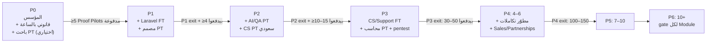
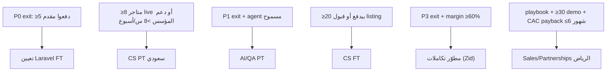

# 10. Recommended Team Structure

> الحالة: مسودة v1.0 — بانتظار موافقة المؤسس (2026-10-21)

> **مراجع القسم:** المراحل والـExit Criteria في [07-master-development-phases.md](07-master-development-phases.md)، والميزانية في [11-budget-timeline.md](11-budget-timeline.md)، والمعمارية في [09-technical-architecture.md](09-technical-architecture.md)، والمخاطر في [13-risks-mitigation.md](13-risks-mitigation.md)، والقرارات في [14-key-decisions.md](14-key-decisions.md). البحث التنظيمي (مصر مقابل السعودية) في [../research/saudi-regulatory-pdpl.md](../research/saudi-regulatory-pdpl.md).
>
> **مهم:** كل الرواتب والتكاليف في القسم ده **[افتراض]**. البحث اللي عملناه مفيهوش مصدر موثوق لرواتب المطورين أو الـCS في مصر أو السعودية، فالأرقام تقديرات تخطيط لازم تتأكد بعروض حقيقية من 3–5 مرشحين في P0 (شوف "Open issues" في الآخر). الميزانيات بالريال، شهرية، **من غير راتب المؤسس**، ومحسوبة بافتراض مهندسين في مصر (الفريق في السعودية ≈ 2x)، زي ما الـspine بيقول.

---

## 10.1 الخلاصة في 6 نقط

1. **الفريق بيكبر بالـGates، مش بالتقويم.** مفيش تعيين قبل ما الـPhase اللي قبله تعدّي الـExit Criteria بتاعتها، أو قبل ما الـmetric اللي بيبرر التعيين يظهر (القسم 10.5). ده تطبيق مباشر لـRules 5 و10 و12.
2. **P0 = المؤسس لوحده** + مستشار قانوني بالساعة + (اختياري) باحث part-time في السعودية. **أول تعيين = Laravel full-stack full-time مع بداية P1**، والمؤسس يفضل هو اللي بيبيع في P0–P1 (إلزامي).
3. **الحجم المخطط [افتراض]:** P1 ≈ 2.2–2.3 FTE، P2 ≈ 3.2، P3 ≈ 3.5–3.7 FTE (+ contractors: محاسب، pentest، تسويق)، P4 = 4–6 أشخاص، P5 = 7–10، P6 = 10+. ده كفاية لـModular Monolith واحد (Rule 6)، ومش محتاج DevOps أو Platform team قبل P5.
4. **أكبر خطر في القسم ده هو وقت المؤسس، مش المهارات** (خطر #11 في الـspine). المؤسس في P1 بيكتب كود وبيبيع وبيشغّل الـpilots وبيطلّع التقرير اليدوي. عشان كده القسم ده بيحدد صراحةً **إيه اللي المؤسس ميعملوش** (10.2).
5. **الـcore product (tenancy، الأمان، القياس، سياسة الخصم) يفضل in-house.** الوكالات والـfreelancers مسموحين بس في حاجات حوالين المنتج (تصميم، landing page، محتوى، pentest).
6. **AI coding tools جزء من خطة الفريق، مش رفاهية**، لكن بقواعد واضحة: ممنوع أسرار أو PII في الـprompts، ومراجعة بشرية إلزامية لأي كود بيلمس الـtenancy أو الأمان أو الخصومات (10.7).

---

## 10.2 دور المؤسس

المؤسس تقني (PHP/Laravel، JS/TS/React، MySQL، n8n، Docker) [مؤكدة: `docs/00-master-prompt.md`، القسم 6]. ده بيخلّيه قادر يبني الـMVP بنفسه، وده نفسه الخطر: الطبيعي إنه يهرب لكتابة الكود ويأجّل البيع والمقابلات.

### توزيع وقت المؤسس حسب الـPhase [اقتراح]

| Phase | كود | بيع ومقابلات وPilots | Ops/دعم/تقرير | قانوني ومنصّات (Meta، سلة، استضافة) | Hiring وإدارة |
|---|---|---|---|---|---|
| P0a (أسبوع 1–3) | 0% (Rule 1) | 60% | 0% | 35% | 5% |
| P0b (أسبوع 3–7) | 35% (spikes + E17 بس) | 40% | 0% | 15% | 10% (تجهيز تعيين P1) |
| P1 | 40–50% | 25–30% | 15–20% (التقرير اليدوي أول 4 أسابيع) | 5% | 5% |
| P2 | 35–45% | 25–30% | 10% | 5% | 10% |
| P3 | 20–30% | 35–40% | 5–10% | 10% (مراجعة سلة، ترحيل Dammam) | 10–15% |
| P4+ | 10–20% (review ومعمارية) | 30–40% | — | 10% | 30%+ |

**القاعدة:** لو الكود عدّى 50% من وقت المؤسس في أي أسبوعين متتاليين في P1–P2، ده إنذار إن البيع واقف. [اقتراح]

### إيه اللي المؤسس **ميعملوش**

| ممنوع | ليه | البديل |
|---|---|---|
| يكتب كود منتج قبل اعتماد الـBlueprint، أو يكتب أي حاجة غير spikes وE17 في P0b | Rule 1، وأكبر 3 مخاطر مش تقنية | مقابلات، Meta BV، سلة Partners، مستشار قانوني |
| يسلّم البيع لحد تاني في P0–P1 | قرار #15 في الـspine: المؤسس بيبيع بنفسه إلزامي. محدش غيره يقدر يتعلم من الرفض | تعيين Sales/Partnerships بس في P4 بعد playbook مكتوب |
| يبني Module برّه نطاق الـPhase (M13 وما بعده قبل P3 exit) | Rule 2 وقاعدة الـspine الثابتة | يكتب الطلب في backlog بـ"عدد التجار اللي طلبوه" |
| يقبل Custom Integration لتاجر واحد | "Reject لحد P5" في نماذج الإيراد. فخ الخدمات (Rule 12) | استثناء بس لو مدفوع بالكامل وبيتحول لـfeature عامة |
| يلمّع الـadmin أو يبني dashboards داخلية | E14 = Filament داخلي بس، ومفيش "SaaS revenue analytics" قبل 30 عميل | Filament defaults + SQL |
| يفضل هو الـsupport الوحيد بعد P2 | بيقتل وقت البيع والكود | CS part-time في P2، full-time في P3 |
| يعيّن قبل الـtrigger | Rule 10. كل تعيين بيقصّر الـrunway (300–500 ألف لحد نهاية P3 [افتراض]) | جدول الـtriggers في 10.5 |
| يسلّم الـcore لوكالة أو freelancer مش ثابت | معرفة الـtenancy والقياس والـconsent لازم تفضل جوه الشركة (Rule 7) | الوكالات للتصميم والمحتوى بس |
| يبني Infra معقدة (Kubernetes، microservices، Python service) | Rule 6 وADR-007 | Docker + managed Postgres/Redis + Horizon |
| يكون الشخص الوحيد اللي معاه production access ومفاتيح Meta وسلة | bus factor = 1. لو المؤسس وقع، التجار هيقعوا | break-glass access موثّق مع المطوّر الأول من P1 (10.8) |
| يوافق على خصم أو حملة نيابة عن التاجر | Rule 9: الخصم قرار التاجر ومحرك السياسات بالكود، مش الـAI ولا CODEX | الموافقات في المنتج (E05، ADR-014) |

---

## 10.3 الفريق لكل Phase

> **Legend:** FT = full-time. PT = part-time. Contractor = بعقد بالساعة أو بالمشروع. FTE = نسبة من وظيفة كاملة.

### نظرة عامة

### P0: Discovery & Platform Gates (5–7 أسابيع)

| الدور | النوع | FTE | المكان | التكلفة [افتراض] | ليه دلوقتي |
|---|---|---|---|---|---|
| المؤسس | — | 1.0 | أي مكان + زيارة واحدة على الأقل للرياض [اقتراح] | راتبه برّه الميزانية | مقابلات، Meta BV، سلة Partners، GCP Invoiced Billing، spikes |
| مستشار قانوني (PDPL + Meta 4.7 + الكيان والضريبة) | Contractor بالساعة | — | مكتب سعودي أو إقليمي عنده ممارسة PDPL | **15–30 ألف ريال إجمالي** (رقم الـspine) | Exit criterion #7: رأي قانوني مكتوب |
| باحث/منسّق مقابلات | PT، اختياري | 0.25–0.5 | **السعودية** (اللهجة والوصول للتجار) | 3–6 ألف/شهر، بسقف ~6 آلاف للمرحلة كلها (القسم 11، 2.2) [افتراض] | يحجز المقابلات ويحضر بعضها. اختياري لو المؤسس قادر يوصل لـ60 متجر لوحده |
| مستشار ضريبي/محاسب | Contractor، جلسة أو اتنين | — | سعودي | ضمن الميزانية القانونية أو 2–5 ألف [افتراض] | BDR-001 (الكيان والضريبة) قبل أول فاتورة |

**الإجمالي:** 25–50 ألف (burn 5–10 ألف/شهر على 5–7 أسابيع + قانوني 15–30 ألف) [افتراض، رقم الـspine].

**تنبيه حسابي:** الباحث بالحد الأعلى (6 آلاف/شهر) + زيارة للرياض + الأدوات والـdemo store بياكلوا الـburn الشهري كله تقريبًا (10 آلاف). عشان كده الجلسة الضريبية لازم تدخل **جوه** الـ15–30 ألف القانونية، مش فوقها، والباحث يفضل اختياري فعلًا: نعيّنه بس لو المؤسس معملش ≥10 مقابلات في أول أسبوعين. [اقتراح]

**ممنوع في P0:** تعيين مطوّر بعقد طويل قبل ما Exit criterion #2 (≥5 دفعوا مقدم) يتحقق. المسموح: **اتفاق مبدئي** مع المرشح الأول (وممكن مهمة تجريبية مدفوعة صغيرة في P0b على demo store) عشان يبدأ أول يوم في P1. [اقتراح]

### P1: Measured Recovery Pilot (10–12 أسبوع)

| الدور | النوع | FTE | المكان المقترح | التكلفة الشهرية [افتراض] | المسؤوليات الأساسية |
|---|---|---|---|---|---|
| المؤسس | — | 1.0 | — | — | Tech lead، E05/E06/E07 (القياس والتقرير)، البيع، تشغيل الـpilots، التقرير اليدوي أول 4 أسابيع |
| **Laravel full-stack (أول تعيين)** | **FT** (موظف أو contractor حصري) | 1.0 | مصر | 12.5–20 ألف ريال (عقد remote بالدولار ~$3,300–5,300، نفس رقم القسم 11) | E01، E02، E03، E04، E13، E14، E15، isolation tests في CI |
| مصمم UI/UX (RTL أولًا) | PT أو Contractor | 0.2–0.3 | مصر أو freelance عربي | 3.5–5.5 ألف ريال | شاشات onboarding، صفحة التقرير، الـhandoff inbox lite، قوالب رسائل WhatsApp بصريًا |
| مستشار قانوني | Contractor | حسب الحاجة | — | جوه بند "قانوني ومحاسبة" 2–4 ألف/شهر في القسم 11 [افتراض] | DPA عربي، سياسة الخصوصية، مراجعة الـopt-out وquiet hours |

**Burn المرحلة:** 25–45 ألف/شهر ≈ 75–135 ألف للمرحلة، والبنية $150–400/شهر [افتراض، أرقام الـspine].

**مواصفات المطوّر الأول (الأهم في القسم كله):**

| لازم | مفضّل | مش مهم دلوقتي |
|---|---|---|
| Laravel إنتاجي ≥3 سنين، Queues/Horizon، Pest أو PHPUnit | Inertia + React + TS | Python، ML |
| خبرة multi-tenant أو SaaS (حتى لو صغير) | PostgreSQL (المؤسس خبرته MySQL، فده بيكمّله) | Kubernetes |
| Webhooks وOAuth وidempotency | تكامل سلة أو زد أو WhatsApp قبل كده | Next.js |
| يقرا ويكتب عربي (الـUI RTL والقوالب عربي) | Filament | Microservices |
| بيستخدم AI coding tools بانضباط (10.7) | تجربة startup | — |

**طريقة الاختيار [اقتراح]:** مهمة مدفوعة 2–3 أيام على demo store (webhook بـHMAC + جدول `webhook_events` + اختبار isolation)، مش leetcode.

### P2: Conversational Selling MVP (8–12 أسبوع)

| الدور | النوع | FTE | المكان | التكلفة الشهرية [افتراض] | المسؤوليات |
|---|---|---|---|---|---|
| المؤسس | — | 1.0 | — | — | E10/E11 (AiGateway والـagent)، البيع، تجديدات P1 |
| Laravel full-stack | FT | 1.0 | مصر | 12.5–20 ألف | E09 (catalog sync + hybrid search)، E12، E16 (COD لو اتأكد)، صيانة P1 |
| **مهندس AI/QA (eval وgolden set)** | **PT** أو Contractor | 0.5 | مصر أو السعودية (لازم يفهم اللهجة السعودية) | 6–9 ألف | golden set ≥300 حالة سعودي، eval قبل كل تغيير prompt/model، مراقبة الـvalidator، تكلفة المحادثة ≤$0.03 |
| **CS / Onboarding (لهجة سعودية)** | **PT** | 0.5 | **السعودية** مفضّل (أو مقيم سعودي/خليجي remote) | 3.5–5 ألف | onboarding بإيدنا (WABA، templates، BV للتاجر)، إدخال هوامش الفئات (E08)، أول خط support، تجميع feedback |
| مصمم | PT | 0.2 | — | 2.5–4 ألف | شاشات الـAssisted mode والـhandoff |

**Burn المرحلة:** 35–55 ألف/شهر ≈ 90–140 ألف، وLLM $100–500/شهر [افتراض، أرقام الـspine].

**ليه الـAI/QA مش FT:** الـgolden set والـeval شغل كثيف في أول 4–6 أسابيع وبعدين بيبقى صيانة. الـagent واحد بـtools (ADR-007) ومفيش Python/LangGraph، فمش محتاجين ML engineer. [اقتراح]

### P3: Public Launch & Monetization (8–12 أسبوع)

| الدور | النوع | FTE | المكان | التكلفة الشهرية [افتراض] | المسؤوليات |
|---|---|---|---|---|---|
| المؤسس | — | 1.0 | زيارات للرياض أكتر | — | البيع (Salla App Store + مباشر)، الأسعار، الـreferral (M20)، مراجعة سلة |
| Laravel full-stack | FT | 1.0 | مصر | 12.5–20 ألف | E18 (listing + self-serve onboarding)، Salla billing (ADR-012)، ترحيل Dammam |
| AI/QA | PT | 0.5 | — | 7–9 ألف | eval مستمر، golden set للحالات الجديدة |
| **CS / Support عربي** | **FT** (الـPT في P2 يتحول FT لو أداؤه كويس) | 1.0 | السعودية مفضّل | 8–12 ألف (مصر/remote أقل، سعودي داخل كيان سعودي أعلى) | self-serve onboarding ≤48 ساعة لـ70%، support، تقرير churn أسبوعي |
| مصمم | PT | 0.2 | — | 2.5–4 ألف | listing assets، onboarding |
| محاسب / bookkeeping | Contractor | — | حسب الكيان (BDR-001) | جوه بند "قانوني ومحاسبة" 2–4 ألف/شهر في القسم 11 [افتراض] | الفواتير، VAT، ZATCA (Wave 25 = 2027-02-01 للمقيمين فوق 187,500 ريال [مؤكدة، الـspine 7.6]) |
| Pentest خارجي | Contractor، مرة واحدة قبل الـlisting العام | — | — | 10–25 ألف مرة واحدة [افتراض]، بند one-time في القسم 11 (2.1) | multi-tenancy، webhooks، OAuth tokens، PII redaction |
| DevOps contractor (اختياري) | مشروع واحد | — | — | 5–15 ألف مرة واحدة [افتراض]، بند one-time في القسم 11 (2.1) | المساعدة في ترحيل Frankfurt → Dammam لو حصل (ADR-005) |
| تسويق | Freelance/وكالة صغيرة | — | — | ضمن 10–20 ألف للمرحلة (رقم الـspine) | landing page، case studies من الـpilots |

**Burn المرحلة:** 45–70 ألف/شهر ≈ 110–175 ألف + تسويق 10–20 ألف [افتراض، أرقام الـspine].

### P4: Profit Engine v2 + Zid + CRM Lite (4–6 شهور)

| الدور | النوع | المكان | التكلفة الشهرية [افتراض] | الـtrigger |
|---|---|---|---|---|
| المؤسس (CEO + Tech lead) | — | — | — | — |
| Laravel full-stack #1 | FT | مصر | 12.5–20 ألف | — |
| **مطوّر تكاملات (Zid + Commerce Adapter)** | FT | مصر | 12.5–20 ألف | P3 exit + قرار Zid |
| AI/QA أو Data (pooled priors، CUPED، M09) | PT → FT لو الـpooled estimates بقت أساس البيع | مصر/السعودية | 6–14 ألف | ≥50 متجر بيانات holdout |
| CS/Support | FT (+ PT تاني لو >80 متجر) | السعودية | 8–12 ألف للفرد | — |
| **Sales/Partnerships** | FT | **السعودية (الرياض)** | 10–18 ألف + عمولة [افتراض] (نفس رقم القسم 11، 2.4) | playbook مكتوب + CAC payback مقاس (10.5) |

**Burn:** 70–120 ألف/شهر [افتراض، رقم الـspine]. **الحجم:** 4–6 أشخاص.

**تنبيه:** لو كل الأدوار اللي فوق اتعيّنت (بما فيها CS PT تاني وData FT)، العدد يوصل 7 أشخاص، يعني فوق سقف الـspine (4–6). القاعدة: AI/Data والـCS التاني يفضلوا PT لحد ما الـtrigger بتاعهم يتحقق (10.5)، فالمجموع يفضل ≈ 5–6 FTE. ومجموع الرواتب في الجدول (≈ 49–84 ألف) + البنية والـLLM والتسويق والأدوات (≈ 17–32 ألف في القسم 11، 2.4) بيقع جوه الـ70–120 ألف، بس من غير هامش لو كل الأدوار اتعيّنت بالحد الأعلى. [افتراض]

### P5 وP6 (مستوى عالي فقط)

| Phase | الحجم | إضافات متوقعة [اقتراح] | ملاحظة |
|---|---|---|---|
| P5 | 7–10 | مطوّر frontend/inbox (M04 الكامل)، Partner manager للوكالات (M20)، CS في الإمارات أو بلهجة خليجية، أول Engineering lead غير المؤسس، DevOps/SRE PT | الـburn 120–200 ألف من الإيراد أو تمويل. أول مرة نفكر في on-call rotation حقيقي |
| P6 | 10+ | فريق لكل Module بـbusiness case، Voice specialist (لو M19 عدّى الـgate)، Enterprise/solutions engineer (M21)، golden set مصري مع دخول مصر | كل Module له gate بـ≥5–10 عملاء ملتزمين يدفعوا. ممنوع تعيين لـModule قبل الـgate |

التفاصيل دي هتتكتب في خطة الـPhase نفسها، مش هنا.

---

## 10.4 المكان: مصر ولا السعودية ولا remote ولا وكالة

### مقارنة خيارات المكان

| المعيار | مصر (موظف/contractor) | السعودية (موظف في كيان سعودي) | Freelance remote (أي مكان) | وكالة تطوير |
|---|---|---|---|---|
| تكلفة مطوّر Laravel senior/شهر | 12.5–20 ألف ريال (عقد remote بالدولار) [افتراض] | ≈ 2x، تقريبًا 25–40 ألف + تأمينات وإقامة [افتراض] | متغيرة جدًا | غالبًا أعلى لكل ساعة [افتراض] |
| تكلفة CS/شهر | 4–7 ألف [افتراض] | 7–12 ألف لمواطن سعودي [افتراض] | — | — |
| اللهجة السعودية مع التاجر | ضعيفة لأغلب الناس (فيه استثناءات) | **قوية** | حسب الشخص | — |
| الوصول للتجار والثقة | بعيد | **قوي** | ضعيف | — |
| فرق التوقيت | ساعة أو أقل [افتراض] | صفر | متغير | متغير |
| الامتثال | لو الفريق في مصر بيوصل لبيانات شخصية: قانون 151/2020 ولائحته (صدرت نوفمبر 2025، المهلة 31 أكتوبر 2026) ممكن يتطلب ترخيص PDPC وDPO [مؤكدة، ثانوي: https://www.bakermckenzie.com/en/insight/publications/2026/10/egypt-personal-data-protection-law-update و https://cms.law/en/are/legal-updates/egypt-s-pdpl-executive-regulations-issued-one-year-compliance-countdown-begins، اطّلاع 2026-10-21]. انطباقه على شركة بتعالج بيانات متسوقين سعوديين **غير مؤكد** | مرتبط بقرار الكيان (BDR-001). متطلبات توطين الوظائف (Nitaqat) على كيان سعودي **غير مؤكدة** في بحثنا وتتسأل للمستشار | حسب مكان الشخص، وأصعب في التحكم | DPA مع الوكالة، وصول أوسع للكود |
| الاحتفاظ بالمعرفة | جيد لو موظف ثابت | جيد | **ضعيف** | **ضعيف** |
| مناسب لـ | الـengineering الأساسي | CS، Sales، Partnerships | مهام محددة (تصميم، محتوى) | landing page، brand، فيديو |

### التوصية [اقتراح]

| النوع | المكان المقترح | السبب |
|---|---|---|
| Engineering (P1–P4) | **مصر** | التكلفة، ونفس لغة المؤسس، والـspine محسوب عليه |
| CS / Onboarding | **السعودية** (أو شخص سعودي/خليجي remote) | التاجر بيتعامل مع حد بيتكلم لهجته [افتراض: إن ده بيأثر على التجديد]. **مش تمايز قوي لوحده:** Thikaa مقرها البحرين وبتعلن دعم اللهجات الخليجية [مؤكدة: [../research/thikaa.md](../research/thikaa.md)]، وKasbly مقرها المعلن أمريكا [مؤكدة: [../research/kasbly.md](../research/kasbly.md)] ونموذج الدعم البشري عندها **غير مؤكد**. يعني اللهجة شرط دخول، مش ميزة |
| Sales / Partnerships | **الرياض** | المبيعات B2B للتجار علاقات وجهًا لوجه [افتراض] |
| الوكالات | تصميم ومحتوى بس | Rule 7: الـcore يفضل in-house |

**تحذير الامتثال:** قبل ما أي حد في مصر يوصل لبيانات production (حتى read-only)، لازم الرأي القانوني يجاوب سؤال الـspine المفتوح: هل الوصول من مصر يعتبر نقل من منظور SDAIA، وهل محتاجين ترخيص PDPC؟ لحد الإجابة: الـpseudonymization (ADR-008) بيقلل الخطر، والوصول للـproduction محصور في أقل عدد. [اقتراح]

---

## 10.5 ترتيب التعيين والـTriggers

كل تعيين له **trigger** بيبرره (metric)، و**guardrail** بيمنع التعيين حتى لو الـtrigger اتحقق.

| # | الدور | Phase | الـTrigger (لازم يتحقق) | Guardrail (ميتعيّنش لو...) |
|---|---|---|---|---|
| 0 | مستشار قانوني بالساعة | P0a (أول 30 يوم) | فورًا. على المسار الحرج (Exit #7) | — |
| 1 | **Laravel full-stack FT** | بداية P1 | P0 exit: **≥5 Proof Pilots مدفوعة مقدمًا** + Meta BV مقبولة | أقل من 5 دفعوا (Kill criterion) |
| 2 | مصمم PT | P1 | أول شاشة بتتعرض على تاجر (onboarding أو التقرير) | — |
| 3 | **AI/QA PT** | بداية P2 | P1 exit + قرار بناء الـagent (مش Kill بسبب Meta 4.7) | Meta صنّفتنا AI Provider → مفيش agent، مفيش تعيين |
| 4 | **CS PT (سعودي)** | بداية P2 (أو آخر P1 لو الـtrigger ظهر بدري) | **≥8 متاجر live**، أو دعم/onboarding المؤسس **>8 ساعات/أسبوع** لأسبوعين متتاليين | الـrunway أقل من 6 شهور |
| 5 | محاسب contractor | قبل أول فاتورة (BDR-001) | أول فاتورة رسمية | — |
| 6 | **CS FT** | P3 | **≥20 متجر بيدفع** أو قبول الـlisting على سلة | logo churn >5%/شهر (المشكلة في المنتج مش في الدعم) |
| 7 | Pentest | قبل الـlisting العام | تقديم الـlisting | — |
| 8 | مطوّر تكاملات FT | بداية P4 | P3 exit (30–50 بيدفعوا، MRR 15–30 ألف، gross margin ≥60% بالتعريف اللي المؤسس هيثبّته، القسم 11 ملاحظة 1) | gross margin تحت الحد |
| 9 | **Sales/Partnerships FT** | P4 | (1) playbook مبيعات مكتوب من المؤسس، (2) win rate معروف على ≥30 demo، (3) المؤسس وصل لسقف ~8 demos/أسبوع [افتراض]، (4) CAC payback مقاس ≤6 شهور، **محسوب بتكلفة وقت المؤسس في البيع** (مش صفر)، وإلا الرقم هيطلع أحسن من الحقيقة ومش هيتكرر مع موظف بمرتب وعمولة | المؤسس لسه بيقفل أقل من نص الـdemos بتاعته (يعني المشكلة في العرض مش في السعة) |
| 10 | CS تاني | P4 | **>40 متجر لكل CS FT** [افتراض]، أو first response >4 ساعات في أوقات العمل | — |
| 11 | Data/AI FT | P4 | ≥50 متجر بـholdout data والـpooled priors بقت جزء من البيع | — |
| 12 | Engineering lead / DevOps PT | P5 | فريق engineering ≥4، أو ≥2 incidents Sev1 في شهر | — |

**قاعدة عامة [اقتراح]:** أي تعيين FT جديد لازم يا إما تكلفته الشهرية مغطّاة بالـgross profit الشهري الحالي (بعد عمولة سلة والـAI والاستضافة)، يا إما يفضل بعده runway ≥6 شهور على الـburn الجديد. لو مش كده، يبقى PT أو contractor.

**تعارض لازم يتحسم في القسم 11:** الـrunway المخطط (300–500 ألف لحد نهاية P3، ~9–11 شهر [افتراض، الـspine]) مصمم يخلص تقريبًا عند نهاية P3. يعني تعيين CS FT في P3 والتعيينات كلها في P4 **مش ممكنة من الـrunway**، ولازم تتغطى من الإيراد (MRR 15–30 ألف × gross margin ≥60% ≈ 9–18 ألف gross profit/شهر عند P3 exit، يكفي CS FT واحد بالكاد) أو من تمويل جديد. لو الإيراد أقل من كده، CS يفضل PT.

---

## 10.6 احتياجات غير هندسية

| الاحتياج | إمتى | النوع | ملاحظات |
|---|---|---|---|
| **Customer Success / Onboarding بلهجة سعودية** | P2 (PT)، P3 (FT) | موظف | المهمة الأساسية مش "رد على تذاكر": إعداد WABA والـtemplates وBV للتاجر، وإدخال هوامش الفئات (E08)، وشرح التقرير والـholdout. الـholdout مفهوم صعب، وشرحه الكويس = تجديد [افتراض]. لازم playbook مكتوب: سكريبت شرح الـholdout، أسئلة الهامش، أسباب الـchurn |
| **Sales** | P0–P3 المؤسس بس، P4 أول تعيين | المؤسس ثم FT | البيع في P0–P1 بيتعلّم منه المنتج. التعيين قبل playbook = حرق فلوس |
| **Partnerships** (وكالات سلة، مطوّري قوالب) | P3 referral (المؤسس)، P4–P5 دور مستقل | المؤسس ثم FT/PT | Mersal بتعلن حلول للوكالات [مؤكدة: https://mersal.ai/industries/agencies، اطّلاع 2026-10-21، في [../research/mersal-ai.md](../research/mersal-ai.md)]، وإنها طالعة من وكالة مكاسب في الرياض **[افتراض]** في نفس الملف. الدرس: الوكالة الشريكة ممكن تبني منافس. الشراكة referral بعمولة محددة المدة |
| **Legal / PDPL advisor** | P0 (15–30 ألف)، وبعدين retainer صغير | Contractor | أسئلة P0: Meta 4.7، دورنا (Processor/Controller) خصوصًا مع الـpooling (ADR-009)، الكيان، الوصول من مصر. وبعدين: DPA، سياسة الخصوصية، DPIA template، متابعة تعديلات PDPL (الاستطلاع بيقفل 2026-11-05 [مؤكدة، الـspine 7.6]) |
| **محاسب / ضرائب** | قبل أول فاتورة | Contractor | VAT، ZATCA/Fatoora، ممثل ضريبي لو بنبيع من برّه [مؤكدة: [../research/saudi-regulatory-pdpl.md](../research/saudi-regulatory-pdpl.md) القسم 10.1] |
| **تصميم / Brand** | P1 PT | Freelance أو وكالة صغيرة | RTL أولًا، logical properties |
| **محتوى وتسويق** | P3 | Freelance | case studies من الـpilots، والمنهجية المنشورة (جزء من الاستدامة في الـspine 3.4). ممنوع العبارات في الـspine 3.2 |
| **Data Protection Officer** | **غير مؤكد** إمتى يبقى إلزامي علينا (في السعودية أو مصر) | يتسأل للمستشار في P0 | ممكن يبقى دور مضاف للمستشار القانوني في الأول [اقتراح] |

---

## 10.7 استخدام AI Coding Tools لمضاعفة فريق صغير

**الفرضية:** أدوات زي Claude Code وCursor وCopilot بتخلّي المؤسس + مطوّر واحد يسلّموا نطاق P1 في 10–12 أسبوع بدل ما نحتاج 3–4 مطورين. **[افتراض]**: مفيش عندنا قياس لنسبة الإنتاجية دي، ولازم نقيسها في P1 (سرعة الـepics الفعلية مقابل التقدير).

### إيه اللي الأدوات دي تعمله وإيه اللي متعملوش [اقتراح]

| استخدام مسموح ومشجَّع | استخدام بمراجعة بشرية إلزامية (2 reviewers أو المؤسس) | ممنوع |
|---|---|---|
| boilerplate (migrations، models، Form Requests، Filament resources) | أي كود بيلمس `tenant_id` أو Global Scopes أو Policies | لصق secrets أو tokens أو `.env` في أي prompt |
| كتابة tests (خصوصًا isolation tests وPest arch tests) | `webhook_events` والـidempotency والـHMAC | لصق بيانات production أو PII (أرقام عملاء، محادثات) |
| ترجمة مسودات الـUI (عربي/إنجليزي) | محرك سياسات الخصم والموافقات (ADR-014) | دمج كود في `main` من غير review لأن "الـAI كتبه وعدّى الـtests" |
| توثيق، ADR drafts، runbooks | الـconsent والـopt-out وquiet hours | الاعتماد على الأداة في صياغة نص قانوني (DPA، سياسة خصوصية) من غير المستشار |
| تحليل SQL للتقرير اليدوي (على بيانات pseudonymized) | الـprice/stock validator والـprompts بتاعة الـagent | توليد ردود عربية "باللهجة السعودية" للـgolden set من غير مراجعة سعودي |
| refactoring وتنظيف | سكريبتات ترحيل الداتا (Frankfurt → Dammam) | — |

### ضوابط تشغيلية

| الضابط | التفاصيل |
|---|---|
| التكلفة | $20–200/شخص/شهر حسب الأداة والاستخدام [افتراض]، بتتحسب في بند الأدوات في [11-budget-timeline.md](11-budget-timeline.md) |
| إعدادات الخصوصية | حسابات Team/Business بشروط no-training، أو enterprise privacy mode لو متاح [اقتراح؛ شروط كل أداة تتراجع قبل الاستخدام] |
| Repo hygiene | `CLAUDE.md`/rules file في الـrepo فيه Critical Rules وقواعد الـtenancy والـRTL، عشان الأدوات تمشي عليها |
| CI كحَكَم | الـisolation suite وarch tests وstatic analysis لازم يعدّوا. ده اللي بيخلّي الكود المولّد آمن نسبيًا (E15) |
| القياس | في P1: نقارن الـepic estimates بالفعلي، ونسجّل الـbugs اللي جت من كود مولّد. لو نسبة الـbugs في الـtenancy/security >0، نشدد المراجعة |

**ملاحظة نقدية:** الأدوات دي بتسرّع **الكتابة**، مش **الاكتشاف**. أكبر 3 مخاطر في المشروع (Meta، استعداد الدفع، شروط سلة) مش بتتحل بكود أسرع. فالأدوات دي مش مبرر إننا نبني نطاق أكبر في P1 (Rule 2).

---

## 10.8 RACI-lite للمجالات الحرجة

> **R** = بيعمل الشغل. **A** = المسؤول النهائي (واحد بس). **C** = بيتسأل قبل القرار. **I** = بيتبلّغ.
> **F** = المؤسس، **D** = Laravel dev، **AQ** = AI/QA، **CS** = Customer Success، **L** = مستشار قانوني، **M** = التاجر (العميل).

### P1–P2 (فريق 2–3.5 شخص)

| المجال | F | D | AQ (P2) | CS (P2) | L | M | ملاحظات |
|---|---|---|---|---|---|---|---|
| Security baseline وisolation tests (E15) | **A** | R | — | — | — | — | أي PR بيلمس الـtenancy محتاج review المؤسس |
| PII وسياسة الـLLM (ADR-008) | **A** | R | R | — | C | I | — |
| Consent / opt-out <24 ساعة | **A** | R | — | R (يتابع البلاغات) | C | I | Exit criterion في P1 = 100% |
| سياسة الخصم والموافقات (ADR-014) | **A** (المحرك والحدود) | R | — | — | — | C (بيحدد سقف الخصم ويوافق على كل خصم) | Rule 9: CODEX مسؤول عن إن المحرك ميسمحش بخصم برّه سياسة التاجر. قرار الخصم نفسه للتاجر، ومش جزء من الـRACI الداخلي |
| Releases / deploy | **A** | R | C (لأي تغيير prompt/model) | I | — | I | deploy بـchecklist، مفيش deploy يوم الخميس بالليل أو قبل ويك إند سعودي [اقتراح] |
| On-call / incidents | **A** | R (أسبوع بأسبوع مع F) | — | I | C (لو فيه تسريب بيانات) | I (خلال 24 ساعة لو بيانات اتأثرت) | تفاصيل تحت |
| Customer support / onboarding | **A** (P1) | C | — | R (P2) | — | — | P1: المؤسس R+A |
| Meta account health (quality rating، BV، templates) | **A** | R (monitoring) | — | R (templates مع التاجر) | — | C | صفر quality warnings = Exit criterion في P1 |
| Salla relationship والـapp review | **A/R** | C | — | — | C | — | — |
| Golden set وeval (E10) | **A** | C | R | C (مراجعة اللهجة) | — | — | — |
| Incremental Profit Report | **A/R** (يدوي أول 4 أسابيع) | R (الصفحة في المنتج) | — | C | — | I | — |

### P3 (بعد CS FT ومحاسب)

| المجال | A | R | تغيير عن P1–P2 |
|---|---|---|---|
| Security + pentest remediation | F | D | Pentest خارجي قبل الـlisting |
| On-call | F | D + F بالتناوب | SLA مكتوب للتجار (أوقات العمل السعودية) |
| Releases | D (بموافقة F على الـrelease notes) | D | الـA بيتنقل للـdev عشان F يفرّغ وقت للبيع |
| Customer support | CS | CS | F بيبقى escalation بس |
| Billing / invoicing | F | محاسب + D (Salla billing) | — |
| Legal / DPA updates | F | L | — |

### On-call في فريق من 2 [اقتراح]

| البند | P1–P2 | P3 |
|---|---|---|
| التغطية | أوقات العمل السعودية (≈09:00–22:00 KSA، اللي هي نفسها نافذة الإرسال خارج quiet hours) بالتناوب أسبوعي بين F وD. بعد 22:00: best effort | نفس الشي + SLA مكتوب |
| ليه ممكن من غير 24/7 | الـrecovery مش بيبعت في quiet hours (22:00–09:00، وفي رمضان 01:00–12:00 [مؤكدة كنص CST، الـspine 7.6]؛ فالتغطية تتزحزح معاها في رمضان)، والـreconciliation polling بيعوّض الـwebhooks الضايعة، وMeta بتعيد الـwebhooks لحد 7 أيام [مؤكدة، الـspine 7.2] | **الحجة دي بتضعف في P2:** الـagent بيرد على رسائل **واردة** في أي ساعة، وquiet hours مش بتغطيه. الحل [اقتراح] متفصّل في [09-technical-architecture.md](09-technical-architecture.md) 9.11.3: بعد 22:00 الـagent يرد بس في اللي الـvalidator عدّاه، وأي handoff برسالة "هنرد الصبح"، وkill switch تلقائي (رجوع Assisted) لو منع الـvalidator عدّى 2% |
| الحِمل | تغطية 13 ساعة/يوم × 7 أيام بين شخصين = حِمل مش مستدام، وفيه خطر burnout للمؤسس اللي بيبيع ويكتب كود في نفس الوقت [افتراض] | ده سبب إضافي لـCS FT في P3 (أول خط) وEngineering lead في P5 |
| Sev1 (تسريب cross-tenant، إرسال لمن عمل opt-out، سعر/خصم غلط اتبعت) | وقف الإرسال للـtenant فورًا (kill switch لكل tenant) + إخطار التاجر خلال 24 ساعة + المستشار القانوني لو فيه بيانات شخصية (72 ساعة لـSDAIA حسب المسودة [مؤكدة، الـspine 7.6]) | نفس الشي + postmortem مكتوب |
| Sev2 (token سلة باظ، webhooks متأخرة، quality rating نازل) | خلال 4 ساعات في أوقات العمل | خلال ساعتين |
| الأدوات | Sentry + Nightwatch alerts بـPII redaction (ADR-015)، قناة alerts واحدة | + status page بسيطة [اقتراح] |
| Bus factor | runbook مكتوب + break-glass access موثّق للـdev لكل حاجة (الاستضافة، Meta Business Manager، Salla Partners، DNS، الـbackups) من أول شهر في P1 | — |

---

## 10.9 عقود ووصول [اقتراح]

| البند | التطبيق |
|---|---|
| IP assignment | في كل عقد (موظف أو contractor أو freelancer)، قبل أول commit |
| NDA + بنود حماية بيانات | لكل حد بيوصل لبيانات تجار، متسقة مع الـDPA اللي بنوقّعه مع التجار |
| Least privilege | الـcontractors (تصميم، تسويق، pentest) ملهمش production access. الـpentest على staging أو بنطاق مكتوب |
| Offboarding | سحب الوصول في نفس اليوم + rotation للأسرار المشتركة |
| مكان الكيان والعقود | مرتبط بـBDR-001. عقد الموظف في مصر وهو بيوصل لبيانات سعودية سؤال قانوني مفتوح (10.4) |

---

## ملاحظات للمراجعة

1. **ضغط وقت المؤسس في P1 (مش خلاف مع الـspine، تحذير):** Exit criterion #10 في P1 بيسمح بـ≤4 ساعات شغل يدوي/تاجر/أسبوع. مع ≥6 متاجر ده ممكن يوصل لـ24 ساعة/أسبوع، فوق الكود والبيع. التزمنا بالـspine (CS PT في P2)، لكن ضفنا trigger بيسمح بتقديم الـCS PT لآخر P1 لو دعم المؤسس عدّى 8 ساعات/أسبوع لأسبوعين. **محتاج موافقة المؤسس**، والـrunway مفيهوش هامش يستوعبه (≈3.5–5 ألف/شهر إضافي [افتراض]).
2. **راتب المؤسس صفر** في كل الميزانيات (زي الـspine). أثره متحسب في [11-budget-timeline.md](11-budget-timeline.md) 4.3 (+41 عميل للـbreak-even لكل 15 ألف/شهر)، والقرار نفسه **عند المؤسس**.
3. **الـrunway بيخلص عند P3 تقريبًا:** P0–P3 ≈ 310–520 ألف إجمالي قبل الإيراد (القسم 11، 2.1)، فتعيينات P3 (CS FT) وP4 لازم تتغطى من الإيراد أو تمويل. القسم 11 (5.4) اقترح Burn Gates وقرار تمويل عند P3 exit، وده **محتاج اعتماد المؤسس**.

**اتحسم في المراجعة دي:** (أ) نطاقات الرواتب في القسم ده بقت هي نفس أرقام القسم 11 (2.3 و2.4)، بعد ما كان فيه فرق (مثلًا المطوّر 8–14 ألف هنا مقابل 12.5–20 ألف هناك). اعتمدنا أرقام القسم 11 لأنها اللي مجموعها بيطابق burn الـspine. (ب) البنود اللي مكانتش ظاهرة في الـspine اتحطت في القسم 11: الـAI coding tools والسفر والمحاسب جوه الـburn الشهري، والـpentest والـDevOps contractor كبنود one-time في P3. (ج) سلوك الـagent بعد 22:00 اتفصّل في القسم 09 (9.11.3).

---

## Open issues

- رواتب مصر والسعودية كلها [افتراض]. محتاجين 3–5 عروض حقيقية لكل دور (Laravel، CS سعودي) في P0b قبل تثبيت ميزانية P1.
- هل الوصول من مصر لبيانات مستضافة في السعودية = نقل من منظور SDAIA، وهل محتاجين ترخيص PDPC مصري؟ (سؤال للمستشار في P0).
- متطلبات التوطين (Nitaqat) لو اخترنا كيان سعودي: **غير مؤكدة**، وبتأثر على تكلفة CS وSales في السعودية.
- إمتى يبقى الـDPO إلزامي علينا (سعودي أو مصري): **غير مؤكد**.
- نسبة الإنتاجية الفعلية من AI coding tools: [افتراض] لحد ما تتقاس في P1.
