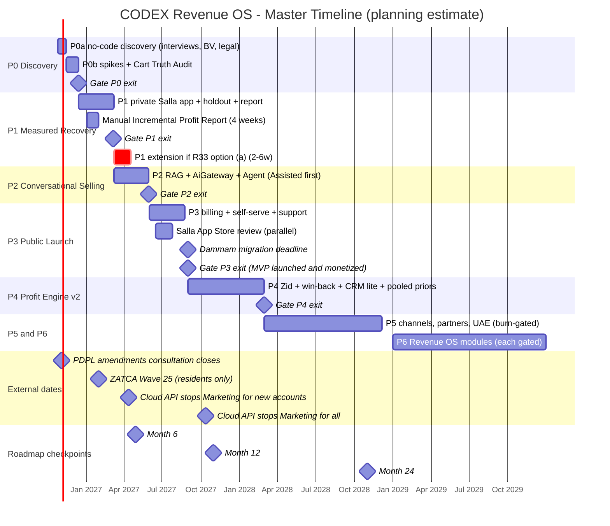
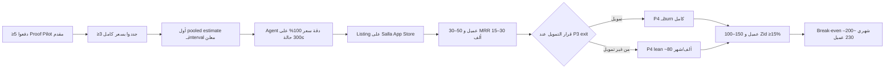

# 11. Estimated Budget and Timeline

> الحالة: مسودة v1.0 — بانتظار موافقة المؤسس (2026-10-21)

> **المراجع:** الأرقام الموحّدة في الـDecision Spine (القسم 5 و6 و7)، و[07-master-development-phases.md](07-master-development-phases.md)، و[10-team-structure.md](10-team-structure.md)، و[12-first-90-days.md](12-first-90-days.md)، و[13-risks-mitigation.md](13-risks-mitigation.md)، و[14-key-decisions.md](14-key-decisions.md). البحث: [market-and-pricing.md](../research/market-and-pricing.md)، [ai-llm-costs-arabic.md](../research/ai-llm-costs-arabic.md)، [whatsapp-business-platform.md](../research/whatsapp-business-platform.md)، [salla-platform.md](../research/salla-platform.md)، [saudi-regulatory-pdpl.md](../research/saudi-regulatory-pdpl.md)، [tech-stack-options.md](../research/tech-stack-options.md).
>
> **تحذير:** كل رقم في القسم ده **[افتراض]** إلا اللي جنبه مصدر. الهدف مش التنبؤ، الهدف إننا نعرف **إيه اللي لازم يحصل عشان الشركة تعيش**، ونحط Gates على الصرف. الحسابات مكتوبة صراحةً عشان أي رقم يتغير نعيد الحساب بسهولة.

---

## 0. الخلاصة في 8 نقط

1. **تكلفة الوصول لنهاية P3 (الـMVP اتطلق واتسيّل، حوالي 10 شهور):** 300–525 ألف ريال صافي بعد الإيراد، حسب السيناريو، **من غير راتب المؤسس** [افتراض]. ده متسق مع رقم الـspine (300–500 ألف)، والسيناريو الـAggressive بيعدّيه بـ~25 ألف بسبب تكلفة الكيان السعودي (التفاصيل في القسم 5 و9). **الرقم ده محسوب على P1 بـ12 أسبوع.** لو المؤسس اختار تمديد P1 لـ14–18 أسبوع (R33 خيار أ، [القسم 13](13-risks-mitigation.md))، الاحتياج بيوصل **~310–590 ألف** [افتراض/حساب، القسم 5.2.1]. لو اختار تليين المعيار، الرقم بيفضل زي ما هو.
2. **أول التزام حقيقي هو P0 بس: 25–50 ألف ريال.** مفيش صرف على P1 قبل ما P0 exit criteria تتحقق (≥5 تجار دفعوا Proof Pilot مقدم) [اقتراح، Rule 10].
3. **رسوم Meta لازم تفضل pass-through على كارت التاجر.** لو استوعبناها، متجر متوسط بيكلّف رسوم Meta ~874 ريال/شهر وده **أكبر من سعر باقة 699** [افتراض/حساب]. القرار ده أهم من اختيار الـLLM.
4. **الـLLM مش هو الخطر على الهامش.** AI COGS لباقة Sell & Recover ≈ 115 ريال/شهر (routing 80/20). الخطر الحقيقي: **عمولة سلة ~30%** والدعم البشري [افتراض].
5. **الـGross margin بيوصل 60% بالكاد (59.6%) عند نصيب سلة 60% من الإيراد، وبيقع تحتها فوق كده** (لو العمولة اتحسبت كتكلفة على السعر الإجمالي). عشان كده الـpilots والسنوي يتباعوا مباشر (Moyasar/Tap) [اقتراح].
6. **Break-even مش هيحصل في أول 24 شهر لو صرفنا حسب burn الـP4 والـP5 المكتوب في الـspine.** الاحتياج التراكمي لحد شهر 24 = 1.3–1.8 مليون ريال [افتراض/حساب]. لو ثبّتنا الـburn الثابت عند ~75 ألف/شهر بعد P3 (P4 lean) وأجّلنا P5، وحسبنا تكلفة الـAI والاستضافة المتغيرة مع كل عميل، الـbreak-even الشهري بنمو الـBase **مش هيحصل قبل شهر 27–28 تقريبًا** (~230 عميل)، والاحتياج الأقصى ~**0.95–1.0 مليون**. بنمو الـAggressive بس (250 عميل في شهر 24) بيحصل حوالي شهر 21–22 (القسم 5.3).
7. **عشان كده بنقترح "Burn Gates":** مفيش زيادة في الـburn الشهري لمستوى Phase جديدة إلا لو (أ) الـexit criteria اتحققت، و(ب) الـnet MRR بيغطي ≥50% من الـburn الجديد **أو** فيه runway ≥12 شهر متأمّن (تمويل) [اقتراح].
8. **قرار التمويل يتاخد عند P3 exit (حوالي أغسطس 2027)**، مش قبله: لو الأرقام حقيقية، بنرفع على أرقام. لو مش حقيقية، بنوفّر الفلوس [اقتراح، Rule 12].

---

## 1. افتراضات الحساب الأساسية

| البند | القيمة | التصنيف |
|---|---|---|
| سعر الصرف | 1 USD = 3.75 SAR | [مؤكدة] سعر الربط الرسمي، [market-and-pricing.md](../research/market-and-pricing.md) |
| راتب المؤسس | **مش داخل** في أي ميزانية (زي الـspine). أثره متوضّح في القسم 4.3 | [افتراض] |
| مكان الفريق | مهندسين في مصر. نفس الفريق في السعودية ≈ 2x | [افتراض] من الـspine |
| VAT | الأسعار والتكاليف من غير VAT 15% | — |
| رسوم Meta | على WABA وكارت التاجر مباشرةً (Tech Provider)، من غير markup | [اقتراح] ADR-006؛ موديل Tech Provider [مؤكدة] https://developers.facebook.com/docs/whatsapp/solution-providers (2026-10-21) |
| عمولة متجر سلة | ~30% | [افتراض] محسوبة من حاسبة https://partners.salla.com/en/apps (2026-10-21): 100 × 59 = 4,130 للمطوّر |
| رسوم بوابة الدفع المباشر (Moyasar/Tap) | ~2.5% للحساب | [افتراض] الأسعار الرسمية **غير مؤكدة** (Moyasar "من فريق المبيعات") |
| شهر 1 | نوفمبر 2026 (P0 بيبدأ آخر أكتوبر 2026). شهر 12 = أكتوبر 2027. شهر 24 = أكتوبر 2028 | [اقتراح] |
| الـPhases بالشهور | P0: شهر 1–2. P1: شهر 2–5. P2: شهر 5–7. P3: شهر 8–10. P4: شهر 11–16. P5: من شهر 17 | [افتراض] من الجدول الزمني في الـspine |
| الأسعار | Proof Pilot 1,500 مقدم/90 يوم، Recover 399، Sell & Recover 699، Pro 999+ | [اقتراح] الـspine 6.1 |

---

## 2. الميزانية لكل Phase

### 2.1 الملخص

| Phase | المدة | Burn شهري (ريال) | إجمالي المرحلة | بنود لمرة واحدة | الفريق |
|---|---|---|---|---|---|
| **P0** Discovery & Platform Gates | 5–7 أسابيع | 5–10 ألف | **25–50 ألف** (burn + قانوني 15–30 ألف) | رأي قانوني | المؤسس + مستشار قانوني بالساعة + (اختياري) باحث part-time |
| **P1** Measured Recovery Pilot | 10–12 أسبوع (الـspine). **واقعيًا 14–18** لو exit criterion #1 فضل زي ما هو (R33) | 25–45 ألف | **75–135 ألف** (بـ12 أسبوع). بـ14–18 أسبوع: **~87–197 ألف** | — | المؤسس + Laravel full-stack FT + مصمم PT |
| **P2** Conversational Selling MVP | 8–12 أسبوع | 35–55 ألف | **90–140 ألف** | — | + AI/QA PT + CS PT |
| **P3** Public Launch & Monetization | 8–12 أسبوع | 45–70 ألف | **110–175 ألف + تسويق 10–20 ألف** | كيان سعودي 40–60 ألف (مشروط، BDR-001)، pentest قبل الـlisting 10–25 ألف، DevOps contractor للترحيل 5–15 ألف (اختياري) | + CS/Support FT |
| **P4** Profit Engine v2 + Zid + CRM Lite | 4–6 شهور | 70–120 ألف | 280–720 ألف | — | 4–6 أشخاص |
| **P5** Channels, Partners & GCC | 6–12 شهر | 120–200 ألف | 0.7–2.4 مليون | دخول الإمارات | 7–10 أشخاص |
| **P6** Revenue OS Platform | 12–24 شهر | حسب الإيراد/التمويل | — | business case لكل Module | 10+ |

كل الأرقام [افتراض] ومأخوذة من الـspine (القسم 5). المجموع من P0 لـP3 (إجمالي، قبل الإيراد): 25+75+90+110+10 = **310 ألف** (أقل حد) لـ 50+135+140+175+20 = **520 ألف** (أعلى حد)، **من غير** الكيان السعودي. الـpentest والـDevOps contractor في P3 بيتمولوا الأول من احتياطي P3 (~13.5–18 ألف على 3 شهور، القسم 2.3)، وبالحد الأعلى (25 + 15 = 40 ألف) بيعدّوا الاحتياطي بـ~22 ألف [افتراض/حساب]. الرقم ده **مش** داخل في جدول الكاش (5.2).

### 2.2 تفصيل P0 (إجمالي المرحلة)

| البند | ريال | ملاحظة |
|---|---|---|
| رأي قانوني مكتوب (Meta 4.7، دور CODEX تحت PDPL، الكيان والضريبة، مسودة DPA) | 15,000–30,000 | [افتراض] الـspine. ساعات محدودة مع مكتب سعودي |
| سفر للسعودية لمقابلات ومتابعة الـdesign partners (1–2 رحلة) | 4,000–10,000 | [افتراض] |
| باحث/منسّق مقابلات part-time في السعودية (اختياري) | 0–6,000 | [افتراض] |
| أدوات وdomain وGoogle Workspace وdemo store | 500–1,500 | [افتراض] |
| تكلفة Cart Truth Audit (P0b) | ~0 إضافي | read-only، من غير WhatsApp ولا LLM، المؤسس بيكتبه (E17) |
| رسوم Meta BV / Salla Partners | 0 معروف | **غير مؤكدة** إن فيه رسوم. Tech Provider نفسه مفيهوش رسوم فوق Meta [مؤكدة] https://developers.facebook.com/docs/whatsapp/solution-providers (2026-10-21) |
| احتياطي | 2,000–5,000 | [افتراض] |
| **الإجمالي** | **~25,000–50,000** | |

**إيراد P0:** ≥5 Proof Pilots × 1,500 = **≥7,500 ريال مقدم** [اقتراح كـexit criterion]. ده مش "إيراد مهم" ماليًا، ده **إثبات استعداد للدفع** (Rule 10).

### 2.3 تفصيل الـburn الشهري لـP1 وP2 وP3 (ريال/شهر)

| البند | P1 | P2 | P3 | ملاحظة |
|---|---|---|---|---|
| Laravel full-stack FT (مصر) | 12,500–20,000 | 12,500–20,000 | 12,500–20,000 | [افتراض] تعاقد remote بالدولار (~$3,300–5,300) |
| مصمم UI/UX part-time | 3,500–5,500 | 2,500–4,000 | 2,500–4,000 | [افتراض] بيقلّ بعد ما الـdesign system يتثبّت |
| مهندس AI/QA part-time (eval وgolden set ≥300 حالة) | — | 6,000–9,000 | 7,000–9,000 | [افتراض] |
| CS/Support بيتكلم سعودي | — | 3,500–5,000 (PT) | 8,000–12,000 (FT) | [افتراض] |
| Infrastructure (hosting، Postgres، Redis، storage، backup/DR، ومكانه بيحدده ADR-005، القسم 09، 9.18.4) | 560–1,500 ($150–400) | 750–1,500 ($200–400) | 1,500–3,000 ($400–800، بعد Dammam) | [افتراض] الـspine. علاوة Dammam +24–45% compute [مؤكدة، ثانوي] https://gcloud-compute.com/e2-standard-2.html (2026-10-21) |
| LLM APIs | 100–400 (تجارب dev بس) | 375–1,875 ($100–500) | 750–3,000 ($200–800) | [افتراض] P1 مفيهوش agent |
| أدوات (Forge، Sentry، Nightwatch، GitHub، Workspace، Figma، CRM، AI coding tools $20–200/شخص [افتراض، القسم 10.7]) | 700–1,500 | 1,000–1,800 | 1,500–2,500 | Forge $12–39 [مؤكدة] https://laravel.com/forge/pricing، Sentry Team $26 [مؤكدة] https://sentry.io/pricing/، Nightwatch Pro $20 [مؤكدة] https://laravel.com/nightwatch/pricing (كلها 2026-10-21). الباقي [افتراض] |
| قانوني ومحاسبة (retainer) | 2,000–4,000 | 1,500–3,000 | 2,000–4,000 | [افتراض] DPA، سياسة خصوصية، فواتير، ZATCA |
| سفر ومبيعات ميدانية (المؤسس) | 3,000–7,000 | 4,000–5,000 | 4,000–6,000 | [افتراض] |
| رسوم بوابات الدفع | ~0 | ~0 | 300–700 | [افتراض] 2.5% على المبيعات المباشرة |
| احتياطي (~10%) | 2,500–4,500 | 3,500–4,500 | 4,500–6,000 | [افتراض] |
| **الإجمالي الشهري** | **~25,000–44,000** | **~35,500–55,500** | **~44,500–70,000** | مطابق لنطاقات الـspine (25–45 / 35–55 / 45–70 ألف) |

**ليه مفيش بند "رسوم Meta" هنا؟** لأن التاجر بيدفعها من كارته على WABA بتاعته (القسم 2.5). الاستثناء الوحيد: رسائل الاختبار على demo number بتاعنا، وهي مهملة (<100 ريال/شهر) [افتراض].

### 2.4 P4 وP5 (مستوى تقريبي بس)

ده Master Blueprint، فالتفاصيل دي هتتعمل لما نوصل للـPhase. التقسيم التقريبي [افتراض]:

| البند (ريال/شهر) | P4 (70–120 ألف) | P5 (120–200 ألف) |
|---|---|---|
| الفريق التقني (2 Laravel منهم مطوّر تكاملات Zid، AI/QA FT، مصمم PT) | 35,000–58,000 | 60,000–100,000 |
| CS/Support | 8,000–12,000 | 15,000–25,000 (2 أشخاص) |
| مبيعات وشراكات (في السعودية، ≈2x تكلفة مصر) | 10,000–18,000 | 20,000–35,000 |
| تسويق وعمولات إحالة | 5,000–8,000 | 12,000–20,000 |
| Infrastructure + LLM | 5,000–12,000 | 8,000–15,000 |
| أدوات وقانوني ومحاسبة واحتياطي | 7,000–12,000 | ~5,000 |

**تحذير [افتراض/حساب]:** بند "Infrastructure + LLM" (5–12 ألف في P4) بيكفي لحد ~40–90 عميل بس. عند 100–150 عميل، AI + hosting + أدوات ≈ 138 ريال/عميل (القسم 3.1) = 14–21 ألف/شهر. يعني الـburn الحقيقي في آخر P4 ممكن يعدّي سقف الـ120 ألف لو الفريق اتعيّن بالكامل، وده سبب إضافي للـBurn Gates (القسم 5.4).

### 2.5 بنود خاصة مطلوبة

#### (أ) رسوم WhatsApp: Pass-through ولا Absorbed؟

رسوم Meta لنفس أحجام الاستخدام اللي في [ai-llm-costs-arabic.md](../research/ai-llm-costs-arabic.md) القسم 9.4 [افتراض/حساب بأسعار [مؤكدة، ثانوية]: Marketing $0.0576، Service $0.0107، أول 1,000 Service مجانية/رقم/شهر]:

| حجم التاجر | رسوم Meta/شهر | بالريال | الباقة المناسبة | لو **استوعبناها**: الباقي من سعر الباقة قبل أي تكلفة تانية |
|---|---|---|---|---|
| Light (300 محادثة، 500 سلة) | ~$44 | ~165 | Recover 399 | 399 − 165 = 234 (هامش بيتآكل 41%) |
| Medium (1,500 محادثة، 2,000 سلة) | ~$233 | ~874 | Sell & Recover 699 | 699 − 874 = **−175 (خسارة)** |
| Heavy (6,000 محادثة، 8,000 سلة) | ~$964 | ~3,615 | Pro 999+ | **−2,616 (خسارة)** |

ملاحظة: صف Medium بيفترض 1,500 محادثة، بينما حصة باقة S&R 1,000 محادثة (والـAI COGS في القسم 3.1 محسوب على 1,000). الفرق (500 محادثة) هو overage، ورسوم Meta بتاعته على التاجر برضه.

**القرار [اقتراح، متسق مع الـspine]:** Pass-through إجباري على كارت التاجر. وكمان:
- رسوم Meta زادت +27% في 7 شهور [مؤكدة كاتجاه، الـspine 7.2]، فاستيعابها = مخاطرة أسعار مش في إيدينا.
- لو المقابلات أثبتت إن الكارت الدولي عائق، البديل **Multi-Partner مع Solution Partner** (رسوم الشريك **غير مؤكدة**)، ونضيف الفرق على التاجر صراحةً، مش في هامشنا.
- 360dialog بياخد 59–299 USD/رقم/شهر و7% surcharge على Marketing خارج MM API [مؤكدة] https://docs.360dialog.com/docs/360dialog/prices-plans-and-payment-options (2026-10-21). ده سبب إضافي إن Tech Provider مباشر أرخص.

**التكلفة الكلية على التاجر (TCO) لازم تتقال في البيع:** تاجر Recover بـ1,000 سلة × رسالتين ≈ 320 ريال لـMeta [افتراض، الـspine 7.2]، يعني **TCO ≈ 720 ريال/شهر**. **بس** الـ320 محسوبة على ~0.16 ريال/رسالة (سعر Salla Chat بالنقاط)، وإحنا Tech Provider بندفع سعر Meta المباشر (~0.216 ريال): **~390 ريال** بعد 10% holdout، و**~432** من غيره (القسم 3.5، و[القسم 04](04-positioning-differentiation.md)، و[القسم 14](14-key-decisions.md)). يعني الـTCO الواقعي **~790–830 ريال/شهر** [افتراض/حساب]. في البيع نستخدم الرقم الأعلى. (تفصيل ROI التاجر في القسم 3.5.)

#### (ب) رسوم متجر تطبيقات سلة

| البند | القيمة | التصنيف | الأثر المالي |
|---|---|---|---|
| العمولة | ~30% من الاشتراك | [افتراض] محسوبة من https://partners.salla.com/en/apps (2026-10-21) | 699 → ~489 صافي، 399 → ~279 |
| صرف المستحقات | ~15 يوم بعد فترة الضمان | [مؤكدة] https://partners.salla.com/legal/apps-policy (2026-10-21) | Working capital: الإيراد بيوصل متأخر ~2–6 أسابيع |
| نافذة استرداد للتاجر | 7 أيام بعد أول تنزيل | [مؤكدة] https://apps.salla.sa/en/faq (2026-10-21) | جزء من إيراد أول شهر مش مضمون |
| Usage billing (لكل محادثة) | ملقيناش دعم رسمي | **غير مؤكدة** | الـoverage (0.25 ريال/محادثة) ممكن ميتحصّلش عن طريق سلة، فيتأجل لـP4 |
| رسوم التسجيل كـpartner أو الـlisting | — | **غير مؤكدة** | — |

**[اقتراح]** الـpilots والعقود السنوية تتباع **مباشرةً** (Moyasar/Tap أو تحويل بنكي)، وسلة تبقى قناة الاكتشاف والـself-serve. الهدف: نصيب سلة من الإيراد ≤60% (ده الحد اللي بيعدّي عنده الـgross margin 60%، القسم 3.3).

#### (ج) القانوني وتأسيس الشركة

| البند | التكلفة | التوقيت | التصنيف |
|---|---|---|---|
| رأي قانوني (Meta 4.7، PDPL، الكيان، الضريبة) | 15,000–30,000 | P0 | [افتراض] الـspine |
| DPA عربي، سياسة خصوصية، incident runbook، ROPA | داخل الـretainer (1,500–4,000/شهر) | P0–P1 | [افتراض] |
| كيان سعودي (MISA + سجل تجاري) | **40,000–60,000**، و8–16 أسبوع | قبل P3 (أو عند المحفّز) | [مؤكدة كادعاء مزود] https://expandway.sa/misa-license-fees-saudi-arabia/ (2026-10-21). الأرقام الدقيقة **غير مؤكدة** |
| البديل: بيع من الخارج + ممثل ضريبي سعودي | تكلفة الممثل **غير مؤكدة** | قبل أول فاتورة | الإلزام [مؤكدة] https://zatca.gov.sa/en/RulesRegulations/VAT/Pages/tax-agentsrepresentatives.aspx (2026-10-21) |
| تسجيل VAT | لغير المقيم: من أول توريد لعميل غير مسجّل | قبل أول فاتورة | [مؤكدة، ثانوي] [saudi-regulatory-pdpl.md](../research/saudi-regulatory-pdpl.md) 10.1 |
| Fatoora (للمقيم) | Wave 25: الربط بحلول 2027-02-01 لمن تعدّى 187,500 ريال | لو كيان سعودي وتعدّينا الحد | [مؤكدة، ثانوي] نفس الملف |
| ISO 27001 / NCNICC | يتأجل | P5+ لو عملاء كبار طلبوه | [اقتراح] |

**[اقتراح]** الكيان السعودي **مش** جزء من الـburn الأساسي. هو قرار BDR-001 بعد الرأي القانوني. في السيناريوهات (القسم 5): Lean بيأجّله لـP4، وBase وAggressive بيدفعوه في P3.

#### (د) الأدوات

[افتراض] حوالي 700–2,500 ريال/شهر لحد P3. القاعدة: **free tier أولًا، ومفيش أداة مدفوعة من غير مستخدم حقيقي ليها**. Datadog وOpenTelemetry وGrafana مؤجلين [اقتراح، الـspine 8]. مفيش Kubernetes ولا multi-region (Rule 6).

#### (هـ) التسويق والمبيعات

| Phase | الحركة | الصرف | التصنيف |
|---|---|---|---|
| P0–P2 | Founder-led: مقابلات، زيارات، LinkedIn، شبكة التجار، Cart Truth Audit كـlead magnet | سفر 3,000–7,000/شهر (داخل الـburn) | [اقتراح] |
| P3 | إطلاق على Salla App Store، case studies من الـpilots، محتوى عربي، تجارب إعلانات صغيرة | **10,000–20,000 إجمالي** | [افتراض] الـspine |
| P3→P4 | Referral للوكالات (M20) بعمولة محددة المدة | 20% من صافي أول 12 شهر للعميل المُحال [اقتراح]. الوكالات ممكن تطلب 20–30% متكرر [افتراض] | |
| P4 | أول مسؤول مبيعات/شراكات + تسويق 5,000–8,000/شهر | داخل burn P4 | [افتراض] |

---

## 3. Unit Economics لكل Tenant

### 3.1 افتراضات الـCOGS (ريال/tenant/شهر)

| البند | Recover | Sell & Recover | Pro | الحساب والتصنيف |
|---|---|---|---|---|
| AI (LLM) | **~10** (5–15) | **~115** (60–170) | **~250** (180–500) | S&R: (1,000 محادثة × $0.0215 + 1,500 recovery × $0.001) × 1.3 overhead = $29.9 ≈ 112 ريال. Pro (بافتراض حصة 2,000 محادثة): (2,000 × 0.0215 + 8,000 × 0.001) × 1.3 = $66 ≈ 249 ريال. Recover: 1,500 × $0.001 × 1.3 ≈ 7 ريال (لو استخدمنا LLM لاختيار الـtemplate أصلًا). تكلفة المحادثة [افتراض] من [ai-llm-costs-arabic.md](../research/ai-llm-costs-arabic.md)، وأسعار الموديلات [مؤكدة] |
| WhatsApp (Meta) | 0 علينا | 0 علينا | 0 علينا | Pass-through (القسم 2.5 أ) |
| Hosting share | ~40 | ~40 | ~40 | [افتراض] $400–800/شهر ÷ 40–75 tenant في P3–P4 ≈ 20–75 ريال، ويقلّ مع الحجم |
| دعم مباشر (steady state) | ~85 | ~85 | ~85 | [افتراض] CS واحد (~10,000 ريال) لكل ~120 tenant. **في P3 الحقيقة أسوأ:** CS واحد لـ30–50 tenant = 160–400 ريال/tenant |
| أدوات per-tenant (monitoring، email، storage) | ~5 | ~5 | ~5 | [افتراض] |

**سقف تكلفة المحادثة (exit criterion في P2): ≤$0.03** [اقتراح، الـspine]. عنده AI لباقة S&R = (1,000 × 0.03 + 1.5) × 1.3 = $41 ≈ **154 ريال**، وده أعلى حد مقبول.

### 3.2 الهامش لكل باقة × قناة (base case)

التعريفات: **صافي الإيراد** = السعر − (عمولة سلة 30% أو رسوم دفع 2.5%). **COGS (تعريف الـspine)** = AI + Hosting. **COGS كامل** = AI + Hosting + دعم + أدوات.

| الباقة / القناة | السعر | صافي الإيراد | COGS (spine) | GM على الصافي (spine) | GM على **السعر** (spine) | COGS كامل | GM كامل على الصافي | Contribution (صافي − AI − hosting − أدوات) |
|---|---|---|---|---|---|---|---|---|
| Recover / مباشر | 399 | 389 | 50 | 87% | 85% | 140 | 64% | 334 |
| S&R / مباشر | 699 | 682 | 155 | 77% | 75% | 245 | 64% | 522 |
| Pro / مباشر | 999 | 974 | 290 | 70% | 68% | 380 | 61% | 679 |
| Recover / سلة | 399 | 279 | 50 | 82% | 57% | 140 | 50% | 224 |
| S&R / سلة | 699 | 489 | 155 | 68% | 48% | 245 | 50% | 329 |
| Pro / سلة | 999 | 699 | 290 | 59% | 41% | 380 | 46% | 404 |

كلها [افتراض/حساب]. مثال الحساب (S&R عن طريق سلة): 699 × 0.70 = 489. (489 − 115 − 40) ÷ 489 = 68%. و(489 − 115 − 40) ÷ 699 = 48%.

**الاستنتاجات:**
- **قاعدة الـspine "AI COGS + دعم ≤35% من الصافي"** بتنجح في المباشر (Recover 24%، S&R 29%، Pro 34%) وبتفشل في سلة لـS&R ((115+85)/489 = **41%**) ولـPro ((250+85)/699 = **48%**). Recover عن طريق سلة على الحافة (34%) [افتراض/حساب].
- **Pro بـ999 عن طريق سلة ضعيف.** لازم حصة محادثات واضحة (اقتراحنا 2,000) وoverage، أو سعر ≥1,299، أو بيع Pro مباشر بس [اقتراح].
- **الـAI مش المشكلة؛ عمولة سلة هي المشكلة.** في S&R عن طريق سلة، العمولة (210 ريال) أكبر من AI + hosting مع بعض (155) [افتراض/حساب].

### 3.3 الـBlended gross margin عند P3

Mix الباقات [افتراض]: 40% Recover، 45% S&R، 15% Pro → **ARPA إجمالي = 0.4×399 + 0.45×699 + 0.15×999 = 624 ريال**. متوسط AI = 0.4×10 + 0.45×115 + 0.15×250 = **93 ريال**.

| نصيب سلة من الإيراد | صافي ARPA | GM على الصافي (spine) | GM على السعر (spine، العمولة تكلفة) | GM كامل على الصافي (مع الدعم) |
|---|---|---|---|---|
| 30% | 557 | 76% | 68% | 60% |
| **60% (base)** | 505 | 74% | **60%** | 56% |
| 80% | 471 | 72% | 54% | 53% |

الحساب (صف 60%): صافي = 624 × (0.6×0.70 + 0.4×0.975) = 624 × 0.81 = 505. GM على السعر = (505 − 93 − 40) ÷ 624 = 60%.

**النتيجة:** exit criterion الـP3 "gross margin ≥60% بعد عمولة سلة والـAI والاستضافة" **بيتحقق بالكاد** لو نصيب سلة 60%، وبيفشل فوق كده، **لو** اتحسب على السعر الإجمالي. لو اتحسب على الصافي، بيتحقق بسهولة (72–76%). **التعريف لازم يتثبّت** (ملاحظة للمراجعة رقم 1).

### 3.4 اقتصاد الـOverage (0.25 ريال/محادثة، من P3/P4)

| السيناريو | تكلفة المحادثة (×1.3 overhead) | هامش مباشر (0.244 صافي بعد 2.5%) | هامش عن طريق سلة (0.175 صافي) |
|---|---|---|---|
| Routing 80/20 ($0.0215) | 0.105 ريال | 57% | 40% |
| السقف ($0.03) | 0.146 ريال | 40% | 17% |
| Sonnet لكل حاجة ($0.088) | 0.43 ريال | **خسارة** | **خسارة** |

[افتراض/حساب]. **الـoverage مربح بس مع الـrouting والـcaching**. أي انحراف للموديل الغالي بيقلبه خسارة، وده سبب إن metering لكل tenant من أول يوم (E13) و`AiGateway` (E10) مش رفاهية.

### 3.5 اقتصاد التاجر (هل المنتج يستاهل تمنه؟)

ده اختبار الـvalue، مش الـCOGS بتاعنا، بس من غيره مفيش renewal.

| البند | Recover | الحساب |
|---|---|---|
| TCO شهري للتاجر | **~790–830 ريال** (رقم الـspine: ~720) | 399 + Meta (1,000 سلة × رسالتين) بسعر Meta المباشر 0.0576 USD ≈ 0.216 ريال [مؤكدة، مصادر ثانوية، الـspine 7.2]: **~390** بعد 10% holdout (900 × 2 × 0.216)، و**~432** من غير holdout [افتراض/حساب]. رقم الـspine (~320) محسوب على ~0.16 ريال/رسالة (سعر Salla Chat بالنقاط)، ومش بينطبق علينا كـTech Provider (متسق مع [القسم 04](04-positioning-differentiation.md) و[القسم 14](14-key-decisions.md)) |
| ربح الطلب الإضافي الواحد | ~100 ريال | متوسط طلب ~250 ريال [افتراض] × هامش 40% [افتراض] |
| **طلبات إضافية (incremental) لازمة عشان التاجر يقف على الصفر** | **~8–9 طلب/شهر** | 790–830 ÷ 100 ≈ 7.9–8.3. (برقم الـspine: 720 ÷ 100 = 7.2) |
| كنسبة من السلات المؤهلة | ~0.8–0.9% uplift إضافي على 1,000 سلة | 8.5 ÷ 1,000 |

**[افتراض]** ده هدف مش صعب نظريًا، **بس** قياسه للمتجر الواحد صعب إحصائيًا (power: متجر 500 سلة/شهر ≈ سنة بـ80/20، الـspine 7.5). عشان كده الـProof Pilot بيوعد بـ"تقدير مجمّع" مش رقم دقيق لكل متجر. لو المتجر طلع تحت الـ8–9 طلب، الـsuppression (رسائل أقل = Meta أقل) لازم يعوّض، وده بيتقاس في P1.

### 3.6 أهم الحساسيات

| لو اتغيّر... | الأثر على GM الـblended (على السعر، base 60%) | التصنيف |
|---|---|---|
| عمولة سلة 20% بدل 30% | ~+6 نقط | [افتراض] |
| Meta اتحسبت علينا (بالغلط أو بقرار) | سالب في S&R وPro | [افتراض/حساب] القسم 2.5 |
| تكلفة المحادثة $0.03 بدل $0.0215 (على S&R وPro) | ~−5 نقط: AI بيزيد ~39 ريال لـS&R و~83 لـPro → 0.45×39 + 0.15×83 ≈ 30 ريال ÷ 624 | [افتراض/حساب] |
| 30% من محادثات S&R راحت لـSonnet بدل 20% | ~−3 نقط | [افتراض] |
| ARPA نزل لـ500 (ضغط Karam على السعر) | ~−6 نقط (لو تكلفة الـAI ثابتة)، والأهم إن الـbreak-even يبعد ~35–40% (Contribution بتنزل من 367 لـ~267: 500×0.81 − 138) | [افتراض] |

---

## 4. تحليل الـBreak-even

### 4.1 الطريقة
Break-even (عدد العملاء) = **الـburn الثابت** (الـburn ناقص بنود الـinfra والـLLM اللي بتتحرك مع العملاء) ÷ **Contribution لكل tenant** (صافي ARPA − AI − hosting − أدوات). الدعم هنا جوه الـburn الثابت لأنه مرتبات.

Contribution (base، نصيب سلة 60%) = 505 − 93 − 40 − 5 = **367 ريال/tenant/شهر** [افتراض/حساب].

### 4.2 النتيجة

| مستوى الـburn | Burn ثابت تقريبي | عملاء لازمين للـbreak-even | مقارنة بهدف الـspine | التصنيف |
|---|---|---|---|---|
| فريق P3 (45–70 ألف) | 42–64 ألف | **115–175** | هدف P3: 30–50 → **بعيد** | [افتراض/حساب] |
| فريق P4 (70–120 ألف) | 65–108 ألف | **177–294** | هدف P4: 100–150 → **مش كفاية** | [افتراض/حساب] |
| فريق P5 (120–200 ألف) | 110–185 ألف | **300–505** | هدف P5: ≥300 → **على الحافة** | [افتراض/حساب] |
| فريق ثابت ~80 ألف (P4 lean من غير P5) | ~75 ألف | **~205** (بـARPA 624). بـARPA الـBase (575): Contribution = 575×0.81 − 138 ≈ 328 → **~230** | هدف شهر 24: 120–250 → **في الطرف الأعلى بس**. الـBase (190 عميل) مش كفاية | [افتراض/حساب] |

### 4.3 أثر راتب المؤسس
لو المؤسس محتاج 15,000 ريال/شهر [افتراض مثال]: كل مستوى بيحتاج **+41 عميل** (15,000 ÷ 367). ولو 25,000: **+68 عميل**. القرار ده لازم يتاخد صراحةً، لأن الـspine (وكل الأرقام هنا) بتفترض إنه صفر.

### 4.4 الدرس
**[افتراض]** الـbreak-even ممكن بفريق صغير (~6 أشخاص، ~75–80 ألف/شهر ثابت) وحوالي 200–230 عميل، يعني أعلى من هدف الـspine لـ18 شهر (50–150) وفي الطرف الأعلى من هدف شهر 24. أي توسّع في الفريق قبل الرقم ده **لازم يتموّل من برّه**. ده متسق مع Rule 12: الشركة المربحة بتكبر الفريق ورا الإيراد، مش قدامه.

---

## 5. سيناريوهات الـRunway واحتياج الكاش

### 5.1 تعريف السيناريوهات [افتراض]

| | Lean | Base | Aggressive |
|---|---|---|---|
| الـburn | أقل حد في كل Phase | المنتصف | أعلى حد |
| Proof Pilots في P0 | 5 (7,500) | 6 (9,000) | 8 (12,000) |
| ARPA إجمالي | 500 | 575 | 625 |
| عملاء شهر 6 / 12 / 16 / 24 | 6 / 30 / 52 / 120 | 8 / 45 / 100 / 190 | 10 / 60 / 130 / 250 |
| الكيان السعودي | مؤجّل لشهر 14 (40 ألف) | شهر 10 (50 ألف) | شهر 10 (60 ألف) |
| تسويق P3 | 10 ألف | 15 ألف | 20 ألف |
| نصيب سلة بعد الإطلاق | الصافي = 81% من الإجمالي (60% سلة) في الثلاثة | | |

قواعد النموذج: الـpilots بيدفعوا مقدم في شهر 2–3، ومفيش MRR قبل شهر 6 (آخر الـ90 يوم). الإيراد قبل شهر 10 مباشر (97.5%)، وبعده 81%. Proof Pilot اللي بيتحول لسنوي بيتخصم من أول اشتراك، فالـ1,500 مش إيراد إضافي فوق السنوي.

**أعداد العملاء صافية بعد الـchurn [افتراض/حساب].** عند logo churn 5%/شهر (سقف P3 exit) ده ~46% في السنة. عشان نوصل 190 عميل في شهر 24 (Base)، بين شهر 16 و24 محتاجين ~11 عميل صافي/شهر + ~6–8 بيمشوا = **~17–19 عميل جديد إجمالي/شهر**. ده اللي بيتحسب عليه الـCAC (القسم 7.2)، مش الصافي.

### 5.2 الكاش التراكمي (ريال، سالب = احتياج)

| النقطة | Lean | Base | Aggressive |
|---|---|---|---|
| نهاية P0 (شهر 2) | −30,500 | −46,500 | −61,500 |
| نهاية P1 (شهر 5) | −107,500 | −152,000 | −195,500 |
| شهر 6 | −139,600 | −192,500 | −244,400 |
| **نهاية P3 (شهر 10)** | **−295,900** | **−431,000** | **−525,500** |
| شهر 12 | −414,000 | −582,300 | −709,800 |
| نهاية P4 (شهر 16) | −663,900 | −820,200 | −989,800 |
| **شهر 24** | **−1,334,800** | **−1,536,700** | **−1,790,000** |
| MRR إجمالي شهر 24 | 60,000 | 109,250 | 156,250 |
| Break-even شهري خلال 24 شهر؟ | لأ | لأ | لأ |

[افتراض/حساب]. مثال (Base، شهر 10): burn P3 57,500 + كيان 50,000 = 107,500. إيراد = 32 عميل × 575 × 0.81 = 14,904. صافي الشهر = −92,600.

**قراءة الجدول:**
- لحد نهاية P3: **300–525 ألف**، متسق مع الـspine (300–500 ألف). الفرق في الـAggressive سببه الكيان السعودي. **الجدول ده بيفترض P1 = 12 أسبوع**؛ أثر التمديد في 5.2.1.

#### 5.2.1 أثر تمديد P1 (R33) على الـrunway

الأقسام [07](07-master-development-phases.md) و[08](08-phase-dependencies.md) و[12](12-first-90-days.md) و[13](13-risks-mitigation.md) متفقة إن شرط "≥6 متاجر live ≥60 يوم" مش هيتحقق في 10–12 أسبوع، والـP1 الواقعية **14–18 أسبوع**. ده قرار مؤسس قبل P1 (البوابة C في [القسم 14](14-key-decisions.md)):

| | خيار (أ): تمديد P1 لـ14–18 أسبوع | خيار (ب): تليين المعيار لـ"≥6 live، منهم ≥3 عدّوا 60 يوم" |
|---|---|---|
| أسابيع زيادة فوق الـ12 | 2–6 | 0 |
| burn إضافي في P1 (25–45 ألف/شهر ≈ 5.8–10.4 ألف/أسبوع) | **~12–62 ألف** [افتراض/حساب] | 0 |
| احتياج لحد نهاية P3 | Lean ~310 ألف (+2 أسبوع × 5.8)، Base ~465 ألف (+4 × 8.1)، Aggressive **~590 ألف** (+6 × 10.4) | 300–525 ألف (زي 5.2) |
| الإيراد | بيتأخر بنفس المدة (P3 والـApp Store بيتأخروا)، فالرقم الفعلي **أعلى شوية** من اللي فوق [افتراض] | من غير تغيير |
| كاش بداية P1 (5.4، Base) | ~630 ألف بدل ~600 ألف | ~600 ألف |
| المخاطرة | نهاية P3 بتتحرك لـسبتمبر–أكتوبر 2027، وقرار التمويل بيتأخر | دليل أضعف على الـrenewal (3 متاجر بس عدّوا 60 يوم) قبل الصرف على P2 |

**التوصية [اقتراح]:** خيار (ب) كأساس، بشرط إن الـ3 متاجر اللي عدّوا 60 يوم يكون عندهم قرار renewal فعلي، والباقيين يتقاسوا جوه P2 من غير ما يوقّفوها. خيار (أ) بيعدّي سقف الـspine (500 ألف) في الـBase والـAggressive، ولازم يتمول صراحةً قبل بداية P1. **قرار المؤسس.**
- بعد P3، لو التزمنا بـburn الـP4 والـP5 زي ما هو، **مفيش break-even في 24 شهر في أي سيناريو**، والاحتياج 1.3–1.8 مليون. ده مش فشل في الخطة، ده معناه إن P4/P5 **محتاجين تمويل أو انضباط في الـburn**، والـspine نفسه بيقول "P5 من الإيراد أو تمويل".

### 5.3 متغيرين مهمين

| المتغير | النتيجة | التصنيف |
|---|---|---|
| **Downside:** burn الـBase + عملاء الـLean لحد P3 | −454,000 في شهر 10 | [افتراض/حساب] أسوأ حالة واقعية قبل قرار التمويل |
| **Disciplined:** إيراد Base، والـburn **الثابت** 75 ألف من شهر 11 (P4 lean، وP5 متأجل) + تكلفة متغيرة ~138 ريال/عميل (AI + hosting + أدوات) | تراكمي شهر 24 ≈ **−954,000**، وأقصى احتياج ~**970,000**، و**break-even شهري حوالي شهر 28** (~230 عميل، بافتراض نفس النمو ~11/شهر بعد شهر 24) | [افتراض/حساب]. صافي الشهر = 328 × العملاء − 75,000. شهر 16: 100 عميل → −42 ألف. شهر 24: 190 → −13 ألف |
| **Disciplined + نمو Aggressive** | نفس الـburn، بـ250 عميل في شهر 24 وARPA 625 (Contribution ≈ 368) | break-even عند ~204 عميل ≈ **شهر 21–22** | [افتراض/حساب] |

**تصحيح مهم:** النسخة الأولى من الحساب ده عاملت الـ80 ألف كـburn شامل الـAI والاستضافة، فطلع break-even في شهر 23 واحتياج 0.82 مليون. ده مش متسق مع القسم 4.2 (اللي بيفصل التكلفة المتغيرة)، ومعناه إن الفريق بيصغر وإحنا بنكبر. الرقم المعتمد هنا هو الأعلى.

### 5.4 احتياج الكاش وBurn Gates [اقتراح]

| النقطة | الكاش اللي لازم يكون متأمّن | الشرط قبل الصرف |
|---|---|---|
| بداية P0 (دلوقتي) | **50,000** | موافقة المؤسس على الـBlueprint |
| بداية P1 | **≥ احتياج لحد نهاية P3 في السيناريو المختار + 3 شهور burn P3** ≈ 430,000 + 170,000 ≈ **600,000 (Base)**، أو ~430,000 (Lean). لو P1 اتمدت (R33 خيار أ): ~630,000 (Base) [افتراض/حساب، 5.2.1] | P0 exit: ≥5 دفعوا مقدم، Meta BV، رأي قانوني |
| بداية P3 | باقي الـrunway ≥6 شهور | P2 exit: دقة السعر 100%، ≥10–15 بيدفعوا |
| **بداية P4** | **قرار تمويل:** إما تمويل ~0.8–1.2 مليون (مسار P4/P5 الكامل)، وإما burn ثابت ≤75–80 ألف لحد الـbreak-even، وده محتاج ~0.55 مليون إضافي فوق اللي اتصرف لحد P3 | P3 exit + net MRR ≥15 ألف + logo churn ≤5% |
| بداية P5 | runway ≥12 شهر متأمّن، **أو** net MRR ≥50% من burn P5 (~60–100 ألف) | P4 exit: 100–150 عميل، NRR ≥100% |

**قاعدة ثابتة:** أي Gate فشلت = الـburn يرجع لمستوى المرحلة اللي فاتت، ومفيش تعيينات جديدة (متسق مع Kill criteria في الـspine).

---

## 6. الجدول الزمني الكلي

- التواريخ [افتراض] من الجدول الزمني في الـspine. التواريخ الخارجية [مؤكدة]: استطلاع PDPL لحد 2026-11-05، وZATCA Wave 25 في 2027-02-01، وإيقاف Marketing على Cloud API 2027-04-13 / 2027-10-13 (الـspine 7.2 و7.6).
- **التأخير الأكثر احتمالًا** [افتراض]: Meta BV/App Review (P0)، ومراجعة سلة (P3، مفيش SLA [مؤكدة])، وDammam Invoiced Billing. كل أسبوع تأخير في P1–P3 بيكلّف ~6–17 ألف ريال (burn أسبوعي) [حساب].
- الـbuffer: P1 وP2 مخطط ليهم 12 أسبوع (أعلى حد) عمدًا. لو خلصوا بدري، الفلوس اللي اتوفرت بتروح للـrunway، مش لـscope إضافي. **بس** الـ12 أسبوع في P1 **مش buffer كفاية** لشرط "≥6 متاجر live ≥60 يوم" (R33). الـgantt ماشي على 12 أسبوع (خيار ب، تليين المعيار). لو اتاخد خيار (أ)، الشريط الأحمر "P1 extension" بيتفعّل، وكل اللي بعد P1 (P2 وP3 وP4 وقرار التمويل) بيتأخر 2–6 أسابيع: P3 exit بيبقى حوالي منتصف سبتمبر–منتصف أكتوبر 2027 بدل 2027-08-31 [افتراض/حساب]. التواريخ الخارجية مش بتتحرك.

---

## 7. الـRoadmap: 6 و12 و24 شهر (Task 6)

> خطة أول 30 و90 يوم بالتفصيل في [12-first-90-days.md](12-first-90-days.md). باختصار: **30 يوم** = 0 live، ≥10 مقابلات، ≥3 LOIs، BV وطلب Dammam مقدّمين، مستشار قانوني متعاقد. **90 يوم** = ≥5 Proof Pilots مدفوعة، 2–4 live، MRR 0–2,000 + 7,500 مقدم، P0 مقفولة وP1 في النص [افتراض، الـspine 7.7].

### 7.1 الخطة حسب المحور

| المحور | 6 شهور (أبريل 2027) | 12 شهر (أكتوبر 2027) | 24 شهر (أكتوبر 2028) |
|---|---|---|---|
| **Product Development** | P1 مقفولة: recovery end-to-end بـholdout، consent ledger، Incremental Profit Report في المنتج (بعد 4 أسابيع يدوي). P2 بدأت: catalog sync، `AiGateway`، golden set | P2 وP3 مقفولين: Agent (Assisted ثم Scoped Autonomous)، COD لو اتأكد، Salla billing، self-serve onboarding، الإنتاج على Dammam. بداية P4 | P4 مقفولة: Zid، win-back/repeat/failed payment، CRM lite، pooled priors، overage وannual. P5 بدأت (لو الـBurn Gate عدّت): Instagram/Messenger، agency dashboard |
| **Customer Discovery** | ≥25 مقابلة اتعملت، ومقابلات exit لكل pilot | مقابلات churn لكل عميل بيمشي، ومقابلات ربع سنوية مع أكبر 10 عملاء | Discovery للإمارات (≥15 مقابلة) وللـFashion قبل ضبط الـagent ليه |
| **Market Validation** | ≥3 من أول 5 جددوا بسعر كامل؛ ≥3 تجار غيّروا قرار بسبب التقرير؛ أول pooled estimate | 30–50 بيدفعوا من غير خصم الـpilot؛ ≥50% من الجدد جايين من سلة أو referral (مش المؤسس) | ≥15% من الإيراد من زد؛ NRR ≥100% |
| **Pricing Tests** | Proof Pilot 1,500 → تحويل لـ399/699. قياس: نسبة القبول، والاعتراضات على السعر | 399/699/999 على سلة؛ اختبار السنوي (خصم = شهرين) بعد ≥3 شهور churn؛ اختبار حصة Pro (2,000 محادثة) | Overage 0.25/محادثة؛ Outcome fee اختياري 2–5% على الربح الإضافي المثبت لعينة ≥10 عملاء؛ مراجعة الأسعار مقابل Karam |
| **Pilot Customers** | 5–8 Proof Pilots؛ 6–10 بيدفعوا | الـpilots الأوائل اتحولوا case studies (≥3 منشورة بإذن) | برنامج "design partners" تاني لزد ولـM13 |
| **Sales Channels** | Founder-led مباشر 100% | Salla App Store + مباشر (هدف: سلة ≤60% من الإيراد) + referral | سلة + زد + مباشر + partners (هدف ≥20% من الجدد في P5) + مسؤول مبيعات |
| **Agency Partnerships** | مفيش (بدري) | Referral فقط (M20): 3–5 وكالات، عمولة 20% من صافي أول 12 شهر [اقتراح] | 10–20 وكالة نشطة؛ agency dashboard (P5)؛ **مفيش white label** قبل شهر 24 |
| **Support Operations** | المؤسس + مهندس؛ وقت يدوي ≤4 ساعات/تاجر/أسبوع | CS FT عربي؛ onboarding ≤48 ساعة لـ70%؛ ساعات دعم 9–22 بتوقيت السعودية [اقتراح]؛ runbook للحوادث | 2 CS؛ نسبة ~1 CS لكل 100–150 tenant؛ help center عربي؛ SLA لـPro |
| **Cash Requirements** | تراكمي 140–245 ألف؛ متأمّن ≥ runway لنهاية P3 + 3 شهور | تراكمي 415–710 ألف؛ **قرار التمويل** عند P3 exit | تراكمي ~0.95 مليون (disciplined) لـ1.3–1.8 مليون (لو P5 على الميعاد) |
| **Growth Milestones** | أول تقدير مجمّع للأثر بـinterval معلن | Listing منشور؛ MVP "اتطلق واتسيّل" | ≥120 عميل؛ break-even شهري في مسار الـdisciplined **مش قبل شهر ~28** بنمو الـBase (شهر 21–22 بس لو النمو Aggressive) |

كل الخانات [افتراض] أو [اقتراح]. أرقام العملاء والـMRR من الـspine 7.7.

### 7.2 أهداف SaaS Metrics

| المقياس | 6 شهور | 12 شهر | 24 شهر | الحساب / التصنيف |
|---|---|---|---|---|
| عملاء بيدفعوا | 6–10 | 30–60 | 120–250 | [افتراض] الـspine 7.7 |
| MRR (ريال، إجمالي) | 2,500–5,000 | 15,000–35,000 | 60,000–150,000 | [افتراض] الـspine 7.7 |
| ARPA إجمالي | ~400–500 | ~500–600 | ~550–650 | [افتراض] (MRR ÷ العملاء) |
| Logo churn شهري | مش ذو معنى إحصائيًا؛ المقياس: ≥3 من أول 5 جددوا | ≤5% | ≤3% | [اقتراح] P3 exit في الـspine ≤5% |
| NRR | — | قياس أول مرة (هدف ≥95%) | ≥100% | [اقتراح] P4 exit ≥100% |
| Gross margin (الـspine: ≥60% في P3 و≥65% في P4؛ **التعريف معلّق**، ملاحظة 1) | غير ذو معنى (pilots) | ≥60% | ≥65% | [اقتراح] P3/P4 exit. على السعر الإجمالي ده على الحافة، وعلى الصافي سهل (3.3) |
| CAC (كاش، من غير وقت المؤسس) | ~1,000–1,500 (سفر ÷ pilots) | ~1,000–1,500 | ≤2,500 (fully loaded بمسؤول المبيعات) | [افتراض/حساب] P3: (15 ألف تسويق + ~15 ألف سفر) ÷ ~24 عميل جديد ≈ 1,250. P4: (10–18 ألف مبيعات + 5–8 ألف تسويق) ÷ ~12 عميل جديد/شهر ≈ 1,250–2,170. لو الـchurn 5%/شهر، العملاء الجداد الإجمالي ~15–18/شهر، بس الصافي اللي بيبني الـMRR أقل (القسم 5.1) |
| CAC payback | — | ≤6 شهور | ≤6 شهور | [حساب] 1,700 ÷ (466 صافي ARPA × 72% GM) ≈ 5.1 شهر |
| Burn multiple (net burn ÷ net new ARR) | — | مش هدف قبل P3 | ≤2.5 | [اقتراح] مؤشر انضباط قبل أي تمويل |
| % الإيراد من زد | 0 | 0 | ≥15% | [افتراض] P4 exit |
| % العملاء الجدد من partners | 0 | ~10% | ≥20% | [اقتراح] P5 exit |

### 7.3 Growth Milestones (بالترتيب، مش بالتاريخ)

**[اقتراح]** كل سهم هنا Gate. لو Gate فشلت مرتين: وقفة مراجعة كاملة قبل أي صرف جديد (Kill criteria في الـspine 5).

---

## 8. إيه اللي ممكن يكسر الأرقام دي

| المخاطرة | الأثر على الميزانية | الإشارة المبكرة | الرد |
|---|---|---|---|
| التاجر مش هيدفع للرقم الصادق | P0 بتفشل؛ الخسارة ≤50 ألف | أقل من 5 دفعوا مقدم | Pivot لـCOD أو "توفير التكلفة" قبل أي صرف على P1 |
| عمولة سلة أعلى أو usage billing ممنوع | GM ينزل تحت 60% | رد سلة الرسمي في P0 | قناة مباشرة أكبر، Pro مباشر بس |
| Meta بتصنّفنا AI Provider | P2 تتلغي؛ نوفّر ~90–140 ألف بس نخسر قيمة S&R | رد Meta المكتوب في P0 | Recovery/COD من غير agent |
| P1 اتمدت لـ14–18 أسبوع (R33 خيار أ) | +12–62 ألف؛ احتياج نهاية P3 ~310–590 ألف | قرار المؤسس في البوابة C قبل P1 | تليين المعيار (خيار ب)، القسم 5.2.1 |
| تأخير Meta BV أو مراجعة سلة | +6–17 ألف لكل أسبوع | مفيش رد بعد 3 أسابيع | Frankfurt + private app يكمّلوا؛ نشتغل بالتوازي |
| ارتفاع رسوم Meta | مش علينا مباشرةً (pass-through)، بس بيقلل ROI التاجر | Meta pricing updates كل ربع | suppression كقيمة بيعية |
| راتب المؤسس أو أول تعيين أغلى | +41 عميل لكل 15 ألف للـbreak-even | قبل P1 | تحديد الرقم صراحةً في القسم 4.3 |
| Pro بيستهلك أكتر من الحصة | خسارة على Pro عن طريق سلة | metering من E13 | حصة + overage، وPro مباشر |

---

## ملاحظات للمراجعة

1. **تعريف الـGross margin في P3 exit criterion مش محدد.** الـspine بيقول "≥60% بعد عمولة سلة والـAI والاستضافة". لو اتحسب على **الصافي**: 72–76% (سهل). لو اتحسب على **السعر الإجمالي** والعمولة تكلفة: 60% بالظبط عند نصيب سلة 60% (على الحافة). ولو الدعم داخل: 56%. **التوصية:** نعتمد "GM على صافي الإيراد، COGS = AI + hosting + دعم مباشر + أدوات per-tenant" كمقياس أساسي، وهدفه ≥55% في P3 و≥60% في P4، ونتابع مقياس الـspine جنبه. ده **مش تعديل** للـspine، بس محتاج قرار من المؤسس.
2. **الكيان السعودي (40–60 ألف ريال) مش داخل في ميزانيات الـPhases في الـspine.** لما يتضاف في P3، احتياج الـAggressive لحد نهاية P3 بيوصل ~525 ألف، فوق سقف الـspine (500 ألف) بـ~5%. التزمنا بنطاق الـspine وأضفنا الكيان كبند مشروط منفصل.
3. **قاعدة الـspine "AI COGS + دعم ≤35% من الصافي" بتفشل عن طريق سلة** لـS&R (~41%) ولـPro (~48%) في الـsteady state، وبتفشل في كل الباقات في P3 (CS واحد لـ30–50 tenant = 160–400 ريال/tenant). ممكن تتحقق بس من ~120 tenant ونصيب مباشر أعلى.
4. **باقة Pro (999+) من غير حصة محادثات محددة في الـspine.** حسبنا بحصة 2,000 محادثة [اقتراح]. بـ3,000 محادثة الـAI COGS بيوصل ~355 ريال والهامش عن طريق سلة بيقع لـ44% (تعريف الـspine على الصافي).
5. **أرقام الـburn في P4 وP5 مع أهداف العملاء في الـspine معناها مفيش break-even في 24 شهر**، واحتياج تراكمي 1.3–1.8 مليون ريال، بينما الـrunway المذكور في الـspine (300–500 ألف) بيغطي لحد P3 بس. ده مش تناقض صريح (الـspine بيقول P5 "من الإيراد أو تمويل")، بس قرار التمويل عند P3 exit والـBurn Gates (القسم 5.4) لازم يتعتمدوا صراحةً.
6. **راتب المؤسس صفر في كل الأرقام** زي الـspine. ده افتراض قوي على 24 شهر، وبيغيّر الـbreak-even بـ+41 عميل لكل 15 ألف ريال/شهر.
7. **(مراجعة) تصحيح مسار الـDisciplined:** كان محسوب بـburn شامل 80 ألف من غير تكلفة متغيرة لكل عميل (break-even شهر 23، احتياج 0.82 مليون). بعد فصل الـAI والاستضافة (متسق مع القسم 4.2): break-even ~شهر 28 بنمو الـBase، واحتياج ~0.97 مليون. ده بيقوّي حجة قرار التمويل عند P3 exit.
8. **(مراجعة) رقم الـspine "1,000 سلة × رسالتين ≈ 320 ريال لـMeta"** محسوب على ~0.16 ريال/رسالة (سعر Salla Chat بالنقاط)، مش سعر Meta المباشر اللي بندفعه كـTech Provider (~0.216): **~390 ريال** بعد 10% holdout، و**~432** من غيره (متسق مع القسمين [04](04-positioning-differentiation.md) و[14](14-key-decisions.md)). القسم ده بقى بيستخدم ~390–432 في TCO التاجر (~790–830) وفي ROI (8–9 طلب إضافي بدل 7–8). محتاج الـspine يتصلّح.
9. **(مراجعة) الـchurn:** سقف 5%/شهر في P3 exit معناه ~46% سنويًا. أعداد العملاء في السيناريوهات صافية، فالـacquisition الإجمالي المطلوب أعلى بـ~50–70% من الصافي بعد P3 (17–19 إجمالي مقابل ~11 صافي/شهر في الـBase). لو الـchurn فعلًا قريب من 5%، الـbreak-even بيبعد أكتر.
10. **(مراجعة) مدة P1 مقابل exit criteria #1 و#3.** الأقسام 07 و08 و12 متفقة إن "≥6 متاجر live ≥60 يوم" و"≥4,000 سلة" مش هيتحققوا في 12 أسبوع، والـP1 الواقعية 14–18 أسبوع (R33 في القسم 13). التمديد 2–6 أسابيع بـburn P1 (25–45 ألف/شهر) = **~12–62 ألف إضافي** [افتراض/حساب]، واحتياج نهاية P3 بيبقى ~310–590 ألف بدل 300–525 (القسم 5.2.1)، وبيأخّر كل الـgantt بنفس المدة. البديل اللي مفيهوش تكلفة: تعديل المعيار لـ"≥6 live، منهم ≥3 عدّوا 60 يوم". **قرار المؤسس.** جدول الكاش (5.2) والـgantt الأساسي لسه ماشيين على 12 أسبوع، والتمديد ظاهر كبند منفصل (5.2.1، وشريط "P1 extension" في الـgantt، والقسم 8).
11. **(مراجعة) موعد ترحيل Dammam ممكن يتقدّم** لو اللائحة النهائية لـPDPL اعتمدت التخزين المحلي ونفاذها وقع جوه P1 (القسم 09، 9.18.2، والقسم 13). الأثر على الميزانية محدود (علاوة Dammam ~$80–200/شهر بتبدأ بدري [مؤكدة، ثانوي]، + ممكن الـDevOps contractor يتقدّم من P3 لـP1)، لكن الـmilestone "Dammam migration deadline" في الـgantt (2027-08-31) هيتغير.

**اتحسم في المراجعة دي:** بنود القسم 10 اللي مكانتش ظاهرة (pentest، DevOps contractor، محاسب، AI coding tools، سفر) اتحطت صراحةً في 2.1 و2.3. أرقام الرواتب في القسم 10 اتوحّدت مع 2.3 و2.4 هنا. تاريخ Gate الـP0 (2026-12-14) بقى متسق مع القسمين 08 و12.
