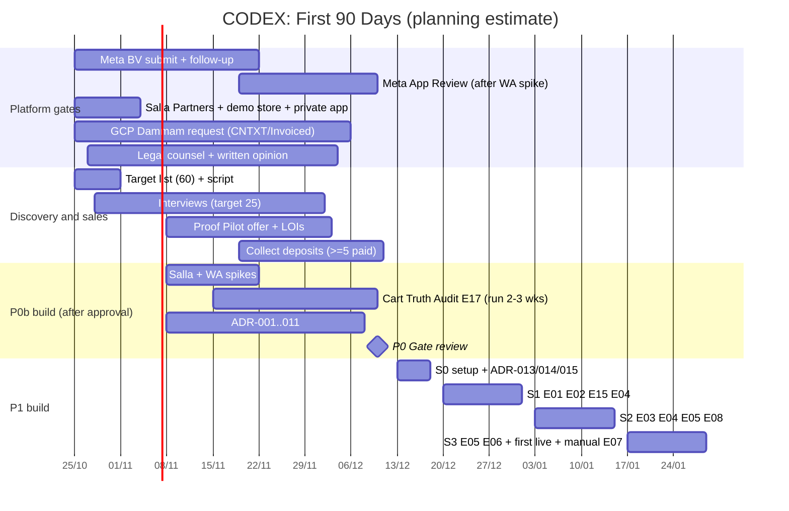
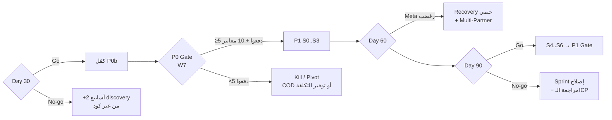
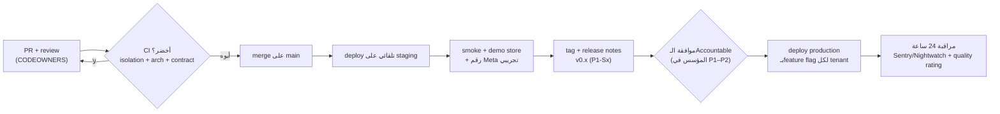

# 12. First 90 Days Execution Plan

> الحالة: مسودة v1.0 — بانتظار موافقة المؤسس (2026-10-21)

> **المرجع:** الأسماء والـIDs (P0..P6، M01..M21، E01..E18، ADR-001..015، BDR-001) والأرقام منقولة بالنص من الـDecision Spine. تفاصيل المراحل في [07-master-development-phases.md](07-master-development-phases.md)، والاعتماديات في [08-phase-dependencies.md](08-phase-dependencies.md)، والمعمارية في [09-technical-architecture.md](09-technical-architecture.md)، والفريق في [10-team-structure.md](10-team-structure.md)، والميزانية وخطة 6/12/24 شهر في [11-budget-timeline.md](11-budget-timeline.md)، والمخاطر في [13-risks-mitigation.md](13-risks-mitigation.md).
>
> **التصنيف:** [مؤكدة] = عليها مصدر (تاريخ الاطلاع 2026-10-21). [افتراض] = محتاجة اختبار. [اقتراح] = توصية مننا. [غير مؤكدة] = ملقيناش دليل في أي اتجاه.
>
> **Rule 1:** القسم ده خطة تشغيل. أول كود (spikes وE17) بيبدأ في P0b **بعد** اعتماد الـBlueprint بس. مفيش هنا أي implementation code، والـtrees والقوالب تحت هي هيكل مقترح مش كود.

---

## 12.0 الخلاصة في 7 نقط

1. **أول 90 يوم = P0 كاملة + أول نص من P1.** الهدف مش "نبني MVP"، الهدف إننا نوصل ليوم 90 ومعانا **≥5 Proof Pilots مدفوعة مقدمًا (≈7,500 ريال) و2–4 متاجر live** على recovery مُقاس بـholdout [افتراض: أهداف الـspine 7.7].
2. **أهم مؤشر في أول 7 أسابيع (P0) هو الفلوس، مش الكلام:** عدد التجار اللي دفعوا 1,500 ريال مقدم. أي "الفكرة عجبتني" من غير دفع بتتحسب صفر (Rule 10).
3. **المسارات اللي مش في إيدنا بتبدأ في الأسبوع الأول:** Meta Business Verification، Salla Partners + demo store، طلب GCP Dammam، التعاقد مع المستشار القانوني. دول على المسار الحرج، والكود مش بيسرّعهم.
4. **3 checkpoints رسمية (Go / No-go) في يوم 30 و60 و90**، وكل واحدة ليها شروط مكتوبة وقرار بديل لو فشلت. Gate الـP0 نفسها (10 معايير) بتتعمل آخر الأسبوع 7 (حوالي يوم 47، الخميس 2026-12-10).
5. **البناء في أول 90 يوم محصور في:** spikes مرمية + Cart Truth Audit (E17) في P0b، وبعدين P1 Sprints 0–3: E01، E02، E15، E04، E03، E05، E06، E08. **مفيش AI agent، ولا LLM في مسار الإرسال، ولا Zid، ولا self-serve** (Rule 2).
6. **نظام تنفيذ واحد خفيف:** repo واحد (Laravel Modular Monolith + docs + evals)، GitHub Project بـMilestone لكل Phase وEpic issue لكل E-ID، sprints أسبوعين، SemVer بـ`0.x` لحد الـlisting العام في P3 (`1.0.0`)، وGate issue لكل Phase فيها معايير الخروج بأدلة.
7. **أي حد يقدر يعرف الحالة في أقل من 5 دقايق** من 4 أماكن بس: GitHub Project views، ملف `STATUS.md`، Gate issue للـPhase الحالية، وقناة الـalerts.

---

# الجزء A: خطة أول 30 و90 يوم (Task 6)

## 12.1 الافتراضات اللي الخطة مبنية عليها

| # | الافتراض | التصنيف | لو طلع غلط |
|---|---|---|---|
| 1 | يوم 1 = الأحد **2026-10-25**، والأسبوع شغل الأحد–الخميس (السعودية ومصر) | [اقتراح] | كل التواريخ بتتزحلق بنفس المسافة |
| 2 | المؤسس يوافق على الـBlueprint آخر الأسبوع 2 أو أول الأسبوع 3 (شرط بداية P0b) | [افتراض] | كل أسبوع تأخير = أسبوع تأخير في الـspikes وApp Review وE17 وGate الـP0 |
| 3 | P0 بتاخد **7 أسابيع** (الحد الأعلى في الـspine 5–7، وP0b "أسبوع 3–7" في الـspine 12.2)، والأسبوع 8 = P1 Sprint 0. ده نفس تاريخ Gate 0 في [08-phase-dependencies.md](08-phase-dependencies.md) و[11-budget-timeline.md](11-budget-timeline.md) (2026-12-14، بأسبوع شغل بيبدأ الاتنين) | [افتراض] | لو P0 خلصت في 6 أسابيع، كل تواريخ P1 بتتقدّم أسبوع ويوم 90 بيقع في آخر S3 |
| 4 | P1 = الأسابيع 8–19 (12 أسبوع، الحد الأعلى في الـspine) | [افتراض] | — |
| 5 | تعيين الـLaravel full-stack بيبدأ أول P1 (أسبوع 8–9)، بعرض **مشروط** بنتيجة Gate الـP0 **وبشرط الكاش المتأمّن قبل P1** (~430 ألف Lean / ~600 ألف Base حسب Burn Gates في [11-budget-timeline.md](11-budget-timeline.md) 5.4) | [اقتراح] متسق مع trigger #1 في [10-team-structure.md](10-team-structure.md) | لو التعيين اتأخر، P1 Sprint 1–2 يتعملوا بالمؤسس لوحده بنطاق أقل (E01 + E02 + E15 بس) |
| 6 | موسم الجمعة البيضاء (أواخر نوفمبر) بيقلل وقت التجار المتاح للمقابلات في الأسابيع 4–5 | [افتراض] | نقدّم المقابلات للأسابيع 1–3، ونستغل الموسم كبيانات حقيقية في Cart Truth Audit |
| 7 | رمضان 2027 بيبدأ تقريبًا أوائل فبراير 2027، يعني **بعد** يوم 90 وجوه P1 | [افتراض: التاريخ الهجري التقريبي] | quiet hours رمضان (01:00–12:00) لازم تبقى جاهزة في E04 قبل الأسبوع 14 |

### الجدول الزمني بالتواريخ (تقريبي) [افتراض]

| الأسبوع | التواريخ | الـPhase | Sprint |
|---|---|---|---|
| W1 | 2026-10-25 → 10-29 | P0a | D1 (discovery أسبوعي) |
| W2 | 11-01 → 11-05 | P0a | D2 |
| W3 | 11-08 → 11-12 | P0a → P0b | D3 |
| W4 | 11-15 → 11-19 | P0b | D4 |
| W5 | 11-22 → 11-26 | P0b (**Day 30 checkpoint ≈ 11-24**) | D5 |
| W6 | 11-29 → 12-03 | P0b | D6 |
| W7 | 12-06 → 12-10 | P0b + **P0 Gate review** (خميس 12-10) | D7 |
| W8 | 12-13 → 12-17 | P1 | S0 (Setup) |
| W9–W10 | 12-20 → 12-31 | P1 (**Day 60 checkpoint ≈ 12-23**) | S1 |
| W11–W12 | 2027-01-03 → 01-14 | P1 | S2 |
| W13–W14 | 01-17 → 01-28 | P1 (**Day 90 checkpoint ≈ 01-21**، أول أسبوع في S3) | S3 |



---

## 12.2 الأسابيع 1–7: P0 أسبوع بأسبوع

> كل أسبوع في P0 = sprint discovery أسبوعي (D1..D7)، بمراجعة يوم الخميس: إيه اتعلمناه، الأرقام، والقرار للأسبوع الجاي.

| الأسبوع | Discovery والبيع | المنصات والقانوني | البناء (P0b بس) | Deliverable آخر الأسبوع |
|---|---|---|---|---|
| **W1** (P0a) | قايمة **60 متجر** في الـICP (300–3,000 طلب/شهر، عطور/Beauty/Personal Care + Fashion للمقارنة). سكريبت المقابلات v1. أول 10 طلبات مقابلة | **تقديم Meta BV**. فتح Salla Partners + demo store + إنشاء private app (إعدادات بس). **طلب GCP Dammam** (CNTXT لو عنوان الفوترة سعودي، وإلا Invoiced Billing). ترشيح 2–3 مستشارين قانونيين | **صفر كود** (Rule 1) | قايمة الـ60، السكريبت، حالة الطلبات الأربعة في `STATUS.md` |
| **W2** (P0a) | أول **4–5 مقابلات**. مسودة عرض Proof Pilot (صفحة واحدة) + نموذج LOI. نموذجين ثابتين (صور مش منتج) لتقرير "إيراد منسوب" مقابل "ربح إضافي صادق" | **التعاقد مع المستشار القانوني** + قايمة أسئلته (12.6). سؤال مكتوب لفريق شركاء سلة: العمولة، usage billing، حدود الـprivate app. متابعة BV. استطلاع PDPL بيقفل 2026-11-05 [مؤكدة] https://www.clydeco.com/en/insights/2026/10/sdaia-publishes-draft-amendments-to-the-pdpl (2026-10-21) | صفر كود. مسودات ADR-001 وADR-011 (ورق) | **اعتماد الـBlueprint من المؤسس** (شرط P0b) |
| **W3** (P0a→P0b) | مقابلات 6–10. **أول عرض Proof Pilot حقيقي** على أول 3 تجار مناسبين. طلب تثبيت Cart Truth Audit عند أي تاجر قبل | ADR-001 وADR-011 معتمدين (لازم قبل P0b). متابعة BV وDammam | **Spikes على demo store:** `checkout_url`/`pending_payment`، webhooks السلات، token refresh بـlock، Easy Mode. **WhatsApp spike:** template على MM API من demo WABA (ده نفسه اللي بيطلّع فيديو App Review) + تجربة Coexistence على رقم سعودي (دعمها في السعودية [غير مؤكدة]) | تقرير نتيجة لكل spike (نجح/فشل/قيود). ≥10 مقابلات |
| **W4** (P0b) | مقابلات 11–16. LOIs. أول طلب deposit. **Recruiting:** إعلان وظيفة Laravel full-stack + أول مقابلات (عرض مشروط بالـGate) | **تقديم App Review** (بعد BV) بفيديو الإرسال وإنشاء الـtemplate. رأي المستشار الأولي في طريقة تحصيل الـdeposits قبل BDR-001 | **E17 Cart Truth Audit** read-only (من غير WhatsApp ولا LLM) جاهز ومتثبت عند أول 2–3 متاجر | ≥3 LOIs. E17 بيجمع بيانات |
| **W5** (P0b) | مقابلات 17–22 (الجمعة البيضاء: أونلاين وقصيرة). تحصيل deposits. **Day 30 checkpoint** | ADR-002..005، 006 (مسودة)، 007..010. متابعة App Review | E17 على ≥5 متاجر (2–3 أسابيع تشغيل). تقرير Audit أول لكل تاجر (lead magnet) | Day 30 decision (12.4) |
| **W6** (P0b) | مقابلات 23–25 + synthesis. تحصيل باقي الـdeposits. مقابلة نهائية للـdev | **الرأي القانوني المكتوب** (Meta 4.7، دور CODEX تحت PDPL، الكيان والضريبة). متابعة App Review | E17 في أسبوعه التالت على أغلب المتاجر. مراجعة أخيرة لـADR-001..011 | مسودة Gate issue بالأدلة |
| **W7** (P0b) | **قفل الـdeposits (≥5)**. قرار الـwedge (Recovery / +COD). kickoff مبدئي مع الـdesign partners | قرار الاستضافة: Dammam ولا Frankfurt مؤقت (ADR-005). مسودة DPA عربي | ADR-001..011 كلها Accepted. تقرير E17 المجمّع. archive لـ`codex-spikes` | **P0 Gate review (الخميس 2026-12-10)** |

### P0 Gate review (آخر W7)
المعايير العشرة بالنص من الـspine (القسم 5)، وكل معيار عليه **دليل مربوط** في Gate issue (12.13):

| # | المعيار | الدليل المطلوب |
|---|---|---|
| 1 | ≥20 مقابلة في الـICP (هدف 25) | ملف synthesis + جدول المقابلات (pseudonymized) |
| 2 | ≥8 design partners موقعين LOI، و**≥5 منهم دفعوا Proof Pilot مقدمًا** (1,500 ريال) | LOIs + إيصالات الدفع |
| 3 | ≥60% بيفضّلوا "ربح إضافي صادق" على "إيراد مسترجع" | نتيجة اختبار النموذجين في المقابلات |
| 4 | ≥5 متاجر عندهم ≥400 سلة مؤهلة/شهر | تقرير E17 المجمّع |
| 5 | ≥5 قبلوا holdout 10% | بند الـholdout في الـLOI |
| 6 | Meta BV مقبولة وApp Review متقدّم | screenshot حالة Business Manager |
| 7 | رأي قانوني مكتوب | المستند |
| 8 | Spikes ناجحة | تقارير الـspikes |
| 9 | ADR-001..011 معتمدة | روابط `docs/adr/` |
| 10 | قرار الـwedge | BDR أو ملاحظة القرار في Gate issue |

**نتائج ممكنة:** Go (كل العشرة) / Go بشروط (نجاح جزئي، المؤسس يقرر صراحةً ويوثّق السبب، ومفيش انتقال تلقائي) / Pivot / Kill. **Kill criterion:** أقل من **5** تجار دفعوا مقدم → منبنيش، ونراجع الـwedge (COD أو "توفير التكلفة") [اقتراح: الـspine].

---

## 12.3 الأسابيع 8–14: P1 Sprints 0–3

> P1 = Measured Recovery Pilot (Private Salla App). مدتها 10–12 أسبوع، وأول 90 يوم بيغطوا أول 6 أسابيع منها بس (S3 بيكمّل أسبوع بعد يوم 90). ترتيب الـEpics ماشي على جدول P1 في [07-master-development-phases.md](07-master-development-phases.md) (الأسابيع 1–4: E01، E02، E15، E04، E03. الأسابيع 4–7: E05، E06، E08 وأول تجار live).

| Sprint | الأسابيع | Epics | هدف الـSprint (Sprint Goal) | البيزنس في نفس الوقت |
|---|---|---|---|---|
| **S0 Setup** | W8 | E15 (أساس)، E01 (بداية) | repo واحد، CI فيه isolation suite وarch tests (حتى لو فاضيين)، staging على الاستضافة اللي ADR-005 حددها، ADR-013 وADR-014 وADR-015 Accepted، PRD الـP1 v1.0، onboarding الـdev | اجتماع kickoff مع كل design partner: تاريخ go-live، فئات الهامش (E08)، مين بيوافق على الخصم |
| **S1** | W9–W10 | E01، E02، E15، E04 (schema) | تاجر تجريبي يثبّت الـprivate app على demo store، الـtokens بتتجدد بـlock، webhooks بتتسجل في `webhook_events` بـunique (provider, event_id)، reconciliation polling شغال، `audit_events` append-only، isolation suite بتعدّي في كل PR | **ADR-006 قبل أول رقم.** بداية onboarding أول تاجر على WABA (Embedded Signup v4 + Coexistence؛ دعم Coexistence في السعودية [غير مؤكدة] ولازم يتأكد في الـWhatsApp spike، والبديل رقم مخصص للـAPI) + BV التاجر نفسه |
| **S2** | W11–W12 | E03، E04، E05 (بداية)، E08 | أول template اتبعت على MM API من WABA تاجر حقيقي لرقم داخلي. opt-out بكلمات عربي بيتنفّذ فورًا، وquiet hours 22:00–09:00 (ورمضان 01:00–12:00) متطبقة. `scheduled_actions` + eligibility. إدخال هامش 5–10 فئات | 2–3 تجار جاهزين على WABA. مراجعة نصوص الـtemplates مع المستشار |
| **S3** | W13–W14 | E05، E06، E07 (يدوي)، E13 (metering hooks) | recovery end-to-end: أول رسالة ≥60 دقيقة، مفيش خصم في أول رسالة، تصنيف Marketing دايمًا، holdout 10% بـhash ثابت على مستوى العميل، cost ledger (Meta، خصومات، LLM=0 في P1) | **أول 2–3 تجار live** (هدف آخر S3). أول Incremental Profit Report **يدوي** (SQL + template) لأول تاجر عدّى عليه أسبوع. **Day 90 checkpoint** في أول أسبوع من S3 |

**بعد يوم 90 (للعلم بس، التفاصيل في PRD الـP1):** S4 (W15–16): E12 Handoff Inbox lite، E14 Filament admin، باقي التجار live. S5 (W17–18): E13 فواتير/روابط Moyasar أو Tap، صفحة E07 في المنتج. S6 (W19): أول تقدير مجمّع، مفاوضات التجديد، P1 Gate review. **تحذير [افتراض: حساب]:** لو أول تجار live في W13–W14، معيار P1 #1 (≥6 متاجر live ≥60 يوم) ومعيار #3 (4,000 سلة) **مش هيتحققوا في W19**. الواقعي إن P1 Gate تيجي حوالي W22–W25 (P1 بـ15–18 أسبوع)، أو المعيار يتعدّل. ده نفس ملاحظة المراجعة #8 في [07-master-development-phases.md](07-master-development-phases.md)، والقرار عند المؤسس.

### قواعد البناء في الـ90 يوم [اقتراح]
| القاعدة | السبب |
|---|---|
| الـspikes في repo منفصل (`codex-spikes`) ويتعمله archive بعد P0. مفيش سطر منه بيتنقل للمنتج من غير rewrite وreview | Rule 1، وكود الـspike مكتوب بسرعة ومن غير tenancy |
| E17 read-only، tokens متشفرة، البيانات بتتمسح بعد 30 يوم من آخر تقرير، وموافقة مكتوبة من التاجر قبل التثبيت | بيلمس بيانات تجار حقيقية قبل الـDPA (Rule 7) |
| مفيش أي LLM في الـrepo قبل P2 غير stub الـmetering في `AiGateway` | الـspine: P1 من غير agent |
| أي خصم في الـpilots **مقفول افتراضيًا**. تفعيله = قرار التاجر عن طريق محرك السياسات (E05/ADR-014) مع approval | Rule 9 |
| لو الكود عدّى 50% من وقت المؤسس أسبوعين متتاليين = إنذار إن البيع واقف | [10-team-structure.md](10-team-structure.md) القسم 10.2 |

---

## 12.4 الـCheckpoints: يوم 30 و60 و90

> كل checkpoint اجتماع 60 دقيقة (المؤسس + المستشار لو فيه بند قانوني)، والقرار بيتكتب في `docs/phases/P0/` أو `docs/phases/P1/` كـ`checkpoint-dXX.md`. الحالة: 🟢 Go، 🟡 Go بشروط، 🔴 No-go.

### Day 30 (≈ 2026-11-24، منتصف P0)

| المؤشر | 🟢 Go | 🟡 Go بشروط | 🔴 No-go | المصدر |
|---|---|---|---|---|
| مقابلات في الـICP | ≥10 | 7–9 | ≤6 | الـspine 7.7 [اقتراح] |
| LOIs | ≥3 | 1–2 | 0 | الـspine 7.7 [اقتراح] |
| Meta BV | مقدّمة (أو مقبولة) | — | مش مقدّمة | الـspine 7.7 |
| طلب GCP Dammam | مقدّم | — | مش مقدّم | الـspine 7.7 |
| مستشار قانوني | متعاقد | — | مش متعاقد | الـspine 7.7 |
| الـBlueprint | معتمد وP0b بدأت | معتمد ومتأخر أسبوع | مش معتمد | 12.1 #2 |
| Cart Truth Audit | متثبت عند ≥2 | 1 | 0 | [اقتراح] |
| التجار اللي قالوا "مش بدفع للصراحة" | <30% من المقابلات | 30–50% | >50% | [افتراض] إشارة مبكرة لمعيار #3 |

**لو 🔴:** P0b تفضل محصورة في الـspikes وE17 (مفيش أي بناء تاني ولا إعلان توظيف)، ونضيف أسبوعين discovery بقنوات وصول مختلفة، ونراجع الـICP (الحجم أو القطاع). لو الحالة فضلت 🔴 في يوم 44 (أول W7، أسبوع الـGate): نطبّق Kill criterion بدري ونراجع الـwedge، بدل ما نستنى Gate الـP0.

### Day 60 (≈ 2026-12-23، أول أسبوع في P1 Sprint 1)

| المؤشر | 🟢 Go | 🟡 Go بشروط | 🔴 No-go |
|---|---|---|---|
| P0 Gate | اتقفلت بالعشرة معايير | اتقفلت بنجاح جزئي موثّق بقرار المؤسس | فشلت |
| Proof Pilots مدفوعة | ≥5 | — (أقل من 5 = Kill) | <5 |
| Laravel dev | بدأ | عرض متقبل وبيبدأ قبل W11 | مفيش |
| ADR-013/014/015 (ADR-006 اتقفل في Gate الـP0، معيار #9) | الـ3 Accepted | واحد منهم Proposed، والـEpic اللي بيعتمد عليه (E05 أو E06) متأجل | اتنين أو أكتر مش معتمدين |
| الكاش المتأمّن قبل صرف P1 | ≥ حد Burn Gate بداية P1 ([11-budget-timeline.md](11-budget-timeline.md) 5.4) | متأمّن للـLean بس (~430 ألف)، والنطاق يتقلّص | مش متأمّن = مفيش تعيين ولا صرف P1 |
| CI | isolation suite وarch tests بيعدّوا على كل PR | — | مفيش CI |
| أول تاجر على WABA | Embedded Signup اتعمل | بدأ | مش متجدول |
| Meta App Review | مقبول | متقدّم ومستني | مرفوض أو صنّفونا AI Provider |
| Burn لحد دلوقتي (P0 + ~1.5 أسبوع P1) | ≤ P0 (25–50 ألف) + ~0.35 شهر × burn P1 (25–45 ألف) ≈ 34–66 ألف [افتراض: حساب] | +10% | >+20% |

**لو 🔴 بسبب Meta (رفض أو تصنيف AI Provider):** P1 أصلًا من غير AI agent، فنكمل P1 كـrecovery حتمي، ونطلب رأي المستشار، ونجهّز Multi-Partner مع Solution Partner كبديل [اقتراح: الـspine 10 الخطر #1]. **لو 🔴 بسبب الدفع:** Kill/Pivot حسب الـspine، ومفيش تعيين.

### Day 90 (≈ 2027-01-21، أول أسبوع في P1 Sprint 3)

| المؤشر | 🟢 Go | 🟡 Go بشروط | 🔴 No-go | التصنيف |
|---|---|---|---|---|
| Proof Pilots مدفوعة | ≥5 (≈7,500 ريال مقدم) | — | <5 | [افتراض] الـspine 7.7 |
| متاجر live | 2–4 (هدف الـspine) | 1، و≥2 متجدولين قبل آخر S3 (W14) | 0 | [افتراض] الـspine 7.7. مع P0 بـ7 أسابيع، الواقعي يوم 90 = 1–2 (ملاحظة 5) |
| MRR | 0–2,000 ريال | — | — | [افتراض] الـspine 7.7 (الـpilot fees مقدمة ومش MRR) |
| أول Incremental Profit Report يدوي | اتبعت لكل تاجر عدّى عليه أسبوع live | اتبعت لواحد | مفيش | [اقتراح] |
| Isolation suite | صفر تسريب cross-tenant | — | أي تسريب = Sev1 ووقف | Exit P1 #5 |
| Opt-out | 100% اتنفّذ <24 ساعة | — | أي حالة >24 ساعة | Exit P1 #6 |
| Meta | صفر quality warnings أو تقييد | warning واحد اتعالج | تقييد | Exit P1 #7 |
| Webhooks | صفر ضايعة من غير reconciliation | — | فيه ضايع | Exit P1 #8 |
| وقت الفريق اليدوي/تاجر/أسبوع | ≤4 ساعات | 4–6 | >6 | Exit P1 #10 |
| السلات المؤهلة/أسبوع لكل متجر live | ≥90 (= حد الـICP 400/شهر ÷ 4.3) | 60–90 | <60 | [افتراض: حساب]. للعلم: 6 متاجر × ~90 ≈ 550/أسبوع، يعني Exit P1 #3 (4,000) محتاج ~7+ أسابيع والـ6 كلهم live |
| Runway المتبقي | ≥7 شهور | 5–7 | <5 | [اقتراح] |

**لو 🔴:** تأجيل باقي الـonboarding، وsprint كامل لإصلاح السبب (تقني أو تجاري)، ومراجعة 13 أسبوع للـP1 بدل 12. لو المشكلة إن نسبة السلات المؤهلة (موبايل + consent) أقل من المتوقع: نطبّق opt-in عند الـcheckout مع التجار، ونراجع حد الـICP (≥400 سلة مؤهلة) [افتراض: الـspine 10 الخطر #7].



---

## 12.5 Customer Discovery بالتفصيل

### عدد المقابلات والشرائح [اقتراح]

| الشريحة | العدد المستهدف | السبب |
|---|---|---|
| عطور (300–3,000 طلب/شهر) | 9–10 | الـvertical الأول، وعمق الـagent بعدين (نوتات/مناسبة/ثبات) |
| Beauty | 6–7 | نفس الـICP |
| Personal Care | 3–4 | نفس الـICP |
| Fashion | 3–4 | **للمقارنة بس.** الـagent مش متضبط ليه قبل P4 (المقاسات والمرتجعات) |
| **المجموع** | **21–25 حسب توزيع الشرائح، والهدف 25 (الحد الأدنى للـGate: 20)** | الـspine P0 exit #1 |
| خبراء (مش داخلين في الـ25) | 3–5 | وكالة سلة، مطوّر تطبيقات سلة، تاجر بيستخدم Karam أو Salla Chat، محاسب تجارة إلكترونية |

**مستبعد من العدد:** أقل من 300 طلب، والـenterprise، ومتاجر Zid بس (Zid في P4). ممكن نقابل متجر على زد لو قابلناه، بس مش بيتحسب في الـGate.

### القنوات وقمع الوصول [افتراض: نسب التحويل محتاجة قياس]

| المرحلة | العدد | ملاحظة |
|---|---|---|
| قايمة مستهدفة | 60 | LinkedIn، مجتمعات تجار سلة، معارف، والتجار اللي كتبوا reviews علنية على تطبيقات الاسترجاع في متجر تطبيقات سلة [اقتراح] |
| تواصل فعلي | 50 | رسالة شخصية من المؤسس، مش حملة |
| مقابلة | 25 | ≈50% [افتراض] |
| Cart Truth Audit متثبت | 8–10 | lead magnet: "اعرف كام سلة عندك فعلًا مؤهلة، وكام بتدفع لـMeta" |
| LOI | ≥8 | الـspine P0 exit #2 |
| دفع Proof Pilot | ≥5 | الـspine P0 exit #2 |

### محاور سكريبت المقابلة (45 دقيقة) [اقتراح]
القاعدة: أسئلة عن **سلوك فعلي حصل** وأرقام من المتجر، مش "لو عملنا X هتستخدمه؟".

| # | المحور | أسئلة الاتجاه | بيغذّي أنهي قرار |
|---|---|---|---|
| 1 | السياق | عدد الطلبات/شهر، القطاع، مين بيرد على الواتساب، أدوات حالية (Karam، Salla Chat، تطبيقات 49–119 ريال) | الـICP، P0 exit #4 |
| 2 | ترتيب الألم | آخر مرة السلات المتروكة/الـCOD/محادثات البيع ضيّعت فلوس: حصل إيه؟ رتّب التلاتة | **قرار الـwedge** (P0 exit #10) |
| 3 | الصرف الحالي | بتدفع كام على رسائل واتساب وخصومات كل شهر؟ مين بيدفع رسوم Meta؟ | Cost ledger، زاوية "التوفير" |
| 4 | القياس | إزاي بتعرف إن الاسترجاع نجح؟ مين الأداة اللي قالتلك الرقم؟ | Positioning |
| 5 | اختبار النموذجين | نعرض تقريرين ثابتين: "استرجعنا 18,000 ريال" مقابل "ربح إضافي تقديري 2,000–5,000 ريال، احتمال إنه موجب 85%" (أرقام توضيحية في النموذج، مش وعد [اقتراح]). أنهي واحد بتدفع عشانه؟ ليه؟ | **P0 exit #3 (≥60%)** |
| 6 | الـholdout | نشرح إن 10% من العملاء مش هتوصلهم رسالة عشان نقيس. مقبول؟ | **P0 exit #5** |
| 7 | الهامش | تعرف هامش كل فئة تقريبًا؟ تقدر تدخل 5–10 أرقام؟ | E08 |
| 8 | الخصم | مين بيقرر الخصم؟ عندك أرضية؟ عمرك ادّيت خصم لعميل كان هيشتري كده كده؟ | ADR-014، Rule 9 |
| 9 | الـconsent | بتجمع موافقة تسويق عند الـcheckout؟ | الخطر #7 (السلات المؤهلة) |
| 10 | كارت Meta | عندك كارت دولي يتحط على WABA؟ | ADR-006، الخطر #12 |
| 11 | COD | نسبة الـCOD ونسبة الرفض/عدم الاستلام | E16 (P2 مشروط) |
| 12 | السعر والطلب | (12.7) + العرض الفعلي للـProof Pilot لو التاجر مناسب | P0 exit #2 |

**تسجيل المقابلات:** ملاحظات منظمة في قالب ثابت (issue template "Customer insight" في 12.11)، **من غير أسماء أو أرقام موبايل** في الـrepo. بيانات التواصل في CRM بسيط (Sheet بصلاحيات محدودة) [اقتراح]. Synthesis أسبوعي يوم الخميس.

### معايير اختيار الـdesign partners [اقتراح]

| المعيار | الحد | مصدره |
|---|---|---|
| السلات المؤهلة (فيها موبايل) | ≥400/شهر، **متقاسة** بـE17 | الـspine 2.3 |
| القطاع | عطور / Beauty / Personal Care | الـspine 2.3 |
| holdout 10% | موافق كتابةً | P0 exit #5 |
| WABA | موافق على Coexistence ورقم مخصص، وعنده كارت لرسوم Meta (أو بديل) | ADR-006 |
| صاحب القرار | 30 دقيقة أسبوعيًا للتقرير | Exit P1 #9 |
| الهامش | يقدر يدخل 5–10 فئات | E08 |
| مش design partner | لو عايز custom integration أو white label | Rule 12، "Reject لحد P5" |

### الـLOI وPre-sales
- **الـLOI** (صفحة واحدة، غير ملزم): الـholdout 10%، صلاحيات القراءة على سلة، فئات الهامش، نافذة go-live، سعر Proof Pilot 1,500 ريال لـ90 يوم، والسعر المرجعي بعده (399/699/999 حسب الحجم) [اقتراح: الـspine 6.1].
- **Proof Pilot:** 1,500 ريال **مقدم** لـ90 يوم من الـgo-live، بيتخصم من أول اشتراك سنوي، والوعد: لو التقدير المجمّع للربح الإضافي طلع مش موجب، الشهر التالت مجاني [اقتراح: الـspine 6.1].
- **التحصيل:** عن طريق الكيان/الطريقة اللي المستشار يوافق عليها **قبل** أول تحصيل (W4). ده مرتبط بـBDR-001 (شوف ملاحظات المراجعة).
- **ممنوع في البيع:** الجمل الممنوعة في الـspine 3.2 ("AI Chatbot" كعنوان، "أول من يقيس الـincrementality"، "بياناتك كلها في السعودية"، "Autonomous"، "رقم ربحك الدقيق من أول شهر"، "% استرجاع" من غير holdout).

---

## 12.6 الموافقات المنصّاتية والقانونية (تبدأ في الأسبوع الأول)

| المسار | إمتى يبدأ | المدة المتوقعة | المتطلبات والقيود | Owner | الحالة عند يوم 30 / 60 / 90 |
|---|---|---|---|---|---|
| **Meta Business Verification** | W1 | 1–14 يوم عمل حسب مصادر ثانوية [غير مؤكدة]، ونخطط على 2–4 أسابيع للمسار الكامل مع App Review [افتراض: whatsapp-business-platform.md] | لازم تخلص **قبل** App Review [مؤكدة] https://developers.facebook.com/docs/whatsapp/solution-providers/get-started-for-tech-providers (2026-10-21). بتحتاج مستندات كيان قانوني (شوف ملاحظات المراجعة) | المؤسس | مقدّمة / مقبولة / مقبولة |
| **Meta App Review (Tech Provider)** | W4 (بعد BV + WhatsApp spike) | [افتراض] 1–3 أسابيع | فيديو لرسالة اتبعتت واتسلمت + فيديو لإنشاء template، وبعدها Advanced access لـ`whatsapp_business_messaging` و`whatsapp_business_management` [مؤكدة] نفس المصدر | المؤسس | — / متقدّم أو مقبول / مقبول |
| **حد الـonboarding** | — | — | 10 عملاء جدد كل 7 أيام، و200 بعد التحقق [مؤكدة] https://developers.facebook.com/docs/whatsapp/embedded-signup (2026-10-21). كفاية للـpilots | — | — |
| **حد الإرسال لكل تاجر** | P1 S1 | — | 250 مستخدم/24 ساعة، و2,000 بعد BV التاجر [مؤكدة] https://developers.facebook.com/documentation/business-messaging/whatsapp/messaging-limits.md (2026-10-21). **BV التاجر جزء من الـonboarding** | المؤسس/التاجر | — / بدأ / أول تاجر |
| **MM API** | spike في W3 | — | Cloud API بيوقف Marketing للحسابات الجديدة 2027-04-13 وللكل 2027-10-13 [مؤكدة] https://developers.facebook.com/documentation/business-messaging/whatsapp/marketing-messages/overview.md (2026-10-21). عشان كده MM API من أول يوم | الـdev | spike / — / شغال |
| **Salla Partners + demo store + private app** | W1 | أيام [افتراض] | نوع Private موجود (لتاجر معيّن ومش ظاهر في البحث) [مؤكدة] https://docs.salla.dev/421410m0 (2026-10-21). حدوده (عدد التجار، المراجعة، Custom Mode) [غير مؤكدة] → سؤال مكتوب لسلة في W2 | المؤسس | مفتوح / شغال / شغال |
| **Salla App Store listing** | **مش في الـ90 يوم** (P3) | 3–6 أسابيع للتخطيط [افتراض] | مراجعة أشد للتطبيقات اللي بتلمس قنوات التواصل أو بتبعت بيانات لـAI providers [مؤكدة] https://docs.salla.dev/playbook/foundations/intro-salla-partners (2026-10-21). مفيش SLA منشور، وفيه شكوى partner إن تطبيقه فضل pending ~15 يوم [مؤكدة: الشكوى نفسها، مش مدة رسمية] https://ideas.salla.partners/ideas/SC-I-2328 (2026-10-21) | — | بنجمع المتطلبات بس |
| **GCP Dammam** | W1 | [غير مؤكدة] | العميل بعنوان فوترة سعودي بيشتري عن طريق CNTXT، والأجنبي محتاج Invoiced Billing [مؤكدة] https://docs.cloud.google.com/docs/dammam-region-access (2026-10-21). لو مش متاح قبل نهاية P0 → Frankfurt بتصميم portable (ADR-005) | المؤسس | مقدّم / قرار ADR-005 / staging + prod شغالين |
| **المستشار القانوني** | W1–W2 | رأي مكتوب W6 | 15–30 ألف ريال [افتراض: الـspine 5] | المؤسس | متعاقد / رأي مكتوب / DPA موقّع مع أول التجار |

### أسئلة المستشار القانوني (W2) [اقتراح]
1. هل CODEX معرّضة لتصنيف "AI Provider" تحت القسم 4.7 من شروط Meta، وإزاي نصيغ الـpositioning والـagent؟ (الشرط [مؤكدة]، تطبيقه علينا [غير مؤكدة]).
2. دور CODEX تحت PDPL: Processor ولا Controller، خصوصًا مع الـpooling (ADR-009).
3. الكيان والضريبة (BDR-001)، وطريقة تحصيل الـdeposits **قبل** القرار النهائي.
4. السجل الوطني: SDAIA فتحت تسجيل الجهات الأجنبية 2026-10-08 [مؤكدة، ثانوي] https://www.clydeco.com/en/insights/2026/10/sdaia-opens-controller-registration-for-overseas-o (2026-10-21). هل بينطبق علينا كـProcessor؟ [غير مؤكدة]
5. انطباق quiet hours الخاصة بـCST على WhatsApp [غير مؤكدة].
6. مسودة DPA عربي + سياسة خصوصية + الـsub-processors (Meta، الاستضافة، Sentry/Nightwatch).
7. وصول فريق في مصر لبيانات سعودية.
8. هل الـDPO إلزامي علينا [غير مؤكدة].

---

## 12.7 اختبارات التسعير في أول 90 يوم

> مع 25 مقابلة، أي اختبار هنا **نوعي** ومش إحصائي [افتراض]. الإشارة الوحيدة اللي بنعتبرها "حقيقية" هي الدفع.

| # | الاختبار | الطريقة | الإشارة المقبولة | التوقيت |
|---|---|---|---|---|
| T1 | **Proof Pilot 1,500 ريال مقدم** | عرض حقيقي بفاتورة | ≥5 دفعوا (P0 exit #2) | W3–W7 |
| T2 | الباقات 399/699/999 | نعرضها بعد سؤال الحجم، ونسجّل الباقة اللي التاجر بيختارها والاعتراض بالنص | أغلب الـICP بيختار 399 أو 699 من غير ما يطلب "أرخص من Karam" | W3–W7 |
| T3 | المرجع التنافسي | سؤال: بتدفع كام دلوقتي؟ Karam سعره الفعلي 268–698 ريال [مؤكدة] https://apps.salla.sa/ar/app/864133974 (2026-10-21)، وتطبيقات الاسترجاع 49–119 [مؤكدة: market-and-pricing.md] | التاجر بيقارننا بـKaram مش بالـ49 ريال | W2–W6 |
| T4 | Framing | النموذجين الثابتين (المحور 5 في 12.5) | ≥60% بيفضّلوا "ربح إضافي صادق" (P0 exit #3) | W2–W6 |
| T5 | الزاوية البديلة | نص المقابلات بنفتح بـ"Profit-Proven Recovery"، والنص التاني بـ"بنوفّر عليك رسائل وخصومات ملهاش لازمة" | نسجّل أنهي زاوية جابت LOI/دفع أكتر (نوعي) | W3–W6 |
| T6 | رسوم Meta pass-through | "رسوم Meta على كارتك مباشرة من غير markup" | مفيش اعتراض قاتل، وعنده كارت | كل المقابلات |
| T7 | التجديد بسعر كامل | **بعد** الـ90 يوم (P1 Exit #2: ≥3 من أول 5 جددوا بـ≥399) | — | P1 S6 |

**ممنوع في الـ90 يوم:** نعرض outcome fee (P4)، أو usage overage (P3/P4)، أو خصم على الـ399/699 غير الـProof Pilot. أي طلب منهم بيتسجل كـinsight بس.

---

## 12.8 Support Setup (من أول تاجر)

| البند | من إمتى | التفاصيل [اقتراح] |
|---|---|---|
| قناة دعم التجار | W4 (أول Cart Truth Audit) | رقم WhatsApp Business مخصص لـCODEX (مش رقم المؤسس الشخصي) + إيميل support. ساعات الرد: أوقات العمل السعودية |
| SLA داخلي | P1 S1 | Sev1 فورًا (وقف الإرسال للـtenant بالـkill switch + إخطار التاجر خلال 24 ساعة)، Sev2 خلال 4 ساعات في أوقات العمل [اقتراح، متسق مع [10-team-structure.md](10-team-structure.md) 10.8] |
| Onboarding playbook | S0 | `docs/playbooks/merchant-onboarding.md`: تثبيت الـprivate app، Embedded Signup، BV التاجر، الـtemplates، فئات الهامش، شرح الـholdout. **هيتحول لـself-serve في P3** |
| Runbooks | S1 | token سلة باظ، webhooks متأخرة، quality rating نازل، opt-out متأخر، تسريب محتمل (72 ساعة لـSDAIA حسب المسودة [مؤكدة، الـspine 7.6]) |
| سجل الدعم | W4 | issue بـlabel `type:support` من غير PII + بيانات التواصل في الـCRM بس |
| On-call | S1 | أسبوع بأسبوع بين المؤسس والـdev، في نافذة 09:00–22:00 KSA (نفس نافذة الإرسال) |
| وقت الدعم | من أول live | بيتقاس أسبوعيًا لكل تاجر (هدف ≤4 ساعات، Exit P1 #10). لو دعم المؤسس >8 ساعات/أسبوع لأسبوعين → trigger الـCS PT [10-team-structure.md](10-team-structure.md) |

---

## 12.9 الـScorecard الأسبوعي

> بيتحدّث كل خميس في `STATUS.md`. الأرقام المستهدفة كلها [افتراض] إلا لو مكتوب غير كده.

| المجموعة | المؤشر | Day 30 | Day 60 | Day 90 | المصدر |
|---|---|---|---|---|---|
| Discovery | مقابلات في الـICP (تراكمي) | ≥10 | ≥20 (Gate) | 25+ | CRM |
| Discovery | % بيفضّلوا "ربح صادق" | قراءة أولية | ≥60% | — | Synthesis |
| Sales | LOIs | ≥3 | ≥8 | ≥8 | CRM |
| Sales | Proof Pilots مدفوعة / ريال | 0–2 | ≥5 / ≥7,500 | ≥5 | الفواتير |
| Sales | التحويل: مقابلة → دفع | — | ≥20% | — | CRM |
| Data | متاجر E17 / ≥400 سلة مؤهلة | ≥2 / — | ≥5 / ≥5 | — | تقرير E17 |
| Platform | BV / App Review / Dammam / قانوني | مقدّمة/—/مقدّم/متعاقد | مقبولة/متقدّم/قرار/رأي | مقبولة/مقبول/شغال/DPA | `STATUS.md` |
| Build | Epics مقفولة من خطة P1 | — | S0 + نص S1 (E01، E02، E15 أساس) | E01، E02، E15، E04، E03، E08 + E05/E06 live | GitHub Project |
| Build | isolation suite في CI | — | أخضر | أخضر، صفر تسريب | CI |
| Pilot | متاجر live | 0 | 0 | 2–4 | Filament/SQL |
| Pilot | سلات مؤهلة/أسبوع (علاج + تحكم) | — | — | قراءة أولى | SQL |
| Pilot | % السلات اللي فيها consent | — | — | قراءة أولى (بيغذّي الخطر #7) | SQL |
| Pilot | opt-out <24 ساعة | — | — | 100% | `consent_records` |
| Pilot | Meta quality warnings | — | — | 0 | Business Manager |
| Ops | ساعات يدوية/تاجر/أسبوع | — | — | ≤4 | سجل الوقت |
| Founder | % وقت الكود | ≤35% (P0b؛ وكان 0% في P0a) | 40–50% (P1) | 40–50%، ومش أكتر من 50% أسبوعين متتاليين | تقدير ذاتي أسبوعي |
| Cash | burn تراكمي (ريال) | ≤25 ألف | ≤34–66 ألف (P0 + ~1.5 أسبوع P1) | 60–113 ألف | المحاسبة |

**تقدير الصرف في الـ90 يوم [افتراض: محسوب من أرقام الـspine]:** P0 25–50 ألف + حوالي 1.4 شهر من P1 (6 أسابيع) بـburn 25–45 ألف ≈ **60–113 ألف ريال**، من غير راتب المؤسس. المرجع الرسمي للأرقام في [11-budget-timeline.md](11-budget-timeline.md).

---

## 12.10 إيه اللي مش هنعمله في الـ90 يوم (Rule 2 و10 و12)

| مش هنعمله | ليه | إمتى |
|---|---|---|
| AI Sales Agent أو أي LLM في الإرسال | خطر Meta 4.7، والـspine حاطه في P2 | P2 |
| COD Confirmation | مشروط بقرار الـwedge | P2 لو P0 أكدت، وإلا P4 |
| Self-serve onboarding وSalla App Store | محتاجين playbook من الـpilots الأول | P3 |
| Billing آلي | فواتير/روابط يدوي كفاية لـ5–10 تجار | P3 |
| Zid، Instagram، Shopify | خارج نطاق P1 | P4/P5 |
| موقع تسويق كامل أو صرف إعلاني | البيع في P0–P1 شخصي من المؤسس | P3 |
| Dashboards عامة | التقرير الوحيد هو Incremental Profit Report | — |
| Custom integration لتاجر | فخ خدمات | Reject لحد P5 |
| Microservices، Kubernetes، Python service | Rule 6، ADR-007 | P4+ بـADR لو اتبرر |

---

# الجزء B: نظام التنفيذ مرحلة بمرحلة (Task 7)

## 12.11 GitHub Repository Structure

### القرار [اقتراح]
- **Repo رئيسي واحد private:** `codex-revenue-os`، فيه الـLaravel Modular Monolith + واجهة Inertia/React + `docs/` + `evals/` + ملفات التشغيل. ده "monorepo" بمعنى repo واحد، **من غير** أدوات workspaces زي Nx أو Turborepo (Rule 6). مفيش غير app واحد يتبني.
- **Repos جانبية مؤقتة:** `codex-spikes` (P0b، archive بعد Gate الـP0). وموقع التسويق لو احتجناه بـNext.js (مسموح بس للتسويق حسب ADR-002) يبقى repo منفصل في P3.
- الـ`docs/` الحالية (الـBlueprint والـresearch والـADRs) بتتنقل جوه الـrepo الرئيسي في S0، عشان القرارات والكود يتراجعوا في نفس الـPR.

### الهيكل المقترح (مستوى عالي)

```text
codex-revenue-os/
├── app/
│   ├── Modules/                 # domain folders، حدودها مفروضة بـPest arch tests (ADR-001)
│   │   ├── Identity/            # M01  (P1)
│   │   ├── Commerce/            # M02  CommerceAdapter + Salla/  (Zid/ في P4)
│   │   ├── Messaging/           # M03  WhatsApp (Tech Provider, MM API)
│   │   ├── Inbox/               # M04  handoff lite
│   │   ├── Recovery/            # M08  scheduled_actions, eligibility, discount policy
│   │   ├── Measurement/         # M09  holdout, cost ledger, profit report
│   │   ├── Compliance/          # M10  consent_records, opt-out, quiet hours, retention
│   │   ├── Billing/             # M11  metering (P1), billing (P3)
│   │   ├── Platform/            # M12  Filament admin, integration health, flags
│   │   │   # (الـfolders اللي تحت مبتتعملش قبل P2، ومكتوبة هنا عشان الحدود تبقى واضحة في ADR-001)
│   │   ├── Knowledge/           # M05  (P2)
│   │   ├── SalesAgent/          # M06  (P2)
│   │   └── AiGateway/           # M07  (stub للـmetering في P1، كامل في P2)
│   └── Shared/                  # Tenancy (Global Scope), Audit (audit_events), Webhooks (webhook_events)
├── resources/js/                # Inertia + React + TS، pages مقسمة بالـmodule، locales ar/en، RTL/LTR
├── database/                    # migrations (forward-only)، seeders لـtenants تجريبية من غير PII حقيقي
├── tests/
│   ├── Arch/                    # حدود الـModules
│   ├── Isolation/               # cross-tenant suite (إجبارية في CI)
│   ├── Contract/                # fixtures مسجلة لـSalla وMeta (HMAC، تكرار، ترتيب غلط)
│   ├── Feature/  └── Unit/
├── evals/                       # golden set (P2): ≥300 حالة سعودي، من غير PII
├── docs/                        # شوف 12.12
├── ops/                         # Docker، إعدادات البيئات، سكريبتات backup/restore (من غير secrets)
├── .github/
│   ├── workflows/               # CI، deploy staging، release
│   ├── ISSUE_TEMPLATE/          # 12.13
│   ├── PULL_REQUEST_TEMPLATE.md
│   └── CODEOWNERS               # مسارات Tenancy/Compliance/Recovery policy/AiGateway → review المؤسس
├── CLAUDE.md                    # Critical Rules + قواعد الـtenancy والـRTL للـAI coding tools
├── CHANGELOG.md
├── STATUS.md                    # 12.19
└── README.md
```

### قواعد الـrepo [اقتراح]

| القاعدة | التفاصيل |
|---|---|
| Branching | Trunk-based: `main` محمي، branches قصيرة (`feat/E05-eligibility`، `fix/…`، `spike/…`)، عمرها ≤3 أيام |
| Merge | PR إجباري، CI أخضر، squash merge، رسالة الـcommit فيها الـEpic ID (مثلًا `E02: token refresh lock`) |
| Review | Review واحد على الأقل. مسارات CODEOWNERS (tenancy، consent، discount policy، webhooks/HMAC، `AiGateway`، migrations الترحيل) = review المؤسس إجباري [متسق مع [10-team-structure.md](10-team-structure.md) 10.7] |
| Secrets | مفيش `.env` ولا tokens في الـrepo. GitHub secret scanning + push protection مفعّلين |
| PII | ممنوع في الـfixtures والـseeders والـevals والـissues. أي بيانات حقيقية بتتعمل pseudonymization الأول |
| Dependencies | Dependabot أسبوعي، و`composer audit` و`npm audit` في CI |

---

## 12.12 Project Documentation Structure

```text
docs/
├── 00-master-prompt.md
├── blueprint/                   # 01..14 (الوثيقة دي). بتتحدّث بس عند Gate review
├── research/                    # البحث الخام، بتاريخ اطلاع، وبيتراجع كل ربع سنة
├── adr/
│   ├── README.md                # فهرس: الرقم، العنوان، الحالة، التاريخ، لازم قبل أنهي Phase
│   ├── 0000-template.md
│   ├── ADR-001-modular-monolith.md … ADR-015-observability-pii-redaction.md
│   └── BDR-001-legal-entity-tax.md
├── phases/
│   ├── P0/  prd.md · interviews-synthesis.md · spikes/ · cart-truth-audit.md · checkpoint-d30.md · gate-review.md
│   ├── P1/  prd.md · architecture.md · sprints/S0..S6.md · checkpoint-d60.md · checkpoint-d90.md · gate-review.md · retro/
│   ├── P2/ … P3/                 # بتتفتح لما الـPhase اللي قبلها تعدّي الـGate
│   └── P4/ P5/ P6/              # فاضية لحد ما ييجي وقتها (مفيش PRD قبل Gate السابقة)
├── methodology/                 # منهجية القياس (holdout، pooled estimates، win probability). نسخة عامة في P3
├── compliance/                  # DPA (عربي)، privacy policy، ROPA، sub-processors، DPIA template، retention
├── playbooks/                   # merchant-onboarding، holdout-explainer، support، sales-script
├── runbooks/                    # incident، kill-switch، token-refresh، webhook-backlog، meta-quality، breach-notification
├── modules/                     # README لكل Module: الغرض، الحدود، الـinterface، ملاحظات tenancy
└── glossary.md                  # المصطلحات والـIDs (M/E/P/ADR)
```

**قاعدة:** PRD لكل Phase بيتكتب **بعد** Gate الـPhase اللي قبلها، مش قبل (متسق مع البرومبت: "بعد اعتماده ننتقل لتفصيل كل Phase"). الاستثناء: PRD الـP1 بيتكتب في P0b عشان S0 يبدأ عليه، ويتقفل v1.0 في S0.

---

## 12.13 GitHub Issues وProject Board

### أعمدة الـBoard (GitHub Projects، field "Status")

| العمود | المعنى | قاعدة الدخول/الخروج |
|---|---|---|
| Triage | أي issue جديد (bug، support، insight، فكرة) | بيتفرز مرتين في الأسبوع (الأحد والأربع) |
| Backlog | متفرز وله Phase وModule، بس مش في الـsprint | مفيش issue لـM13+ قبل P3 exit غير بـlabel `later` |
| Ready | Definition of Ready متحققة (12.14) | — |
| In Progress | حد شغال عليه | **WIP ≤2 لكل شخص** |
| In Review | PR مفتوح | — |
| Blocked | واقف على حاجة برّه إيدنا (Meta، سلة، تاجر، قرار مؤسس) | لازم comment فيه السبب والـowner والتاريخ المتوقع |
| Done | merged + deployed على staging + معايير القبول اتحققت | — |
| Released | على production وفي release notes | بيتقفل الـissue |

### الـLabels (بـprefixes عشان مفيش تداخل بين أولوية "P0" وPhase "P0")

| المجموعة | القيم |
|---|---|
| `type:` | epic، story، bug، spike، chore، docs، adr، gate، support، incident، insight |
| `phase:` | P0، P1، P2، P3، P4، P5، P6 |
| `module:` | M01 … M21 |
| `epic:` | E01 … E18 (للتصفية، مع sub-issues تحت الـEpic issue) |
| `prio:` | P0 (لازم للـGate)، P1، P2 — **بنفس معنى عمود الأولوية في الـspine 1.4** |
| `sev:` | 1، 2، 3 (للـbugs والـincidents) |
| `area:` | tenancy، consent، security، measurement، rtl، platform-risk (Meta/Salla) — أي label منهم = review المؤسس |
| `rule:` | rule-7، rule-8، rule-9 (أي issue بيلمس المبادئ دي) |
| حالة | `blocked:external`، `needs:founder-decision`، `later` |

### Issue Templates (`.github/ISSUE_TEMPLATE/`) [اقتراح]

| Template | الحقول الأساسية |
|---|---|
| **Epic** | E-ID، Module، Phase، الهدف، معايير القبول، Gate criterion اللي بيخدمه، sub-issues |
| **Story** | المستخدم والقيمة، معايير القبول (Given/When/Then بالعربي)، checklist: أثر على الـtenancy؟ consent؟ PII؟ RTL/LTR؟ audit event؟ feature flag؟ |
| **Bug** | sev، tenant(s) متأثرين (ID بس)، خطوات من غير PII، المتوقع/الفعلي، رابط Sentry |
| **Spike** | السؤال، الـtimebox (≤3 أيام)، النتيجة (نجح/فشل/قيود)، القرار اللي بيترتب |
| **ADR proposal** | السياق، الخيارات، القرار المقترح، الـPhase اللي لازم قبلها |
| **Gate** | Phase، جدول معايير الخروج بالنص من الـspine، عمود "الدليل" (رابط)، عمود الحالة، القرار النهائي |
| **Incident** | sev، بداية/نهاية، الأثر، tenants، هل فيه بيانات شخصية؟ (لو آه: المستشار + إخطار التاجر خلال 24 ساعة)، postmortem link |
| **Support** | التاجر (ID)، القناة، المشكلة، الوقت المستهلك، اتحول لـbug؟ |
| **Customer insight** | الشريحة، الحجم، الاقتباس (من غير اسم)، الألم، رد الفعل على السعر والـholdout، الإشارة (LOI/دفع/رفض) |

### Views في الـProject

| View | الفلتر | بيجاوب على |
|---|---|---|
| Current Sprint (Board) | iteration = الحالي | إيه اللي بيتعمل؟ |
| Roadmap | مجمّع بالـMilestone (Phase) وEpic | إيه الجاي؟ |
| Broken | `type:bug` أو `type:incident` مفتوح، مترتب بـ`sev:` | إيه اللي بايظ؟ |
| Blocked | Status = Blocked | إيه اللي واقف ومستني مين؟ |
| Gate | `type:gate` للـPhase الحالية | إيه اللي ناقص عشان ننتقل؟ |
| Discovery (P0) | `type:insight` | بنتعلم إيه من التجار؟ |

---

## 12.14 Epics & Milestones

### الربط [اقتراح]
- **GitHub Milestone = Phase** (`P0 Discovery & Platform Gates`، `P1 Measured Recovery Pilot`، …) بتاريخ استحقاق تقديري.
- **Epic issue = E-ID** من الـspine (E01..E18)، والـstories sub-issues تحته.
- **Iteration field = Sprint** (D1..D7 في P0، S0..S6 في P1).
- **Gate issue واحد لكل Milestone.** الـMilestone مبتتقفلش غير لما الـGate issue يتقفل بقرار مكتوب.

| Epic | Module | Milestone | Sprint (تقديري) | Gate criterion بيخدمه |
|---|---|---|---|---|
| E17 Cart Truth Audit | M02/M09 | P0 | D3–D7 | P0 #4 |
| E02 (spikes) | M02 | P0 | D3–D4 | P0 #8 |
| E03 (spike MM API) | M03 | P0 | D3 | P0 #6، #8 |
| E01 Workspace, Auth & Tenancy | M01 | P1 | S0–S1 | P1 #5 |
| E15 Security baseline | M10/M12 | P1 | S0–S1 (ومستمر) | P1 #5 |
| E02 Salla Adapter | M02 | P1 | S1 | P1 #8 |
| E04 Consent، opt-out، quiet hours | M10 | P1 | S1–S2 | P1 #6 |
| E03 WhatsApp Tech Provider onboarding | M03 | P1 | S1–S2 | P1 #7 |
| E08 هامش لكل فئة | M05/M09 | P1 | S2 | P1 #9 |
| E05 Recovery workflow | M08 | P1 | S2–S3 | P1 #1، #3 |
| E06 Holdout + Cost ledger | M09 | P1 | S3 | P1 #3، #4 |
| E07 Incremental Profit Report | M09 (الـspine: M09/M14؛ الكود جوه M09، وM14 بيبدأ P5) | P1 | S3 (يدوي) → S5 (في المنتج) | P1 #4، #9 |
| E13 Usage metering + فوترة يدوية | M11 | P1→P3 | S3 (metering)، S5 (فواتير) | P1 #2 |
| E12 Handoff Inbox lite | M04 | P1 (lite)/P2 | S4 | — |
| E14 Internal admin (Filament) | M12 | P1 | S4–S5 | P1 #10 |
| E09، E10، E11 | M05، M07، M06 | P2 | بعد P1 Gate | P2 #1–#5 |
| E16 COD (مشروط) | M08 | P2 | بعد P1 Gate | — |
| E18 Salla public listing | M02/M11 | P3 | بعد P2 Gate | P3 #1 |

---

## 12.15 Sprint Planning Cadence

| البند | P0 (Discovery) | P1 وما بعدها (Build) |
|---|---|---|
| الطول | أسبوع | أسبوعين (الأحد → خميس الأسبوع التاني) |
| Planning | الأحد 30 دقيقة: أهداف المقابلات والتواصل والمسارات المنصّاتية | الأحد أول الـsprint، 60 دقيقة: Sprint Goal واحد مربوط بـEpic وGate criterion |
| Daily | async مكتوب (امبارح/النهارده/blocked) | نفس الشي، وأي blocked يتحوّل لعمود Blocked |
| Review | الخميس: الأرقام + synthesis | خميس الأسبوع التاني: demo على staging بـdemo store (عربي RTL وإنجليزي LTR) |
| Retro | كل أسبوعين، 20 دقيقة | 30 دقيقة، وبند ثابت: "الكود عدّى 50% من وقت المؤسس؟" |
| السعة | المؤسس فقط | المؤسس (40–50% كود في P1) + الـdev full-time. **20% من السعة محجوزة** لدعم الـpilots والـbugs وتغييرات المنصات [افتراض] |
| التقدير | — | T-shirt (S/M/L) من غير story points في أول 3 sprints، وبعدين نقارن التقدير بالفعلي (بيقيس أثر AI coding tools حسب [10-team-structure.md](10-team-structure.md) 10.7) |
| Carryover | — | أي story اتنقلت مرتين = تتقسم أو تتشال |
| متابعة المنصات | أسبوعي | changelog سلة وMeta أسبوعيًا (deprecations بمُهَل أسبوعين–17 يوم [مؤكدة: salla-platform.md]) كبند ثابت في الـplanning |

---

## 12.16 Versioning Strategy

| الشيء | الطريقة [اقتراح] |
|---|---|
| **المنتج (التطبيق)** | SemVer: `MAJOR.MINOR.PATCH`. **`0.x` لحد الـlisting العام على Salla App Store (P3 exit #1) = `1.0.0`**. في `0.x`: الـMINOR بيزيد مع كل sprint release، والـPATCH للـhotfixes |
| **اسم الـrelease** | `<Phase>-<Sprint>` جنب رقم الإصدار، مثلًا `v0.3.0 (P1-S3)`. ده بيخلّي أي حد يعرف الإصدار تبع أنهي مرحلة من غير جدول |
| Tags | Git tag لكل release على `main` + GitHub Release فيه الـnotes |
| **Database** | migrations forward-only بأسلوب expand/contract. مفيش migration بيكسر الإصدار اللي قبله (عشان rollback الكود يبقى ممكن) |
| **Prompts والموديلات (P2)** | `prompt_version` و`model_id` بيتسجلوا مع كل استدعاء في `AiGateway`. أي تغيير = eval على الـgolden set قبل الـrelease |
| **Golden set (P2)** | نسخة مرقّمة (`gs-v1`، `gs-v2`) ومربوطة بنتيجة الـeval في الـrelease notes |
| **منهجية القياس** | رقم نسخة في كل Incremental Profit Report (مثلًا `method v1.0`) عشان التاجر يعرف لو طريقة الحساب اتغيرت |
| **Public API** | مفيش قبل P5. وقتها `/v1` في الـpath |
| **الوثائق** | Blueprint بـ`v1.0`، `v1.1`… بيتحدّث بس في Gate reviews. PRD لكل Phase له نسخة |
| **Salla app / Meta templates** | نسخة سلة بتتبع رقم المنتج. الـtemplates ليها اسم ورقم (`cart_reminder_1_ar_v2`) عشان التقارير تفرّق |

---

## 12.17 Testing Strategy

> الهدف مش نسبة coverage عامة. الهدف إن **كل مسار ممكن يسرّب بيانات أو يبعت رسالة غلط أو يحسب فلوس غلط** يبقى عليه test بيمنع الـmerge [اقتراح].

| الطبقة | بتختبر إيه | إمتى بتشتغل | بتمنع الـmerge؟ | من أول |
|---|---|---|---|---|
| Static analysis | Larastan، Pint، ESLint، `tsc` | كل PR | أيوه | S0 |
| Arch tests (Pest) | حدود الـModules (مفيش module بيلمس internals تاني) | كل PR | أيوه | S0 |
| **Isolation suite** | كل model عليه `tenant_id` + Global Scope، Jobs بتحمل `tenant_id` صريح، مفيش query بيرجّع بيانات tenant تاني | كل PR | **أيوه، من غير استثناء** | S0 |
| Unit | قواعد الـeligibility، الـscoring، محرك الخصم (أرضية الهامش، لا خصم في أول رسالة، approvals)، hash assignment للـholdout (ثابت ونسبته ~10%)، quiet hours (عادي ورمضان)، كلمات الـopt-out العربي | كل PR | أيوه | S1 |
| Contract | fixtures مسجلة لـwebhooks سلة وMeta: HMAC-SHA256 `X-Salla-Signature`، تكرار نفس الـevent، ترتيب غلط، retries | كل PR | أيوه | S1 |
| Feature | الـflows: تثبيت → token → webhook → `scheduled_actions` → إرسال → cost ledger → تقرير | كل PR | أيوه | S1–S3 |
| Idempotency | unique (provider, event_id) و idempotency keys للإرسال: نفس الحدث مرتين = رسالة واحدة | كل PR | أيوه | S1 |
| PII redaction | الـlogs وSentry/Nightwatch مفيهمش أرقام موبايل أو أسماء | كل PR | أيوه | S0 |
| Smoke (E2E خفيف) | onboarding والتقرير بالعربي RTL والإنجليزي LTR على staging | بعد كل deploy على staging | بيمنع الـrelease | S3 |
| Sandbox حقيقي | demo store سلة + رقم Meta تجريبي | قبل كل release | بيمنع الـrelease | S1 |
| **Golden set eval** | ≥300 حالة سعودي، دقة السعر والمخزون 100%، الـvalidator بيمنع 100% من الأرقام اللي مش من الـtools | أي تغيير prompt/model/tool | أيوه | P2 |
| Security | `composer audit`، `npm audit`، secret scanning. Pentest خارجي قبل الـlisting | CI / قبل P3 | أيوه / P3 | S0 / P3 |
| Restore drill | استرجاع backup على بيئة منفصلة | مرة كل شهر | — | S2 |

---

## 12.18 Release Process وADR Process وDocumentation Standards

### Release Process [اقتراح]



| القاعدة | التفاصيل |
|---|---|
| الإيقاع | release لكل sprint (كل أسبوعين) + hotfix لما يلزم |
| التوقيت | مفيش deploy على production الخميس بالليل أو قبل الويك إند السعودي [10-team-structure.md](10-team-structure.md) 10.8. ويفضّل يكون في quiet hours مش في نافذة الإرسال |
| Feature flags | Laravel Pennant scoped على الـTeam. أي feature جديدة للـpilots بتتفعّل tenant بـtenant |
| Kill switch | وقف الإرسال لكل tenant من الـadmin من غير deploy |
| Rollback | الكود يرجع للـtag السابق، والـmigrations expand/contract بتسمح بده |
| Release notes | داخلية (تقنية) لكل release، وعربي مختصر للتجار لو فيه تغيير بيشوفوه |
| Checklist | migrations، feature flags، templates Meta جديدة اتوافق عليها، أثر على الـconsent، تغيير في منهجية القياس (نسخة جديدة؟) |
| Hotfix | branch من `main`، نفس الـCI كامل، PATCH bump، postmortem لو Sev1 |

### ADR Process [اقتراح]

| البند | التفاصيل |
|---|---|
| إمتى لازم ADR | قرار irreversible أو غالي الرجوع فيه (region، tenancy، الكيان)، vendor جديد بيلمس PII، أي تغيير على قرار في الـspine، أي Module جديد، أي infra جديدة (Rule 6)، أي حاجة بتلمس Rule 7/8/9 |
| القالب | Status، التاريخ، Context، Options (جدول مقارنة)، Decision، Consequences، Evidence (بتصنيف [مؤكدة]/[افتراض]/[اقتراح])، "لازم قبل أنهي Phase"، Review date |
| الحالات | Proposed → Accepted → (Superseded by ADR-0xx / Deprecated). مفيش تعديل على ADR Accepted، بيتعمل ADR جديد |
| الموافقة | المؤسس = A. الـdev = C. المستشار = C في ADR-005، 006، 008، 009 وBDR-001 |
| الحجم | 1–2 صفحة. لو أطول، فيه قرارين |
| الترقيم | `ADR-0xx` تقني، `BDR-0xx` بيزنس. فهرس في `docs/adr/README.md` |
| المواعيد | جدول "لازم يتعتمد قبل" في الـspine 8.1 هو المرجع، وبيتراجع في كل Gate |

### Documentation Standards [اقتراح]

| القاعدة | التفاصيل |
|---|---|
| اللغة | عربي واضح والمصطلحات التقنية بالإنجليزي. الـcode comments وأسماء الـAPIs بالإنجليزي |
| التصنيف | أي رقم سوق أو منافس أو سعر = [مؤكدة] (رابط + تاريخ اطلاع) أو [افتراض] أو [اقتراح]. "غير مؤكدة" مش "غير موجودة" |
| الهيدر | عنوان + سطر حالة (مسودة/معتمد + التاريخ) + owner |
| التواريخ | ISO (`2026-10-21`) |
| الروابط | relative links بين الوثائق |
| PII | ممنوع أسماء تجار أو عملاء أو أرقام في أي وثيقة في الـrepo |
| الـIDs | M/E/P/ADR بالنص من الـspine، والجديد بيتسجل في `glossary.md` |
| PRD template | المشكلة، الأهداف، Non-goals، الـEpics، معايير القبول، المقاييس، Gate criteria، المخاطر، الأسئلة المفتوحة |
| Module README | الغرض، الحدود، الـinterface العام، ملاحظات tenancy وPII، owner |
| Runbook | الأعراض، التشخيص، الخطوات، الإخطار (مين وإمتى)، آخر مراجعة |
| التحديث | Definition of Done فيها "الوثائق اتحدّثت". مراجعة freshness للـdocs في كل Gate |

---

## 12.19 إزاي أي حد يعرف الحالة

| السؤال (من البرومبت) | مصدر الحقيقة | مين بيحدّثه وإمتى |
|---|---|---|
| **إيه اللي خلص؟** | عمود Released + `CHANGELOG.md` + Milestone progress | تلقائي مع كل release |
| **إيه اللي بيتطوّر؟** | View "Current Sprint" (In Progress/In Review) | الـassignee يوميًا |
| **إيه اللي بايظ؟** | View "Broken" (bugs/incidents بالـsev) + Sentry/Nightwatch alerts + integration health في Filament (tokens سلة، webhooks متأخرة، quality rating) | تلقائي + triage مرتين في الأسبوع |
| **إيه المرحلة الجاية؟** | View "Roadmap" + [07-master-development-phases.md](07-master-development-phases.md) | في كل Gate review |
| **شروط الانتقال من Phase لـPhase؟** | Gate issue للـPhase الحالية (المعايير بالنص + الدليل + الحالة) + `docs/phases/Px/gate-review.md` | المؤسس، تحديث أسبوعي |

### `STATUS.md` (صفحة واحدة، بتتحدّث كل خميس) [اقتراح]
الأقسام: (1) الـPhase والـSprint الحاليين + Sprint Goal. (2) حالة الـGate: X من Y معايير متحققة، والناقص. (3) الـScorecard الأسبوعي (12.9). (4) المسارات المنصّاتية (BV، App Review، سلة، Dammam، قانوني) بـ🟢/🟡/🔴. (5) أعلى 3 مخاطر وأي تغيير فيها. (6) قرارات مطلوبة من المؤسس (`needs:founder-decision`). (7) الـburn والـrunway.

### Gate review لأي Phase
1. قبل الـreview بأسبوع: الـGate issue لازم يكون فيه دليل لكل معيار أو سبب الغياب.
2. اجتماع (90 دقيقة): نراجع المعايير واحد واحد، ونراجع Kill/Pivot criteria، وفهرس الـADRs المطلوبة للـPhase الجاية.
3. القرار: Go / Go بشروط (موثّق بقرار المؤسس، ومفيش انتقال تلقائي) / Pivot / Kill. أي Gate فشلت مرتين = وقفة مراجعة كاملة قبل أي إنفاق جديد [اقتراح: الـspine 5].
4. بعد الـGo: Milestone الـPhase الجاية تتفتح، والـPRD بتاعها يتكتب، والـBlueprint يتحدّث لو فيه تغيير (نسخة جديدة).

---

## ملاحظات للمراجعة

> الملاحظات دي **مش تعديل** على الـspine. القسم ماشي بأرقامه وأسماءه بالنص، ودي نقط محتاجة المؤسس يحسمها.

1. **Meta BV محتاجة كيان قانوني من الأسبوع الأول، وBDR-001 (الكيان) متأجل لحد الرأي القانوني.** الـBV والـTech Provider app مربوطين بـbusiness portfolio لكيان معيّن. لو قدّمنا بكيان حالي وغيّرناه بعدين، ممكن نحتاج نعيد التحقق أو ننقل الـapp [افتراض]. محتاج قرار في W1: بأنهي كيان نقدّم.
2. **تحصيل الـdeposits في W4–W7 قبل BDR-001.** نفس ملاحظة [07-master-development-phases.md](07-master-development-phases.md) رقم 3. الخطة هنا بتطلب رأي المستشار في طريقة التحصيل المؤقتة قبل W4.
3. **App Review محتاج فيديو من spike شغال، والـspike بيبدأ بعد اعتماد الـBlueprint.** لو الاعتماد اتأخر بعد W3، معيار P0 #6 ("App Review متقدّم") هيبقى في خطر في نفس توقيت الـGate.
4. **تداخل التسمية بين أولوية الـEpics (P0/P1) وأسماء الـPhases (P0..P6) في الـspine 1.4.** اقترحنا prefixes (`prio:` و`phase:`) في GitHub. ممكن الأوضح نعيد تسمية الأولوية لـMust/Should في الـspine نفسه.
5. **يوم 90 = "2–4 live" (هدف الـspine 7.7) صعب مع P0 بـ7 أسابيع.** بعد توحيد تاريخ Gate الـP0 مع القسمين 08 و11، يوم 90 بيقع في أول أسبوع من S3، والواقعي 1–2 live يومها و2–3 في آخر S3 (W14). القسم 08 وصل لنفس النتيجة (أول تاجر live ~2027-01-25). الهدف نفسه مش متغيّر، بس الـDay 90 checkpoint بيعتبر "1 live + ≥2 متجدولين" Go بشروط مش No-go.
6. **Cart Truth Audit بيلمس بيانات تجار حقيقية قبل الـDPA.** الـspine بيقول read-only بس. ضفنا ضوابط حد أدنى (موافقة مكتوبة، tokens متشفرة، مسح بعد 30 يوم). ده إضافة مش تغيير، بس محتاجة موافقة المستشار.
7. **تقدير صرف الـ90 يوم (60–113 ألف ريال)** محسوب من نطاقات الـspine (P0 + ~6 أسابيع P1) ومش رقم مستقل، وهو **إجمالي قبل** الـ7,500 ريال بتوع الـpilots. المرجع النهائي القسم 11 (5.2).
8. **P1 Gate في W19 مش واقعية بالمعايير الحالية** (شوف التحذير في 12.3، وملاحظة #8 في القسم 07، والقسم 08). الخيارات: P1 بـ15–18 أسبوع (burn إضافي ~17–62 ألف لـ3–6 أسابيع زيادة [افتراض: burn P1 25–45 ألف/شهر، القسم 11 ملاحظة 10])، أو تعديل المعيار لـ"≥6 live، منهم ≥3 عدّوا 60 يوم". قرار المؤسس.
9. **Burn Gate قبل P1:** القسم 11 (5.4) بيطلب كاش متأمّن ~430–600 ألف قبل أي صرف على P1. ضفناه كشرط في 12.1 #5 وفي Day 60. لو الكاش ده مش موجود يوم Gate الـP0، التعيين في W8 مش هيحصل، وP1 هتمشي بالمؤسس لوحده بنطاق أقل. المؤسس لازم يأكد مصدر الكاش قبل العرض المشروط للمطوّر (W4–W7).

**اتحسم في المراجعة دي:** تعارض تاريخ Gate الـP0 مع القسم 11. القسم ده بقى ماشي على P0 بـ7 أسابيع (Gate review الخميس 2026-12-10، وP1 S0 من الأحد 2026-12-13)، زي القسمين 08 و11 (2026-12-14) وقريب من القسم 14 (~2026-12-15). كل تواريخ P1 والـsprints والـcheckpoints اتحدّثت على الأساس ده. الفرق الوحيد الباقي إن يوم 1 هنا الأحد 2026-10-25 (أسبوع شغل سعودي الأحد–الخميس) مقابل الاتنين 2026-10-26 في 08 و11 و14: نفس الأسبوع، ومش بيغيّر أي Gate. [اقتراح] المؤسس يثبّت تاريخ بداية واحد، والقسم 14 لسه بيشير لتاريخ 2026-12-03 القديم بتاع القسم ده ومحتاج يتحدّث.
