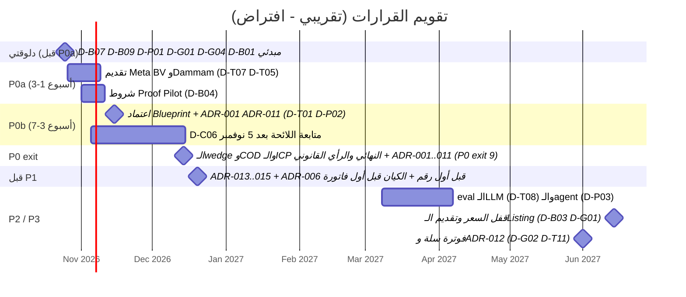
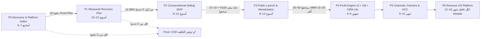

# 14. Key Decisions We Need to Make

> الحالة: مسودة v1.0 — بانتظار موافقة المؤسس (2026-10-21)

> **المرجع:** الأسماء والـIDs (M01..M21، E01..E18، P0..P6، ADR-001..015، BDR-001) والأرقام منقولة بالنص من الـDecision Spine. المراحل بالتفصيل في [07-master-development-phases.md](07-master-development-phases.md)، والاعتماديات في [08-phase-dependencies.md](08-phase-dependencies.md)، والمعمارية في [09-technical-architecture.md](09-technical-architecture.md)، والفريق في [10-team-structure.md](10-team-structure.md)، والميزانية في [11-budget-timeline.md](11-budget-timeline.md)، وأول 90 يوم في [12-first-90-days.md](12-first-90-days.md)، والمخاطر في [13-risks-mitigation.md](13-risks-mitigation.md). الـADRs نفسها هتتكتب في `docs/adr/`.
>
> **التصنيف:** [مؤكدة] = عليها مصدر (كل الروابط اتقرت 2026-10-21). [افتراض] = محتاجة اختبار. [اقتراح] = توصية مننا. [غير مؤكدة] = ملقيناش دليل في أي اتجاه.

---

## 14.0 إزاي تقرا القسم ده

القسم ده مش قايمة أمنيات. كل صف فيه قرار **لازم** يتاخد في وقت محدد، وإلا هيتاخد بالصدفة أو بالتأخير. القاعدة اللي ماشيين بيها:

- **One-way door:** قرار الرجوع فيه غالي جدًا أو مستحيل (كيان قانوني، region بيانات WhatsApp، نموذج الـtenancy بعد ما الداتا تتكتب). ده بياخد وقت ورأي قانوني أو ADR مكتوب **قبل** ما ننفذه.
- **Two-way door:** قرار نقدر نرجع فيه بتكلفة قليلة (سعر، رسالة تسويقية، ICP). ده نقرره بسرعة ونختبره، ومنضيّعش فيه أسابيع.
- **"Two-way بتكلفة":** نقدر نرجع فيه، بس الرجوع بياكل أسابيع شغل أو بيحرجنا قدام التجار. بنعامله كأنه one-way بعد نقطة معينة مكتوبة في الجدول.

**الـOwners:** في P0–P1 الفريق صغير جدًا (المؤسس + مستشار قانوني بالساعة، وبعدين Laravel full-stack full-time من بداية P1) [افتراض: [القسم 07](07-master-development-phases.md) و[القسم 10](10-team-structure.md)]. عشان كده أغلب القرارات صاحبها المؤسس، والمستشار القانوني بيدّي رأي مكتوب مش قرار.

**الـIDs:** `D-Bxx` تجاري، `D-Pxx` منتج، `D-Txx` تقني، `D-Gxx` Go-to-Market، `D-Cxx` امتثال. الرقم اللي بين قوسين جنب الـID (مثلًا "§11 #4") هو رقم القرار في قايمة قرارات المؤسس الـ15 بتاعة الـDecision Spine، والقايمة دي كلها منقولة في 14.7.3 بنفس الأرقام، فمش محتاج ترجع للـspine. أو بيربط القرار بالـADR.

**التواريخ:** كلها [افتراض] ومبنية على الجدول التقريبي، وبداية P0 يوم **2026-10-26** وGate P0 يوم **2026-12-14** زي [القسم 08](08-phase-dependencies.md) و[القسم 11](11-budget-timeline.md) (القسم 12 ماشي على نفس الـ7 أسابيع بس بأسبوع شغل بيبدأ الأحد، فبدايته 2026-10-25 والـGate review الخميس 2026-12-10، يعني نفس الأسبوع، شوف ملاحظات المراجعة): P0 أواخر أكتوبر–منتصف ديسمبر 2026 (P0a أسبوع 1–3، P0b أسبوع 3–7)، P1 ديسمبر 2026–مارس 2027، P2 مارس–مايو 2027، P3 يونيو–أغسطس 2027، P4 سبتمبر 2027–فبراير 2028.

---

## 14.1 القرارات التجارية (Business)

| ID | القرار | الخيارات | توصيتنا | ليه | الموعد | Reversibility | المعلومات المطلوبة | Owner |
|---|---|---|---|---|---|---|---|---|
| **D-B01** (§11 #4) | الـICP والـvertical الأول | (أ) كل متاجر سلة. (ب) عطور + Beauty + Personal Care، والـFashion في المقابلات بس. (ج) الأربع قطاعات بتوع البرومبت | **(ب)** + حجم 300–3,000 طلب/شهر و≥400 سلة مؤهلة (فيها موبايل)/شهر. مستبعد: أقل من 300 طلب والـenterprise [اقتراح] | تحت 300 طلب التاجر بيقارن بتطبيقات بـ49–119 ريال [مؤكدة: الأسعار من قوائم Salla App Store في [market-and-pricing.md](../research/market-and-pricing.md)، 2026-10-21]، وإن ده سقف نفسي عنده [افتراض]، والحجم مش كفاية للقياس (متجر 500 سلة/شهر محتاج حوالي سنة بـ80/20 عشان يكشف 5%→7%) [افتراض: حسابات power]. الـFashion بيعقّد الـagent (مقاسات ومرتجعات) [افتراض]. Meta Business Agent موجود كفئة تسعير من 2026-07-01 [مؤكدة: https://developers.facebook.com/docs/whatsapp/pricing، 2026-10-21]، وإن العمق الرأسي هو أقوى دفاع قدامه [افتراض] | مبدئي **دلوقتي** (قبل سكريبت المقابلات). نهائي عند **P0 exit** (~منتصف ديسمبر 2026) | Two-way | ≥20 مقابلة (هدف 25). عدد السلات المؤهلة الفعلي من Cart Truth Audit (E17). نسبة السلات اللي فيها consent | المؤسس |
| **D-B02** (§11 #12) | الـWedge: إيه أول ألم بنبيعه | (أ) Abandoned Cart Recovery مُقاس بـholdout. (ب) Recovery + COD Confirmation. (ج) زاوية "بنوفّر عليك رسائل وخصومات ملهاش لازمة". (د) البيع بالمحادثة (AI agent) أولًا | **(أ) كـwedge في P1.** COD يدخل P2 **لو** P0 أكدته، وإلا P4. (ج) خطة بديلة جاهزة. (د) مرفوض كـwedge [اقتراح] | (د) بقى سلعة: Karam بيقدّم أغلب الـMVP بـ268–698 ريال [مؤكدة: https://apps.salla.sa/en/app/864133974، 2026-10-21]، وبيعرّضنا لخطر Meta 4.7 من أول يوم. (أ) هو اللي فيه الفرق القابل للقياس (holdout + ربح). COD عند Karam [مؤكدة: [karam-ai.md](../research/karam-ai.md)] وتصنيفه Utility (أرخص) [افتراض: لازم يتأكد] | **P0 exit** | Two-way قبل P1. بعد بداية P1 بيبقى "two-way بتكلفة" (8–12 أسبوع بناء) | ترتيب الألم في المقابلات (Recovery / COD / الرد على المحادثات). نسبة الـCOD من طلبات التاجر [افتراض]. هل التاجر بيدفع للصراحة ولا للتوفير | المؤسس |
| **D-B03** (§11 #11) | فرضية التسعير | (أ) 499/899. (ب) **399/699/999**. (ج) 399/699/899+. (د) usage فقط. (هـ) outcome fee فقط | **(ب) كفرضية للاختبار:** Recover 399، Sell & Recover 699 (1,000 محادثة، الزيادة 0.25 ريال/محادثة من P3/P4)، Pro 999+. Outcome fee 2–5% **لاحقًا في P4** واختياري [اقتراح] | 399 قريب من الحد الأدنى لـKaram، و699 عند حده الأعلى مع agent مدمج [مؤكدة: Karam 268–698، https://apps.salla.sa/en/app/864133974، 2026-10-21]. بعد عمولة سلة ~30%: 699 → ~490 صافي، و399 → ~280 [افتراض: حاسبة https://partners.salla.com/en/apps، 2026-10-21]. القاعدة: AI COGS + دعم ≤35% من الصافي [اقتراح]. (هـ) محتاج pooled estimate موثوق الأول | اختبار في **P0–P1**. السعر المعلن يتقفل **قبل تقديم الـListing لسلة** (أول أسبوعين من P3، ~يونيو 2027) | Two-way قبل الـListing. بعدها "two-way بتكلفة" (رفع سعر علني على متجر سلة بيضرّ السمعة) | WTP في المقابلات، ومنها مقارنة 399 **قدام Karam Starter 119** (فيه journey السلة من غير AI [مؤكدة: https://karamai.co/en/pricing ، 2026-10-21])، لأن Recover أغلى منه ~3.4 مرة ([القسم 3](03-competitor-analysis.md) §3.9). حصة محادثات Pro (2,000 [اقتراح: [القسم 11](11-budget-timeline.md)]) وسعر الـoverage (0.25 بيكسر قاعدة الـ35% عند سقف التكلفة، [القسم 4](04-positioning-differentiation.md) §4.9.2). نسبة التحويل من Proof Pilot لاشتراك. شرط P1 exit: ≥3 من أول 5 جددوا بسعر كامل ≥399. العمولة الرسمية من سلة | المؤسس |
| **D-B04** (§11 #5، #11) | شروط Proof Pilot | (أ) pilot ببلاش. (ب) خصم 50% لـ3–6 شهور. (ج) Proof Month: مفيش نتيجة موجبة = مفيش دفع. (د) **1,500 ريال مقدم لـ90 يوم** | **(د) + ضمان (ج):** 1,500 ريال مقدم، holdout 10% إجباري، تقرير أسبوعي، onboarding بإيدنا، case study، المبلغ بيتخصم من أول اشتراك سنوي، ولو التقدير المجمّع للربح الإضافي طلع مش موجب الشهر التالت مجاني [اقتراح]. **بما إن المبلغ مدفوع مقدم، التنفيذ العملي لازم يبقى استرداد أو رصيد ~500 ريال**، والشرط يتعرّف إحصائيًا في العقد على التقدير المجمّع لكل الـpilots (مثلًا: نقطة التقدير ≤ صفر) مش "النطاق كله موجب" ولا "الحد الأدنى للنطاق"، لأن نطاق 5 متاجر بعد شهرين هيبقى غالبًا عريض ومش حاسم [افتراض] | الدفع المقدم هو الاختبار الحقيقي لـRule 10. الـpilot المجاني بيجيب تجار مش ملتزمين. الـholdout الإجباري هو قلب الميزة، ولو التاجر رفضه يبقى مش ICP | قبل ما نعرض الـpilot في المقابلات (**أسبوع 2–3 من P0a**، ~أوائل نوفمبر 2026) | Two-way | صيغة عقد الـpilot (المستشار القانوني). آلية "الشهر التالت مجاني" مع مبلغ مدفوع مقدم (استرداد جزئي ولا رصيد؟) — شوف ملاحظات المراجعة. مين بيصدر الفاتورة (مرتبط بـD-B06) | المؤسس + المستشار القانوني |
| **D-B05** (§11 #7) | رسوم Meta: مين بيدفعها وإزاي | (أ) جوه الاشتراك الثابت. (ب) نعيد بيعها بـmarkup (Solution Partner أو BSP). (ج) **Tech Provider: التاجر بيدفع لـMeta بكارته مباشرة، من غير markup**. (د) Multi-Partner: Tech Provider + Solution Partner بـcredit line | **(ج)**، و**(د) خطة بديلة** لو كارت الدفع طلع عائق عند التجار. (أ) و(ب) مرفوضين [اقتراح] | الـTech Provider مالوش credit line والتاجر لازم يضيف وسيلة دفع لـMeta [مؤكدة: https://developers.facebook.com/docs/whatsapp/solution-providers، 2026-10-21]. Marketing السعودية 0.0576 USD (+~27% في 7 شهور) [مؤكدة، مصادر ثانوية: [whatsapp-business-platform.md](../research/whatsapp-business-platform.md)]، والـService بقى بفلوس بعد 1,000 رسالة/رقم/شهر من 2026-10-01 [مؤكدة: https://developers.facebook.com/docs/whatsapp/pricing، 2026-10-21]. دمجها في الاشتراك يحوّل كل زيادة من Meta لخسارة في هامشنا. وفصلها بيخلّي الـsuppression نفسه قيمة بيعية | **ADR-006 قبل أول رقم WhatsApp حقيقي** (spike P0b / بداية P1، ~ديسمبر 2026) | Two-way بتكلفة (التحويل لـMulti-Partner محتاج اتفاق مع Solution Partner وإعادة ربط التجار) | سؤال في المقابلات: عندك كارت دولي جاهز لـMeta؟ [افتراض: نسبة من التجار الصغار هيتعبوا]. عرض Solution Partner لـMulti-Partner (التكلفة والشروط) | المؤسس |
| **D-B06** (§11 #6، BDR-001) | الكيان القانوني ومكانه | (أ) كيان سعودي (MISA). (ب) كيان إماراتي. (ج) كيان من برّه + ممثل ضريبي في السعودية | **القرار بعد الرأي القانوني في P0 وقبل أول فاتورة.** الميل لـ(أ) لو الـpilots نجحت (Dammam وMoyasar وثقة التاجر) [اقتراح] | Stripe مش متاح في السعودية والإمارات متاحة [مؤكدة: https://stripe.com/global، 2026-10-21]. غير المقيم لازم يعيّن ممثل ضريبي بالتضامن [مؤكدة: https://zatca.gov.sa/en/RulesRegulations/VAT/Pages/tax-agentsrepresentatives.aspx، 2026-10-21]. العميل بعنوان فوترة سعودي بيشتري Dammam عن طريق CNTXT، والأجنبي محتاج Invoiced Billing [مؤكدة: https://docs.cloud.google.com/docs/dammam-region-access، 2026-10-21]. تكلفة الكيان السعودي ~40–60 ألف ريال و8–16 أسبوع [افتراض، تقدير مورّد: https://expandway.sa/misa-license-fees-saudi-arabia/، 2026-10-21] | الرأي القانوني: **P0 exit criterion #7**. القرار: **قبل أول فاتورة** | **One-way** (فلوس ووقت وضرايب، والتغيير بعدين = تصفية وترحيل عقود) | الوضع الحالي لـCODEX AI Systems (فين متسجلة؟). أثر VAT وZATCA على كل خيار. هل ينفع نحصّل deposits الـpilots قبل الكيان النهائي. **الحل المؤقت المقترح [اقتراح]:** نجمع LOIs في P0a، ونأجل تحصيل الـdeposits لحد ما المستشار يأكد كيان فوترة مؤقت (الكيان الحالي لو موجود). ده بيأثّر على P0 exit #2 لو اتأخر | المؤسس + المستشار القانوني + محاسب |
| **D-B07** (§11 #1، #14) | ميزانية P0 والـKill criteria | (أ) نبدأ نبني على طول. (ب) **P0 من غير كود منتج بـ25–50 ألف ريال** (منها قانوني 15–30 ألف) وKill criteria مكتوبة | **(ب)** [اقتراح] | أكبر 3 مخاطر قاتلة مش تقنية (Meta 4.7، استعداد الدفع، شروط سلة). لو P0 فشلت الخسارة ≤50 ألف وأسابيع، مش 6 شهور بناء [افتراض] | **دلوقتي** | Two-way | لا شيء إضافي | المؤسس |
| **D-B08** (§11 #13) | أول تعيين | (أ) **Laravel full-stack full-time من بداية P1**. (ب) مطوّر part-time. (ج) وكالة outsourcing. (د) مهندس AI/ML الأول | **(أ)**، والمؤسس في البيع والـpilots. مهندس AI/QA part-time ييجي في P2 [اقتراح] | الـbandwidth بتاع المؤسس أكبر خطر تشغيلي (R29 في [القسم 13](13-risks-mitigation.md)). P1 مفيهوش AI agent أصلًا، فـ(د) سابق لأوانه. (ج) بيضيّع المعرفة المعمارية (tenancy وidempotency) برّه الشركة | التوظيف يبدأ في **P0b** عشان يبدأ مع P1 (~ديسمبر 2026) | Two-way بتكلفة | الـrunway الفعلي (300–500 ألف ريال لحد نهاية P3 [افتراض]). سوق المطوّرين (مصر ≈ نص تكلفة السعودية [افتراض]) | المؤسس |
| **D-B09** (§11 #15) | مين بيبيع في P0–P1 | (أ) **المؤسس بنفسه**. (ب) sales freelancer بعمولة. (ج) وكالة | **(أ) إلزامي** [اقتراح] | المقابلات الأولى هي مصدر الـproduct insight. لو حد تاني باع، هنعرف السعر ومش هنعرف ليه | **دلوقتي** | Two-way | لا شيء | المؤسس |

---

## 14.2 قرارات المنتج (Product)

| ID | القرار | الخيارات | توصيتنا | ليه | الموعد | Reversibility | المعلومات المطلوبة | Owner |
|---|---|---|---|---|---|---|---|---|
| **D-P01** (§11 #2) | إعادة صياغة الميزة التنافسية | (أ) نسيبها "Profit-Aware Autonomous Growth". (ب) **"Profit-Proven Recovery"** ونشيل "Autonomous". (ج) نلغي فكرة الربح خالص ونبيع inbox + AI | **(ب)** [اقتراح] | الحكم: **Narrow + Reframe**. Holdouts موجودة عند Klaviyo (بشرط 400 ألف profile) وBraze وBloomreach [مؤكدة: https://help.klaviyo.com/hc/en-us/articles/18138290642971، 2026-10-21]، فـ"أول من يقيس" ادعاء غلط. عند الأربع منافسين المحليين الـholdout **غير مؤكد**. "Autonomous" بيخالف Rule 9 وبيزوّد خطر تصنيف Meta 4.7 | **دلوقتي** (قبل سكريبت المقابلات والـone-pager) | Two-way | رد التجار على الصيغة: ≥60% بيفضّلوا "ربح إضافي صادق" على "إيراد مسترجع" (P0 exit #3) | المؤسس |
| **D-P02** (§11 #3) | تقليص الـMVP | (أ) الـ10 وظايف بتوع البرومبت كاملة. (ب) **حسب [القسم 6](06-mvp-vs-future-matrix.md):** Inbox lite، Admin بـFilament، فوترة يدوية، الـagent في P2 Assisted أولًا، workflows ثابتة مش builder | **(ب)** [اقتراح] | Rule 2 وRule 5. الـ13 Module = منتج لشركة فيها 50 شخص. تفاصيل In/Out في [06-mvp-vs-future-matrix.md](06-mvp-vs-future-matrix.md) | **قبل P0b** (مع اعتماد الـBlueprint) | Two-way (إضافة scope بعدين أسهل من شيله) | لا شيء إضافي. يتراجع عند P0 exit لو الـwedge اتغيّر | المؤسس |
| **D-P03** | مستوى استقلالية الـAI | (أ) Autonomous كامل من أول يوم. (ب) Assisted بس للأبد. (ج) **مرحلي: P1 من غير agent، P2 Assisted (مسودة والموظف يوافق) ≥4 أسابيع لكل tenant، بعدين Scoped Autonomous محصور في الكتالوج + handoff**. (د) من غير AI خالص | **(ج)** [اقتراح] | خطر هلوسة السعر أو الخصم (R20 في [القسم 13](13-risks-mitigation.md)). Rule 9. P1 من غير agent بيخلّي الـrecovery شغال حتى لو Meta صنّفتنا AI Provider. Kasbly عنده shadow mode وautonomy levels [مؤكدة: [kasbly.md](../research/kasbly.md)]، يعني ده parity مش ميزة. ممنوع على الـagent: خصومات، payment links مخصصة، أسئلة عامة، طلب بيانات كارت | السياسة: **قبل P1** (جزء من ADR-014). التفعيل: **P2** (مارس–مايو 2027) | Two-way لكل tenant (feature flag). لكن حادثة سعر غلط واحدة اتبعتت لعميل = ضرر سمعة one-way | نتايج الـgolden set (≥300 حالة سعودي، دقة سعر ومخزون 100%). handoff rate ≤40%. تكلفة المحادثة ≤$0.03 [اقتراح] | المؤسس + مهندس AI/QA (P2) |
| **D-P04** (ADR-014) | سياسة الخصومات | (أ) الـAI يقرر الخصم. (ب) كوبون ثابت من التاجر لكل السلات (زي سلة native). (ج) **محرك سياسات بالكود:** مفيش خصم في أول رسالة، أرضية هامش لكل فئة (5–10 فئات)، مفيش خصم للعميل الحالي إلا بموافقة، أي حاجة فوق السقف = approval | **(ج)، والـAI عمره ما بيقرر الخصم** [اقتراح] | الخصم الأكبر قلّل المشتريات اللاحقة عند العملاء الحاليين [مؤكدة: Anderson & Simester 2004, Marketing Science 23(1)، عبر [cart-recovery-incrementality.md](../research/cart-recovery-incrementality.md)، 2026-10-21]. تذكير من غير خصم لسلة عمرها 4–28 يوم مكانش له أثر معنوي [مؤكدة: https://www.msi.org/wp-content/uploads/2021/09/MSI_Report_21-133-1.pdf، 2026-10-21]. سلة عندها تذكير native بخصم [مؤكدة: https://help.salla.sa/en/article/abandoned-cart-reminders-with-a-discount/vzit7tzwz9e5pcv37nnenyqv، 2026-10-21]، فالخصم الأعمى مش ميزة | **قبل P1** (ADR-014) | Two-way (القواعد بتتعدل)، بس الافتراضيات لازم تبقى محافظة من أول يوم | هوامش الفئات من التاجر وقت الـonboarding (E08). سقف الخصم المقبول عند التجار (مقابلات) | المؤسس |
| **D-P05** (§11 #5، ADR-013) | الـholdout | (أ) اختياري. (ب) **10% على مستوى العميل بـhash ثابت، إجباري في الـpilots، وافتراضي في المنتج** | **(ب)** [اقتراح]. هل التاجر المدفوع بعد P3 يقدر يقفله أو يقلله؟ **يتقرر في P3** ببيانات P1–P2 | من غير holdout المنتج بيبقى نسخة من المنافسين. Klaviyo بيستخدم last-touch بنافذة 5 أيام [مؤكدة: [cart-recovery-incrementality.md](../research/cart-recovery-incrementality.md)] | الإجبار في الـpilots: **دلوقتي**. سياسة المنتج العام: **P3** | Two-way | نسبة التجار اللي قبلوا holdout 10% (P0 exit #5: ≥5) | المؤسس |
| **D-P06** (§11 #12) | COD Confirmation في P2 ولا P4 | (أ) P2 (E16). (ب) P4 | **بعد نتيجة P0** [اقتراح] | مرتبط بـD-B02. لو COD طلع ألم أكبر من الاسترجاع، يدخل P2 | **P0 exit** | Two-way | نفس معلومات D-B02 + تأكيد تصنيف template الـCOD (Utility ولا Marketing) | المؤسس |
| **D-P07** | Shared Inbox | (أ) Inbox كامل (tags، SLA، analytics). (ب) **Handoff inbox lite + Coexistence** (الموظف يفضل على تطبيق WhatsApp Business). (ج) مفيش inbox | **(ب)** [اقتراح]: queue + assign + notes + status + سجل محادثات الـAI + زرار takeover | القطع الكامل بيكسر شرط Meta للـhuman handoff. Coexistence بيوفّر علينا بناء inbox كامل [مؤكدة: الميزة موجودة، https://developers.facebook.com/documentation/business-messaging/whatsapp/embedded-signup/onboarding-business-app-users.md، 2026-10-21] | **قبل P1** | Two-way | **هل Coexistence متاح في السعودية؟ [غير مؤكدة]**. لو لأ، الـinbox lite بيكبر في P1 | المؤسس + Laravel dev |
| **D-P08** | لهجة الـagent | (أ) سعودي + مصري في الرد. (ب) **الرد بالسعودي، والفهم سعودي + مصري** | **(ب)** [اقتراح]. golden set مصري في P6 مع دخول مصر | الـICP سعودي. تغطية لهجتين في الرد = ضعف الـeval | **قبل P2** | Two-way | عينة محادثات حقيقية من الـpilots (من غير تدريب عليها: شوف D-C01) | مهندس AI/QA |
| **D-P09** | الـIncremental Profit Report في P1 | (أ) منتج من أول يوم. (ب) **يدوي أول 4 أسابيع (SQL + template)، بعدين صفحة واحدة في المنتج قبل نهاية P1** | **(ب)** [اقتراح] | نتعلم التاجر بيقرا إيه قبل ما نبني. التقرير بيفصل 4 أرقام: إيراد منسوب، إيراد إضافي تقديري (نطاق)، تكلفة الرسائل والخصومات، ربح إضافي تقديري | **قبل P1** | Two-way | لا شيء | المؤسس |

---

## 14.3 القرارات التقنية (Technical)

> الـStack المقترح في البرومبت (Next.js + Laravel + PostgreSQL + Redis + Python/FastAPI اختياري) اتراجع في [tech-stack-options.md](../research/tech-stack-options.md). الحكم على كل جزء:

| ID | القرار | الخيارات | توصيتنا | ليه | الموعد | Reversibility | المعلومات المطلوبة | Owner |
|---|---|---|---|---|---|---|---|---|
| **D-T01** (ADR-001) | شكل الـBackend | (أ) Microservices. (ب) Laravel + Python services. (ج) **Laravel 13 Modular Monolith**: domain folders (مش nwidart) + Pest arch tests لفرض الحدود | **(ج)** [اقتراح] | Rule 6. الـflows خطية ومفيش مبرر لتوزيع. حزم الـmodules مش بتفرض حدود [مؤكدة: https://packagist.org/packages/nwidart/laravel-modules و https://laravelmodules.com/docs/13، 2026-10-21]، فالحدود بتتفرض بالـarch tests | **قبل P0b** | One-way عمليًا (التحويل لـservices بعدين ممكن، بس إعادة كتابة) | لا شيء | المؤسس |
| **D-T02** (§11 #9، ADR-002) | الـFrontend | (أ) Next.js منفصل (المقترح الأصلي). (ب) **Inertia 3 + React 19 + TS + Tailwind 4 + shadcn/ui** (React starter kit) | **(ب)**. Next.js مسموح بس لموقع التسويق لاحقًا لو احتجناه [اقتراح] | Next المنفصل = Sanctum SPA + CORS + deploy تاني، يعني تكلفة على مؤسس بيكتب الكود (Rule 5) [مؤكدة: https://laravel.com/docs/13.x/sanctum و https://laravel.com/docs/13.x/starter-kits، 2026-10-21]. RTL/LTR بـlogical properties إلزامي في الحالتين | **قبل P1** | Two-way قبل P1. One-way عمليًا بعد ما الشاشات تتبني | لا شيء | المؤسس |
| **D-T03** (ADR-003) | قاعدة البيانات | (أ) MySQL (خبرة المؤسس). (ب) **PostgreSQL + pgvector** | **(ب)** [اقتراح] | الـvector search في Laravel محتاج pgvector [مؤكدة: https://laravel.com/docs/13.x/search، 2026-10-21]. RLS كطبقة دفاع تانية متاحة في Postgres بس. **وقت تعلّم المؤسس محسوب في P1** | **قبل P1** | One-way بعد أول بيانات حقيقية | لا شيء | المؤسس |
| **D-T04** (ADR-004) | نموذج الـMulti-Tenancy | (أ) DB لكل tenant. (ب) schema لكل tenant. (ج) **DB واحدة + `tenant_id` + Global Scope + isolation tests إجبارية في CI + Jobs بتحمل `tenant_id` صريح**، وRLS طبقة تانية بعد اختيار الاستضافة | **(ج)**. (أ) و(ب) **ممنوعين** في الـMVP [اقتراح] | RLS في stancl v4 experimental وFK cascades بتتخطاه [مؤكدة: [tech-stack-options.md](../research/tech-stack-options.md)]. (أ)/(ب) بيضاعفوا الـmigrations والـops على فريق من شخصين. Rule 7: العزل بيتثبت بالاختبارات من أول يوم (P1 exit #5: صفر تسريب cross-tenant) | **قبل P1** | **One-way** بعد ما الداتا تتكتب | هل الاستضافة المختارة بتسمح بـBYPASSRLS وrole منفصل (Laravel Cloud مثلًا لأ [مؤكدة: [tech-stack-options.md](../research/tech-stack-options.md)]) | المؤسس + Laravel dev |
| **D-T05** (§11 #8، ADR-005) | الاستضافة ومكان البيانات | (أ) Laravel Cloud (EU). (ب) Frankfurt دائم. (ج) AWS الإمارات/البحرين. (د) **GCP Dammam (Invoiced Billing/CNTXT)، وFrankfurt مؤقت بتصميم portable لو اتأخر، وترحيل قبل نهاية P3**. (هـ) نستنى AWS/Azure السعودية | **(د)**. نقدّم على Dammam **في أول أسبوعين من P0**. (ج) **ممنوع**. Backup في region تانية [اقتراح] | مسودة المادة 23 من تعديلات اللائحة بتلزم التخزين جوه المملكة [مؤكدة كمسودة، ثانوي: https://www.clydeco.com/en/insights/2026/10/sdaia-publishes-draft-amendments-to-the-pdpl، 2026-10-21]. Dammam شغالة لكن الشراء عن طريق CNTXT/Invoiced Billing [مؤكدة: https://docs.cloud.google.com/docs/dammam-region-access، 2026-10-21]. Azure Saudi نوفمبر وAWS Saudi ديسمبر 2026 [مؤكدة: https://english.aawsat.com/technology/5313287-aws-launch-first-cloud-infrastructure-region-saudi-arabia-december، 2026-10-21]، يعني (هـ) رهان على مواعيد. فرق Dammam عن EU +24–45% compute [مؤكدة، ثانوية: https://gcloud-compute.com/e2-standard-2.html عبر [saudi-regulatory-pdpl.md](../research/saudi-regulatory-pdpl.md)، 2026-10-21]، يعني ~$80–200/شهر زيادة لـMVP صغير [افتراض: تقدير]. (ج) ممنوع لأن ضربات drones في مارس 2026 طلّعت 2 من 3 AZs في الإمارات من الخدمة وAWS أعلنت إنها مش هتقدر تسترجع كل البيانات [مؤكدة: https://www.techzine.eu/news/infrastructure/144322/aws-cant-recover-all-data-from-data-centers-hit-in-middle-east/، 2026-10-21]، ومش بيحل مشكلة التخزين جوه المملكة أصلًا | التقديم: **أسبوع 1–2 من P0**. القرار: **قبل P1**. الإنتاج على Dammam: **P3 exit #7** | Two-way **لو** التصميم portable (Docker، Postgres standard، S3-compatible). من غير كده one-way | نتيجة طلب Invoiced Billing. الصيغة النهائية للائحة بعد 5 نوفمبر 2026. توفر Cloud SQL Postgres وpgvector في `me-central2` [مؤكدة جزئيًا: https://cloud.google.com/sql/docs/postgres/region-availability-overview، 2026-10-21] | المؤسس |
| **D-T06** (ADR-006) | `data_localization_region` لأرقام WhatsApp | (أ) من غير localization (التخزين الافتراضي برّه). (ب) AE. (ج) BH | **يتحدد قبل أول رقم، بعد الرأي القانوني**. الميل لـ(ب) AE [اقتراح]. (الـspine بيذكر ZA كمان، وده [غير مؤكدة] في ملفات البحث) | السعودية **مش** في قايمة الـregions المتاحة [مؤكدة: https://developers.facebook.com/docs/whatsapp/cloud-api/reference/registration، 2026-10-21]. يعني قناة WhatsApp نفسها نقل برّه المملكة مهما كانت استضافتنا. الـlocal storage تقليل مخاطر مش امتثال كامل [افتراض] | **قبل تسجيل أول رقم تاجر حقيقي** (بداية P1) | **One-way** لكل رقم [افتراض: مذكور في [saudi-regulatory-pdpl.md](../research/saudi-regulatory-pdpl.md) من غير نص Meta صريح، ولازم يتأكد من وثائق الـregistration قبل ADR-006]. بنعامله كـone-way لحد ما يتثبت العكس | رأي قانوني. هل Meta ناوية تضيف SA [غير مؤكدة]. أثر الـregion على الـlatency والتكلفة | المؤسس + المستشار القانوني |
| **D-T07** (ADR-006) | مسار الوصول لـWhatsApp | (أ) **Tech Provider + Embedded Signup v4 + Coexistence + MM API**. (ب) ISV فوق BSP (360dialog/Twilio). (ج) Solution Partner بنفسنا. (د) أي API غير رسمي | **(أ)**، و(ب) بديل لو الـBusiness Verification اتأخر. (د) **مرفوض للأبد** (Rule 8) [اقتراح] | الـMarketing لازم يعدّي على Marketing Messages API: الحسابات الجديدة من 2027-04-13 والكل من 2027-10-13 [مؤكدة: https://developers.facebook.com/documentation/business-messaging/whatsapp/marketing-messages/overview.md، 2026-10-21]، فبنبني عليه من أول يوم. حد الـonboarding 10 عملاء/7 أيام → 200 بعد التحقق [مؤكدة: [whatsapp-business-platform.md](../research/whatsapp-business-platform.md)]. (ج) "عملية طويلة" ومحتاج credit line [مؤكدة: https://developers.facebook.com/docs/whatsapp/solution-providers، 2026-10-21] | تقديم Meta BV: **أسبوع 1–2 من P0**. BV مقبولة وApp Review متقدّم: **P0 exit #6** | Two-way بتكلفة (تغيير المسار = إعادة onboarding للتجار) | مدة BV وApp Review الفعلية. دعم Coexistence في السعودية [غير مؤكدة] | المؤسس |
| **D-T08** | مزوّد الـLLM والنماذج | (أ) نموذج غالي واحد. (ب) **افتراضي رخيص (Haiku 5.5 أو GPT-6 Luna) + تصعيد لـSonnet 5.5 بقواعد**. (ج) Gemini Flash. (د) self-host نموذج مفتوح على GPU سعودي | **(ب)، والاختيار النهائي بعد eval داخلي على الـgolden set**. (د) مرفوض للـMVP [اقتراح] | Haiku 5.5: $0.10/$0.50 لكل 1M، Sonnet 5.5: $2/$10 [مؤكدة: https://platform.claude.com/docs/en/about-claude/pricing، 2026-10-21]. GPT-6 Luna: $0.10/$0.50 [مؤكدة: https://developers.openai.com/api/docs/pricing، 2026-10-21]. Gemini 3.8 Flash $0.75/$3.75 لحد 2026-12-31 ثم $1.50/$7.50 [مؤكدة: https://ai.google.dev/gemini-api/docs/pricing، 2026-10-21]. محادثة بيع 8 رسائل ~$0.005 على Haiku/Luna مقابل ~$0.088 على Sonnet [افتراض]. الأسعار بتتغير كل 1–2 شهر، فالالتزام بمزوّد واحد غلط | Eval: **بداية P2** (مارس 2027). عقود zero-retention/no-training: **قبل أي PII يعدّي على LLM** | Two-way (بفضل `AiGateway`) | نتايج eval باللهجة السعودية. شروط zero-retention لكل مزوّد. Vertex في Dammam مش بيضمن in-region processing [مؤكدة: [saudi-regulatory-pdpl.md](../research/saudi-regulatory-pdpl.md)] | مهندس AI/QA + المؤسس |
| **D-T09** (§11 #9، ADR-007) | الـAI orchestration | (أ) Python/FastAPI أو LangGraph منفصل. (ب) Prism (community، 0.x). (ج) **Laravel AI SDK v1 ورا interface داخلي `AiGateway`، Agent واحد + tools، Approvable tools لأي خصم أو كوبون. الـrecovery = workflows حتمية مش agent** | **(ج)**. Python يتراجع بس في P4+ (uplift models/batch stats) أو P6 (Voice) بـADR منفصل [اقتراح] | SDK رسمي v1.3 فيه Approvable tools [مؤكدة: https://laravel.com/docs/13.x/ai-sdk و https://packagist.org/packages/laravel/ai، 2026-10-21]. نصيحة Anthropic: workflows بسيطة قبل agents معقدة [مؤكدة: https://www.anthropic.com/engineering/building-effective-agents، 2026-10-21]. Rule 6 | **قبل P2** | Two-way (ورا `AiGateway`) | لا شيء | المؤسس |
| **D-T10** (ADR-008، ADR-015) | الـPII مع الـLLM والـobservability | (أ) نبعت البيانات زي ما هي. (ب) **pseudonymization (الـLLM مبيشوفش الاسم ولا الرقم) + zero-retention/no-training + Sentry/Nightwatch بـPII redaction إجباري** | **(ب)** [اقتراح] | بيقلل خطر النقل عبر الحدود [افتراض قانوني]. داتا الـobservability بتروح US/EU [مؤكدة: [tech-stack-options.md](../research/tech-stack-options.md)] | **قبل P1** | Two-way، بس أي تسريب قبل القرار one-way | رأي قانوني على "هل نداء LLM لحظي = نقل؟" [غير مؤكدة: مفيش إرشاد رسمي] | المؤسس + المستشار القانوني |
| **D-T11** (ADR-012) | أدوات فوترتنا | (أ) Laravel Cashier (Stripe). (ب) Paddle/Lemon Squeezy (MoR). (ج) **يدوي/روابط دفع في P1–P2 → Moyasar أو Tap tokenization → Salla billing في P3** | **(ج)** [اقتراح] | Stripe مش متاح في السعودية [مؤكدة: https://stripe.com/global، 2026-10-21]. الـMoR العالمي مش مناسب لتاجر بيدفع بمدى وعايز فاتورة ZATCA [افتراض]. Moyasar عنده tokenization [مؤكدة: https://docs.moyasar.com/guides/tokenization/overview، 2026-10-21] | **قبل P3** (مرتبط بـD-B06) | Two-way | الكيان (D-B06). شروط usage billing جوه سلة [غير مؤكدة] | المؤسس |

**باقي الـADRs ومواعيدها** (قرارات تنفيذية جوه حدود القرارات اللي فوق):

| ADR | العنوان | لازم يتعتمد قبل |
|---|---|---|
| ADR-009 | Cross-merchant pooled data policy (نتائج سلة فقط) | P1 (شوف D-C01) |
| ADR-010 | Workflow execution: `scheduled_actions`، idempotency، `webhook_events` | P1 |
| ADR-011 | Commerce Adapter ونموذج البيانات الداخلي | P0b |
| ADR-013 | Measurement methodology: holdout، hash assignment، pooled estimates، win probability | P1 |
| ADR-014 | Discount policy engine & approvals | P1 (شوف D-P04) |
| ADR-015 | Observability وPII redaction | P1 (شوف D-T10) |

---

## 14.4 قرارات الـGo-to-Market

| ID | القرار | الخيارات | توصيتنا | ليه | الموعد | Reversibility | المعلومات المطلوبة | Owner |
|---|---|---|---|---|---|---|---|---|
| **D-G01** | قناة التوزيع الأساسية وترتيبها | (أ) Salla App Store من أول يوم. (ب) الوكالات أولًا. (ج) إعلانات مدفوعة. (د) **مباشر بالمؤسس (P0–P2) عن طريق private app → Salla App Store public (P3) → referral للوكالات (P3) → agency dashboard (P5)** | **(د)** [اقتراح] | Easy Mode هو الطريقة الوحيدة للتطبيقات المنشورة [مؤكدة: https://docs.salla.dev/doc-421118، 2026-10-21]، فالتوزيع العام بيعدّي على سلة في الآخر. لكن سلة بتقبل أو ترفض من غير مدة محددة [مؤكدة: https://partners.salla.com/legal/apps-policy، 2026-10-21]، فمينفعش نستنى المراجعة عشان نختبر الطلب. الـprivate app بيخلّينا نشتغل مع design partners من غير مراجعة. (ج) قبل ما نعرف الرسالة اللي بتبيع = حرق فلوس | **دلوقتي** للترتيب. تجهيز ملف مراجعة سلة في **آخر P2**، والتقديم بعد Gate 2 في **أول أسبوعين من P3** (~يونيو 2027)، والمراجعة 3–6 أسابيع بالتوازي [افتراض: زي [القسم 07](07-master-development-phases.md) و[08](08-phase-dependencies.md)] | Two-way | تكلفة الحصول على عميل في كل قناة (بعد P3). شروط الشركاء الرسمية | المؤسس |
| **D-G02** | الفوترة للعميل: جوه سلة ولا مباشر | (أ) سلة بس. (ب) مباشر بس. (ج) **الاتنين: الـpilots والعقود السنوية مباشر (Moyasar/Tap)، والشهري عن طريق Salla billing من P3** | **(ج)** [اقتراح] | الدفع للتطبيقات المدفوعة "يتم عبر منصة سلة وتخضع للعمولات" [مؤكدة: https://partners.salla.com/legal/apps-policy، 2026-10-21]، والعمولة ~30% [افتراض: https://partners.salla.com/en/apps، 2026-10-21]. صرف المستحقات بعد ~15 يوم [مؤكدة: نفس المصدر] | السؤال الرسمي لسلة: **P0**. القرار: **قبل P3** | Two-way | العمولة الرسمية. هل مسموح لتطبيق public يحاسب على usage برّه سلة أو جواها [غير مؤكدة] | المؤسس |
| **D-G03** | الوكالات (Agencies) | (أ) شراكة كاملة + white label بدري. (ب) **referral بعمولة محددة بمدة في P3، dashboard في P5، ومفيش white label قبل شهر 24** (P6 gated). (ج) نتجاهلهم | **(ب)** [اقتراح] | الوكالات قناة أرخص من الإعلانات [افتراض: [market-and-pricing.md](../research/market-and-pricing.md)]، بس الوكالة ممكن تبقى منافس: Mersal غالبًا منتج طالع من وكالة "مكاسب" [افتراض: [mersal-ai.md](../research/mersal-ai.md)؛ وجود الوكالة نفسها مؤكد، الربط بينهم استنتاج]. White label بيضعف البراند وبيعقّد علاقتنا بـMeta | برنامج الـreferral: **P3**. White label: **مش قبل شهر 24** | Two-way (الـreferral). White label one-way عمليًا (عقود وبراند) | عدد الوكالات اللي بتدير متاجر سلة في الـICP. هيكل العمولة | المؤسس |
| **D-G04** | الـPositioning والجمل الممنوعة | (أ) "AI Chatbot/Agent" كعنوان. (ب) **"Profit Recovery لمتاجر سلة"** والجمل الممنوعة في [القسم 4](04-positioning-differentiation.md) §4.5 | **(ب)** [اقتراح] | خطر تصنيف Meta 4.7: الشرط [مؤكدة: https://www.facebook.com/legal/Meta-Terms-for-WhatsApp-Business-Platform، 2026-10-21]، وتطبيقه علينا [غير مؤكدة]. ممنوع كمان: "بياناتك كلها في السعودية" (WhatsApp مفيهوش تخزين سعودي)، و"رقم ربحك الدقيق من أول شهر". تفاصيل في [04-positioning-differentiation.md](04-positioning-differentiation.md) | **دلوقتي** (قبل الـone-pager) | Two-way | رد التجار في المقابلات | المؤسس |
| **D-G05** | ترتيب التوسع (منصات وأسواق) | (أ) زد مع سلة من البداية. (ب) **سلة لوحدها لحد P4، زد في P4، Shopify/Woo في P5 حسب الطلب، الإمارات في P5، مصر وباقي الخليج (الكويت، قطر، البحرين، عُمان) في P6** | **(ب)** [اقتراح]. ترتيب الأسواق ومعاييره في **14.4.1** | سلة ~5:1 على زد في عدد المتاجر المعلن (68,000+ مقابل 12,000–13,500+) [مؤكدة، متناقضة: https://salla.com/ و https://storeleads.app/reports/zid، 2026-10-21]، لكن StoreLeads بيعد متاجر زد live في السعودية أكتر [مؤكدة، متناقضة: https://storeleads.app/reports/salla، 2026-10-21]، فزد تحوّط مهم بس مش أولوية قبل ما المنتج يشتغل. Rule 2 | المراجعة: **P3 exit** | Two-way | بيانات طلب من المقابلات والـpipeline. أثر سلة لو أطلقت agent native (R13 في [القسم 13](13-risks-mitigation.md)) | المؤسس |
| **D-G06** | فهم لهجات الخليج غير السعودية (كويتي، إماراتي، قطري، بحريني، عُماني) | (أ) نعتبر الـgolden set السعودي كفاية لكل الخليج. (ب) **golden set صغير لكل سوق قبل ما الـagent يشتغل Scoped Autonomous فيه، والرد يفضل بالسعودي أو "خليجي أبيض" كإعداد tenant** | **(ب)** [اقتراح] | الأبحاث المنشورة بتقول النماذج أداؤها على الخليجية أحسن من المصرية والشامية [مؤكدة: https://aclanthology.org/2025.coling-main.283.pdf، 2026-10-21]، بس "خليجي" في البحث ده مش مقسّم لكل دولة، ومفيش benchmark منشور على Claude 5.5 أو GPT-6 Luna لأي لهجة خليجية في سياق مبيعات [مؤكدة كغياب: [ai-llm-costs-arabic.md](../research/ai-llm-costs-arabic.md)، الملخص]. مفردات زي أسماء المنتجات والمقاسات والعملة وطرق الشحن بتختلف من دولة لدولة [افتراض]. (أ) رخيص بس بيخبّي الخطأ لحد ما تاجر يشتكي | **قبل تفعيل Scoped Autonomous في أي سوق جديد** (أول مرة: الإمارات في P5) | Two-way | 50–100 محادثة حقيقية مجهّلة لكل سوق من أول 3–5 تجار فيه [اقتراح]، وحكّام بشر من نفس الدولة. نفس قاعدة D-C01: من غير تدريب على نصوص WhatsApp | مهندس AI/QA |

### 14.4.1 ترتيب أسواق التوسع (Market sequencing)

البرومبت الأصلي بيذكر 6 أسواق بعد السعودية: الإمارات، الكويت، قطر، البحرين، عُمان، مصر ([00-master-prompt.md](../00-master-prompt.md) §3). البحث اللي عملناه لحد دلوقتي **سعودي بالأساس**، فمعظم الأرقام عن باقي الأسواق [افتراض] أو [غير مؤكدة]. الجدول ده ترتيب مبدئي مش دراسة سوق، والغرض منه إننا منفتحش أكتر من سوق في نفس الوقت (Rule 2 وRule 5).

**المعايير:** (1) وجود سلة في السوق، لأن M01 هو التكامل الوحيد لحد P4. (2) حجم التجارة الإلكترونية. (3) سعر رسالة Marketing من Meta في الدولة دي، لأنه بيحدد هامش M09 (Abandoned Cart Recovery). (4) قانون حماية البيانات وقوانين التسويق. (5) العملة والدفع. (6) اللهجة. (7) المنافسين الموجودين.

| الترتيب | السوق | المرحلة | سلة موجودة؟ | سعر Marketing من Meta | التنظيم والفوترة | اللهجة | المنافسين | ليه في الترتيب ده |
|---|---|---|---|---|---|---|---|---|
| 0 | **السعودية** | P0–P4 | نعم، السوق الأساسي لسلة [مؤكدة: https://salla.com/، 2026-10-21] | 0.0576 USD [مؤكدة، ثانوي: [whatsapp-business-platform.md](../research/whatsapp-business-platform.md) §4.3] | PDPL + CST + ZATCA، مغطّى في D-C01..D-C06 | الـgolden set الأساسي | الأربعة كلهم | الـICP والبحث كله هنا |
| 1 | **الإمارات** | P5 | نعم، سلة بتعلن "+68,000 متجر نشط في السعودية والإمارات" ومعاها موقع `en-ae` [مؤكدة: https://salla.com/en-ae/ai-info، 2026-10-21]. عدد متاجر الإمارات لوحدها [غير مؤكدة] | ليها سعر خاص في الـrate card [افتراض]، والرقم نفسه [غير مؤكدة] (ملف الـrate card مااتقراش) | قانون حماية بيانات اتحادي ومنطقة حرة ليها قواعدها [افتراض: يتأكد برأي قانوني]. تسعير بالدرهم (07 P5). Stripe متاح [مؤكدة: https://stripe.com/global، 2026-10-21] | إماراتي، قريب من السعودي في الفهم [افتراض] | Thikaa وKasbly وMersal بيبيعوا للخليج عمومًا [افتراض: [competitive-feature-matrix.md](../research/competitive-feature-matrix.md)] | أكبر سوق خليجي تاني [افتراض]، وأقل تكلفة دخول لأن سلة موجودة فمش محتاجين connector جديد |
| 2 | **الكويت** | P6 (أول واحد فيها) | [غير مؤكدة] | غالبًا ضمن شريحة "Rest of Middle East" في الـrate card [افتراض] | قانون حماية البيانات [غير مؤكدة]، محتاج رأي قانوني. الدينار وبوابات دفع محلية [افتراض] | كويتي | Mersal عنده تبويب أسعار للكويت ودراسات حالة منها [مؤكدة: https://mersal.ai/#pricing، 2026-10-21] | قدرة شرائية عالية [افتراض]، ووجود Mersal دليل إن فيه طلب، بس كمان منافسة. غالبًا محتاج Shopify/Woo (M02) لو سلة ضعيفة هناك [افتراض] |
| 3 | **قطر** | P6 | [غير مؤكدة] | "Rest of Middle East" [افتراض] | [غير مؤكدة]، رأي قانوني | قطري | [غير مؤكدة] | سوق صغير بعدد سكان قليل [افتراض]، فالعائد على تكلفة الدخول أقل |
| 4 | **البحرين** | P6 | [غير مؤكدة] | "Rest of Middle East" [افتراض] | [غير مؤكدة]، رأي قانوني. WhatsApp local storage متاح فيها [مؤكدة: [saudi-regulatory-pdpl.md](../research/saudi-regulatory-pdpl.md) #6] (ده بيخص تخزين Meta، مش السوق) | بحريني | Thikaa مقرها البحرين [مؤكدة: https://thikaa.com/about، 2026-10-21] | سوق صغير [افتراض]، ومنافس محلي موجود |
| 5 | **عُمان** | P6 | [غير مؤكدة] | "Rest of Middle East" [افتراض] | [غير مؤكدة]، رأي قانوني | عُماني، أبعد عن السعودي في المفردات [افتراض] | [غير مؤكدة] | أقل سوق خليجي في التجارة الإلكترونية غالبًا [افتراض] |
| — | **مصر** | P6 (مسار منفصل) | [غير مؤكدة] | 0.0644 USD [مؤكدة، طرف تالت: https://www.injazdigital.com/en/blog/whatsapp-business-api-pricing/، 2026-10-21]، يعني أغلى من السعودية بالرسالة مع إن متوسط السلة أقل [افتراض] | قانون 151/2020 ولائحته، ترخيص PDPC وممثل محلي [مؤكدة، ثانوي: [saudi-regulatory-pdpl.md](../research/saudi-regulatory-pdpl.md) §10.2] | مصري، golden set منفصل (D-P08) | Mersal عنده دراسات حالة من مصر [مؤكدة: https://mersal.ai/case-studies، 2026-10-21] | سوق كبير بعدد التجار، بس سعر الاشتراك اللي يستحمله التاجر أقل بكتير [افتراض]، وتكلفة Meta للرسالة أعلى، فهامش M09 أضعف. مش "خليج"، فبيتعامل كمسار تاني |

**القواعد [اقتراح]:**

- **سوق واحد في المرة.** مفيش سوق جديد غير لما اللي قبله يعدّي الـGate بتاعه (P5 exit #5 للإمارات في [القسم 07](07-master-development-phases.md)). الترتيب من 2 لـ5 بيتراجع في P5 exit ببيانات حقيقية، مش بالجدول ده.
- **شرط دخول أي سوق (Exit criteria صغيرة):** (1) سعر Meta الرسمي للدولة دي من ملف الـrate card، وحساب هامش M09 بيه. (2) رأي قانوني مكتوب عن حماية البيانات وقوانين الرسائل التسويقية هناك (زي D-C03 للسعودية). (3) ≥5 تجار من نفس السوق قالوا هيدفعوا (LOI أو deposit)، زي منطق P0 (Rule 10). (4) golden set للهجة (D-G06). (5) طريقة الفوترة بالعملة المحلية.
- **مفيش بنية تحتية منفصلة لكل سوق** (Rule 6). نفس الـModular Monolith، والسوق إعداد على مستوى الـtenant (عملة، لهجة، quiet hours، قوالب). استضافة البيانات بتتبع ADR-005/ADR-006، ولو قانون دولة طلب تخزين محلي، ده بيتقرر قبل دخولها مش بعده.
- **قبل P5 مفيش شغل على الأسواق دي** غير إننا نسجّل في المقابلات لو تاجر سعودي بيبيع للخليج كمان، لأن ده أرخص طريقة نعرف بيها الطلب [اقتراح].

**المعلومات الناقصة (محتاجة بحث قبل P5):** ملف Meta rate card الرسمي لكل الدول الست، توزيع المنصات (سلة/زد/Shopify/Woo) في كل دولة، قوانين حماية البيانات والتسويق في كل دولة، وحجم التجارة الإلكترونية لكل سوق من مصدر رسمي.

---

## 14.5 قرارات الامتثال (Compliance)

| ID | القرار | الخيارات | توصيتنا | ليه | الموعد | Reversibility | المعلومات المطلوبة | Owner |
|---|---|---|---|---|---|---|---|---|
| **D-C01** (§11 #10، ADR-009) | سياسة البيانات المجمّعة بين التجار (pooled priors) | (أ) نجمّع كل حاجة (محادثات + نتائج). (ب) **نتائج طلبات سلة وتخصيص المجموعات بس، من غير نصوص WhatsApp**. (ج) مفيش pooling | **(ب) + بند صريح في الـDPA + رأي قانوني** [اقتراح] | شروط Meta بتمنع استخدام بيانات الـWABA ولو مجهّلة أو مجمّعة لتدريب أو تحسين أي نموذج [مؤكدة: https://www.facebook.com/legal/Meta-Terms-for-WhatsApp-Business-Platform، 2026-10-21]. (ج) بيقتل مصدر الاستدامة الوحيد (الـpriors المجمّعة). الـpooling ممكن يحوّل CODEX من Processor لـController تحت PDPL [افتراض] | **قبل P1** (قبل أول بيانات حقيقية) | **One-way** (اللي اتجمّع واتستخدم مبيترجعش، والعقود بتتوقّع) | رأي قانوني على دورنا تحت PDPL (P0 exit #7) | المؤسس + المستشار القانوني |
| **D-C02** | التعامل مع Meta القسم 4.7 (AI Providers) | (أ) نتجاهله. (ب) **رأي قانوني + سؤال مكتوب لـMeta في P0 + positioning كـcommerce platform + agent محصور في الكتالوج + handoff + P1 من غير agent** | **(ب)** [اقتراح] | الشرط بيمنع مزوّد الـAI لو الـAI هو الوظيفة الأساسية، وبيسمح للشركة تستعين بمزوّد AI كـSolution Provider [مؤكدة: نفس المصدر]. وضعنا منطقة رمادية [غير مؤكدة]. الأثر لو اتصنّفنا: قفل الوصول (قاتل) | **P0 exit** | — (مش قرار بنرجع فيه، ده وضع بنديره) | رد Meta المكتوب (Direct Support بعد Tech Provider). رأي قانوني | المؤسس + المستشار القانوني |
| **D-C03** | الـConsent والـquiet hours والـopt-out | (أ) الحد الأدنى بتاع Meta. (ب) **قواعد CST كإعداد افتراضي على WhatsApp: موافقة صريحة بإثبات (consent ledger)، opt-out <24 ساعة بكلمات عربي، quiet hours 22:00–09:00 (رمضان 01:00–12:00)** | **(ب)** [اقتراح] | لائحة CST للرسائل الاقتحامية: موافقة صريحة، إيقاف خلال 24 ساعة، منع الترويج 10 م–9 ص وفي رمضان 1 ص–12 ظ (البند 4.6.8) [مؤكدة كنص: [saudi-regulatory-pdpl.md](../research/saudi-regulatory-pdpl.md)]، وانطباقها على WhatsApp [غير مؤكدة]. التشدد أرخص من تغيير التفسير بعدين. رسالة الاسترجاع أقرب لـ"ترويجية" [افتراض] | **قبل أول رسالة** (P1) | Two-way (نقدر نخفف بعدين، والتشدد آمن) | نسبة السلات اللي فيها consent فعلًا (Cart Truth Audit) — R10 في [القسم 13](13-risks-mitigation.md). سلة مبتبعتش field لموافقة التسويق [مؤكدة: [salla-platform.md](../research/salla-platform.md) §1]، فلازم يتحدد مصدر الـconsent | المؤسس + المستشار القانوني |
| **D-C04** | عُدّة الامتثال التعاقدية | (أ) Terms عامة. (ب) **DPA عربي، سياسة خصوصية، DPIA template، ROPA وقائمة sub-processors (Meta، مزوّد الـLLM، الاستضافة)، retention قابلة للضبط، incident runbook بإخطار التاجر خلال 24 ساعة** | **(ب)** [اقتراح] | غرامة PDPL لحد 5 مليون ريال/مخالفة وتتضاعف عند التكرار [مؤكدة: [saudi-regulatory-pdpl.md](../research/saudi-regulatory-pdpl.md)]. إخطار SDAIA 72 ساعة (مسودة) و3 أيام للمستهلك والوزارة [مؤكدة: نفس الملف]. المنافسين ضعاف هنا (Mersal: Terms بقانون بريطاني ومفيش PDPL) [مؤكدة: https://mersal.ai/terms-and-conditions، 2026-10-21] | **قبل أول pilot live** (بداية P1) | Two-way | الصيغة النهائية لتعديلات اللائحة (الاستطلاع لحد 2026-11-05، النفاذ بعد 60 يوم من النشر) [مؤكدة: https://www.clydeco.com/en/insights/2026/10/sdaia-publishes-draft-amendments-to-the-pdpl، 2026-10-21] | المستشار القانوني |
| **D-C05** | الفوترة الإلكترونية والـVAT | (أ) نبني تكامل ZATCA بنفسنا. (ب) **مزوّد e-invoicing جاهز لما نلزم** | **(ب)** [اقتراح] | Wave 25: أي مكلف دخله الخاضع للضريبة >187,500 ريال، الالتزام من 2027-02-01 [مؤكدة: https://globaltaxnews.ey.com/news/2026-1705-saudi-arabia-announces-25th-wave-of-phase-2-e-invoicing، 2026-10-21]. غالبًا مش هنعدّي الحد بدري [افتراض]، بس ده بيعتمد على الكيان | مع **BDR-001** (قبل أول فاتورة) | Two-way | الكيان (D-B06). حجم الإيراد المتوقع | المؤسس + محاسب |
| **D-C06** | خطة الترحيل لو المسودة اتعتمدت | (أ) نستنى. (ب) **hosting portable من أول يوم + trigger مكتوب: لو اللائحة النهائية ألزمت التخزين المحلي، الترحيل لـDammam يبقى أولوية فوق أي feature** | **(ب)** [اقتراح] | الاستطلاع بيقفل 5 نوفمبر 2026، يعني الصيغة النهائية ممكن تطلع جوه P0 أو P1 | المتابعة: **أسبوعية من دلوقتي**. القرار: **أول ما الصيغة النهائية تتنشر** | Two-way (بفضل D-T05) | النص النهائي وتاريخ النفاذ | المؤسس + المستشار القانوني |

---

## 14.6 تقويم القرارات (إمتى لازم كل قرار يتقفل)

### الـOne-way doors (القرارات اللي مينفعش تتاخد بسرعة)

| ID | القرار | ليه one-way | الحماية |
|---|---|---|---|
| D-B06 | الكيان القانوني | فلوس (~40–60 ألف ريال [افتراض]) و8–16 أسبوع، والتغيير = تصفية | رأي قانوني مكتوب قبل أي إنفاق |
| D-T06 | `data_localization_region` | ثابت لكل رقم بعد التسجيل | ADR-006 + رأي قانوني قبل أول رقم |
| D-T04 | نموذج الـtenancy | تغييره بعد ما الداتا تتكتب = migration لكل tenant | ADR-004 + isolation tests في CI من أول commit |
| D-T03 | PostgreSQL | نفس السبب | ADR-003 قبل P1 |
| D-C01 | الـpooled data | اللي اتجمّع مبيترجعش، وبيغيّر دورنا القانوني | ADR-009 + بند DPA |
| D-T01 | Modular Monolith | الرجوع = إعادة كتابة | ADR-001 + Pest arch tests |

---

## 14.7 التقسيم المقترح للمشروع وأول Phase نبدأ بها

### 14.7.1 التقسيم الكلي

الرؤية الكاملة (13 Module في البرومبت → M01..M21 بعد إعادة التقسيم) متوزعة على **7 Phases (P0..P6)**. الفكرة: كل Phase بتشتري معلومة أو إيراد قبل اللي بعدها، وكل Phase ليها Exit Criteria لازم **كلها** تتحقق (Rule 11). التفاصيل في [07-master-development-phases.md](07-master-development-phases.md).

> كل المدد والأرقام في الرسم (عدد التجار، MRR، المدد) [اقتراح] كـExit Criteria و[افتراض] كتوقعات، ومنقولة من [القسم 07](07-master-development-phases.md). الرسم بيبيّن شرط واحد بس لكل بوابة، والشروط الكاملة في [07-master-development-phases.md](07-master-development-phases.md).

| الكتلة | الـPhases | المحتوى | الـModules | الحالة |
|---|---|---|---|---|
| **CODEX Commerce MVP** | P0–P3 | اكتشاف ← استرجاع مُقاس ← بيع بالمحادثة ← إطلاق وتسييل | M01–M12 بس | الـMVP = P1 + P2، و"اتطلق واتسيّل" عند نهاية P3 |
| **تعميق وتنويع** | P4 | Zid، Profit Engine v2 (win-back، repeat، failed payment، pooled priors)، CRM Lite، overage/outcome fee (السنوي بيبدأ في P3 زي [القسم 4](04-positioning-differentiation.md) §4.8، وP4 بيوسّعه) | M13 + توسيع M02/M08/M09/M11 | بعد P3 exit بس |
| **قنوات وشركاء وخليج** | P5 | Instagram/Messenger/Email، inbox كامل، حملات بموافقة، NL analytics، API/n8n، agency dashboard، الإمارات | M03، M04، M14 (NL)، M15، M18، M20 | من الإيراد أو تمويل |
| **Revenue OS** | P6 | AI Business Analyst، Ops automation، Workflow builder، ERP/shipping/accounting، Voice (gated)، White label (gated، بعد شهر 24)، Enterprise، مصر | M14، M16–M21 | كل Module بـgate: ≥5–10 عملاء ملتزمين يدفعوا |

**قاعدة ثابتة [اقتراح]:** مفيش Module من M13 لـM21 بيتبني قبل P3 exit.

**Kill / Pivot criteria [اقتراح، تتعتمد رسميًا]:**
- آخر P0: أقل من **5** تجار دفعوا مقدم → منبنيش. نراجع الـwedge (COD أو "توفير التكلفة").
- Meta رفضت أو صنّفتنا AI Provider → recovery/COD من غير محادثة AI، أو قناة تانية.
- آخر P1: أقل من **2** جددوا، أو الأثر الإضافي ≈ صفر والتجار مش هيدفعوا للصراحة → Pivot لـ"توفير التكلفة" أو COD.
- أي Gate فشلت مرتين → وقفة مراجعة كاملة قبل أي إنفاق جديد.

### 14.7.2 أول Phase: **P0 Discovery & Platform Gates**، وتبدأ الأسبوع ده

**ليه P0 ومش P1 على طول:**

| # | السبب | التفصيل |
|---|---|---|
| 1 | أكبر 3 مخاطر قاتلة **مش تقنية** | تصنيف Meta 4.7 [غير مؤكدة]، استعداد التاجر يدفع مقابل رقم أصغر وأصدق [افتراض: أخطر افتراض في المشروع]، وشروط سلة (العمولة ~30% [افتراض] وحق الرفض [مؤكدة]). ولا سطر كود بيحلهم (Rules 1، 10، 12) |
| 2 | مسارات طويلة على المسار الحرج ومش في إيدنا | Meta BV وApp Review، Salla Partner والـprivate app، Dammam Invoiced Billing، الرأي القانوني، الكيان. لو استنيناها لحد ما الكود يخلص هنقف أسابيع |
| 3 | قرارات one-way لازم تتاخد قبل البناء | D-T06 (region WhatsApp)، D-B06 (الكيان)، D-T05 (الاستضافة)، D-T04 (tenancy) |
| 4 | التوقيت التنظيمي | استطلاع تعديلات PDPL بيقفل 2026-11-05 [مؤكدة: https://www.clydeco.com/en/insights/2026/10/sdaia-publishes-draft-amendments-to-the-pdpl، 2026-10-21]، يعني الصيغة النهائية ممكن تتوضح جوه نافذة P0 |
| 5 | تكلفة الفشل صغيرة | لو P0 فشلت، الخسارة ≤50 ألف ريال وأسابيع، مش 6 شهور بناء [افتراض] |
| 6 | بيدّينا بيانات حقيقية مش آراء | Cart Truth Audit (E17، read-only، من غير WhatsApp ولا LLM) بيقيس عدد السلات المؤهلة والـconsent فعلًا، وبيشتغل كـlead magnet |

**محتوى P0 باختصار** (التفصيل في [12-first-90-days.md](12-first-90-days.md)):
- **P0a (أسبوع 1–3، من غير كود):** تقديم Meta BV، فتح Salla Partners + demo store، طلب GCP Invoiced Billing، التعاقد مع مستشار قانوني، سكريبت مقابلات (الألم، السعر، الـholdout، COD، كارت Meta، عدد السلات)، قايمة 60 متجر مستهدف، أول 10 مقابلات، عرض Proof Pilot في صفحة واحدة.
- **P0b (أسبوع 3–7، بعد اعتماد الـBlueprint):** spikes على demo store (`checkout_url`/`pending_payment`، webhooks، token refresh، template على MM API)، Cart Truth Audit read-only (2–3 أسابيع)، ADR-001..011، تحصيل الـdeposits، قرار الـwedge.

**Exit Criteria بتاعة P0 (كلها لازم تتحقق) [اقتراح]:** (1) ≥20 مقابلة في الـICP (هدف 25). (2) ≥8 design partners موقعين LOI، و**≥5 منهم دفعوا Proof Pilot مقدمًا** (1,500 ريال). (3) ≥60% بيفضّلوا "ربح إضافي صادق" على "إيراد مسترجع". (4) ≥5 متاجر عندهم ≥400 سلة مؤهلة/شهر (من Cart Truth Audit). (5) ≥5 قبلوا holdout 10%. (6) Meta BV مقبولة وApp Review متقدّم. (7) رأي قانوني مكتوب: Meta 4.7، دور CODEX تحت PDPL، الكيان والضريبة. (8) Spikes ناجحة على demo store. (9) ADR-001..011 معتمدة. (10) قرار الـwedge (Recovery / +COD).

**الميزانية والفريق [افتراض]:** 5–7 أسابيع، 25–50 ألف ريال إجمالي (burn 5–10 ألف + قانوني 15–30 ألف)، المؤسس + مستشار قانوني بالساعة + (اختياري) باحث part-time في السعودية.

### 14.7.3 المطلوب من المؤسس يوافق عليه قبل ما نتحرك

الموافقات متقسمة على 3 بوابات، عشان منستناش كل حاجة مرة واحدة ومنتحركش من غير الضروري:

**البوابة A: دلوقتي، عشان نبدأ P0a (من غير كود)**

| # (spine §11) | القرار | ID | توصيتنا |
|---|---|---|---|
| 1 | اعتماد P0 قبل أي كود منتج، بميزانية 25–50 ألف ريال وKill criteria مكتوبة | D-B07 | **موافقة** |
| 2 | إعادة الصياغة لـ"Profit-Proven Recovery" وشيل "Autonomous" | D-P01 | **موافقة** |
| 4 | الـvertical الأول (مبدئي) | D-B01 | **عطور + Beauty + Personal Care**، والـFashion في المقابلات بس |
| 5 | holdout 10% إجباري في الـpilots | D-P05 | **إجباري** |
| 11 | الأسعار 399/699/999 + Proof Pilot 1,500 كفرضية للاختبار | D-B03، D-B04 | **موافقة كفرضية** |
| 14 | ميزانية قانونية 15–30 ألف في P0 | D-B07 | **موافقة** |
| 15 | المؤسس بيبيع بنفسه في P0–P1 | D-B09 | **إلزامي** |
| 7 | تقديم Meta BV كـTech Provider فورًا (والمسار النهائي في ADR-006) | D-T07، D-B05 | **موافقة** |
| 8 | تقديم طلب Dammam فورًا | D-T05 | **موافقة** |

**البوابة B: اعتماد الـBlueprint، عشان نبدأ P0b (spikes + Cart Truth Audit فقط)**

| # (spine §11) | القرار | ID | توصيتنا |
|---|---|---|---|
| 3 | تقليص الـMVP حسب [القسم 6](06-mvp-vs-future-matrix.md) | D-P02 | **موافقة** |
| 9 | الـStack: شيل Next.js وPython/LangGraph من التطبيق، واعتماد Inertia وLaravel AI SDK | D-T02، D-T09 | **موافقة** (ADR-002، ADR-007) |
| — | Modular Monolith + Commerce Adapter | D-T01 | **موافقة** (ADR-001، ADR-011 قبل P0b) |
| — | الـBlueprint كله (الأقسام 1–14) كمرجع للـPRD بتاع P1 | — | **موافقة أو تعديلات مكتوبة** |

**البوابة C: P0 exit، عشان نبدأ P1 (أول كود منتج حقيقي)**

| # (spine §11) | القرار | ID | توصيتنا |
|---|---|---|---|
| 6 | الكيان القانوني | D-B06 | **بعد الرأي القانوني، قبل أول فاتورة.** الميل لكيان سعودي لو الـpilots نجحت |
| 7 | مسار رسوم Meta وregion البيانات | D-B05، D-T06 | **Tech Provider + كارت التاجر**، وMulti-Partner بديل. الـregion بعد الرأي القانوني |
| 8 | الاستضافة النهائية للـpilot | D-T05 | **Dammam لو بقت متاحة، وإلا Frankfurt مؤقت وترحيل قبل نهاية P3** |
| 10 | سياسة البيانات المجمّعة (نتائج سلة فقط) | D-C01 | **موافقة** كـADR-009 + بند DPA |
| 12 | COD في P2 ولا P4 | D-P06، D-B02 | **حسب نتيجة P0** |
| 13 | أول تعيين: Laravel full-stack full-time مع بداية P1 | D-B08 | **موافقة**، والتوظيف يبدأ في P0b |
| — | نتيجة الـKill criteria: نكمل، ولا pivot | — | **حسب أرقام P0 بالظبط**، من غير استثناءات |

**المطلوب حرفيًا من المؤسس دلوقتي:** موافقة (أو تعديل مكتوب) على البوابة A. البوابة B بعد مراجعة الـBlueprint كامل. البوابة C مش مطلوبة دلوقتي، وهتتعرض بأرقام P0 الحقيقية.

---

## ملاحظات للمراجعة

1. **تعارض رقمي في تكلفة Meta (spine §7.2):** رقم "~320 ريال/شهر لمتجر 1,000 سلة × 2 رسالة" محسوب على 0.16 ريال للرسالة (سعر Salla Chat بالنقاط)، بينما سعر Meta المباشر في نفس الـspine 0.0576 USD ≈ 0.216 ريال، يعني التكلفة الفعلية على Tech Provider ≈ **432 ريال/شهر**. القسم ده ماستخدمش الرقم عشان ميتنقلش، بس الـspine محتاج يصلّحه أو يوضّح الافتراض. وكمان غريب إن Salla Chat أرخص من سعر Meta المعلن (يعني سلة يا إما بتدعم السعر، يا إما رقم 0.0576 مش دقيق للتسعير بالريال)، وده بيأثّر على مقارنتنا السعرية مع سلة.
2. **آلية ضمان الـProof Pilot (spine §6.1):** "1,500 ريال مقدم لـ90 يوم" + "الشهر التالت مجاني لو التقدير مش موجب" مش متسقين حرفيًا: لو الفلوس اتدفعت مقدم، الضمان لازم يبقى استرداد ~500 ريال أو رصيد. ولازم كمان نتفق إن "التقدير المجمّع" بعد شهرين على 5 متاجر هيبقى غالبًا واسع جدًا ومش حاسم، فلازم الضمان يتعرّف بشرط إحصائي واضح. توصيتنا: نقطة التقدير المجمّع لكل الـpilots ≤ صفر (مش "الحد الأدنى للنطاق"، لأن ده هيبقى سالب تقريبًا دايمًا مع حجم P1 فالضمان يتفعّل أوتوماتيك). نفس الاتجاه في [القسم 4](04-positioning-differentiation.md) (ملاحظة 6) و[القسم 13](13-risks-mitigation.md) (R32، وفيه اقتراح holdout 20% للـpilots). **محتاج قرار المؤسس + المستشار القانوني.** اتّبعنا الـspine وحطيناها كمعلومة مطلوبة في D-B04.
3. **مين بيفوتر deposits الـpilots في P0b:** الـspine بيقول الكيان يتقرر "قبل أول فاتورة"، وفي نفس الوقت بيحصّل الـdeposits في P0b قبل P0 exit (اللي فيه الرأي القانوني عن الكيان). محتاجين حل مؤقت واضح (فاتورة من كيان CODEX AI Systems الحالي لو موجود، أو تأجيل التحصيل لحد الرأي القانوني). اتّبعنا الـspine وحطيناها في D-B06، مع حل مؤقت مقترح (تأجيل التحصيل لحد تأكيد كيان الفوترة).
4. **حساب خصم الـProof Pilot (spine §6.1):** الـspine بيقول 1,500 ريال لـ90 يوم "≈50% من Sell & Recover". الحساب الفعلي: 1,500 ÷ 3 = 500 ريال/شهر ≈ **72%** من 699 (أو 50% من 3 شهور × 999). القسم ده مانقلش نسبة الـ50%، والـspine محتاج يصحّحها.
5. **توقيت ADR-007:** الـspine §8.1 بيقول ADR-007 "قبل P2"، وP0 exit #9 بيطلب ADR-001..011 كلها (ومنها ADR-007) معتمدة عند نهاية P0. مش تعارض خطير (اعتماده بدري مش ضار)، بس لازم القسم 07 يوضّح إن ADR-007 بيتعتمد في P0 كمبدأ والتفاصيل بتتراجع قبل P2.
6. **توحيد التواريخ:** القسم ده اتعدّل على بداية P0 يوم 2026-10-26 وGate P0 يوم 2026-12-14 زي القسمين [08](08-phase-dependencies.md) و[11](11-budget-timeline.md). [القسم 12](12-first-90-days.md) بقى ماشي على نفس الـ7 أسابيع، بس بأسبوع شغل الأحد–الخميس (بداية الأحد 2026-10-25، والـGate review الخميس 2026-12-10، وP1 S0 من 2026-12-13). الفرق بين 12-10 و12-14 هو فرق بداية أسبوع الشغل (أحد ولا اتنين) مش فرق في مدة P0. **المؤسس لازم يثبّت اصطلاح واحد لبداية الأسبوع** قبل ما تقويم القرارات يتستخدم [اقتراح]. ملحوظة: milestone "دلوقتي" في 14.6 (2026-10-25) هو يوم 1 في القسم 12، ولو اتأخر اعتماد الـBlueprint عن كده، كل التواريخ بتتزحلق بنفس المسافة [افتراض].
7. **مدة P1 (R33):** الأقسام 07 و08 و12 و13 متفقين إن 10–12 أسبوع مش كفاية لشرط "≥6 متاجر live ≥60 يوم" وتجديد pilot مدته 90 يوم. ده قرار مؤسس لازم يتاخد في البوابة C (قبل P1): يا نمد P1 لـ14–18 أسبوع، يا نليّن الشرط. التفاصيل في [القسم 13](13-risks-mitigation.md) R33.
8. **أسواق الخليج غير السعودية (14.4.1 وD-G06):** الـspine بيقول "مصر وباقي الخليج" في P6 من غير ترتيب. القسم ده اقترح ترتيب (الإمارات ← الكويت ← قطر ← البحرين ← عُمان، ومصر مسار منفصل)، بس كل خانات الكويت وقطر والبحرين وعُمان تقريبًا [افتراض] أو [غير مؤكدة] لأن البحث كان سعودي. الترتيب ده محتاج يتراجع في P5 exit ببيانات حقيقية، ومحتاج بحث سوق قصير (rate card، منصات، قوانين) قبل P5.
